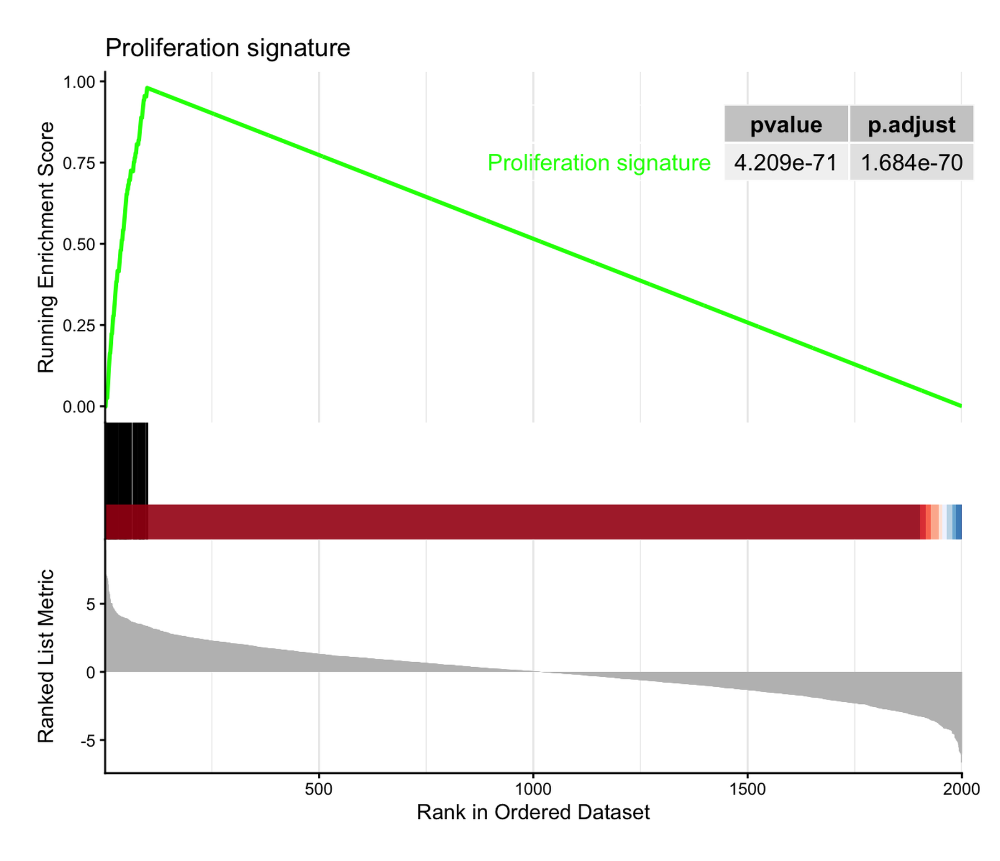
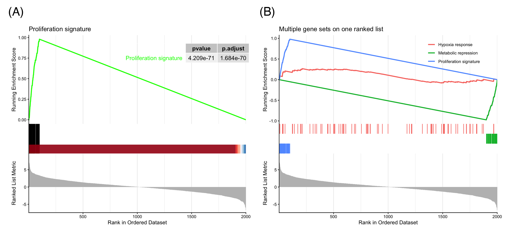

Gene Set Enrichment Analysis (GSEA) asks whether the genes of a defined set (a pathway, a signature) cluster towards one end of a genome-wide ranked list \[1\]. Its canonical figure is the **running-score plot**: the ranked statistic as a bar code (top), the walking enrichment score that rises at set-member hits and falls at misses, peaking at the *enrichment score* (middle), and the set membership as a rug (bottom). Unlike over-representation analysis, GSEA uses the full ranked list — no arbitrary significance cutoff on the input genes — which is why the plot, not a table, carries the argument.

In R the analysis is handled by `clusterProfiler::GSEA()` \[2\] and the canonical figure by `enrichplot::gseaplot2()` \[3\]. This tutorial renders the canonical plot, stacks several gene sets on one ranked list, and then rebuilds the running score from primitives in ggplot2 so the statistic itself becomes legible. The Python counterpart of this tutorial is [GSEA Running-Score (Python)](../Python/GSEAPlot.html).

This tutorial covers three workflows:

1. The canonical `gseaplot2` running-score plot with a p-value table;
2. Several gene sets overlaid on one ranked list;
3. A hand-built three-panel reconstruction of the running ES (ggplot2 + patchwork).

## Example

{fig-alt="GseaPlot DEMO" fig-align="center" width="60%"}

## Setup

-   System Requirements: Cross-platform (Linux/MacOS/Windows)

-   Programming language: R

-   Dependent packages: `clusterProfiler`; `enrichplot`; `ggplot2`; `dplyr`; `patchwork`

```{r packages setup, message=FALSE, warning=FALSE, output=FALSE}
# Installing necessary packages (Bioconductor)
if (!requireNamespace("BiocManager", quietly = TRUE)) {
  install.packages("BiocManager")
}
if (!requireNamespace("clusterProfiler", quietly = TRUE)) {
  BiocManager::install("clusterProfiler")
}
if (!requireNamespace("patchwork", quietly = TRUE)) {
  install.packages("patchwork")
}

# Load packages
library(clusterProfiler)
library(enrichplot)
library(ggplot2)
library(dplyr)
library(patchwork)
```

```{r}
sessioninfo::session_info("attached")
```

## Data Preparation

To keep the tutorial fully reproducible we simulate the ranked list and the gene sets instead of downloading MSigDB: 2,000 genes ranked by a Wald-like statistic, a 60-gene "proliferation" set concentrated among the top ranks, a 50-gene "metabolic" set among the bottom ranks, and two neutral sets — the configuration that produces cleanly interpretable enrichment scores. `clusterProfiler::GSEA()` consumes a named, decreasing-sorted numeric vector (`geneList`) plus a `TERM2GENE` data frame.

```{r load data, message=FALSE, warning=FALSE}
set.seed(251)

n_genes <- 2000
genes <- paste0("Gene", sprintf("%04d", 1:n_genes))
stats <- rnorm(n_genes, sd = 2)
names(stats) <- genes

geneList <- sort(stats, decreasing = TRUE)   # must be decreasing-sorted

# Synthetic gene sets: one top-ranked, one bottom-ranked, two neutral
gs_up   <- genes[order(stats, decreasing = TRUE)[1:100]] |> sample(60)
gs_down <- genes[order(stats)[1:100]] |> sample(50)
gs_neu1 <- sample(genes, 80)
gs_neu2 <- sample(genes, 70)

term2gene <- dplyr::bind_rows(
  data.frame(term = "Proliferation signature",     gene = gs_up),
  data.frame(term = "Metabolic repression",        gene = gs_down),
  data.frame(term = "Hypoxia response",            gene = gs_neu1),
  data.frame(term = "Immune checkpoint pathway",   gene = gs_neu2)
)

set.seed(251)  # GSEA permutes gene sets; keep p-values reproducible
gser <- GSEA(geneList, TERM2GENE = term2gene,
             minGSSize = 40, maxGSSize = 500,
             pvalueCutoff = 1,      # keep all sets for teaching
             eps = 0, seed = TRUE, verbose = FALSE)

as.data.frame(gser) |>
  dplyr::select(ID, setSize, enrichmentScore, NES, pvalue, p.adjust)
```

The negative NES of *Metabolic repression* marks a set enriched at the bottom of the list (down-regulated genes); the neutral sets hover around NES ≈ 0.

## Visualization

### 1. The Canonical Running-Score Plot

```{r}
#| label: fig-1.1GseaPlot2
#| fig-cap: "gseaplot2 of the top-ranked set: running enrichment score peaking at ES ≈ 0.98, hit rug, and ranked statistic; the inset table reports the permutation p-value."
#| out.width: "80%"
#| fig-width: 7
#| fig-height: 6
#| warning: false
#| message: false

gseaplot2(gser, geneSetID = 1, pvalue_table = TRUE,
          title = "Proliferation signature")
```

Three panels share one x-axis of rank positions: the running ES climbs steeply over the first 100 ranks (where the set members sit), peaks at the enrichment score, then decays; the rug marks the member positions; the bottom curve is the ranked statistic itself. The peak position defines the *leading edge* — the genes that drive the enrichment.

### 2. Several Gene Sets on One Ranked List

```{r}
#| label: fig-2.1GseaMulti
#| fig-cap: "Three gene sets overlaid on the same ranked list: a top-enriched set (positive NES), a bottom-enriched set (negative NES) and a neutral set."
#| out.width: "80%"
#| fig-width: 7
#| fig-height: 6
#| warning: false
#| message: false

ids <- match(c("Proliferation signature", "Metabolic repression", "Hypoxia response"),
             gser$ID)
gseaplot2(gser, geneSetID = ids, pvalue_table = FALSE,
          title = "Multiple gene sets on one ranked list")
```

Overlaying sets is how GSEA results are compared in practice: up-enriched sets peak early and plateau, down-enriched sets dive to a negative minimum near the end of the list, and null sets wander near zero. Legend labels follow the selected sets; the `color` argument controls the palette.

### 3. Rebuilding the Running Score from Primitives

```{r}
#| label: fig-3.1HandBuilt
#| fig-cap: "Hand-built three-panel running-score plot: the weighted Kolmogorov-Smirnov-like statistic is a running sum of ± steps at set members and misses."
#| out.width: "85%"
#| fig-width: 7
#| fig-height: 5.5
#| warning: false
#| message: false

in_set  <- names(geneList) %in% gs_up
w       <- abs(geneList)
step    <- ifelse(in_set, w / sum(w[in_set]), -1 / sum(!in_set))
run_es  <- cumsum(step)
peak    <- which.max(run_es)

df <- data.frame(rank = seq_along(geneList),
                 stat = as.numeric(geneList),
                 es = run_es, hit = in_set)

p_top <- ggplot(df, aes(rank, stat)) +
  geom_segment(aes(xend = rank, yend = 0, color = hit),
               linewidth = 0.15, show.legend = FALSE) +
  scale_color_manual(values = c(`FALSE` = "grey70", `TRUE` = "#e63946")) +
  geom_vline(xintercept = peak, linetype = "dashed",
             color = "#1d3557", alpha = 0.5) +
  labs(y = "Ranked statistic", x = NULL) +
  theme_classic()

p_mid <- ggplot(df, aes(rank, es)) +
  geom_line(color = "#1d3557", linewidth = 0.8) +
  geom_point(data = df[peak, ], color = "#e63946", size = 2) +
  annotate("text", x = peak, y = max(run_es), vjust = -0.8, hjust = 0,
           label = sprintf("ES = %.2f at rank %d", max(run_es), peak), size = 3.5) +
  labs(y = "Running ES", x = NULL) +
  theme_classic()

p_rug <- ggplot(df[df$hit, ], aes(x = rank, y = 1)) +
  geom_segment(aes(xend = rank, yend = 0.55),
               linewidth = 0.3, color = "#e63946") +
  scale_y_continuous(limits = c(0, 1), expand = c(0, 0)) +
  theme_void()

p3 <- p_top / p_mid / p_rug +
  plot_layout(heights = c(3, 2, 0.5))
p3
```

The weighted running ES is a cumulative sum: at each set member add its |statistic| normalized by the total member weight; at each miss subtract 1/(N − n). Rebuilding it from primitives demystifies `gseaplot2` — the shapes in Section 1 are exactly this walk — and makes custom variants (annotation of the leading edge, per-panel themes, multi-figure layouts) straightforward.

::: callout-tip
## Practice tips

-   `geneList` must be a *named, decreasing-sorted* numeric vector, or `GSEA()` stops with "geneList should be a decreasing sorted vector".
-   Use `pvalueCutoff = 1` while exploring so filtered-out sets do not silently disappear from the result object.
-   Pass `seed = TRUE` (plus a `set.seed()` call) for reproducible permutation p-values.
-   Report NES with p.adjust, not the raw ES: ES depends on set size, NES is normalized for it.
:::

## Application

Running-score GSEA plots are the standard figure for pathway-level interpretation of transcriptomic contrasts: tumor-vs-normal signatures, drug perturbation screens, and single-cell cluster markers. The panel below mirrors a typical publication layout: (A) the canonical single-set plot with p-value table and (B) the multi-set overlay.

{fig-alt="GseaPlot Application" fig-align="center" width="60%"}

## Reference

\[1\] Subramanian A, Tamayo P, Mootha VK, et al. Gene set enrichment analysis: a knowledge-based approach for interpreting genome-wide expression profiles. Proc Natl Acad Sci USA. 2005;102(43):15545-15550. doi:10.1073/pnas.0506580102

\[2\] Wu T, Hu E, Xu S, et al. clusterProfiler 4.0: a universal enrichment tool for interpreting omics data. Innovation. 2021;2(3):100141. doi:10.1016/j.xinn.2021.100141

\[3\] Yu G. enrichplot: visualization of functional enrichment result. Bioconductor package. https://bioconductor.org/packages/enrichplot/
