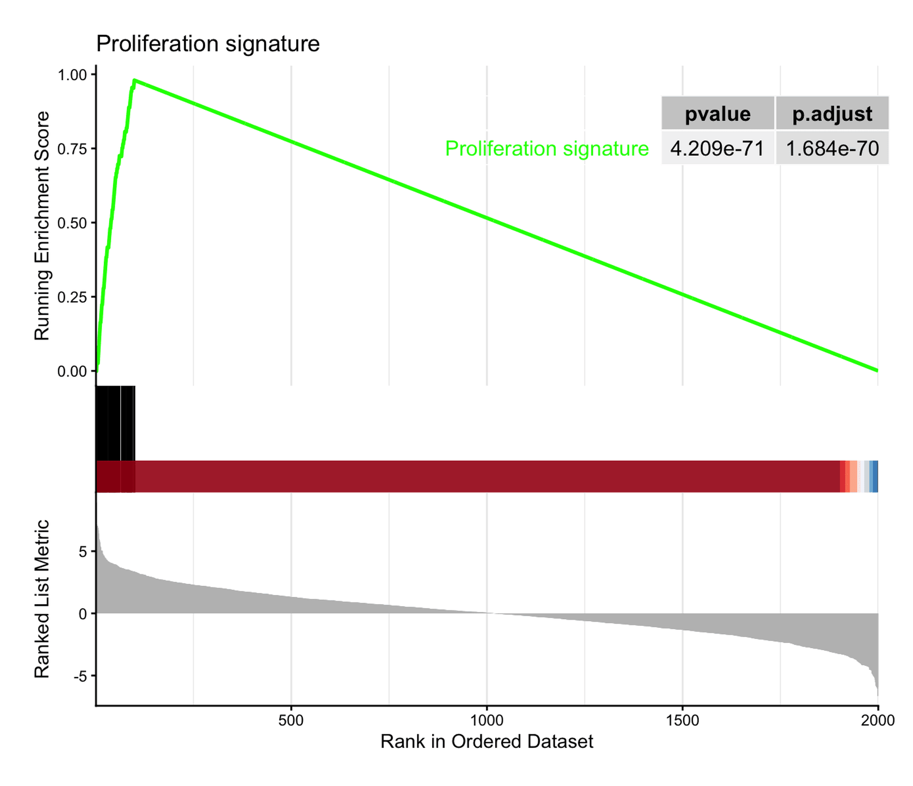
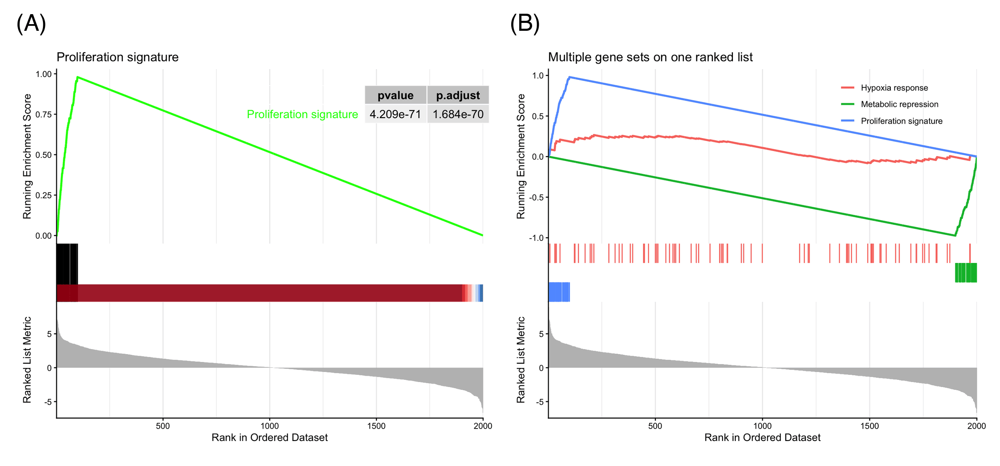

基因集富集分析（GSEA）检验一个已定义的基因集（通路、特征基因）是否在全基因组排序表中聚集在一端 \[1\]。它的经典配图是**运行得分图**：排序统计量以条形码形式展示（顶部），行走的富集得分在基因集成员命中处上升、在未命中处下降，峰值即*富集得分*（中部），基因集成员位置以毯子图（rug）标出（底部）。与过表达分析不同，GSEA 使用完整排序表——不需要对输入基因人为设定显著性截断——这正是"图"而非"表"承载论证的原因。

在 R 中分析由 `clusterProfiler::GSEA()` \[2\] 完成，经典图形由 `enrichplot::gseaplot2()` \[3\] 绘制。本教程绘制经典图形、在同一排序表上叠加多个基因集，并用 ggplot2 从基本组件重建运行得分，使统计量本身变得可读。本教程的 Python 对应版本见 [GSEA 运行得分图（Python）](../Python/GSEAPlot.html)。

本教程涵盖七种工作流：

1. 经典 `gseaplot2` 运行得分图（带 p 值表）；
2. 多个基因集叠加在同一排序表上；
3. 手绘三面板运行 ES 重建（ggplot2 + patchwork）；
4. 用特异性热图比较各亚型特异性通路；
5. fgsea 多通路表格图（条码行 + Size/NES/padj 统计列）；
6. 将 Java-GSEA 输出重绘为等宽对齐的点/条码面板；
7. 富集结果的环形通路-基因层级图（ggraph）。

## Example

{fig-alt="GseaPlot DEMO" fig-align="center" width="60%"}

## Setup

-   系统要求：跨平台（Linux/MacOS/Windows）

-   编程语言：R

-   依赖包：`clusterProfiler`；`enrichplot`；`ggplot2`；`dplyr`；`patchwork`；`pheatmap`；`fgsea`；`ggraph`；`tidygraph`

```{r packages setup, message=FALSE, warning=FALSE, output=FALSE}
# 安装必要的包（Bioconductor）
if (!requireNamespace("BiocManager", quietly = TRUE)) {
  install.packages("BiocManager")
}
if (!requireNamespace("clusterProfiler", quietly = TRUE)) {
  BiocManager::install("clusterProfiler")
}
if (!requireNamespace("patchwork", quietly = TRUE)) {
  install.packages("patchwork")
}
if (!requireNamespace("pheatmap", quietly = TRUE)) {
  install.packages("pheatmap")
}
if (!requireNamespace("fgsea", quietly = TRUE)) {
  BiocManager::install("fgsea")
}
if (!requireNamespace("ggraph", quietly = TRUE)) {
  install.packages("ggraph")
}
if (!requireNamespace("tidygraph", quietly = TRUE)) {
  install.packages("tidygraph")
}

# 加载包
library(clusterProfiler)
library(enrichplot)
library(ggplot2)
library(dplyr)
library(patchwork)
library(pheatmap)
library(fgsea)
library(ggraph)
library(tidygraph)
```

```{r}
sessioninfo::session_info("attached")
```

## Data Preparation

为保证教程完全可复现，我们模拟排序表与基因集而非下载 MSigDB：2,000 个基因按 Wald 式统计量排序；一个集中在排序顶部的 60 基因"增殖"集、一个位于底部的 50 基因"代谢"集，以及两个中性集——这一配置能产生干净可读的富集得分。`clusterProfiler::GSEA()` 需要"命名且降序排序"的数值向量（`geneList`）和 `TERM2GENE` 数据框。

```{r load data, message=FALSE, warning=FALSE}
set.seed(251)

n_genes <- 2000
genes <- paste0("Gene", sprintf("%04d", 1:n_genes))
stats <- rnorm(n_genes, sd = 2)
names(stats) <- genes

geneList <- sort(stats, decreasing = TRUE)   # 必须降序排序

# 模拟基因集：一个在顶部、一个在底部、两个中性
gs_up   <- sample(genes[order(stats, decreasing = TRUE)[1:100]], 60)
gs_down <- sample(genes[order(stats)[1:100]], 50)
gs_neu1 <- sample(genes, 80)
gs_neu2 <- sample(genes, 70)

term2gene <- dplyr::bind_rows(
  data.frame(term = "Proliferation signature",     gene = gs_up),
  data.frame(term = "Metabolic repression",        gene = gs_down),
  data.frame(term = "Hypoxia response",            gene = gs_neu1),
  data.frame(term = "Immune checkpoint pathway",   gene = gs_neu2)
)

set.seed(251)  # GSEA 对基因集做置换抽样；保持 p 值可复现
gser <- GSEA(geneList, TERM2GENE = term2gene,
             minGSSize = 40, maxGSSize = 500,
             pvalueCutoff = 1,      # 教学目的保留全部基因集
             eps = 0, seed = TRUE, verbose = FALSE)

as.data.frame(gser) |>
  dplyr::select(ID, setSize, enrichmentScore, NES, pvalue, p.adjust)
```

*Metabolic repression* 的负 NES 表示该基因集聚集在排序表底部（下调基因）；中性集的 NES 在 0 附近徘徊。

## Visualization

### 1. 经典运行得分图

```{r}
#| label: fig-1.1GseaPlot2
#| fig-cap: "顶部基因集的 gseaplot2：运行富集得分在 ES ≈ 0.98 处达峰、命中毯子图与排序统计量；插图报告置换 p 值。"
#| out.width: "80%"
#| fig-width: 7
#| fig-height: 6
#| warning: false
#| message: false

gseaplot2(gser, geneSetID = 1, pvalue_table = TRUE,
          title = "Proliferation signature")
```

三个面板共享同一横轴（排名位置）：运行 ES 在前 100 名（基因集成员所在）陡峭爬升、在富集得分处达峰后衰减；毯子图标出成员位置；底部曲线即排序统计量本身。峰值位置定义*leading edge*——驱动富集的基因。

### 2. 同一排序表上的多个基因集

```{r}
#| label: fig-2.1GseaMulti
#| fig-cap: "同一排序表上叠加三个基因集：顶部富集集（NES 为正）、底部富集集（NES 为负）与中性集。"
#| out.width: "80%"
#| fig-width: 7
#| fig-height: 6
#| warning: false
#| message: false

ids <- match(c("Proliferation signature", "Metabolic repression", "Hypoxia response"),
             gser$ID)
gseaplot2(gser, geneSetID = ids, pvalue_table = FALSE,
          title = "Multiple gene sets on one ranked list")
```

叠加基因集是比较 GSEA 结果的日常方式：上调富集的集早早达峰并缓慢衰减，下调富集的集在排序表末端俯冲至负的最小值，零假设下的集在 0 附近徘徊。图例标签跟随所选基因集；`color` 参数控制调色板。

### 3. 从基本组件重建运行得分

```{r}
#| label: fig-3.1HandBuilt
#| fig-cap: "手绘三面板运行得分图：加权 Kolmogorov-Smirnov 式统计量就是在成员处加正步长、在未命中处加负步长的累计和。"
#| out.width: "85%"
#| fig-width: 7
#| fig-height: 5.5
#| warning: false
#| message: false

in_set  <- names(geneList) %in% gs_up
w       <- abs(geneList)
step    <- ifelse(in_set, w / sum(w[in_set]), -1 / sum(!in_set))
run_es  <- cumsum(step)
peak    <- which.max(run_es)

df <- data.frame(rank = seq_along(geneList),
                 stat = as.numeric(geneList),
                 es = run_es, hit = in_set)

p_top <- ggplot(df, aes(rank, stat)) +
  geom_segment(aes(xend = rank, yend = 0, color = hit),
               linewidth = 0.15, show.legend = FALSE) +
  scale_color_manual(values = c(`FALSE` = "grey70", `TRUE` = "#e63946")) +
  geom_vline(xintercept = peak, linetype = "dashed",
             color = "#1d3557", alpha = 0.5) +
  labs(y = "Ranked statistic", x = NULL) +
  theme_classic()

p_mid <- ggplot(df, aes(rank, es)) +
  geom_line(color = "#1d3557", linewidth = 0.8) +
  geom_point(data = df[peak, ], color = "#e63946", size = 2) +
  annotate("text", x = peak, y = max(run_es), vjust = -0.8, hjust = 0,
           label = sprintf("ES = %.2f at rank %d", max(run_es), peak), size = 3.5) +
  labs(y = "Running ES", x = NULL) +
  theme_classic()

p_rug <- ggplot(df[df$hit, ], aes(x = rank, y = 1)) +
  geom_segment(aes(xend = rank, yend = 0.55),
               linewidth = 0.3, color = "#e63946") +
  scale_y_continuous(limits = c(0, 1), expand = c(0, 0)) +
  theme_void()

p3 <- p_top / p_mid / p_rug +
  plot_layout(heights = c(3, 2, 0.5))
p3
```

加权运行 ES 是一个累计和：在基因集成员处加上其 |统计量| 除以成员总权重，在未命中处减去 1/(N − n)。从基本组件重建它揭开了 `gseaplot2` 的面纱——第 1 节的曲线正是这条行走轨迹——也让自定义变体（leading edge 注释、分面板主题、多图版式）变得直观。

### 4. 跨分组比较亚型特异性通路

运行得分图一次只评估一张排序表。在亚型（或细胞类型）研究中，反复出现的问题是：**哪些通路是每个分组特有的** \[4\]。工作流是：按"每组 vs. 其余组"的 log2 倍数变化为每组排序基因 → 每组分别做 GSEA → 收集每组 top 通路 → 把它们在*所有*分组中的活性画成一张不聚类热图，对角线式的特异性模式一目了然。

```{r}
#| label: fig-4.1SubtypeGsea
#| fig-cap: "亚型特异性 GSEA：每个模拟亚型的 top-5 通路呈现对角线式的特异性模式。"
#| out.width: "85%"
#| fig-width: 7
#| fig-height: 6
#| warning: false
#| message: false

set.seed(251)
## 模拟表达矩阵：3 个亚型 x 15 个重复 x 1200 个基因
genes   <- paste0("Gene", sprintf("%04d", 1:1200))
subtype <- rep(c("SubtypeA", "SubtypeB", "SubtypeC"), each = 15)
signal  <- matrix(0, nrow = length(genes), ncol = 3,
                  dimnames = list(genes, c("SubtypeA", "SubtypeB", "SubtypeC")))
pool <- genes
for (s in colnames(signal)) {          # 每个亚型 60 个特异基因
  pick <- sample(pool, 60); signal[pick, s] <- 2; pool <- setdiff(pool, pick)
}
expr <- t(signal[, subtype]) +
  matrix(rnorm(length(subtype) * length(genes), sd = 0.6),
         nrow = length(subtype), ncol = length(genes))
colnames(expr) <- genes

## 每个亚型逐基因计算 one-vs-rest log2FC（可换用 t 检验/limma 循环）
lfc <- sapply(colnames(signal), function(s) {
  colMeans(expr[subtype == s, , drop = FALSE]) - colMeans(expr[subtype != s, , drop = FALSE])
})

## 特征基因集：每个亚型 5 个集合、每集 30 个基因
term2gene_sub <- do.call(rbind, lapply(colnames(signal), function(s) {
  do.call(rbind, lapply(1:5, function(k)
    data.frame(term = paste0(s, "_signature_", k),
               gene = sample(genes[signal[, s] > 0], 30))))
}))

## 在各自排序表上对每个亚型做 GSEA
gsea_res <- lapply(colnames(signal), function(s) {
  GSEA(sort(lfc[, s], decreasing = TRUE), TERM2GENE = term2gene_sub,
       minGSSize = 10, maxGSSize = 100, pvalueCutoff = 1,
       eps = 0, seed = TRUE, verbose = FALSE)
})
names(gsea_res) <- colnames(signal)

## 每个亚型取 NES>0 的 top-5 通路
top_gs <- lapply(gsea_res, function(r) {
  res <- as.data.frame(r)
  res <- res[res$NES > 0, ]
  head(rownames(res[order(res$NES, decreasing = TRUE), ]), 5)
})

## 特异性评分：每个 top 基因集的基因在*所有*亚型中的 log2FC 均值
score <- t(sapply(unlist(top_gs, use.names = FALSE), function(gs) {
  gs_genes <- term2gene_sub$gene[term2gene_sub$term == gs]
  colMeans(lfc[gs_genes, , drop = FALSE])
}))
ann <- data.frame(Subtype = gsub("_signature_[0-9]+$", "", rownames(score)),
                  row.names = rownames(score))
jco <- c("#F2CCCC", "#E6D8CF", "#D5E3F0")
pheatmap(score, cluster_rows = FALSE, cluster_cols = FALSE,
         border_color = NA, annotation_row = ann,
         annotation_colors = list(Subtype = c(SubtypeA = jco[1], SubtypeB = jco[2],
                                              SubtypeC = jco[3])),
         main = "Subtype-specific top pathways")
```

对角线模式说明每个亚型的 top 通路确实具有特异性；共享通路则会在多列同时亮起。参考工作流 \[4\] 使用 GSVA（`GSVA::gsva()`）计算通路活性，这是真实数据下的标准做法——此处用各集合基因的 log2FC 均值作为免依赖的近似。若要分析下调通路，按 NES 升序取 top 集合并对行排序即可。

::: callout-tip
## 实践要点

-   `geneList` 必须是*命名且降序排序*的数值向量，否则 `GSEA()` 报错 "geneList should be a decreasing sorted vector"。
-   探索阶段用 `pvalueCutoff = 1`，避免被过滤的基因集从结果对象中悄悄消失。
-   传入 `seed = TRUE`（配合 `set.seed()`）保证置换 p 值可复现。
-   报告 NES 配合 p.adjust，而非原始 ES：ES 依赖基因集大小，NES 已对其标准化。
:::
### 5. fgsea 多通路表格图

当许多通路要挤进同一张图时，`fgsea::plotGseaTable()` 把它们堆成共享排序表上的**条码行**，右侧对齐排列 Size / NES / p / padj 统计列 \[5\]——一眼看完整个富集论证。

```{r}
#| label: fig-5.1FgseaTable
#| fig-cap: "fgsea 表格图：八个 hallmark 式通路作为条码行叠加在同一排序表上，右侧为统计列。"
#| out.width: "95%"
#| warning: false
#| message: false
#| fig-width: 8
#| fig-height: 5.5

set.seed(401)
genes_f <- paste0("Gene", sprintf("%04d", 1:1500))
stats_f <- rnorm(1500, sd = 2)
names(stats_f) <- genes_f

## 八个 hallmark 式集合，富联强度分级（+ = 上调，- = 下调）
set_names <- c("MYC targets", "Cell cycle", "Inflammatory response", "Hypoxia",
               "Angiogenesis", "TGF-beta signaling", "EMT", "Wnt signaling")
enrich_amt <- c(2.5, 2, 1, 0.3, -0.3, -1, -2, -2.5)
pool <- genes_f
pathways_f <- lapply(seq_along(set_names), function(k) {
  hits <- sample(pool, 60)
  pool <<- setdiff(pool, hits)
  stats_f[hits] <<- stats_f[hits] + enrich_amt[k]
  hits
})
names(pathways_f) <- set_names
geneList_f <- sort(stats_f, decreasing = TRUE)

fgseaRes <- fgsea(pathways = pathways_f, stats = geneList_f,
                  minSize = 15, maxSize = 500, eps = 0)
fgseaRes <- fgseaRes[order(pval)]

plotGseaTable(pathways_f, geneList_f, fgseaRes, gseaParam = 0.5)

as.data.frame(fgseaRes)[, c("pathway", "size", "NES", "pval", "padj")]
```

::: callout-tip
## 实践要点

-   `fgsea()` 接受与 `clusterProfiler::GSEA()` 相同的"命名且降序排序"数值向量；`eps = 0` 是现代精确模式设置（旧参数 `nperm` 已弃用）。
-   表格按 p 值排序，最强信号在最上面；只需展示显著集合时，把过滤后的结果对象传入即可。
-   `gseaParam = 1` 用统计量加权运行得分（GSEA 默认）；更小的值会压平曲线，让弱集合更可见。
:::

### 6. 将 Java-GSEA 输出重绘为点图 + 条码面板

Java-GSEA 的每通路 Excel 只保存**通路内基因位置**的运行 ES——这正是线图重绘永远对不上官方图的原因 \[6\]。在成员位置画点是忠实的重绘；下方配一条 rank 条码、再用 `patchwork` 对齐两面板宽度，即可复现论文样式。

```{r}
#| label: fig-6.1JavaRedraw
#| fig-cap: "Java-GSEA 输出重绘：成员位置的运行 ES 点图（上）叠加 rank 条码（下），patchwork 等宽对齐。"
#| out.width: "95%"
#| warning: false
#| message: false
#| fig-width: 8
#| fig-height: 4.5

set.seed(402)
n_rank <- 2000
specs <- list(
  HALLMARK_MYC_TARGETS = list(idx = sort(sample(600, 110)),       dir =  1.0),
  HALLMARK_HYPOXIA     = list(idx = sort(sample(2000, 90)),       dir = -0.5),
  HALLMARK_EMT         = list(idx = sort(sample(1400:2000, 100)), dir = -1.0)
)
java_df <- do.call(rbind, lapply(names(specs), function(pw) {
  spec <- specs[[pw]]
  hit <- seq_len(n_rank) %in% spec$idx
  step <- ifelse(hit, spec$dir / length(spec$idx), -spec$dir / (n_rank - sum(hit)))
  data.frame(pathway = pw,
             RANK.IN.GENE.LIST = seq_len(n_rank),
             RUNNING.ES = cumsum(step),
             member = hit)
}))

pal_j <- c(HALLMARK_MYC_TARGETS = "#E31A1C", HALLMARK_HYPOXIA = "#E7B800",
           HALLMARK_EMT = "#2E9FDF")

p_point <- ggplot(java_df, aes(RANK.IN.GENE.LIST, RUNNING.ES, fill = pathway)) +
  geom_point(data = subset(java_df, member), shape = 21, colour = "black",
             size = 1.6, stroke = 0.25) +
  scale_fill_manual(values = pal_j) +
  scale_x_continuous(expand = c(0, 0)) +
  scale_y_continuous(expand = c(0, 0),
                     limits = c(min(java_df$RUNNING.ES) - 0.02,
                                max(java_df$RUNNING.ES) + 0.02)) +
  labs(x = NULL, y = "Enrichment score", fill = NULL) +
  theme_classic(base_size = 10) +
  theme(axis.line.x = element_blank(), axis.ticks.x = element_blank(),
        axis.text.x = element_blank(),
        legend.position = "bottom", legend.key.size = unit(3, "mm"),
        legend.text = element_text(size = 8))

p_rank <- ggplot(java_df, aes(RANK.IN.GENE.LIST, pathway, fill = pathway)) +
  geom_tile(data = subset(java_df, member), colour = NA) +
  scale_fill_manual(values = pal_j) +
  scale_x_continuous(expand = c(0, 0)) +
  scale_y_discrete(expand = c(0, 0)) +
  labs(x = "Rank in gene list") +
  theme_bw(base_size = 10) +
  theme(panel.grid = element_blank(), panel.border = element_blank(),
        axis.line.y = element_blank(), axis.ticks.y = element_blank(),
        axis.text.y = element_blank(), legend.position = "none")

## 面板堆叠：patchwork 自动等分共享 x 轴宽度
p_point / p_rank + patchwork::plot_layout(heights = c(3, 1))
```

::: callout-tip
## 实践要点

-   用点不用线：Java 输出的 ES 值只存在于成员基因处，连线意味着一条从未被计算的曲线。
-   原工作流用 `grid::unit.pmax()` 对两张 `ggplotGtable()` 的列宽取最大值来对齐面板；`patchwork`（`p_point / p_rank + plot_layout(heights = ...)`）以现代方式实现同样的"共享宽度、独立高度"堆叠。
-   真实输入：用 `read.delim()` 读取每张通路表，保留 `RANK.IN.GENE.LIST`、`RUNNING.ES` 与 `PROBE/NAME` 列，再像此处一样跨通路 rbind。
:::
### 7. 环形通路-基因层级图（ggraph）

富集结果自带层级——内环是通路、外环是其成员基因——参考图把它画成**中心之外的圆环气泡** \[7\]：气泡大小承载基因的 |logFC|、颜色承载方向。tidygraph/ggraph 下整个布局就是一张放射状树状图，无需手工环形计算：

```{r}
#| label: fig-7.1RadialHierarchy
#| fig-cap: "环形通路-基因层级图：内环为通路，外圈为成员基因，气泡大小 = |logFC|，颜色 = 方向。"
#| out.width: "85%"
#| warning: false
#| message: false
#| fig-width: 8
#| fig-height: 7.5

set.seed(504)
pathway_defs <- list(
  "Cell cycle"        = c("CDK2", "CCNB1", "PCNA", "MCM2", "CDC20"),
  "p53 pathway"       = c("TP53", "MDM2", "CDKN1A", "BAX"),
  "DNA repair"        = c("BRCA1", "RAD51", "XRCC1", "PARP1", "ERCC1"),
  "EMT"               = c("VIM", "CDH1", "SNAI1", "TWIST1"),
  "Hypoxia"           = c("HIF1A", "VEGFA", "CA9", "EGLN3"),
  "Apoptosis"         = c("BCL2", "CASP3", "FAS", "XIAP")
)
gene_fc <- rnorm(length(unlist(pathway_defs)), sd = 1.6)
names(gene_fc) <- unlist(pathway_defs)

edges <- do.call(rbind, lapply(names(pathway_defs), function(pw) {
  data.frame(from = "Enrichment", to = pw)
}))
## gene node names must be unique across pathways: suffix with the pathway,
## keep the original gene name in a label column
edges <- rbind(edges, do.call(rbind, lapply(names(pathway_defs), function(pw) {
  data.frame(from = pw, to = paste0(pathway_defs[[pw]], "@", pw))
})))
nodes <- data.frame(
  name = c("Enrichment", names(pathway_defs),
           unique(unlist(lapply(names(pathway_defs), function(pw)
             paste0(pathway_defs[[pw]], "@", pw))))))
graph <- tidygraph::tbl_graph(nodes = nodes, edges = edges)

graph <- graph |>
  dplyr::mutate(
    is_gene = grepl("@", name),
    level   = ifelse(name == "Enrichment", 0, ifelse(is_gene, 2, 1)),
    label   = ifelse(is_gene, sub("@.*$", "", name), name),
    fc      = ifelse(is_gene, gene_fc[sub("@.*$", "", name)], NA_real_),
    leaf    = tidygraph::node_is_leaf())

ggraph(graph, layout = "dendrogram", circular = TRUE) +
  geom_edge_diagonal(colour = "grey75", linewidth = 0.3, alpha = 0.7) +
  geom_node_point(aes(filter = is_gene, size = abs(fc), colour = fc > 0),
                  alpha = 0.85) +
  geom_node_text(aes(filter = level == 1, label = label, angle = node_angle(x, y)),
                 size = 3.2, hjust = 0.5, fontface = "bold") +
  geom_node_text(aes(filter = is_gene, label = label,
                     x = x * 1.07,
                     angle = node_angle(x, y),
                     hjust = ifelse(x < 0, 1.08, -0.08)),   # by circle half, not by FC
                 size = 2.4) +
  scale_colour_manual(values = c(`TRUE` = "#B2182B", `FALSE` = "#2166AC"),
                      labels = c("up", "down"), name = "logFC") +
  scale_size_continuous(range = c(1.5, 5), name = "|logFC|") +
  coord_fixed() +
  theme_void() +
  theme(legend.position = "right",
        legend.key.size = unit(3, "mm"), legend.text = element_text(size = 8),
        legend.title = element_text(size = 9))
```

::: callout-tip
## 实践要点

-   `layout = "dendrogram", circular = TRUE` 就是全部的环形计算；`node_angle(x, y)` 让每个标签沿径向旋转，文字贴合圆环。
-   叶子标签的 `hjust` 两侧取值让基因名排在最外环之外而不是横穿圆环；内环通路名保持居中在自己的辐条上。
-   气泡只能承载大小（|logFC|）——方向交给颜色。更深的层级（通路 → 子通路 → 基因）只需扩展边表。
:::

## Application

运行得分 GSEA 图是转录组差异通路水平解读的标准配图：肿瘤-正常特征、药物扰动筛选和单细胞聚类标志基因。下图模拟典型论文版式：(A) 带p值表的经典单集图，(B) 多集叠加图。

{fig-alt="GseaPlot Application" fig-align="center" width="60%"}

## Reference

\[1\] Subramanian A, Tamayo P, Mootha VK, et al. Gene set enrichment analysis: a knowledge-based approach for interpreting genome-wide expression profiles. Proc Natl Acad Sci USA. 2005;102(43):15545-15550. doi:10.1073/pnas.0506580102

\[2\] Wu T, Hu E, Xu S, et al. clusterProfiler 4.0: a universal enrichment tool for interpreting omics data. Innovation. 2021;2(3):100141. doi:10.1016/j.xinn.2021.100141

\[3\] Yu G. enrichplot: visualization of functional enrichment result. Bioconductor package. https://bioconductor.org/packages/enrichplot/

\[4\] Xiaofan Lu, et al. FigureYa: A Standardized Visualization Framework for Enhancing Biomedical Data Interpretation and Research Efficiency. iMetaMed. 2025. doi:10.1002/imm3.70005

\[5\] Korotkevich G, Sukhov V, Budin N, Shpak B, Artyomov MN, Sergushichev A. Fast gene set enrichment analysis. bioRxiv. 2021. doi:10.1101/060012

\[6\] GSEA desktop application output format. Broad Institute. https://gseapab.github.io/

\[7\] Pedersen TL. ggraph: An Implementation of Grammar of Graphics for Graphs and Networks. https://ggraph.data-imaginist.com/
