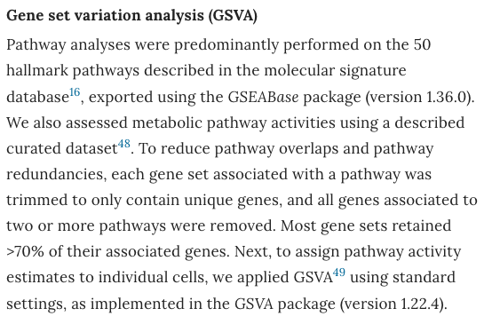

GSVA transforms a **sample × gene** matrix into a **sample × pathway** matrix, so any downstream tool that works on genes works on pathways: running limma on the GSVA scores finds pathways that are differentially active between tumour and normal — more interpretable than gene-level DE and directly usable for subtype discovery \[1\]. The t-statistics of the pathway-level contrast are drawn as a diverging bar plot (FigureYa39bar style), with in-bar labels and colour bins for direction and magnitude \[1\]. `GSVA`, `limma` and `msigdbr` are in this repository's lockfile; the hallmark gene sets, GSVA scoring, limma contrast and figure all run in-page:

## Example

{fig-alt="GSVA Pathway Differential Expression Barplot DEMO" fig-align="center" width="70%"}

## Setup

-   System Requirements: Cross-platform (Linux/MacOS/Windows)

-   Programming language: R

-   Dependent packages: `GSVA`; `limma`; `msigdbr`; `ggplot2`

```{r packages setup, message=FALSE, warning=FALSE, output=FALSE}
suppressPackageStartupMessages({
  library(GSVA); library(limma); library(msigdbr); library(ggplot2)
})
```

```{r}
sessioninfo::session_info("attached")
```

## Data Preparation

Following the reference's de-redundancy rules for the hallmark collection: duplicate genes within a set are removed, and genes appearing in **two or more** pathways are dropped entirely. A tumour/normal expression matrix (10 + 10 samples, 1000 genes) carries planted pathway activity — EMT, hypoxia and glycolysis up in tumour, interferon response up in normal:

```{r load data}
suppressPackageStartupMessages({
  library(GSVA); library(limma); library(msigdbr); library(ggplot2)
})
set.seed(52327)

## hallmark gene sets (gene symbols)
h <- msigdbr(species = "Homo sapiens", collection = "H")
h <- unique(h[, c("gs_name", "gene_symbol")])
gs_all <- split(h$gene_symbol, h$gs_name)

## reference de-redundancy: drop genes present in >= 2 pathways
cnt <- table(unlist(gs_all))
keep <- names(cnt)[cnt < 2]
gs <- lapply(gs_all, function(x) intersect(keep, x))
gs <- gs[lengths(gs) > 0]
cat("pathways kept after de-redundancy:", length(gs), "\n")

## simulated expression over the union of retained genes
genes <- sort(unique(unlist(gs)))
n <- 20
samples <- c(sprintf("T%02d", 1:10), sprintf("N%02d", 1:10))
group <- factor(rep(c("Tumor", "Normal"), each = 10), levels = c("Normal", "Tumor"))
expr <- matrix(rnorm(length(genes) * n, 6, 0.8), length(genes), n,
               dimnames = list(genes, samples))

## planted activity per pathway (positive = tumour-up)
boost <- list(HALLMARK_EPITHELIAL_MESENCHYMAL_TRANSITION = 1.6, HALLMARK_HYPOXIA = 1.3,
              HALLMARK_GLYCOLYSIS = 1.2, HALLMARK_INFLAMMATORY_RESPONSE = -0.9,
              HALLMARK_INTERFERON_GAMMA_RESPONSE = -1.3,
              HALLMARK_INTERFERON_ALPHA_RESPONSE = -1.0)
for (pw in names(boost)) {
  pw_genes <- intersect(gs[[pw]], genes)
  if (length(pw_genes) > 20) pw_genes <- sample(pw_genes, 20)
  idx <- group == "Tumor"
  expr[pw_genes, idx] <- expr[pw_genes, idx] + boost[[pw]]
}
```

## Visualization

### 1. Pathway t-Value Barplot (Tumour vs Normal)

The reference's FigureYa39bar-style figure: limma t-statistics per pathway, sorted, coloured by direction bin, with pathway names printed **inside** the bars at the baseline — long labels never truncate:

```{r}
#| label: fig-1.1GsvaBar
#| fig-cap: "limma t-statistics of GSVA pathway scores, tumour versus normal (BH-adjusted significant pathways only): epithelial-mesenchymal transition, hypoxia and glycolysis are tumour-up (red), interferon-alpha/gamma responses and inflammatory response are normal-up (green); each bar carries its pathway label at the tip."
#| out.width: "100%"
#| fig-width: 7.5
#| fig-height: 5.5

## GSVA (2.x API): samples in columns, gene sets in rows
gsva_es <- gsva(gsvaParam(expr, gs, kcdf = "Gaussian"), verbose = FALSE)
stopifnot(is.matrix(gsva_es), ncol(gsva_es) == n)

## limma on pathway scores: Tumor vs Normal
design <- model.matrix(~ 0 + group)
colnames(design) <- levels(group)
rownames(design) <- samples
fit <- lmFit(gsva_es, design)
contrast <- makeContrasts(Tumor - Normal, levels = design)
fit2 <- eBayes(contrasts.fit(fit, contrast))
top <- topTable(fit2, coef = 1, number = Inf, adjust.method = "BH", sort.by = "P")
sig_pw <- subset(top, adj.P.Val < 0.05)
sig_pw <- head(sig_pw[order(-abs(sig_pw$t)), ], 20)   # cap for one screen
## friendly labels for the hallmark sets (full names truncate at bar tips)
nice <- c(HALLMARK_EPITHELIAL_MESENCHYMAL_TRANSITION = "EMT",
          HALLMARK_HYPOXIA = "Hypoxia",
          HALLMARK_GLYCOLYSIS = "Glycolysis",
          HALLMARK_INFLAMMATORY_RESPONSE = "Inflammatory response",
          HALLMARK_INTERFERON_GAMMA_RESPONSE = "IFN-gamma response",
          HALLMARK_INTERFERON_ALPHA_RESPONSE = "IFN-alpha response")
sig_pw$ID <- ifelse(rownames(sig_pw) %in% names(nice),
                    nice[rownames(sig_pw)],
                    sub("^HALLMARK_", "", rownames(sig_pw)))

## diverging barplot; labels sit at the baseline in the EMPTY half opposite
## each bar (dark on white — robust whatever the bar length)
sig_pw$dir <- ifelse(sig_pw$t > 0, "Tumour-up", "Normal-up")
plotdf <- sig_pw[order(sig_pw$t), ]
plotdf$ID <- factor(plotdf$ID, levels = plotdf$ID)

ggplot(plotdf, aes(ID, t, fill = dir)) +
  geom_col(width = 0.74) +
  geom_hline(yintercept = 0, colour = "grey35", linewidth = 0.4) +
  ## labels just beyond each bar tip (dark on white, never truncated)
  geom_text(data = subset(plotdf, t > 0),
            aes(x = ID, y = t + 0.25, label = ID),
            hjust = 0, size = 3, colour = "grey15") +
  geom_text(data = subset(plotdf, t < 0),
            aes(x = ID, y = t - 0.25, label = ID),
            hjust = 1, size = 3, colour = "grey15") +
  scale_y_continuous(expand = expansion(mult = c(0.26, 0.16))) +
  scale_fill_manual(values = c(`Tumour-up` = "#B2182B", `Normal-up` = "#1B7837"),
                    guide = "none") +
  coord_flip() +
  labs(x = NULL, y = "t value of GSVA score, tumour versus normal") +
  theme_bw(base_size = 11) +
  theme(panel.grid = element_blank(),
        panel.border = element_blank(),
        axis.line.y = element_blank(),
        axis.ticks.y = element_blank(),
        axis.text.y = element_blank())
```

### 2. GSVA Score Heatmap of Significant Pathways

The barplot's evidence: per-sample GSVA scores for the significant pathways, tumour and normal samples separating cleanly on the planted axes:

```{r}
#| label: fig-2.1GsvaHm
#| fig-cap: "GSVA scores (rows z-scored) for the significant pathways across all 20 samples: tumour samples carry high EMT/hypoxia/glycolysis and low interferon-response scores, normal samples the inverse; column annotations mark the group."
#| out.width: "100%"
#| fig-width: 9
#| fig-height: 6

score_mat <- gsva_es[rownames(sig_pw), ]
anno_col <- data.frame(Group = group, row.names = samples)
pheatmap::pheatmap(score_mat,
                   scale = "row",
                   cluster_rows = TRUE, cluster_cols = TRUE,
                   color = colorRampPalette(c("#2166AC", "white", "#B2182B"))(64),
                   cellwidth = 13, cellheight = 13,
                   fontsize = 9,
                   border_color = "white",
                   annotation_col = anno_col,
                   annotation_colors = list(Group = c(Tumor = "#B2182B", Normal = "#1B7837")),
                   legend = TRUE,
                   main = "GSVA scores of significant pathways")
```

::: callout-tip
**Practice tips**
-   Apply the reference's **de-redundancy** before scoring: genes in ≥2 hallmark sets are dropped entirely, so each pathway score reflects mostly-unique biology (most sets keep >70% of their genes).
-   Run limma on the GSVA matrix exactly as you would on genes — the scores are approximately Gaussian, so the linear-model t-statistics are well calibrated.
-   In-bar labels (text at the baseline, coloured white) keep long pathway names readable without a wide y axis — far better than a 12-inch tick-label margin.
-   GSVA 2.x returns **gene sets × samples** — aggregate per group with `rowMeans(gsva_es[, group == g, drop = FALSE])`, not column-wise indexing of samples.
-   Set `kcdf = "Gaussian"` for log-scale RNA-seq/microarray values; use `kcdf = "Poisson"` for raw UMI counts.
:::

## Application

::: {#fig-GsvaHeatmapApplications1}
{fig-alt="GSVA Pathway Differential Expression Barplot" fig-align="center" width="70%"}

GSVA pathway differential expression barplot
:::

Pathway-level DE applies to any two-condition transcriptome comparison: tumour vs normal, pre- vs post-treatment biopsies, or responder vs non-responder cohorts — the output feeds directly into subtype clustering or pathway-focused validation.

## Reference

\[1\] Xiaofan Lu, et al. FigureYa: A Standardized Visualization Framework for Enhancing Biomedical Data Interpretation and Research Efficiency. iMetaMed. 2025. doi:10.1002/imm3.70005
