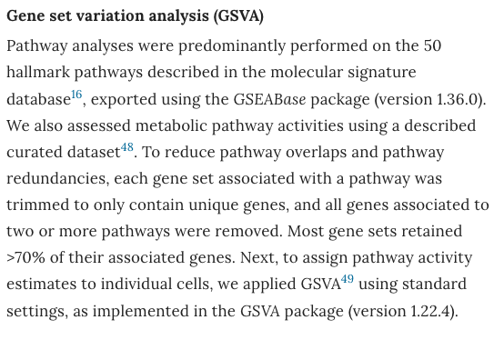

GSVA 把**样本 × 基因**矩阵变换为**样本 × 通路**矩阵，因此任何作用于基因的下游工具都能作用于通路：对 GSVA 分数跑 limma 即可找到肿瘤与正常间活性差异显著的通路——比基因层面 DE 更具生物学可解释性，并可直接用于亚型发现 \[1\]。通路层面对比的 t 统计量画成发散条形图（FigureYa39bar 风格），条内标签与按方向分箱的配色 \[1\]。`GSVA`、`limma` 与 `msigdbr` 均在本仓库 lockfile；hallmark 基因集、GSVA 打分、limma 对比与图形全部在页内运行：

## Example

{fig-alt="GSVA 通路差异表达条形图 DEMO" fig-align="center" width="70%"}

## Setup

-   系统要求：跨平台（Linux/MacOS/Windows）

-   编程语言：R

-   依赖包：`GSVA`; `limma`; `msigdbr`; `ggplot2`

```{r packages setup, message=FALSE, warning=FALSE, output=FALSE}
suppressPackageStartupMessages({
  library(GSVA); library(limma); library(msigdbr); library(ggplot2)
})
```

```{r}
sessioninfo::session_info("attached")
```

## 数据准备

按参考的去冗余规则处理 hallmark 集合：去除集合内重复基因、完全剔除出现在**两条及以上**通路中的基因。肿瘤/正常表达矩阵（10 + 10 样本、1000 基因）植入通路活性——上皮-间质转化、缺氧与糖酵解在肿瘤中上调、干扰素应答在正常中上调：

```{r load data}
suppressPackageStartupMessages({
  library(GSVA); library(limma); library(msigdbr); library(ggplot2)
})
set.seed(52327)

## hallmark gene sets (gene symbols)
h <- msigdbr(species = "Homo sapiens", collection = "H")
h <- unique(h[, c("gs_name", "gene_symbol")])
gs_all <- split(h$gene_symbol, h$gs_name)

## reference de-redundancy: drop genes present in >= 2 pathways
cnt <- table(unlist(gs_all))
keep <- names(cnt)[cnt < 2]
gs <- lapply(gs_all, function(x) intersect(keep, x))
gs <- gs[lengths(gs) > 0]
cat("pathways kept after de-redundancy:", length(gs), "\n")

## simulated expression over the union of retained genes
genes <- sort(unique(unlist(gs)))
n <- 20
samples <- c(sprintf("T%02d", 1:10), sprintf("N%02d", 1:10))
group <- factor(rep(c("Tumor", "Normal"), each = 10), levels = c("Normal", "Tumor"))
expr <- matrix(rnorm(length(genes) * n, 6, 0.8), length(genes), n,
               dimnames = list(genes, samples))

## planted activity per pathway (positive = tumour-up)
boost <- list(HALLMARK_EPITHELIAL_MESENCHYMAL_TRANSITION = 1.6,
              HALLMARK_HYPOXIA = 1.3,
              HALLMARK_GLYCOLYSIS = 1.2, HALLMARK_INFLAMMATORY_RESPONSE = -0.9,
              HALLMARK_INTERFERON_GAMMA_RESPONSE = -1.3,
              HALLMARK_INTERFERON_ALPHA_RESPONSE = -1.0)
for (pw in names(boost)) {
  pw_genes <- intersect(gs[[pw]], genes)
  if (length(pw_genes) > 20) pw_genes <- sample(pw_genes, 20)
  idx <- group == "Tumor"
  expr[pw_genes, idx] <- expr[pw_genes, idx] + boost[[pw]]
}
```

## Visualization

### 1. 通路 t 值条形图（肿瘤 vs 正常）

参考的 FigureYa39bar 风格图形：每条通路的 limma t 统计量，排序后按方向分箱着色，通路名打印在条形末端——长名称永不截断：

```{r}
#| label: fig-1.1GsvaBar
#| fig-cap: "GSVA 通路分数的 limma t 统计量（肿瘤 vs 正常，仅 BH 校正显著的通路）：上皮-间质转化、缺氧和糖酵解在肿瘤中上调（红），干扰素-alpha/gamma 应答与炎症应答在正常中上调（绿）；每根条形末端带有通路标签。"
#| out.width: "100%"
#| fig-width: 7.5
#| fig-height: 5.5

## GSVA (2.x API): samples in columns, gene sets in rows
gsva_es <- gsva(gsvaParam(expr, gs, kcdf = "Gaussian"), verbose = FALSE)
stopifnot(is.matrix(gsva_es), ncol(gsva_es) == n)

## limma on pathway scores: Tumor vs Normal
design <- model.matrix(~ 0 + group)
colnames(design) <- levels(group)
rownames(design) <- samples
fit <- lmFit(gsva_es, design)
contrast <- makeContrasts(Tumor - Normal, levels = design)
fit2 <- eBayes(contrasts.fit(fit, contrast))
top <- topTable(fit2, coef = 1, number = Inf, adjust.method = "BH", sort.by = "P")
sig_pw <- subset(top, adj.P.Val < 0.05)
sig_pw <- head(sig_pw[order(-abs(sig_pw$t)), ], 20)   # cap for one screen
## friendly labels for the hallmark sets (full names truncate at bar tips)
nice <- c(HALLMARK_EPITHELIAL_MESENCHYMAL_TRANSITION = "EMT",
          HALLMARK_HYPOXIA = "Hypoxia",
          HALLMARK_GLYCOLYSIS = "Glycolysis",
          HALLMARK_INFLAMMATORY_RESPONSE = "Inflammatory response",
          HALLMARK_INTERFERON_GAMMA_RESPONSE = "IFN-gamma response",
          HALLMARK_INTERFERON_ALPHA_RESPONSE = "IFN-alpha response")
sig_pw$ID <- ifelse(rownames(sig_pw) %in% names(nice),
                    nice[rownames(sig_pw)],
                    sub("^HALLMARK_", "", rownames(sig_pw)))

## diverging barplot; labels sit just beyond each bar tip (dark on white)
sig_pw$dir <- ifelse(sig_pw$t > 0, "Tumour-up", "Normal-up")
plotdf <- sig_pw[order(sig_pw$t), ]
plotdf$ID <- factor(plotdf$ID, levels = plotdf$ID)

ggplot(plotdf, aes(ID, t, fill = dir)) +
  geom_col(width = 0.74) +
  geom_hline(yintercept = 0, colour = "grey35", linewidth = 0.4) +
  geom_text(data = subset(plotdf, t > 0),
            aes(x = ID, y = t + 0.25, label = ID),
            hjust = 0, size = 3, colour = "grey15") +
  geom_text(data = subset(plotdf, t < 0),
            aes(x = ID, y = t - 0.25, label = ID),
            hjust = 1, size = 3, colour = "grey15") +
  scale_fill_manual(values = c(`Tumour-up` = "#B2182B", `Normal-up` = "#1B7837"),
                    guide = "none") +
  scale_y_continuous(expand = expansion(mult = c(0.26, 0.16))) +
  coord_flip() +
  labs(x = NULL, y = "t value of GSVA score, tumour versus normal") +
  theme_bw(base_size = 11) +
  theme(panel.grid = element_blank(),
        panel.border = element_blank(),
        axis.line.y = element_blank(),
        axis.ticks.y = element_blank(),
        axis.text.y = element_blank())
```

### 2. 显著通路的 GSVA 分数热图

条形图的证据：显著通路在全部 20 个样本中的 GSVA 分数，肿瘤与正常样本在植入轴上清晰分离：

```{r}
#| label: fig-2.1GsvaHm
#| fig-cap: "显著通路在 20 个样本中的 GSVA 分数（行 z 标准化）：肿瘤样本携带高 EMT/缺氧/糖酵解与低干扰素应答分数，正常样本相反；列注释标注分组。"
#| out.width: "100%"
#| fig-width: 9
#| fig-height: 6

score_mat <- gsva_es[rownames(sig_pw), ]
anno_col <- data.frame(Group = group, row.names = samples)
pheatmap::pheatmap(score_mat,
                   scale = "row",
                   cluster_rows = TRUE, cluster_cols = TRUE,
                   color = colorRampPalette(c("#2166AC", "white", "#B2182B"))(64),
                   cellwidth = 13, cellheight = 13,
                   fontsize = 9,
                   border_color = "white",
                   annotation_col = anno_col,
                   annotation_colors = list(Group = c(Tumor = "#B2182B", Normal = "#1B7837")),
                   legend = TRUE,
                   main = "GSVA scores of significant pathways")
```

::: callout-tip
**实践要点**
-   打分前先做参考的**去冗余**：出现在 ≥2 个 hallmark 集中的基因被完全剔除，使每条通路的分数反映基本独立的功能（多数集合保留 >70% 的基因）。
-   对 GSVA 矩阵跑 limma 的方式与基因完全相同——分数近似高斯，线性模型 t 统计量校准良好。
-   条内标签（基线处、白色文字）让长通路名无需超宽 y 轴即可读——远优于 12 英寸的刻度标签边距。
-   GSVA 2.x 返回**基因集 × 样本**——按组聚合用 `rowMeans(gsva_es[, group == g, drop = FALSE])`，不要按样本做列索引。
-   log 标度的 RNA-seq/芯片用 `kcdf = "Gaussian"`；原始 UMI 计数用 `kcdf = "Poisson"`。
:::

## 应用场景

::: {#fig-GsvaHeatmapApplications1}
{fig-alt="GSVA 通路差异表达条形图" fig-align="center" width="70%"}

GSVA 通路差异表达条形图
:::

通路层面 DE 适用于任何两组转录组比较：肿瘤 vs 正常、治疗前后活检、或应答 vs 不应答队列——输出可直接用于亚型聚类或通路聚焦的验证。

## 参考文献

\[1\] Xiaofan Lu, et al. FigureYa: A Standardized Visualization Framework for Enhancing Biomedical Data Interpretation and Research Efficiency. iMetaMed. 2025. doi:10.1002/imm3.70005
