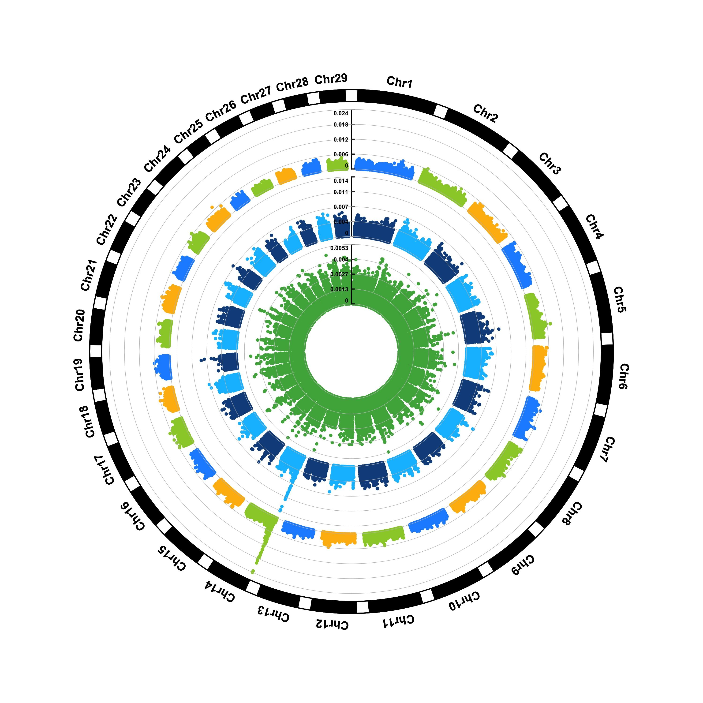

The visualization of Genome-Wide Association Study (GWAS) results mainly includes SNP circular plots displayed by chromosome positions, SNP density plots, Manhattan plots for significance screening, QQ plots comparing the distribution of observed p-values with expected p-values, etc., which are used to screen candidate variant genes at the genome-wide level.

## Example

{fig-alt="GwasSnpPlot DEMO" fig-align="center" width="60%"}

## Setup

-   System Requirements: Cross-platform (Linux/MacOS/Windows)

-   Programming language: R

-   Dependent packages: `CMplot`

```{r packages setup, message=FALSE, warning=FALSE, output=FALSE}
# Install packages
if (!requireNamespace("CMplot", quietly = TRUE)) {
  install.packages("CMplot")
}

# Library packages
library(CMplot)
```

```{r}
sessioninfo::session_info("attached")
```

## Data Preparation

The sample data includes 60K liquid chip raw variation information data of Pig.

```{r load data, message=FALSE, warning=FALSE}
# Example data
data(pig60K)
data <- pig60K

# Data preview
head(data, 5)
```

## Visualization

### 1. SNP screening genome circular map

Genome circular maps can display more chromosomes and traits under the same proportion, and have a great advantage when comparing multiple traits.

```{r}
#| label: fig-1GwasSnpCircos
#| fig-cap: "SNP screening genome circular map"
#| out.width: "95%"
#| warning: false

# SNP screening genome circular map
CMplot(
  data,
  type = "p",
  plot.type = "c",
  chr.labels = paste("Chr", c(1:18, "X", "Y"), sep = ""),
  r = 8,
  cir.axis = TRUE,
  outward = TRUE,
  cir.axis.col = "black",
  cir.chr.h = 2,
  chr.den.col = "black",
  file.output = FALSE,
  verbose = FALSE,
  mar = c(0,0,0,0)
)
```

### 2. SNP Chromosome Density Map

The SNP chromosome density map shows the distribution of SNP density on each chromosome.

```{r}
#| label: fig-2GwasSnpDensity
#| fig-cap: "SNP Chromosome Density Map"
#| out.width: "95%"
#| warning: false
#| message: false

# SNP Chromosome Density Map
CMplot(
  data,
  plot.type = "d",
  bin.size = 1e6,
  chr.den.col = c("darkgreen", "yellow", "red"),
  main = "Density",
  file.output = FALSE,
  verbose = FALSE
)
```

### 3. Manhattan plot for SNP screening

The Manhattan plot for SNP screening is convenient for displaying the significance of SNPs at 5% or 1%, and it also helps identify the concentration effect of key chromosomes.

```{r}
#| label: fig-3GwasSnpManhattan
#| fig-cap: "Manhattan plot for SNP screening"
#| out.width: "95%"
#| warning: false
#| message: false

# Manhattan plot for SNP screening
CMplot(
  data,
  type = "p",
  plot.type = "m",
  LOG10 = TRUE,
  threshold = NULL,
  file.output = FALSE,
  verbose = FALSE,
  chr.labels.angle = 45
)
```

### 4. QQ plot based on SNP

The core function of the QQ plot based on SNPs is to test whether the P-value distribution of SNPs in GWAS analysis conforms to the "expected distribution under the no-association hypothesis", so as to judge the reliability of the analysis results.

```{r}
#| label: fig-4GwasSnpQQ
#| fig-cap: "QQ plot based on SNP"
#| out.width: "95%"
#| warning: false
#| message: false

# QQ plot based on SNP
CMplot(
  data,
  plot.type = "q",
  box = FALSE,
  conf.int = TRUE,
  conf.int.col = NULL,
  threshold.col = "red",
  threshold.lty = 2,
  file.output = FALSE,
  verbose = FALSE
)
```

### 5. Runs of Homozygosity Along the Chromosomes

A Manhattan plot and a QQ plot both summarise **association**. Neither shows **homozygosity**, which is the other half of what a SNP panel measures. Runs of homozygosity (ROH) are maximal stretches of consecutive homozygous genotypes. They arise from consanguinity, from recent inbreeding in a breeding population, or from a somatic deletion, and they are read as horizontal bars along the genome, one row per sample \[1,2\]. The figure is a strip chart rather than a scatter plot: the whole point is that a run is *continuous*, and a per-SNP plot cannot show continuity.

The three patterns below are the ones a real call set has to separate. Two samples carry long runs on every chromosome, one carries a single long run confined to chr3, one carries a patchy set of intermediate runs on two chromosomes, and the remaining eight carry nothing above the 20-SNP floor. That last point matters: an empty row in an ROH figure is information, not a missing plot, so the empty rows must stay on the axis.

```{r}
#| label: fig-5-1RohRibbons
#| out.width: "100%"
#| warning: false
#| message: false
#| fig-width: 10
#| fig-height: 4.2
#| fig-dpi: 300
#| fig-cap: "Simulated runs of homozygosity in 12 samples across five chromosomes laid end to end: each bar is a maximal run of 20 or more consecutive homozygous SNPs, coloured by run length. S02 and S08 carry long runs on every chromosome (consanguinity or a strongly inbred line), S05 carries a single long run restricted to chr3 that no other sample shows (a candidate somatic deletion), and S11 carries a patchy set of intermediate runs on chr1-chr2 only. Eight samples carry no run at all. Note that S02, S05 and S08 look nearly identical at this scale: ROH cannot separate inbreeding from a germline deletion on its own."

suppressPackageStartupMessages({
  library(ggplot2)
  library(dplyr)
  library(tibble)
})

set.seed(43511)

## Toy genome: five chromosomes with a SNP panel every ~200 kb, laid on a
## cumulative axis so that runs can cross chromosome boundaries nowhere.
chr <- data.frame(chr = paste0("chr", 1:5), len = c(120, 95, 80, 60, 45),
                  offset = c(0, 124, 223, 307, 371))
snp <- do.call(rbind, lapply(seq_len(nrow(chr)), function(i) {
  n <- round(chr$len[i] / 0.2)
  data.frame(chr = chr$chr[i], pos = sort(runif(n, 0, chr$len[i])))
}))
snp$x <- snp$pos + chr$offset[match(snp$chr, chr$chr)]

## Per-sample homozygosity at the 62% background rate, then planted patterns:
## two genome-wide (consanguinity), one focal run, one patchy intermediate set.
samples <- sprintf("S%02d", 1:12)
hz <- expand.grid(sample = samples, id = seq_len(nrow(snp))) |>
  as_tibble() |>
  mutate(chr = snp$chr[id], x = snp$x[id], hom = runif(n()) < 0.62) |>
  arrange(sample, x)

plant <- function(s, rng, frac = 1) {
  sel <- hz$sample == s & hz$chr %in% rng
  hz$hom[sel] <<- runif(sum(sel)) < frac
}
plant("S02", chr$chr); plant("S08", chr$chr)
plant("S05", "chr3"); plant("S11", c("chr1", "chr2"), 0.94)

## A run is a maximal stretch of homozygous calls, at least 20 SNPs long.
runs <- hz |>
  group_by(sample) |>
  mutate(run = cumsum(c(TRUE, hom[-1] != hom[-n()] | chr[-1] != chr[-n()]))) |>
  group_by(sample, run, chr) |>
  filter(all(hom), n() >= 20) |>
  summarise(x0 = min(x), x1 = max(x), .groups = "drop") |>
  mutate(len_mb = x1 - x0,
         length_class = cut(len_mb, breaks = c(0, 5, 20, Inf),
                            labels = c("< 5 Mb", "5-20 Mb", "> 20 Mb")))

## Integer rows keep blank samples on the axis (a discrete scale would drop them).
ypos <- setNames(seq_along(samples), samples)
runs$y <- ypos[runs$sample]
ymax <- length(samples)

labs <- data.frame(
  y = c(ypos[["S02"]], ypos[["S05"]], ypos[["S08"]], ypos[["S11"]]),
  lab = c("genome-wide: consanguinity", "focal chr3 run",
          "genome-wide: consanguinity", "patchy, intermediate runs")
)

ggplot(runs) +
  geom_segment(aes(x = x0, xend = x1, y = y, yend = y, colour = length_class),
               linewidth = 2.6, lineend = "butt") +
  geom_vline(xintercept = c(chr$offset[-1], max(chr$offset + chr$len)),
             linewidth = 0.3, colour = "#d9d9d9") +
  annotate("text", x = chr$offset + chr$len / 2, y = ymax + 0.62,
           label = chr$chr, size = 2.7, colour = "#525252") +
  annotate("segment", x = 418, xend = 421, y = labs$y, yend = labs$y,
           linewidth = 0.35, colour = "#6e6e6e") +
  annotate("text", x = 424, y = labs$y, label = labs$lab, hjust = 0,
           size = 2.55, colour = "#333333") +
  scale_colour_brewer("run length", palette = "YlOrRd", direction = 1, drop = FALSE) +
  scale_y_continuous(breaks = seq_along(samples), labels = samples,
                     limits = c(0.35, ymax + 0.95), expand = c(0, 0)) +
  coord_cartesian(xlim = c(0, 512), clip = "off") +
  labs(x = "cumulative position (Mb)",
       y = "sample (12 samples; runs of 20 or more homozygous SNPs)") +
  theme_minimal(base_size = 9) +
  theme(panel.grid.major.y = element_blank(),
        panel.grid.minor = element_blank(),
        plot.margin = margin(4, 6, 6, 4),
        legend.position = "bottom", legend.margin = margin(0, 0, 0, 0),
        legend.key.size = unit(0.32, "cm"),
        legend.text = element_text(size = 7))
```

::: callout-tip
**Practice tips**

-   Define a run with both a marker count and a physical floor (here 20 consecutive homozygous SNPs), and say which caller produced the calls — PLINK's sliding-window ROH scan is the usual reference \[3\]. Three consecutive homozygous SNPs occur by chance at a 1% call error rate, and a length-only definition makes the result depend on marker density.
-   Draw runs as horizontal bars on a cumulative genome axis, one row per sample. Plotting ROH positions as points on a Manhattan plot destroys the only property of interest, namely continuity.
-   Colour by run length, not by sample. The reader's question is "who carries long runs", and length is what separates an old population-level signal from a recent inbreeding event.
-   Keep the rows with no runs. Dropping them makes an absence of runs indistinguishable from an absence of data.
-   State the genotyping-error and allele-frequency filters used before calling runs. A single missing call inside a run splits it in two and silently changes the length, which is the quantity the whole figure is about.
:::

## Reference

\[1\] Ceballos FC, Joshi PK, Clark DW, Ramsay M, Wilson JF. Runs of homozygosity: windows into population history and trait architecture. Nat Rev Genet. 2018;19(4):220-234. doi:10.1038/nrg.2017.109

\[2\] Broman KW, Weber JL. Long homozygous chromosomal segments in reference families from the Centre d'Etude du Polymorphisme Humain. Am J Hum Genet. 1999;65(6):1493-1500. doi:10.1086/302661

\[3\] Purcell S, Neale B, Todd-Brown K, et al. PLINK: a tool set for whole-genome association and population-based linkage analyses. Am J Hum Genet. 2007;81(3):559-575. doi:10.1086/519795
