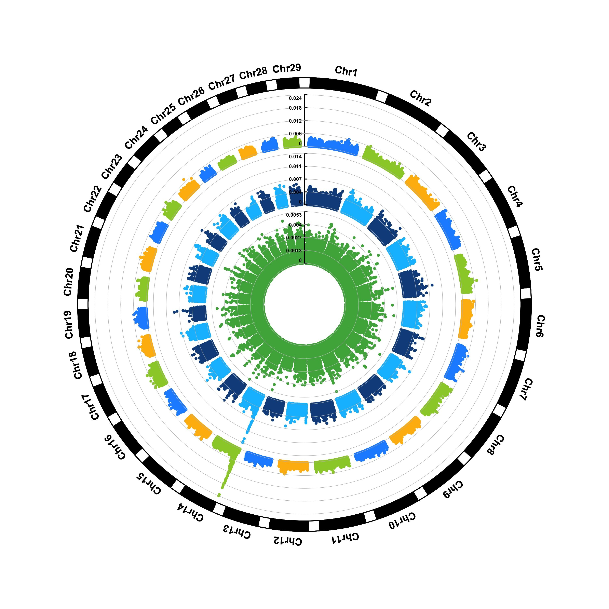

全基因组关联分析（GWAS）结果可视化主要包含按染色体位置展示SNP圈图、SNP密度图、显著性筛选的曼哈顿图、比较观测 p 值与期望 p 值的分布的QQ图等，用于筛选到全基因水平的候选变异基因。

## 示例

{fig-alt="GwasSnpPlot DEMO" fig-align="center" width="60%"}

## 环境配置

-   系统要求： 跨平台（Linux/MacOS/Windows）

-   编程语言：R

-   依赖包：`CMplot`

```{r packages setup, message=FALSE, warning=FALSE, output=FALSE}
# 安装包
if (!requireNamespace("CMplot", quietly = TRUE)) {
  install.packages("CMplot")
}

# 加载包
library(CMplot)
```

```{r}
sessioninfo::session_info("attached")
```

## 数据准备

示例数据包含60K液相芯片Pig的原始变异信息数据。

```{r load data, message=FALSE, warning=FALSE}
# 示例数据
data(pig60K)
data <- pig60K

# 查看数据
head(data, 5)
```

## 可视化

### 1. SNP筛选基因组圈图

基因组圈图可以在相同占比下展示更多的染色体和性状，在多个性状比较时占极大优势。

```{r}
#| label: fig-1GwasSnpCircos
#| fig-cap: "SNP筛选基因组圈图"
#| out.width: "95%"
#| warning: false

# SNP筛选基因组圈图
p <- CMplot(
  data,
  type = "p",
  plot.type = "c",
  chr.labels = paste("Chr", c(1:18, "X", "Y"), sep = ""),
  r = 8,
  cir.axis = TRUE,
  outward = TRUE,
  cir.axis.col = "black",
  cir.chr.h = 2,
  chr.den.col = "black",
  file.output = FALSE,
  verbose = FALSE,
  mar = c(0,0,0,0)
)

p
```

### 2. SNP染色体密度图

SNP染色体密度图展示各个染色体上SNP密度分布。

```{r}
#| label: fig-2GwasSnpDensity
#| fig-cap: "SNP染色体密度图"
#| out.width: "95%"
#| warning: false
#| message: false

# SNP染色体密度图
p <- capture.output(
  CMplot(
    data,
    plot.type = "d",
    bin.size = 1e6,
    chr.den.col = c("darkgreen", "yellow", "red"),
    main = "Density",
    file.output = FALSE,
    verbose = FALSE
  )
)

print(p[1])
```

### 3. SNP筛选曼哈顿图

SNP筛选曼哈顿图便于展示5%或者1%的SNP显著性，同时也辅助鉴定关键染色体的集中效应。

```{r}
#| label: fig-3GwasSnpManhattan
#| fig-cap: "SNP筛选曼哈顿图"
#| out.width: "95%"
#| warning: false
#| message: false

# SNP筛选曼哈顿图
p <- CMplot(
  data,
  type = "p",
  plot.type = "m",
  LOG10 = TRUE,
  threshold = NULL,
  file.output = FALSE,
  verbose = FALSE,
  chr.labels.angle = 45
)

p
```

### 4. SNP基于的QQ图

SNP基于的QQ图核心作用是检验 GWAS 分析中 SNP 的 P 值分布是否符合 “无关联假设下的期望分布”，以此判断分析结果的可靠性。

```{r}
#| label: fig-4GwasSnpQQ
#| fig-cap: "SNP基于的QQ图"
#| out.width: "95%"
#| warning: false
#| message: false

# SNP基于的QQ图
p <- CMplot(
  data,
  plot.type = "q",
  box = FALSE,
  conf.int = TRUE,
  conf.int.col = NULL,
  threshold.col = "red",
  threshold.lty = 2,
  file.output = FALSE,
  verbose = FALSE
)

p
```

### 5. 染色体上的同源片段（ROH）

曼哈顿图与 QQ 图总结的都是**关联**，两者都不展示**纯合性**——而纯合性正是 SNP 芯片度量的另一半。同源片段（run of homozygosity, ROH）是连续纯合基因型的最大延伸段，来源可以是近亲婚配、育种群体中的近期近交，也可以是体细胞缺失；读法是沿基因组画成一条条横条，每个样本一行 \[2,3\]。这是条带图而非散点图：它要传达的核心信息是片段具有*连续性*，而逐 SNP 的点图无法表达连续性。

下面三种模式正是真实检测结果必须区分的：两个样本在每条染色体上都有长片段，一个样本只有 chr3 上的一段长片段，一个样本只在两条染色体上有一段段不连续的中等片段，其余八个样本在「不少于 20 个 SNP」的门槛之上完全为空。最后这一点很关键：ROH 图里的空行是信息而不是漏画，空行必须保留在坐标轴上。

```{r}
#| label: fig-5-1RohRibbons
#| out.width: "100%"
#| warning: false
#| message: false
#| fig-width: 10
#| fig-height: 4.2
#| fig-dpi: 300
#| fig-cap: "12 个样本、5 条染色体首尾相连的同源片段（ROH）图：每根横条是一段连续的纯合片段（连续纯合 SNP 不少于 20 个），按片段长度着色。S02 与 S08 在全部染色体上都有长片段（近亲婚配或高度近交品系），S05 仅在 chr3 上有一段长片段而其他样本都没有（体细胞缺失候选），S11 只在 chr1-chr2 上有一段段中等长度、彼此不连续的片段，另有 8 个样本完全没有片段。注意 S02、S05、S08 在本图尺度上几乎无法区分：单靠 ROH 不能把近交与会生殖细胞缺失分开。"

suppressPackageStartupMessages({
  library(ggplot2)
  library(dplyr)
  library(tibble)
})

set.seed(43511)

## Toy genome: five chromosomes with a SNP panel every ~200 kb, laid on a
## cumulative axis so that runs can cross chromosome boundaries nowhere.
chr <- data.frame(chr = paste0("chr", 1:5), len = c(120, 95, 80, 60, 45),
                  offset = c(0, 124, 223, 307, 371))
snp <- do.call(rbind, lapply(seq_len(nrow(chr)), function(i) {
  n <- round(chr$len[i] / 0.2)
  data.frame(chr = chr$chr[i], pos = sort(runif(n, 0, chr$len[i])))
}))
snp$x <- snp$pos + chr$offset[match(snp$chr, chr$chr)]

## Per-sample homozygosity at the 62% background rate, then planted patterns:
## two genome-wide (consanguinity), one focal run, one patchy intermediate set.
samples <- sprintf("S%02d", 1:12)
hz <- expand.grid(sample = samples, id = seq_len(nrow(snp))) |>
  as_tibble() |>
  mutate(chr = snp$chr[id], x = snp$x[id], hom = runif(n()) < 0.62) |>
  arrange(sample, x)

plant <- function(s, rng, frac = 1) {
  sel <- hz$sample == s & hz$chr %in% rng
  hz$hom[sel] <<- runif(sum(sel)) < frac
}
plant("S02", chr$chr); plant("S08", chr$chr)
plant("S05", "chr3"); plant("S11", c("chr1", "chr2"), 0.94)

## A run is a maximal stretch of homozygous calls, at least 20 SNPs long.
runs <- hz |>
  group_by(sample) |>
  mutate(run = cumsum(c(TRUE, hom[-1] != hom[-n()] | chr[-1] != chr[-n()]))) |>
  group_by(sample, run, chr) |>
  filter(all(hom), n() >= 20) |>
  summarise(x0 = min(x), x1 = max(x), .groups = "drop") |>
  mutate(len_mb = x1 - x0,
         length_class = cut(len_mb, breaks = c(0, 5, 20, Inf),
                            labels = c("< 5 Mb", "5-20 Mb", "> 20 Mb")))

## Integer rows keep blank samples on the axis (a discrete scale would drop them).
ypos <- setNames(seq_along(samples), samples)
runs$y <- ypos[runs$sample]
ymax <- length(samples)

labs <- data.frame(
  y = c(ypos[["S02"]], ypos[["S05"]], ypos[["S08"]], ypos[["S11"]]),
  lab = c("genome-wide: consanguinity", "focal chr3 run",
          "genome-wide: consanguinity", "patchy, intermediate runs")
)

ggplot(runs) +
  geom_segment(aes(x = x0, xend = x1, y = y, yend = y, colour = length_class),
               linewidth = 2.6, lineend = "butt") +
  geom_vline(xintercept = c(chr$offset[-1], max(chr$offset + chr$len)),
             linewidth = 0.3, colour = "#d9d9d9") +
  annotate("text", x = chr$offset + chr$len / 2, y = ymax + 0.62,
           label = chr$chr, size = 2.7, colour = "#525252") +
  annotate("segment", x = 418, xend = 421, y = labs$y, yend = labs$y,
           linewidth = 0.35, colour = "#6e6e6e") +
  annotate("text", x = 424, y = labs$y, label = labs$lab, hjust = 0,
           size = 2.55, colour = "#333333") +
  scale_colour_brewer("run length", palette = "YlOrRd", direction = 1, drop = FALSE) +
  scale_y_continuous(breaks = seq_along(samples), labels = samples,
                     limits = c(0.35, ymax + 0.95), expand = c(0, 0)) +
  coord_cartesian(xlim = c(0, 512), clip = "off") +
  labs(x = "cumulative position (Mb)",
       y = "sample (12 samples; runs of 20 or more homozygous SNPs)") +
  theme_minimal(base_size = 9) +
  theme(panel.grid.major.y = element_blank(),
        panel.grid.minor = element_blank(),
        plot.margin = margin(4, 6, 6, 4),
        legend.position = "bottom", legend.margin = margin(0, 0, 0, 0),
        legend.key.size = unit(0.32, "cm"),
        legend.text = element_text(size = 7))
```

::: callout-tip
**实践要点**

-   片段定义要同时约束标记数与物理长度（此处为连续纯合 SNP 不少于 20 个）。在 1% 的基因型错误率下，连续 3 个纯合 SNP 纯属随机；而只用长度定义会让结果随标记密度变化。
-   以累积基因组坐标把片段画成横条、每个样本一行。把 ROH 位置当散点画到曼哈顿图上会毁掉唯一有价值的信息——连续性。
-   按片段长度着色，而不是按样本着色。读者的问题是「谁带着长片段」，而长度正是区分古老的群体信号与近期近交事件的关键量。
-   保留没有片段的空行。删掉空行会让「没有片段」与「没有数据」变得无法区分。
-   注明调用片段前使用的基因型错误与等位基因频率过滤条件。片段中间一个缺失调用就会把它劈成两段、悄悄改变长度，而长度正是整张图要表达的量。

## 参考资料

\[4\] Purcell S, Neale B, Todd-Brown K, et al. PLINK: a tool set for whole-genome association and population-based linkage analyses. Am J Hum Genet. 2007;81(3):559-575. doi:10.1086/519795

\[5\] Ceballos FC, Joshi PK, Clark DW, Ramsay M, Wilson JF. Runs of homozygosity: windows into population history and trait architecture. Nat Rev Genet. 2018;19(4):220-234. doi:10.1038/nrg.2017.109

\[6\] Broman KW, Weber JL. Long homozygous chromosomal segments in reference families from the Centre d'Etude du Polymorphisme Humain. Am J Hum Genet. 1999;65(6):1493-1500. doi:10.1086/302661
