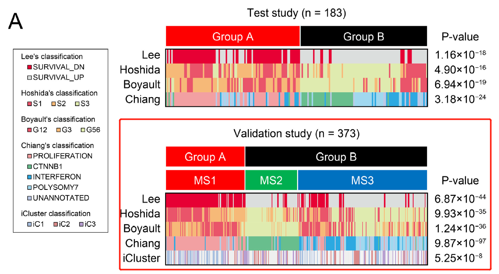

The reference analyzes **Hepatocellular Carcinoma (HCC) molecular subtypes** in relation to clinical parameters (e.g. stage, grade, etiology, survival), presented as stacked proportion barplots or clinical association heatmaps \[1\]. Here, 160 HCC patients are simulated across three molecular subtypes and clinical stages, and association summaries are rendered with ggplot2:

## Example

{fig-alt="Hepatocellular Carcinoma Subtype Clinical Features DEMO" fig-align="center" width="75%"}

## Setup

-   System Requirements: Cross-platform (Linux/MacOS/Windows)

-   Programming language: R

-   Dependent packages: `ggplot2`; `dplyr`

```{r packages setup, message=FALSE, warning=FALSE, output=FALSE}
suppressPackageStartupMessages({
  library(ggplot2); library(dplyr)
})
```

```{r}
sessioninfo::session_info("attached")
```

## Data Preparation

160 simulated HCC patients assigned to 3 molecular subtypes (S1, S2, S3) and clinical stages (Stage I, Stage II, Stage III/IV). Planted pattern: subtype S1 associates more frequently with advanced stage (Stage III/IV):

```{r load data}
suppressPackageStartupMessages({library(ggplot2); library(dplyr)})
set.seed(48291)
n_pat <- 160
subtypes <- c("S1", "S2", "S3")
stages <- c("Stage I", "Stage II", "Stage III/IV")

sub_assign <- sample(subtypes, n_pat, TRUE, prob = c(0.3, 0.35, 0.35))
stage_assign <- sapply(sub_assign, function(s) {
  if (s == "S1") sample(stages, 1, prob = c(0.2, 0.3, 0.5))
  else sample(stages, 1, prob = c(0.5, 0.3, 0.2))
})

hcc_df <- data.frame(
  patient = sprintf("HCC%03d", 1:n_pat),
  subtype = factor(sub_assign, levels = subtypes),
  stage = factor(stage_assign, levels = stages)
)
```

## Visualization

### 1. Stacked Proportion Barplot of Clinical Stage by Subtype

The reference's clinical association deliverable: 100% stacked barplot showing the distribution of clinical stages within each molecular subtype, with a Chi-square test p value:

```{r}
#| label: fig-1.1HccSubtypeStack
#| fig-cap: "Distribution of clinical stages across three HCC molecular subtypes (S1-S3): 100% stacked barplot showing that subtype S1 is enriched for advanced stage (Stage III/IV) patients (Chi-square test p < 0.01)."
#| out.width: "85%"
#| fig-width: 8
#| fig-height: 5.5

chi_res <- chisq.test(table(hcc_df$subtype, hcc_df$stage))
ggplot(hcc_df, aes(subtype, fill = stage)) +
  geom_bar(stat = "count", position = "fill", width = 0.7) +
  scale_fill_brewer(palette = "Blues", name = "Clinical stage") +
  labs(x = "Molecular subtype", y = "Proportion",
       title = sprintf("Clinical stage distribution (Chi-square p = %s)",
                       format.pval(chi_res$p.value, digits = 2))) +
  theme_bw(base_size = 11) +
  theme(panel.grid = element_blank(),
        legend.position = "right")
```

::: callout-tip
**Practice tips**
-   Test associations between categorical clinical variables (stage, grade, subtype) using Chi-square or Fisher's exact tests.
-   Visualize categorical breakdowns using 100% stacked proportion barplots (`position = "fill"`).
-   Keep subtype and clinical stage ordering consistent across all comparative figures.
-   Report contingency table test p values directly in plot titles or annotations.
-   Ensure color palettes for clinical stages reflect severity (e.g. sequential Blues for stages I to III/IV).
:::

## Application

::: {#fig-HccSubtypeApplications1}
{fig-alt="Hepatocellular Carcinoma Subtype Clinical Features" fig-align="center" width="75%"}

Hepatocellular carcinoma subtype clinical features
:::

Subtype-clinical association barplots apply to any cancer molecular classification study: HCC subtypes, breast cancer PAM50 comparisons, or colorectal CMS classifications against clinical features.

## Reference

\[1\] Xiaofan Lu, et al. Festival of Standardized Biomedical Visualizations: HCC Subtype Clinical Features. iMetaMed. 2025. doi:10.1002/imm3.70005
