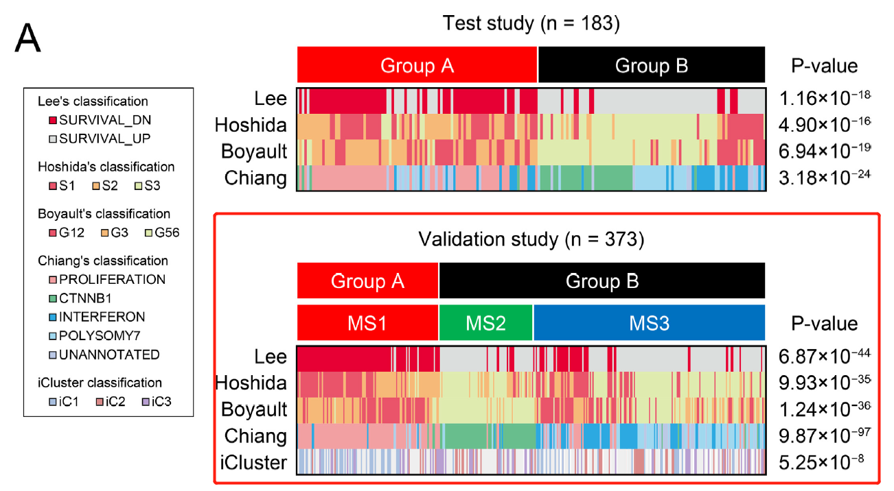

参考分析**肝细胞癌（HCC）分子亚型**与临床参数（如分期、分级、病因、生存）的关系，呈现为堆叠比例条形图或临床关联热图 \[\1\]。此处在 160 名 HCC 患者中跨三个分子亚型和临床分期进行模拟，关联汇总用 ggplot2 渲染：

## Example

{fig-alt="肝细胞癌亚型临床特征 DEMO" fig-align="center" width="60%"}

## Setup

-   系统要求：跨平台（Linux/MacOS/Windows）

-   编程语言：R

-   依赖包：`ggplot2`; `dplyr`

```{r packages setup, message=FALSE, warning=FALSE, output=FALSE}
suppressPackageStartupMessages({
  library(ggplot2); library(dplyr)
})
```

```{r}
sessioninfo::session_info("attached")
```

## 数据准备

160 名模拟 HCC 患者分配到 3 个分子亚型（S1、S2、S3）与临床分期（I 期、II 期、III/IV 期）。植入模式：亚型 S1 更频繁地与晚期（III/IV 期）关联：

```{r load data}
suppressPackageStartupMessages({library(ggplot2); library(dplyr)})
set.seed(48291)
n_pat <- 160
subtypes <- c("S1", "S2", "S3")
stages <- c("Stage I", "Stage II", "Stage III/IV")

sub_assign <- sample(subtypes, n_pat, TRUE, prob = c(0.3, 0.35, 0.35))
stage_assign <- sapply(sub_assign, function(s) {
  if (s == "S1") sample(stages, 1, prob = c(0.2, 0.3, 0.5))
  else sample(stages, 1, prob = c(0.5, 0.3, 0.2))
})

hcc_df <- data.frame(
  patient = sprintf("HCC%03d", 1:n_pat),
  subtype = factor(sub_assign, levels = subtypes),
  stage = factor(stage_assign, levels = stages)
)
```

## Visualization

### 亚型临床分期堆叠比例条形图

参考的临床关联交付物：展示每个分子亚型内临床分期分布的 100% 堆叠比例条形图，附卡方检验 p 值：

```{r}
#| label: fig-1.1HccSubtypeStack
#| fig-cap: "3 个 HCC 分子亚型（S1-S3）间的临床分期分布：100% 堆叠比例条形图显示亚型 S1 富集晚期（III/IV 期）患者（卡方检验 p < 0.01）。"
#| out.width: "85%"
#| fig-width: 8
#| fig-height: 5.5

chi_res <- chisq.test(table(hcc_df$subtype, hcc_df$stage))
ggplot(hcc_df, aes(subtype, fill = stage)) +
  geom_bar(stat = "count", position = "fill", width = 0.7) +
  scale_fill_brewer(palette = "Blues", name = "Clinical stage") +
  labs(x = "Molecular subtype", y = "Proportion",
       title = sprintf("Clinical stage distribution (Chi-square p = %s)",
                       format.pval(chi_res$p.value, digits = 2))) +
  theme_bw(base_size = 11) +
  theme(panel.grid = element_blank(),
        legend.position = "right")
```


## 应用场景

::: {{#fig-HccSubtypeApplications1}}
{fig-alt="肝细胞癌亚型临床特征" fig-align="center" width="60%"}

肝细胞癌亚型临床特征
:::

亚型-临床关联条形图适用于任何癌症分子分类研究：HCC 亚型、乳腺癌 PAM50 比较、或结直肠癌 CMS 分类对照临床特征。

## 参考文献

\[1\] Xiaofan Lu, et al. Festival of Standardized Biomedical Visualizations: HCC Subtype Clinical Features. iMetaMed. 2025. doi:10.1002/imm3.70005
