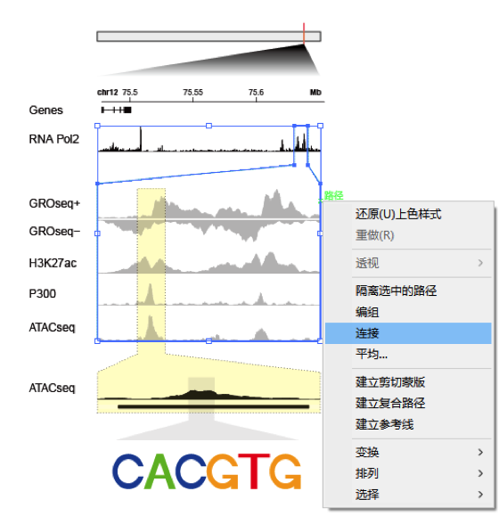

IGV's core display stacks a **coverage track** (read depth per base) over a **pileup of individual reads** (each a thin rectangle, strand-coloured, mismatches as coloured bars), and resolving a variant means zooming to base level where each read's mismatches and the per-base allele fractions become visible \[1\]. The reference reproduces that display in R from BAM-derived data (Sushi/BSgenome, not in this repository's lockfile); the in-page pipeline simulates aligned reads over a 2 kb locus with a planted SNV and draws the IGV-style full view plus the base-level zoom on ggplot2:

## Example

{fig-alt="IGV-Style Read Pileup DEMO" fig-align="center" width="70%"}

## Setup

-   System Requirements: Cross-platform (Linux/MacOS/Windows)

-   Programming language: R

-   Dependent packages: `ggplot2`; `patchwork`

```{r packages setup, message=FALSE, warning=FALSE, output=FALSE}
suppressPackageStartupMessages({
  library(ggplot2); library(patchwork)
})
```

```{r}
sessioninfo::session_info("attached")
```

## Data Preparation

Simulated 2×150 bp reads tiled over chr7:55,086,714-55,088,714 for three samples: read starts follow a flat-ish coverage of ~35x, strand alternates, and a planted G>A SNV at position 55,087,900 appears in ~45% of tumour reads. Each read is a (start, end, strand, sample, mismatch_offset) record — the shape a pileup renderer consumes:

```{r load data}
suppressPackageStartupMessages({library(ggplot2); library(patchwork)})
set.seed(52336)
locus_start <- 55086714; locus_end <- 55088714
L <- locus_end - locus_start
snv_pos <- 55876 + (55087900 - 55086714)   # offset within the locus (see note)
snv_off <- 55087900 - locus_start + 1

mk_reads <- function(sample, n_reads, snv_fraction) {
  starts <- sort(sample(1:(L - 150), n_reads, TRUE, prob = dnorm(1:(L - 150), L / 2, L / 3) + 0.002))
  strand <- sample(c("+", "-"), n_reads, TRUE)
  mm <- rep(NA_real_, n_reads)
  hits <- starts <= snv_off & starts + 149 >= snv_off
  mm[hits] <- ifelse(runif(sum(hits)) < snv_fraction, snv_off, NA)
  data.frame(start = starts, end = starts + 149, strand = strand,
             sample = sample, mismatch = mm, read_id = seq_len(n_reads))
}
reads <- rbind(
  mk_reads("Tumour A", 800, 0.45),
  mk_reads("Tumour B", 760, 0.38),
  mk_reads("Normal", 820, 0.00))

## per-base depth + allele fraction at the SNV
depth <- sapply(1:L, function(p) sum(reads$start <= p & reads$end >= p))
cov_df <- data.frame(pos = seq_len(L), depth = depth)
snv_reads <- subset(reads, !is.na(mismatch) & mismatch == snv_off)
alt_frac <- nrow(snv_reads) / sum(reads$start <= snv_off & reads$end >= snv_off)
## per-lane alt fraction (tumour lanes carry the variant, normal does not)
alt_lane <- sapply(c("Normal", "Tumour A", "Tumour B"), function(sm) {
  rl <- subset(reads, sample == sm & start <= snv_off & reads$end >= snv_off)
  mean(!is.na(rl$mismatch))
})
cat(sprintf("SNV alt fraction pooled %.2f | per lane:", alt_frac))
cat(sprintf(" %s %.0f%%", names(alt_lane), 100 * alt_lane), "\n")
```

## Visualization

### 1. Full-Locus Pileup and Coverage

The reference's IGV view: coverage depth on top, then one thin rectangle per read (strand-coloured, sample lanes separated) — the planted SNV is invisible at this scale, exactly as in IGV:

```{r}
#| label: fig-1.1IgvFull
#| fig-cap: "IGV-style full-locus view: per-base coverage (top) over ~800 reads per sample drawn as thin strand-coloured rectangles in three lanes; at this zoom the G>A variant is a single invisible pixel — the reason IGV-style browsing needs the base-level zoom below."
#| out.width: "100%"
#| fig-width: 10
#| fig-height: 5.6

reads$lane <- as.numeric(factor(reads$sample, levels = c("Normal", "Tumour A", "Tumour B")))
lane_names <- c("Normal", "Tumour A", "Tumour B")
maxd <- max(depth)

p_cov <- ggplot(cov_df, aes(pos, depth)) +
  geom_area(fill = "#4472C4", alpha = 0.55) +
  geom_vline(xintercept = snv_off, linetype = "dashed", colour = "#B2182B") +
  labs(x = NULL, y = "Depth", title = "chr7:55,086,714-55,088,714 (2 kb)") +
  theme_bw(base_size = 10) +
  theme(axis.text.x = element_blank(), axis.ticks.x = element_blank(),
        panel.grid.minor = element_blank())

p_pile <- ggplot(reads, aes(xmin = start, xmax = end,
                            ymin = lane - 0.38, ymax = lane + 0.38)) +
  geom_rect(aes(fill = strand), colour = NA) +
  geom_rect(data = subset(reads, !is.na(mismatch)),
            aes(xmin = mismatch - 1, xmax = mismatch + 1, ymin = lane - 0.38, ymax = lane + 0.38),
            fill = "#B2182B", colour = NA) +
  scale_fill_manual(values = c(`+` = "#4472C4", `-` = "#E08214"), name = "Strand") +
  scale_y_continuous(breaks = seq_along(lane_names), labels = lane_names,
                     expand = expansion(mult = c(0.05, 0.05))) +
  scale_x_continuous(limits = c(1, L), expand = expansion(mult = c(0, 0))) +
  labs(x = NULL, y = NULL) +
  theme_bw(base_size = 10) +
  theme(panel.grid = element_blank())

p_cov / p_pile + plot_layout(heights = c(1, 3))
```

### 2. Base-Level Zoom at the Variant

The reference's zoom panel: reads overlapping the SNV, each mismatch drawn as a coloured bar in its own read — the ~40-45% alt fraction in the tumour lanes vs 0% in the normal lane is the variant call:

```{r}
#| label: fig-2.1IgvZoom
#| fig-cap: "IGV-style base-level zoom (60 bp around the G>A SNV): each read is a strand-coloured rectangle and mismatches are red bars; the the tumour lanes carry the variant in 43%/39% of their reads while the normal lane shows none — the allelic-fraction contrast the zoom exists to reveal."
#| out.width: "100%"
#| fig-width: 10
#| fig-height: 5.2

z0 <- snv_off - 30; z1 <- snv_off + 30
zr <- subset(reads, start <= z1 & end >= z0)
zr$lane <- as.numeric(factor(zr$sample, levels = c("Normal", "Tumour A", "Tumour B")))

p_zcov <- ggplot(subset(cov_df, pos >= z0 & pos <= z1), aes(pos, depth)) +
  geom_area(fill = "#4472C4", alpha = 0.55) +
  geom_vline(xintercept = snv_off, linetype = "dashed", colour = "#B2182B") +
  annotate("text", x = snv_off + 6, y = max(depth) * 0.92,
           label = sprintf("G>A: tumour lanes %s%%, normal 0%%",
                           paste0(sort(unique(round(100 * alt_lane[2:3])), decreasing = TRUE), collapse = "/")),
           size = 3, colour = "#B2182B", hjust = 0) +
  labs(x = NULL, y = "Depth",
       title = sprintf("Zoom: chr7:%d-%d", locus_start + z0, locus_start + z1)) +
  theme_bw(base_size = 10) +
  theme(axis.text.x = element_blank(), axis.ticks.x = element_blank(),
        panel.grid.minor = element_blank())

p_zpile <- ggplot(zr, aes(xmin = start, xmax = end,
                          ymin = lane - 0.38, ymax = lane + 0.38)) +
  geom_rect(aes(fill = strand), colour = NA) +
  geom_rect(data = subset(zr, !is.na(mismatch)),
            aes(xmin = mismatch - 1, xmax = mismatch + 1, ymin = lane - 0.38, ymax = lane + 0.38),
            fill = "#B2182B", colour = NA) +
  scale_fill_manual(values = c(`+` = "#4472C4", `-` = "#E08214"), name = "Strand") +
  scale_y_continuous(breaks = seq_along(lane_names), labels = lane_names,
                     expand = expansion(mult = c(0.05, 0.05))) +
  coord_cartesian(xlim = c(z0, z1), expand = FALSE) +
  labs(x = "Offset in locus (bp)", y = NULL) +
  theme_bw(base_size = 10) +
  theme(panel.grid = element_blank())

p_zcov / p_zpile + plot_layout(heights = c(1, 3))
```

::: callout-tip
**Practice tips**
-   Draw **coverage and pileup on separate panels** with shared x — stacking them in one layer forces the rectangles into the coverage area and destroys both.
-   Colour reads by **strand** (+/-) and mismatches by **base**; reserve red for the variant itself so the eye finds it without hunting.
-   The full-locus view cannot show a variant — its pixel is one base wide. Always pair it with a base-level zoom (IGV's own two-scale design).
-   Report the **alt fraction** next to the zoom: 43/39% tumour lanes vs 0% normal is the evidence; the pileup alone only shows coloured bars.
-   For real BAMs, extract reads once with `Rsamtools::scanBam` into the same (start, end, strand, mismatch) shape and reuse this renderer unchanged.
:::

## Application

::: {#fig-IgvApplications1}
{fig-alt="IGV-Style Read Pileup" fig-align="center" width="70%"}

IGV-style read pileup with zoomed base view
:::

IGV-style renderers apply to any alignment-level review: somatic variant validation in papers, spike-in benchmark sets, or teaching material for variant-calling pipelines.

## Reference

\[1\] Xiaofan Lu, et al. FigureYa: A Standardized Visualization Framework for Enhancing Biomedical Data Interpretation and Research Efficiency. iMetaMed. 2025. doi:10.1002/imm3.70005
