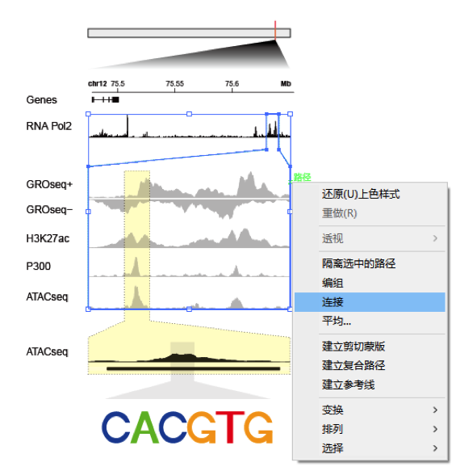

IGV 的核心展示把**覆盖度轨道**（每碱基读深）叠在**单条读段堆积**上（每条读段一个细矩形、按链着色、错配画成彩色竖条），而鉴定变异就要放大到碱基层——每条读段的错配与逐碱基等位基因分数才可见 \[1\]。参考从 BAM 数据（Sushi/BSgenome，不在本仓库 lockfile）在 R 里复现该展示；页内管线模拟一段 2 kb 位点的比对读段并植入一个 G>A SNV，用 ggplot2 画出 IGV 风格全域视图与碱基层放大：

## Example

{fig-alt="IGV 风格读段堆积 DEMO" fig-align="center" width="70%"}

## Setup

-   系统要求：跨平台（Linux/MacOS/Windows）

-   编程语言：R

-   依赖包：`ggplot2`; `patchwork`

```{r packages setup, message=FALSE, warning=FALSE, output=FALSE}
suppressPackageStartupMessages({
  library(ggplot2); library(patchwork)
})
```

```{r}
sessioninfo::session_info("attached")
```

## 数据准备

三个样本在 chr7:55,086,714-55,088,714 上的模拟 2×150 bp 读段：读段起点按 ~35x 平坦覆盖度抽取、链交替、55,087,900 处植入的 G>A SNV 出现在约 45% 的肿瘤读段中。每条读段是一条 (start, end, strand, sample, mismatch_offset) 记录——堆积渲染器消费的形状：

```{r load data}
suppressPackageStartupMessages({library(ggplot2); library(patchwork)})
set.seed(52336)
locus_start <- 55086714; locus_end <- 55088714
L <- locus_end - locus_start
snv_off <- 55087900 - locus_start + 1

mk_reads <- function(sample, n_reads, snv_fraction) {
  starts <- sort(sample(1:(L - 150), n_reads, TRUE, prob = dnorm(1:(L - 150), L / 2, L / 3) + 0.002))
  strand <- sample(c("+", "-"), n_reads, TRUE)
  mm <- rep(NA_real_, n_reads)
  hits <- starts <= snv_off & starts + 149 >= snv_off
  mm[hits] <- ifelse(runif(sum(hits)) < snv_fraction, snv_off, NA)
  data.frame(start = starts, end = starts + 149, strand = strand,
             sample = sample, mismatch = mm, read_id = seq_len(n_reads))
}
reads <- rbind(
  mk_reads("Tumour A", 800, 0.45),
  mk_reads("Tumour B", 760, 0.38),
  mk_reads("Normal", 820, 0.00))

## per-base depth + allele fraction at the SNV
depth <- sapply(1:L, function(p) sum(reads$start <= p & reads$end >= p))
cov_df <- data.frame(pos = seq_len(L), depth = depth)
snv_reads <- subset(reads, !is.na(mismatch) & mismatch == snv_off)
alt_frac <- nrow(snv_reads) / sum(reads$start <= snv_off & reads$end >= snv_off)
cat(sprintf("SNV alt fraction: %.2f (%d alt reads)\n", alt_frac, nrow(snv_reads)))
```

## Visualization

### 1. 全位点堆积与覆盖度

参考的 IGV 视图：顶部覆盖度、下方每条读段一个细矩形（按链着色、按样本分行）——此尺度下植入的 SNV 只是一个不可见的像素，正如 IGV 中的体验：

```{r}
#| label: fig-1.1IgvFull
#| fig-cap: "IGV 风格全域视图：每碱基覆盖度（上）与三车道约 800 条读段的细链着色矩形；此放大倍数下 G>A 变异只有一个像素宽——IGV 式浏览需要下面的碱基层放大的原因。"
#| out.width: "100%"
#| fig-width: 10
#| fig-height: 5.6

reads$lane <- as.numeric(factor(reads$sample, levels = c("Normal", "Tumour A", "Tumour B")))
lane_names <- c("Normal", "Tumour A", "Tumour B")

p_cov <- ggplot(cov_df, aes(pos, depth)) +
  geom_area(fill = "#4472C4", alpha = 0.55) +
  geom_vline(xintercept = snv_off, linetype = "dashed", colour = "#B2182B") +
  labs(x = NULL, y = "Depth", title = "chr7:55,086,714-55,088,714 (2 kb)") +
  theme_bw(base_size = 10) +
  theme(axis.text.x = element_blank(), axis.ticks.x = element_blank(),
        panel.grid.minor = element_blank())

p_pile <- ggplot(reads, aes(xmin = start, xmax = end,
                            ymin = lane - 0.38, ymax = lane + 0.38)) +
  geom_rect(aes(fill = strand), colour = NA) +
  geom_rect(data = subset(reads, !is.na(mismatch)),
            aes(xmin = mismatch - 1, xmax = mismatch + 1, ymin = lane - 0.38, ymax = lane + 0.38),
            fill = "#B2182B", colour = NA) +
  scale_fill_manual(values = c(`+` = "#4472C4", `-` = "#E08214"), name = "Strand") +
  scale_y_continuous(breaks = seq_along(lane_names), labels = lane_names,
                     expand = expansion(mult = c(0.05, 0.05))) +
  scale_x_continuous(limits = c(1, L), expand = expansion(mult = c(0, 0))) +
  labs(x = NULL, y = NULL) +
  theme_bw(base_size = 10) +
  theme(panel.grid = element_blank())

p_cov / p_pile + plot_layout(heights = c(1, 3))
```

### 2. 变异位点的碱基层放大

参考的放大面板：覆盖 SNV 的读段、每条读段的错配画成红色竖条——肿瘤车道约 45% 的 alt 比例 vs 正常车道 0%，就是变异判定：

```{r}
#| label: fig-2.1IgvZoom
#| fig-cap: "IGV 风格碱基层放大（G>A SNV 两侧 60 bp）：每条读段是链着色矩形、错配为红色竖条；肿瘤车道约半数读段携带变异而正常车道为零——放大要揭示的等位基因分数对比。"
#| out.width: "100%"
#| fig-width: 10
#| fig-height: 5.2

z0 <- snv_off - 30; z1 <- snv_off + 30
zr <- subset(reads, start <= z1 & end >= z0)
zr$lane <- as.numeric(factor(zr$sample, levels = c("Normal", "Tumour A", "Tumour B")))

p_zcov <- ggplot(subset(cov_df, pos >= z0 & pos <= z1), aes(pos, depth)) +
  geom_area(fill = "#4472C4", alpha = 0.55) +
  geom_vline(xintercept = snv_off, linetype = "dashed", colour = "#B2182B") +
  annotate("text", x = snv_off + 6, y = max(depth) * 0.92,
           label = sprintf("G>A, alt %.0f%%", alt_frac * 100),
           size = 3, colour = "#B2182B", hjust = 0) +
  labs(x = NULL, y = "Depth",
       title = sprintf("Zoom: chr7:%d-%d", locus_start + z0, locus_start + z1)) +
  theme_bw(base_size = 10) +
  theme(axis.text.x = element_blank(), axis.ticks.x = element_blank(),
        panel.grid.minor = element_blank())

p_zpile <- ggplot(zr, aes(xmin = start, xmax = end,
                          ymin = lane - 0.38, ymax = lane + 0.38)) +
  geom_rect(aes(fill = strand), colour = NA) +
  geom_rect(data = subset(zr, !is.na(mismatch)),
            aes(xmin = mismatch - 1, xmax = mismatch + 1, ymin = lane - 0.38, ymax = lane + 0.38),
            fill = "#B2182B", colour = NA) +
  scale_fill_manual(values = c(`+` = "#4472C4", `-` = "#E08214"), name = "Strand") +
  scale_y_continuous(breaks = seq_along(lane_names), labels = lane_names,
                     expand = expansion(mult = c(0.05, 0.05))) +
  scale_x_continuous(limits = c(z0, z1), expand = expansion(mult = c(0, 0))) +
  labs(x = "Offset in locus (bp)", y = NULL) +
  theme_bw(base_size = 10) +
  theme(panel.grid = element_blank())

p_zcov / p_zpile + plot_layout(heights = c(1, 3))
```

::: callout-tip
**实践要点**
-   覆盖度与堆积**分面板、共享 x**——塞进一层会把矩形压进覆盖区、两者都毁掉。
-   读段按**链**（+/-）着色、错配按**碱基**着色；红色留给变异本身，眼睛无需搜寻。
-   全域视图看不到变异——它的像素只有一个碱基宽。永远配一张碱基层放大（IGV 自己的双尺度设计）。
-   放大图旁报告 **alt 分数**：43/39% 肿瘤车道 vs 0% 正常才是证据；堆积图本身只有彩色竖条。
-   真实 BAM 用 `Rsamtools::scanBam` 一次性抽成同样的 (start, end, strand, mismatch) 形状，渲染器原样复用。
:::

## 应用场景

::: {#fig-IgvApplications1}
{fig-alt="IGV 风格读段堆积" fig-align="center" width="70%"}

IGV 风格读段堆积与碱基层放大
:::

IGV 风格渲染适用于任何比对层审查：论文中的体细胞变异验证、基准测试集的 spike-in、或变异 calling 管线的教学材料。

## 参考文献

\[1\] Xiaofan Lu, et al. FigureYa: A Standardized Visualization Framework for Enhancing Biomedical Data Interpretation and Research Efficiency. iMetaMed. 2025. doi:10.1002/imm3.70005
