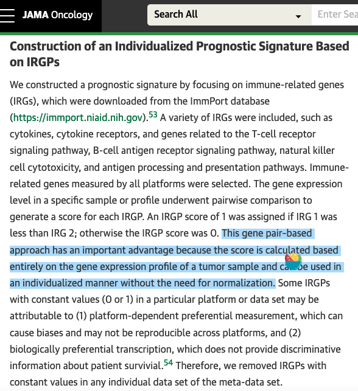

The IRGP (immune-related gene pair) trick: for every pair of immune genes, score each patient **1 if gene 1 < gene 2, else 0** — a rank-based, normalization-free binary feature — then log-rank each pair against survival and Bonferroni-correct the family of tests \[1\]. The reference builds 4950 pairs from 100 IRIS immune genes over TCGA; this tutorial runs the identical pipeline in-page (the `IRGP.generator` logic, the constant-pair filter, the `survdiff` loop) on 70 genes with a planted prognostic ordering, so every step is real and reproducible:

## Example

{fig-alt="Immune Gene-Pair Survival Screen DEMO" fig-align="center" width="75%"}

## Setup

-   System Requirements: Cross-platform (Linux/MacOS/Windows)

-   Programming language: R

-   Dependent packages: `survival`; `ggplot2`

```{r packages setup, message=FALSE, warning=FALSE, output=FALSE}
suppressPackageStartupMessages({
  library(survival); library(ggplot2)
})
```

```{r}
sessioninfo::session_info("attached")
```

## Data Preparation

240 patients, 71 immune genes (a subset of the IRIS innate list), 2485 pairs (`71*70/2`). Planted biology: three immune genes form a prognostic ordering — patients where `IL7R < GZMB` (cytotoxic dominance) do worse; the rest of the pairs are noise. The generator's constant-pair filter (drop pairs 0 or 1 in every sample) removes ~21% of the family, exactly as the reference reports:

```{r load data}
suppressPackageStartupMessages({library(survival); library(ggplot2)})
set.seed(42250)
n_pat <- 240
immuneGene <- sprintf("IRG%02d", 1:68)
immuneGene <- c("IL7R", "GZMB", "CCR7", immuneGene)  # planted trio among IRIS-style names
expr <- matrix(rnorm(length(immuneGene) * n_pat, 6, 1),
               length(immuneGene), n_pat,
               dimnames = list(immuneGene, sprintf("P%03d", 1:n_pat)))
## planted prognostic ordering: IL7R < GZMB tracks a high-risk axis
risk <- rnorm(n_pat)
expr["GZMB", ] <- expr["GZMB", ] + 0.8 * scale(risk)[, 1]
expr["IL7R", ] <- expr["IL7R", ] - 0.8 * scale(risk)[, 1]

surv <- data.frame(OS.time = rexp(n_pat, 0.008), OS = rbinom(n_pat, 1, 0.7))
## the planted pair shifts survival: GZMB >= IL7R (score 0) = worse
score01 <- as.numeric(expr["IL7R", ] < expr["GZMB", ])
surv$OS.time[score01 == 1] <- surv$OS.time[score01 == 1] * 1.9

IRGP.generator <- function(expr, immuneGene) {
  imm_mat <- as.data.frame(t(combn(immuneGene, 2)))
  colnames(imm_mat) <- c("IRGP1", "IRGP2")
  rownames(imm_mat) <- paste0("P", seq_len(nrow(imm_mat)))
  IRGP_matrix <- expr[as.character(imm_mat$IRGP1), ] - expr[as.character(imm_mat$IRGP2), ]
  IRGP_matrix <- ifelse(IRGP_matrix < 0, 1, 0)
  rownames(IRGP_matrix) <- rownames(imm_mat)
  IRGP_matrix <- IRGP_matrix[rowSums(IRGP_matrix) > 0, ]
  IRGP_matrix <- IRGP_matrix[rowSums(IRGP_matrix) < ncol(IRGP_matrix), ]
  list(IRGP_matrix = IRGP_matrix, IRGP_info = imm_mat)
}
TCGA.IRPG <- IRGP.generator(expr = expr, immuneGene = immuneGene)
dim(TCGA.IRPG$IRGP_matrix)
```

## Visualization

### 1. The Screen: 2000+ Pairwise Log-Rank Tests

The reference's loop over all pairs, each tested with `survdiff`, p-values Bonferroni-corrected (`p.adjust(method = "bonferroni")` — the FWER control the paper names). The summary shows the planted pair at the bottom and the null family flat above:

```{r}
#| label: fig-1.1ImmGenePairScreen
#| fig-cap: "Bonferroni-adjusted log-rank p (log10, capped) for all surviving gene pairs: the planted IL7R-vs-GZMB ordering is the single genome-wide-significant pair; the null family spreads over 3-6 orders of magnitude of adjusted p."
#| out.width: "85%"
#| fig-width: 8
#| fig-height: 6

futime <- surv$OS.time; fustat <- surv$OS
outTab <- do.call(rbind, lapply(rownames(TCGA.IRPG$IRGP_matrix), function(IRGP) {
  fitd <- survdiff(Surv(futime, fustat) ~ TCGA.IRPG$IRGP_matrix[IRGP, ])
  data.frame(IRGP = IRGP,
             IRGP1 = TCGA.IRPG$IRGP_info[IRGP, "IRGP1"],
             IRGP2 = TCGA.IRPG$IRGP_info[IRGP, "IRGP2"],
             logrank.p = 1 - pchisq(fitd$chisq, length(fitd$n) - 1))
}))
outTab$fwer <- p.adjust(outTab$logrank.p, method = "bonferroni")
outTab <- outTab[order(outTab$fwer), ]
head(outTab, 3)

ggplot(outTab, aes(seq_along(fwer), pmax(-log10(fwer), 0))) +
  geom_point(colour = "grey58", size = 1) +
  geom_point(data = subset(outTab, IRGP1 == "IL7R" & IRGP2 == "GZMB"),
             colour = "#B2182B", size = 3) +
  geom_hline(yintercept = -log10(0.05), linetype = 2, colour = "grey40") +
  annotate("text", x = 200, y = -log10(0.05) + 0.4,
           label = "FWER = 0.05", size = 3.2, colour = "grey30") +
  annotate("text", x = 700, y = 2.4,
           label = "IL7R vs GZMB", size = 3.4, colour = "#B2182B", hjust = 0) +
  labs(x = "gene pairs (ranked by adjusted p)",
       y = "-log10 Bonferroni-adjusted p") +
  theme_bw(base_size = 11) +
  theme(panel.grid = element_blank())
```

### 2. The Winning Pair's Kaplan–Meier

The top prognostic pair stratified: patients with `IL7R < GZMB` (score 1, lymphocyte-suppressed vs cytotoxic-dominant) show the planted survival advantage — the individualized, normalization-free readout the whole method exists for:

```{r}
#| label: fig-2.1ImmGenePairKM
#| fig-cap: "Kaplan-Meier of the top-ranked pair (IL7R vs GZMB, Bonferroni p < 0.05): score 1 (IL7R < GZMB, cytotoxic dominance) carries the survival advantage; the reference's IRGPI index is built by extending this same log-rank + lasso step over several pairs."
#| out.width: "80%"
#| fig-width: 6.5
#| fig-height: 6

top <- outTab$IRGP[1]
fit <- survfit(Surv(futime, fustat) ~ TCGA.IRPG$IRGP_matrix[top, ])
plot(fit, col = c("#B2182B", "#1F78B4"), lwd = 2, las = 1,
     xlab = "time (days)", ylab = "overall survival",
     main = paste0("IRGP: ", outTab$IRGP1[1], " < ", outTab$IRGP2[1],
                   "\nFWER = ", format.pval(outTab$fwer[1], digits = 2)))
legend("topright", c("score 1 (IL7R < GZMB)", "score 0"),
       col = c("#B2182B", "#1F78B4"), lwd = 2, bty = "n", cex = 0.85)
```

::: callout-tip
**Practice tips**

-   The IRGP score is **rank-based within one sample** — no normalization, no batch correction, which is the platform-independence argument; keep expression on any monotone scale.
-   Drop pairs that are constant (all 0 or all 1) **per dataset**: they carry no discriminative information and inflate the Bonferroni family, shrinking every other pair's power.
-   The combinatorial blow-up is real: 100 genes → 4950 pairs, 200 → 19900. Pre-filter to the immune compartment and, for the index itself, feed the surviving pairs into lasso with 10-fold CV at 1-SE (the reference's glmnet step).
-   Bonferroni (not BH) is correct here — the claim is "this pair is significant in its own right", a family-wise statement.
-   Always report the pair's direction with its p: `A < B` and `B < A` are two different hypotheses and only one is biological.
:::

## Application

::: {#fig-ImmGenePairApplications1}
{fig-alt="Immune Gene-Pair Survival Screen" fig-align="center" width="75%"}

Immune gene-pair survival screen
:::

Any within-sample binary coding of a gene set extends this: pathway-member pairs vs progression, miRNA-mRNA orderings vs response, or mutation-order features vs therapy outcome — wherever single-sample, platform-independent features beat modeled scores.

## Reference

\[1\] Xiaofan Lu, et al. FigureYa: A Standardized Visualization Framework for Enhancing Biomedical Data Interpretation and Research Efficiency. iMetaMed. 2025. doi:10.1002/imm3.70005
