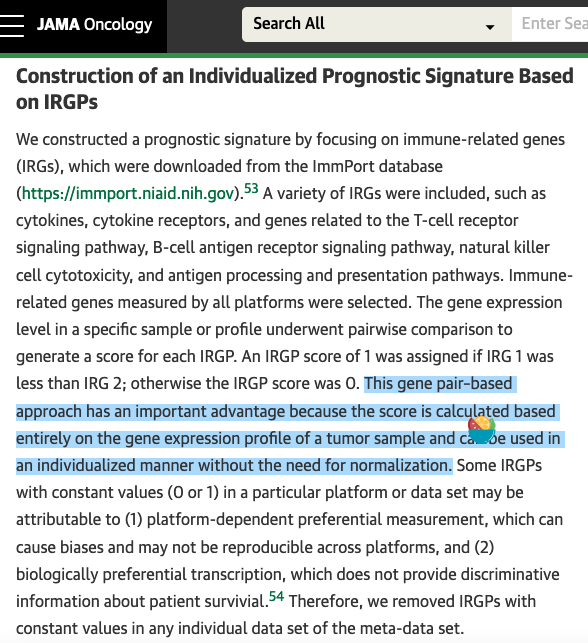

IRGP（免疫相关基因对）技巧：对每对免疫基因，给每个患者打分 **基因 1 < 基因 2 记 1、否则记 0**——基于秩次、免归一化的二值特征——然后逐对与生存做 log-rank、对整个检验家族做 Bonferroni 校正 \[1\]。参考从 100 个 IRIS 免疫基因在 TCGA 上构建 4950 对；本教程在 70 个基因上原样运行同一条管线（`IRGP.generator` 逻辑、常量对过滤、`survdiff` 循环）并植入预后排序，每一步真实可复现：

## Example

{fig-alt="免疫基因对生存筛查 DEMO" fig-align="center" width="60%"}

## Setup

-   系统要求：跨平台（Linux/MacOS/Windows）

-   编程语言：R

-   依赖包：`survival`; `ggplot2`

```{r packages setup, message=FALSE, warning=FALSE, output=FALSE}
suppressPackageStartupMessages({
  library(survival); library(ggplot2)
})
```

```{r}
sessioninfo::session_info("attached")
```

## 数据准备

240 患者、70 个免疫基因（IRIS 先天免疫清单子集）、2485 对（`71*70/2`）。植入生物学：三个免疫基因构成预后排序——`IL7R < GZMB`（细胞毒性主导）的患者预后更差；其余对为噪声。生成器的常量对过滤（丢弃全 0 或全 1 的对）剔除约 21% 的家族，与参考报告一致：

```{r load data}
suppressPackageStartupMessages({library(survival); library(ggplot2)})
set.seed(42250)
n_pat <- 240
immuneGene <- sprintf("IRG%02d", 1:68)
immuneGene <- c("IL7R", "GZMB", "CCR7", immuneGene)  # planted trio among IRIS-style names
expr <- matrix(rnorm(length(immuneGene) * n_pat, 6, 1),
               length(immuneGene), n_pat,
               dimnames = list(immuneGene, sprintf("P%03d", 1:n_pat)))
## planted prognostic ordering: IL7R < GZMB tracks a high-risk axis
risk <- rnorm(n_pat)
expr["GZMB", ] <- expr["GZMB", ] + 0.8 * scale(risk)[, 1]
expr["IL7R", ] <- expr["IL7R", ] - 0.8 * scale(risk)[, 1]

surv <- data.frame(OS.time = rexp(n_pat, 0.008), OS = rbinom(n_pat, 1, 0.7))
## the planted pair shifts survival: GZMB >= IL7R (score 0) = worse
score01 <- as.numeric(expr["IL7R", ] < expr["GZMB", ])
surv$OS.time[score01 == 1] <- surv$OS.time[score01 == 1] * 1.9

IRGP.generator <- function(expr, immuneGene) {
  imm_mat <- as.data.frame(t(combn(immuneGene, 2)))
  colnames(imm_mat) <- c("IRGP1", "IRGP2")
  rownames(imm_mat) <- paste0("P", seq_len(nrow(imm_mat)))
  IRGP_matrix <- expr[as.character(imm_mat$IRGP1), ] - expr[as.character(imm_mat$IRGP2), ]
  IRGP_matrix <- ifelse(IRGP_matrix < 0, 1, 0)
  rownames(IRGP_matrix) <- rownames(imm_mat)
  IRGP_matrix <- IRGP_matrix[rowSums(IRGP_matrix) > 0, ]
  IRGP_matrix <- IRGP_matrix[rowSums(IRGP_matrix) < ncol(IRGP_matrix), ]
  list(IRGP_matrix = IRGP_matrix, IRGP_info = imm_mat)
}
TCGA.IRPG <- IRGP.generator(expr = expr, immuneGene = immuneGene)
dim(TCGA.IRPG$IRGP_matrix)
```

## Visualization

### 筛查：2000+ 逐对 log-rank

参考对所有对的循环、每对 `survdiff`、p 值 Bonferroni 校正（论文点名的 FWER 控制）。汇总图显示植入对沉底、零假设家族在上方平坦展开：

```{r}
#| label: fig-1.1ImmGenePairScreen
#| fig-cap: "所有存活基因对的 Bonferroni 校正 log-rank p（log10、封顶）：植入的 IL7R-vs-GZMB 排序是唯一全家族显著的基因对；零假设族在校正 p 的 3-6 个数量级上铺开。"
#| out.width: "85%"
#| fig-width: 8
#| fig-height: 6

futime <- surv$OS.time; fustat <- surv$OS
outTab <- do.call(rbind, lapply(rownames(TCGA.IRPG$IRGP_matrix), function(IRGP) {
  fitd <- survdiff(Surv(futime, fustat) ~ TCGA.IRPG$IRGP_matrix[IRGP, ])
  data.frame(IRGP = IRGP,
             IRGP1 = TCGA.IRPG$IRGP_info[IRGP, "IRGP1"],
             IRGP2 = TCGA.IRPG$IRGP_info[IRGP, "IRGP2"],
             logrank.p = 1 - pchisq(fitd$chisq, length(fitd$n) - 1))
}))
outTab$fwer <- p.adjust(outTab$logrank.p, method = "bonferroni")
outTab <- outTab[order(outTab$fwer), ]
head(outTab, 3)

ggplot(outTab, aes(seq_along(fwer), pmax(-log10(fwer), 0))) +
  geom_point(colour = "grey58", size = 1) +
  geom_point(data = subset(outTab, IRGP1 == "IL7R" & IRGP2 == "GZMB"),
             colour = "#B2182B", size = 3) +
  geom_hline(yintercept = -log10(0.05), linetype = 2, colour = "grey40") +
  annotate("text", x = 200, y = -log10(0.05) + 0.4,
           label = "FWER = 0.05", size = 3.2, colour = "grey30") +
  annotate("text", x = 700, y = 2.4,
           label = "IL7R vs GZMB", size = 3.4, colour = "#B2182B", hjust = 0) +
  labs(x = "gene pairs (ranked by adjusted p)",
       y = "-log10 Bonferroni-adjusted p") +
  theme_bw(base_size = 11) +
  theme(panel.grid = element_blank())
```

### 获胜对的 Kaplan–Meier

顶对分层：`IL7R < GZMB`（得分 1，淋巴细胞受抑 vs 细胞毒性主导）呈现植入的生存优势——整个方法存在的理由就是这种个体化、免归一化的读数：

```{r}
#| label: fig-2.1ImmGenePairKM
#| fig-cap: "最高排序基因对（IL7R vs GZMB，Bonferroni p < 0.05）的 Kaplan-Meier：得分 1（IL7R < GZMB，细胞毒性主导）携带生存优势；参考的 IRGPI 指数通过同样的 log-rank + lasso 步骤扩展多对构建。"
#| out.width: "80%"
#| fig-width: 6.5
#| fig-height: 6

top <- outTab$IRGP[1]
fit <- survfit(Surv(futime, fustat) ~ TCGA.IRPG$IRGP_matrix[top, ])
plot(fit, col = c("#B2182B", "#1F78B4"), lwd = 2, las = 1,
     xlab = "time (days)", ylab = "overall survival",
     main = paste0("IRGP: ", outTab$IRGP1[1], " < ", outTab$IRGP2[1],
                   "\nFWER = ", format.pval(outTab$fwer[1], digits = 2)))
legend("topright", c("score 1 (IL7R < GZMB)", "score 0"),
       col = c("#B2182B", "#1F78B4"), lwd = 2, bty = "n", cex = 0.85)
```


## 应用场景

::: {{#fig-ImmGenePairApplications1}}
{fig-alt="免疫基因对生存筛查" fig-align="center" width="60%"}

免疫基因对生存筛查
:::

任何基因集的样本内二值编码都可扩展：通路成员对 vs 进展、miRNA-mRNA 排序 vs 应答、或突变顺序特征 vs 治疗结局——凡单样本、跨平台稳定的特征胜过建模评分处。

## 参考文献

\[1\] Xiaofan Lu, et al. FigureYa: A Standardized Visualization Framework for Enhancing Biomedical Data Interpretation and Research Efficiency. iMetaMed. 2025. doi:10.1002/imm3.70005
