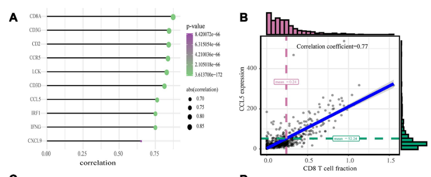

The reference screens candidate genes against an immune-infiltration matrix: for each gene, Spearman correlation with **every immune cell type** across the cohort, drawn as a bubble grid where colour is the correlation coefficient and size the significance — a one-glance map of which genes track with (or against) which populations \[1\]. The immune matrix comes from ssGSEA-style scoring (FigureYa71ssGSEA in the reference); here the ssGSEA scores and gene expression are simulated with planted biology, and the per-gene × per-cell-type Spearman loop with the bubble grid runs in-page:

## Example

{fig-alt="Gene × Immune-Cell Correlation Grid DEMO" fig-align="center" width="70%"}

## Setup

-   System Requirements: Cross-platform (Linux/MacOS/Windows)

-   Programming language: R

-   Dependent packages: `ggplot2`

```{r packages setup, message=FALSE, warning=FALSE, output=FALSE}
suppressPackageStartupMessages({
  library(ggplot2)
})
```

```{r}
sessioninfo::session_info("attached")
```

## Data Preparation

120 samples × 8 immune-cell ssGSEA-style scores, plus 6 candidate genes whose expression is coupled to specific populations — CD274 tracks CD8 T cells and macrophages (adaptive resistance), SIGLEC15 tracks macrophages, LAG3 tracks CD8 T cells, VEGFA tracks endothelial cells, and two genes are immune-independent:

```{r load data}
suppressPackageStartupMessages({library(ggplot2)})
set.seed(52341)
n_sam <- 120
samples <- sprintf("TCGA-%03d", seq_len(n_sam))
cells <- c("CD8 T cells", "CD4 T cells", "B cells", "NK cells",
           "Macrophages", "Monocytes", "Dendritic cells", "Endothelial")

## latent immune programs
act <- matrix(rnorm(n_sam * 8), n_sam, 8, dimnames = list(samples, cells))
act <- scale(act)

## ssGSEA-style scores (small positive offsets so scores look like enrichments)
immune <- act + matrix(rnorm(n_sam * 8, 1.2, 0.3), n_sam, 8,
                       dimnames = list(samples, cells))

## candidate genes coupled to specific populations
gene_def <- list(
  CD274 = c("CD8 T cells" = 0.75, "Macrophages" = 0.5),
  SIGLEC15 = c("Macrophages" = 0.8),
  LAG3 = c("CD8 T cells" = 0.7),
  VEGFA = c("Endothelial" = 0.85),
  TP53 = NULL,   # immune-independent
  KRAS = NULL)
gene_expr <- sapply(names(gene_def), function(g) {
  base <- rnorm(n_sam, 5, 0.8)
  if (is.null(gene_def[[g]])) return(base)
  comp <- gene_def[[g]]
  ## project the sample's immune programs onto the gene's coupling weights
  ## (element-wise comp * matrix would recycle column-major and scramble
  ## the planted signal)
  reduce <- as.numeric(act[, names(comp), drop = FALSE] %*% comp) / sum(comp^2)
  base + reduce + rnorm(n_sam, 0, 0.5)
})
rownames(gene_expr) <- samples
```

## Visualization

### 1. Spearman Correlation Bubble Grid

The reference's per-gene × per-cell-type screen: colour = Spearman ρ, size = −log10(p), stars mark BH-significant cells — CD274/SIGLEC15/LAG3 light up exactly on their planted populations:

```{r}
#| label: fig-1.1ImmuneGeneGrid
#| fig-cap: "Spearman correlation of each candidate gene with each immune-cell ssGSEA score (colour = rho, size = -log10 p, stars = BH-significant): CD274 tracks CD8 T cells and macrophages (adaptive immune resistance), SIGLEC15 is macrophage-restricted, LAG3 is CD8-restricted and VEGFA tracks endothelial cells; TP53 shows a weak NK association and KRAS stays flat — the planted biology."
#| out.width: "100%"
#| fig-width: 9
#| fig-height: 4.8

res <- do.call(rbind, lapply(colnames(gene_expr), function(g) {
  do.call(rbind, lapply(cells, function(c) {
    ct <- suppressWarnings(cor.test(gene_expr[, g], immune[, c], method = "spearman"))
    data.frame(gene = g, cell = c, rho = as.numeric(ct$estimate), p = ct$p.value)
  }))
}))
res$padj <- p.adjust(res$p, method = "BH")
res$star <- ifelse(res$padj < 0.001, "***",
                   ifelse(res$padj < 0.01, "**", ifelse(res$padj < 0.05, "*", "")))
res$size <- pmax(-log10(pmax(res$p, 1e-12)), 0.4)
res$gene <- factor(res$gene, levels = colnames(gene_expr))
res$cell <- factor(res$cell, levels = cells)

ggplot(res, aes(gene, cell, colour = rho, size = size)) +
  geom_point() +
  geom_text(aes(label = star), colour = "grey15", size = 3, vjust = -1.15) +
  scale_colour_gradient2(low = "#2166AC", mid = "white", high = "#B2182B",
                         midpoint = 0, limits = c(-1, 1), name = "Spearman rho") +
  scale_size_continuous(range = c(1.5, 7.5), guide = "none") +
  labs(x = NULL, y = NULL, size = "-log10(p)") +
  theme_bw(base_size = 11) +
  theme(axis.text.x = element_text(angle = 30, hjust = 1),
        panel.grid.minor = element_blank(),
        legend.position = "right")
```

### 2. CD274 Against Its Strongest Population

The reference's follow-up scatter: the top gene-population pair as a scatter with the Spearman ρ annotated — the concrete evidence behind one grid cell:

```{r}
#| label: fig-2.1ImmuneGeneScatter
#| fig-cap: "CD274 expression vs CD8 T-cell ssGSEA score (Spearman rho annotated in-panel): the adaptive-immune-resistance relationship behind the grid's strongest cell — the reference's per-pair follow-up scatter."
#| out.width: "75%"
#| fig-width: 6.2
#| fig-height: 4.8

best <- res[res$gene == "CD274" & res$cell == "CD8 T cells", ]
sc <- data.frame(g = gene_expr[, as.character(best$gene)],
                 cell = immune[, as.character(best$cell)])
ct <- suppressWarnings(cor.test(sc$g, sc$cell, method = "spearman"))
ggplot(sc, aes(cell, g)) +
  geom_point(size = 1.4, alpha = 0.5, colour = "#2166AC") +
  geom_smooth(method = "lm", se = TRUE, colour = "#B2182B", linewidth = 0.8) +
  annotate("text", x = min(sc$cell) + 0.2, y = max(sc$g) - 0.1,
           label = sprintf("%s vs %s\n%s",
                           best$gene, best$cell,
                           if (ct$p.value < 0.001) sprintf("rho = %.2f, p < 0.001", as.numeric(ct$estimate)) else sprintf("rho = %.2f, p = %.3f", as.numeric(ct$estimate), ct$p.value)),
           size = 3.2, colour = "grey15", hjust = 0) +
  labs(x = "Immune-cell ssGSEA score", y = "Gene expression (log2)") +
  theme_bw(base_size = 11) +
  theme(panel.grid.minor = element_blank())
```

::: callout-tip
**Practice tips**
-   Use **Spearman** for the screen — ssGSEA scores are rank-based and monotone-but-not-linear gene/cell relationships are the norm.
-   Correct the whole gene × cell grid with **BH** (not per-cell) — a 6 × 8 grid is 48 tests and uncorrected stars exaggerate.
-   Colour and size carry different dimensions (direction vs strength): fix the rho limits to [-1, 1] so grids are comparable across genes.
-   Immune scores and expression must share the **same sample IDs** — TCGA barcodes turn `-` into `.` silently unless `check.names = FALSE`.
-   A significant grid cell is a hypothesis: follow it with the per-pair scatter (and, ideally, a spatial or protein-level validation) before claiming biology.
:::

## Application

::: {#fig-ImmuneGeneApplications1}
{fig-alt="Gene × Immune-Cell Correlation Grid" fig-align="center" width="70%"}

Gene × immune-cell correlation grid
:::

Gene-vs-immune correlation grids apply to any cohort with an immune matrix: checkpoint-cohort biomarker screens, immune-gene candidate ranking, or transcript-isoform vs microenvironment comparisons.

## Reference

\[1\] Xiaofan Lu, et al. FigureYa: A Standardized Visualization Framework for Enhancing Biomedical Data Interpretation and Research Efficiency. iMetaMed. 2025. doi:10.1002/imm3.70005
