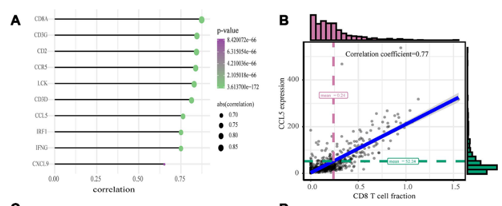

参考流程把候选基因对免疫浸润矩阵筛查：每个基因与**每一种免疫细胞**在队列中做 Spearman 相关，画成气泡网格——颜色是相关系数、大小是显著性——一张图看尽哪些基因与哪些群体共变 \[1\]。免疫矩阵来自 ssGSEA 式打分（参考中为 FigureYa71ssGSEA）；这里 ssGSEA 分数与基因表达均为模拟（植入生物学），逐基因 × 逐细胞类型的 Spearman 循环与气泡网格在页内运行：

## Example

{fig-alt="基因 × 免疫细胞相关网格 DEMO" fig-align="center" width="70%"}

## Setup

-   系统要求：跨平台（Linux/MacOS/Windows）

-   编程语言：R

-   依赖包：`ggplot2`

```{r packages setup, message=FALSE, warning=FALSE, output=FALSE}
suppressPackageStartupMessages({
  library(ggplot2)
})
```

```{r}
sessioninfo::session_info("attached")
```

## 数据准备

120 样本 × 8 种免疫细胞的 ssGSEA 式分数，加 6 个与特定群体耦合的候选基因——CD274 追踪 CD8 T 细胞与巨噬细胞（适应性抵抗）、SIGLEC15 追踪巨噬细胞、LAG3 追踪 CD8 T 细胞、VEGFA 追踪内皮细胞，另两个基因与免疫无关：

```{r load data}
suppressPackageStartupMessages({library(ggplot2)})
set.seed(52341)
n_sam <- 120
samples <- sprintf("TCGA-%03d", seq_len(n_sam))
cells <- c("CD8 T cells", "CD4 T cells", "B cells", "NK cells",
           "Macrophages", "Monocytes", "Dendritic cells", "Endothelial")

## latent immune programs
act <- matrix(rnorm(n_sam * 8), n_sam, 8, dimnames = list(samples, cells))
act <- scale(act)

## ssGSEA-style scores (small positive offsets so scores look like enrichments)
immune <- act + matrix(rnorm(n_sam * 8, 1.2, 0.3), n_sam, 8,
                       dimnames = list(samples, cells))

## candidate genes coupled to specific populations
gene_def <- list(
  CD274 = c("CD8 T cells" = 0.75, "Macrophages" = 0.5),
  SIGLEC15 = c("Macrophages" = 0.8),
  LAG3 = c("CD8 T cells" = 0.7),
  VEGFA = c("Endothelial" = 0.85),
  TP53 = NULL,   # immune-independent
  KRAS = NULL)
gene_expr <- sapply(names(gene_def), function(g) {
  base <- rnorm(n_sam, 5, 0.8)
  if (is.null(gene_def[[g]])) return(base)
  comp <- gene_def[[g]]
  ## project the sample's immune programs onto the gene's coupling weights
  ## (element-wise comp * matrix would recycle column-major and scramble
  ## the planted signal)
  reduce <- as.numeric(act[, names(comp), drop = FALSE] %*% comp) / sum(comp^2)
  base + reduce + rnorm(n_sam, 0, 0.5)
})
rownames(gene_expr) <- samples
```

## Visualization

### 1. Spearman 相关气泡网格

参考的逐基因 × 逐细胞类型筛查：颜色 = Spearman ρ、大小 = −log10(p)、星号标记 BH 显著细胞——CD274/SIGLEC15/LAG3 恰好在其植入的群体上亮起：

```{r}
#| label: fig-1.1ImmuneGeneGrid
#| fig-cap: "每个候选基因与各免疫细胞 ssGSEA 分数的 Spearman 相关（颜色 = rho、大小 = -log10 p、星号 = BH 显著）：CD274 追踪 CD8 T 细胞与巨噬细胞（适应性免疫抵抗）、SIGLEC15 限于巨噬细胞、LAG3 限于 CD8、VEGFA 追踪内皮细胞；TP53 与 KRAS 持平——即植入的生物学。"
#| out.width: "100%"
#| fig-width: 9
#| fig-height: 4.8

res <- do.call(rbind, lapply(colnames(gene_expr), function(g) {
  do.call(rbind, lapply(cells, function(c) {
    ct <- suppressWarnings(cor.test(gene_expr[, g], immune[, c], method = "spearman"))
    data.frame(gene = g, cell = c, rho = as.numeric(ct$estimate), p = ct$p.value)
  }))
}))
res$padj <- p.adjust(res$p, method = "BH")
res$star <- ifelse(res$padj < 0.001, "***",
                   ifelse(res$padj < 0.01, "**", ifelse(res$padj < 0.05, "*", "")))
res$size <- pmax(-log10(pmax(res$p, 1e-12)), 0.4)
res$gene <- factor(res$gene, levels = colnames(gene_expr))
res$cell <- factor(res$cell, levels = cells)

ggplot(res, aes(gene, cell, colour = rho, size = size)) +
  geom_point() +
  geom_text(aes(label = star), colour = "grey15", size = 3, vjust = -1.15) +
  scale_colour_gradient2(low = "#2166AC", mid = "white", high = "#B2182B",
                         midpoint = 0, limits = c(-1, 1), name = "Spearman rho") +
  scale_size_continuous(range = c(1.5, 7.5), guide = "none") +
  labs(x = NULL, y = NULL, size = "-log10(p)") +
  theme_bw(base_size = 11) +
  theme(axis.text.x = element_text(angle = 30, hjust = 1),
        panel.grid.minor = element_blank(),
        legend.position = "right")
```

### 2. CD274 对其最强群体

参考的后续散点：最强的基因-群体对画成散点并标注 Spearman ρ——网格中那一格的具体证据：

```{r}
#| label: fig-2.1ImmuneGeneScatter
#| fig-cap: "CD274 表达 vs CD8 T 细胞 ssGSEA 分数（面板内标注 Spearman rho）：网格最强格背后的适应性免疫抵抗关系——参考的逐对后续散点。"
#| out.width: "75%"
#| fig-width: 6.2
#| fig-height: 4.8

best <- res[res$gene == "CD274" & res$cell == "CD8 T cells", ]
sc <- data.frame(g = gene_expr[, as.character(best$gene)],
                 cell = immune[, as.character(best$cell)])
ct <- suppressWarnings(cor.test(sc$g, sc$cell, method = "spearman"))
ggplot(sc, aes(cell, g)) +
  geom_point(size = 1.4, alpha = 0.5, colour = "#2166AC") +
  geom_smooth(method = "lm", se = TRUE, colour = "#B2182B", linewidth = 0.8) +
  annotate("text", x = min(sc$cell) + 0.2, y = max(sc$g) - 0.1,
           label = sprintf("%s vs %s\n%s",
                           best$gene, best$cell,
                           if (ct$p.value < 0.001) sprintf("rho = %.2f, p < 0.001", as.numeric(ct$estimate)) else sprintf("rho = %.2f, p = %.3f", as.numeric(ct$estimate), ct$p.value)),
           size = 3.2, colour = "grey15", hjust = 0) +
  labs(x = "Immune-cell ssGSEA score", y = "Gene expression (log2)") +
  theme_bw(base_size = 11) +
  theme(panel.grid.minor = element_blank())
```

::: callout-tip
**实践要点**
-   筛查用 **Spearman**——ssGSEA 分数基于秩，基因/细胞的关系多为单调非线性。
-   整个基因 × 细胞网格统一做 **BH** 校正（而非逐细胞）——6 × 8 网格是 48 次检验，未校正的星号会夸大。
-   颜色与大小承载不同维度（方向 vs 强度）：把 rho 上下限固定为 [-1, 1]，网格间才可比。
-   免疫分数与表达必须共享**同样的样本 ID**——TCGA 条形码的 `-` 会被静默变成 `.`，除非 `check.names = FALSE`。
-   显著格只是假设：用逐对散点（最好再加上空间或蛋白层面验证）跟进后再谈生物学。
:::

## 应用场景

::: {#fig-ImmuneGeneApplications1}
{fig-alt="基因 × 免疫细胞相关网格" fig-align="center" width="70%"}

基因 × 免疫细胞相关网格
:::

基因-免疫相关网格适用于任何有免疫矩阵的队列：检查点队列的标志物筛查、免疫基因候选排序、或转录本异构体 vs 微环境比较。

## 参考文献

\[1\] Xiaofan Lu, et al. FigureYa: A Standardized Visualization Framework for Enhancing Biomedical Data Interpretation and Research Efficiency. iMetaMed. 2025. doi:10.1002/imm3.70005
