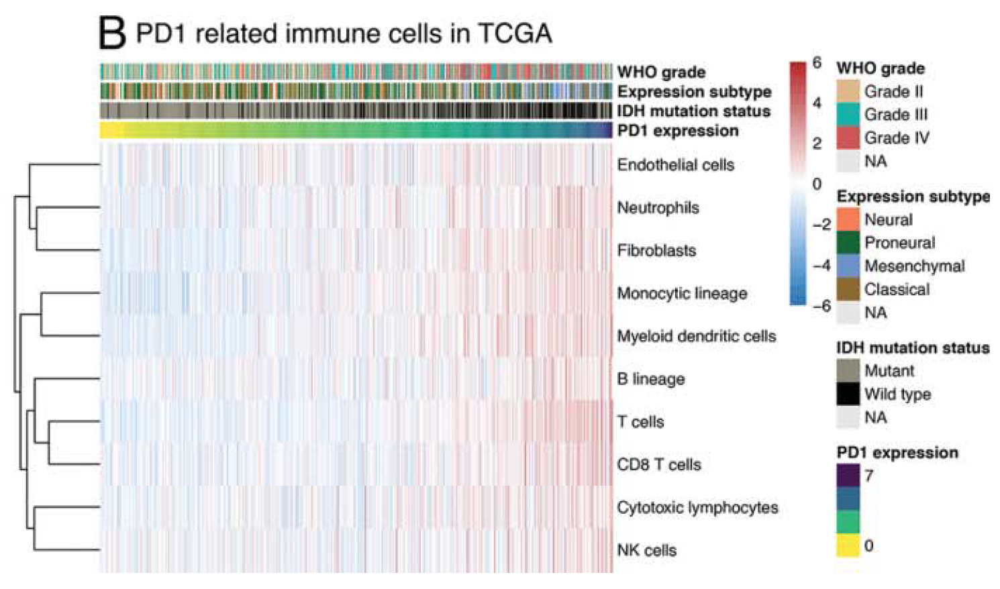

MCP-counter estimates the **absolute abundance of ten immune and stromal populations** from bulk transcriptomes: each population has a curated signature of transcribed marker genes, and the estimate is the mean (standardised) expression of that signature in a sample \[1\]. Samples are then displayed as a heatmap, ordered by the expression of a target gene (here CD274/PD-L1) with clinical and mutation annotations, to read population composition along the target-gene gradient \[1\]. MCP-counter is not in this repository's lockfile; its mean-signature estimator is re-implemented in-page on a compact embedded signature table, and the heatmap runs on pheatmap:

## Example

{fig-alt="Immune Cell Infiltration Heatmap DEMO" fig-align="center" width="70%"}

## Setup

-   System Requirements: Cross-platform (Linux/MacOS/Windows)

-   Programming language: R

-   Dependent packages: `pheatmap`; `ggplot2`

```{r packages setup, message=FALSE, warning=FALSE, output=FALSE}
suppressPackageStartupMessages({
  library(pheatmap); library(ggplot2)
})
```

```{r}
sessioninfo::session_info("attached")
```

## Data Preparation

120 simulated low-grade glioma (LGG) samples: log2-TPM expression for the genes of ten MCP-counter populations plus CD274. Planted biology — CD274 (PD-L1) co-varies with CD8 T-cell and cytotoxic signatures (adaptive immune resistance); IDH-wildtype samples carry higher monocyte/macrophage infiltration; the remaining genes are housekeeping-like:

```{r load data}
suppressPackageStartupMessages({library(pheatmap); library(ggplot2)})
set.seed(52326)
n_sam <- 120
samples <- sprintf("LGG_%03d", seq_len(n_sam))

## compact MCP-counter style populations (abbreviated transcribed signatures)
pops <- c("B cells", "CD8 T cells", "Cytotoxic lymphocytes", "Dendritic cells",
          "NK cells", "Monocytes", "Macrophages", "Neutrophils",
          "CD4 T cells", "Endothelial cells")
sig <- list(
  `B cells` = sprintf("MS4A1,CD79A,CD79B,HLA-DRA,TCL1A,BANK1,BLK,CD19,CR2,FCRL2"),
  `CD8 T cells` = sprintf("CD8A,CD8B,LEF1,TCF7,CXCR6,GZMK,CCL5,CD3D,CD3E,ITGAE"),
  `Cytotoxic lymphocytes` = sprintf("GZMA,GZMB,GZMH,GNLY,PRF1,NKG7,KLRD1,FGFBP2,KLRB1,KLRC1"),
  `Dendritic cells` = sprintf("FCER1A,CLEC10A,CD1C,HLA-DQA1,HLA-DPB1,CD1E,FCRLA,CST3,CLEC4C,IRF8"),
  `NK cells` = sprintf("NCAM1,KIR2DL4,KIR3DL1,SH2D1B,CD7,XCL1,XCL2,IL2RB,NCR1,KLRC2"),
  Monocytes = sprintf("CD14,S100A8,S100A9,LYZ,VCAN,FCN1,FCGR3A,MS4A7,CST3,S100A12"),
  Macrophages = sprintf("CD163,MRC1,MSR1,CD68,APOE,APOC1,FOLR2,MERTK,TREM2,C1QA"),
  Neutrophils = sprintf("CSF3R,FUT4,CEACAM8,CSTA,CAMP,LTF,MMP9,DEFA4,ELANE,ARG1"),
  `CD4 T cells` = sprintf("CD4,IL7R,CCR7,SELL,LTB,CD27,CD28,ICOS,FOXP3,IL2RA"),
  `Endothelial cells` = sprintf("PECAM1,VWF,CLDN5,CDH5,EGFL7,RAMP3,KDR,TEK,SELE,ROBO4")
)
sig <- lapply(sig, function(s) unlist(strsplit(s, ",")))
all_genes <- unique(c(unlist(sig), "CD274"))

## per-population baseline activity per sample
act <- sapply(pops, function(p) rnorm(n_sam, 0, 1))
## CD274 co-varies with cytotoxic + CD8 (adaptive immune resistance)
cyt_axis <- 0.6 * act[, "Cytotoxic lymphocytes"] + 0.6 * act[, "CD8 T cells"] + rnorm(n_sam, 0, 0.4)
cd274 <- 0.55 * cyt_axis + rnorm(n_sam, 0, 0.5)

## IDH status: wildtype carries higher monocyte/macrophage infiltration
idh <- sample(c("IDH mutant", "IDH wildtype"), n_sam, TRUE, prob = c(0.72, 0.28))
act[idh == "IDH wildtype", c("Monocytes", "Macrophages")] <-
  act[idh == "IDH wildtype", c("Monocytes", "Macrophages")] + 1.1

## build log2-TPM-like expression matrix: signature genes follow their population
expr <- matrix(NA, length(all_genes), n_sam,
               dimnames = list(all_genes, samples))
base <- setNames(rnorm(length(all_genes), 4.5, 1.4), all_genes)
for (p in pops) {
  for (g in sig[[p]]) {
    expr[g, ] <- base[[g]] + act[, p] + rnorm(n_sam, 0, 0.55)
  }
}
expr["CD274", ] <- base[["CD274"]] + cd274 + rnorm(n_sam, 0, 0.35)

## MCP-counter estimator: mean z-scored signature expression per population
zexpr <- t(scale(t(expr)))
mcp <- sapply(pops, function(p) colMeans(zexpr[sig[[p]], , drop = FALSE]))
mcp <- t(mcp)                                   # populations x samples
```

## Visualization

### 1. Infiltration Heatmap Ordered by CD274 Expression

The reference's figure: rows = populations (spearman-clustered), columns = samples ordered by ascending CD274 expression, with IDH-status annotation — the CD8/cytotoxic block rises along the PD-L1 axis and IDH-wildtype samples cluster at macrophage/monocyte-high:

```{r}
#| label: fig-1.1ImmuneHm
#| fig-cap: "MCP-counter style infiltration heatmap for 120 LGG samples (rows z-scored, spearman clustering): columns ordered by ascending CD274 (PD-L1) expression; the CD8 T-cell/cytotoxic block increases along the PD-L1 axis (adaptive immune resistance) and IDH-wildtype samples carry higher monocyte/macrophage scores."
#| out.width: "100%"
#| fig-width: 10
#| fig-height: 4.2

ord <- order(cd274, decreasing = FALSE)
anno_col <- data.frame(IDH_status = idh, row.names = samples)
anno_col <- anno_col[ord, , drop = FALSE]
anno_colors <- list(IDH_status = c(`IDH mutant` = "#8EA325", `IDH wildtype` = "#BD6263"))

## pheatmap has no `method` argument; the reference's spearman clustering is
## reproduced by precomputing a spearman-correlation distance for the rows
pheatmap(mcp[, ord],
         clustering_distance_rows = as.dist(1 - cor(t(mcp), method = "spearman")),
         clustering_method = "complete",
         cluster_rows = TRUE, cluster_cols = FALSE,
         scale = "row",
         cellwidth = 2.6, cellheight = 19,
         fontsize = 9,
         color = colorRampPalette(c("navy", "white", "red"))(100),
         show_colnames = FALSE,
         border_color = NA,
         annotation_col = anno_col,
         annotation_colors = anno_colors,
         legend = TRUE)
```

### 2. Population Scores Against the PD-L1 Axis

The heatmap pattern quantified: per-population infiltration score binned by CD274 expression quartile — CD8 and cytotoxic scores climb monotonically while B cells stay flat:

```{r}
#| label: fig-2.1ImmuneTrend
#| fig-cap: "Mean infiltration score per population across CD274-expression quartiles: CD8 T cells and cytotoxic lymphocytes rise monotonically with PD-L1 (immune-resistance axis), monocytes/macrophages stay IDH-driven, and B cells show no trend."
#| out.width: "85%"
#| fig-width: 7.5
#| fig-height: 5

q4 <- cut(cd274, breaks = quantile(cd274, probs = 0:4 / 4), include.lowest = TRUE,
          labels = c("Q1", "Q2", "Q3", "Q4"))
trend <- do.call(rbind, lapply(pops, function(p) {
  data.frame(population = p,
             quartile = factor(levels(q4), levels = levels(q4)),
             score = as.numeric(tapply(mcp[p, ], q4, mean)))
}))
show_pops <- c("CD8 T cells", "Cytotoxic lymphocytes", "Macrophages",
               "Monocytes", "B cells", "CD4 T cells")
ggplot(subset(trend, population %in% show_pops),
       aes(quartile, score, colour = population, group = population)) +
  geom_hline(yintercept = 0, linetype = "dotted", colour = "grey60") +
  geom_line(linewidth = 0.9) +
  geom_point(size = 2.4) +
  scale_colour_manual(values = c(`CD8 T cells` = "#B2182B",
                                 `Cytotoxic lymphocytes` = "#E08214",
                                 Macrophages = "#2166AC",
                                 Monocytes = "#4393C3",
                                 `B cells` = "grey55",
                                 `CD4 T cells` = "#8EA325"),
                      name = NULL) +
  labs(x = "CD274 (PD-L1) expression quartile",
       y = "Mean infiltration score (z)") +
  theme_bw(base_size = 11) +
  theme(panel.grid.minor = element_blank(),
        legend.position = "top")
```

::: callout-tip
**Practice tips**
-   MCP-counter expects **log2-transformed** expression (TPM, FPKM or normalised counts all work) — untransformed counts break the mean-signature estimator.
-   Collapse duplicated gene symbols (median across ENSEMBL IDs) before scoring; duplicated rows silently overweight their population.
-   The estimates are **relative to the cohort** after z-scoring: compare populations within one heatmap, not absolute values across studies.
-   Order columns by a biologically meaningful axis (target-gene expression, treatment arm) — alphabetical or random column order hides the gradient the figure exists to show.
-   Pair the heatmap with a mutation/clinical annotation row (here IDH status) — immune differences between genotypes are the readout most papers need.
:::

## Application

::: {#fig-ImmuneInfiltrationApplications1}
{fig-alt="Immune Cell Infiltration Heatmap" fig-align="center" width="70%"}

Immune cell infiltration heatmap (MCP-Counter style)
:::

Infiltration heatmaps apply to any bulk cohort: checkpoint-immunotherapy biopsies, TCGA pan-cancer immune landscapes, or autoantibody-defined autoimmune tissue transcriptomes.

## Reference

\[1\] Xiaofan Lu, et al. FigureYa: A Standardized Visualization Framework for Enhancing Biomedical Data Interpretation and Research Efficiency. iMetaMed. 2025. doi:10.1002/imm3.70005

\[2\] Becht E, et al. Estimating the population abundance of tissue-infiltrating immune and stromal cell populations using gene expression. Genome Biol. 2016;17:218.
