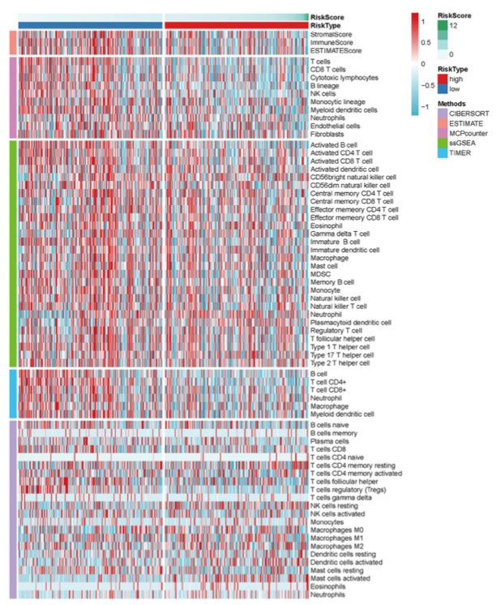

A tumour-immune "landscape" is one heatmap of infiltration scores computed by **several algorithms** (TIMER, CIBERSORT, QUANTISEQ, MCPCOUNTER, XCELL, EPIC...), with samples sorted by risk score so the high/low-immune split is visible across every method \[1\]. The reference renders it twice — a single `pheatmap` with a Methods row-annotation strip and gap lines between algorithms, and a `ComplexHeatmap` version that stacks one sub-heatmap per algorithm, each with its own colour ramp \[1\]. Both renderings work out of the box here (pheatmap, ComplexHeatmap, circlize and viridis are all in the lockfile); the gplots/oompaBase palette helpers are replaced with `colorRampPalette()`:

## Example

{fig-alt="Multi-Algorithm Immune Landscape Heatmap DEMO" fig-align="center" width="70%"}

## Setup

-   System Requirements: Cross-platform (Linux/MacOS/Windows)

-   Programming language: R

-   Dependent packages: `pheatmap`; `ComplexHeatmap`; `viridis`; `RColorBrewer`

```{r packages setup, message=FALSE, warning=FALSE, output=FALSE}
suppressPackageStartupMessages({
  library(RColorBrewer)
})
```

```{r}
sessioninfo::session_info("attached")
```

## Data Preparation

120 samples × 30 immune cell types scored by 7 algorithms, column names carrying the algorithm suffix (`_<METHOD>`) exactly like the reference input. A risk score with planted high/low structure drives the sample order and the `gaps_col` split. Every score is z-scored per cell type and capped at ±2 before plotting:

```{r load data}
suppressPackageStartupMessages({
  library(pheatmap); library(ComplexHeatmap); library(viridis); library(RColorBrewer)
})
set.seed(39230)
methods <- c("TIMER", "CIBERSORT", "CIBERSORT-ABS", "QUANTISEQ",
             "MCPCOUNTER", "XCELL", "EPIC")
cells <- c("B cell", "T cell CD4+", "T cell CD8+", "NK cell",
           "Macrophage M1", "Macrophage M2", "Neutrophil", "DC", "Fibroblast")
n_sam <- 120
sam <- sprintf("TCGA-%02d", 1:n_sam)

## risk score: high-risk samples are cold (low immune), low-risk hot
riskScore <- rnorm(n_sam)
risk <- ifelse(riskScore > quantile(riskScore, 0.6), "high", "low")
risk_df <- data.frame(sample = sam, riskScore = riskScore, risk = risk)

imm <- NULL
for (m in methods) {
  base <- matrix(rexp(length(cells) * n_sam, 2), nrow = n_sam, ncol = length(cells))
  ## planted signal: high-risk samples get a shared immune-cold shift
  shift <- ifelse(risk == "high", -0.7, 0.4)
  base <- base + shift + rnorm(length(base), 0, 0.15)
  colnames(base) <- paste0(cells, "_", m)
  imm <- cbind(imm, base)
}
rownames(imm) <- sam
hmdat <- imm
risk_df <- risk_df[order(risk_df$riskScore), ]
samorder <- risk_df$sample
rownames(risk_df) <- risk_df$sample

immMethod <- sub(".*_", "", colnames(hmdat))
plotdata <- t(pmin(pmax(scale(hmdat), -2), 2))   # cells x samples, z per cell type, capped
plotdata <- plotdata[, colSums(plotdata) != 0, drop = FALSE]
```

## Visualization

### 1. Single pheatmap with Method Annotation and Gaps

The original rendering: one matrix, a Methods strip on the left (one colour per algorithm), a RiskScore annotation bar + RiskType strip on top, and `gaps_row`/`gaps_col` inserting white dividers between algorithm blocks and between the risk groups:

```{r}
#| label: fig-1.1ImmLandscapePheatmap
#| fig-cap: "Immune landscape as a single pheatmap: samples ordered by risk score (gaps split high/low), algorithm blocks separated by row gaps, RiskScore bar on top; z-scored, ±2 capped."
#| out.width: "95%"
#| fig-width: 9
#| fig-height: 9

annCol <- data.frame(RiskScore = scale(risk_df$riskScore),
                     RiskType = risk_df$risk,
                     row.names = samorder)
annRow <- data.frame(Methods = factor(immMethod, levels = methods),
                     row.names = rownames(plotdata))
methods.col <- setNames(brewer.pal(length(methods), "Paired"), methods)
annColors <- list(Methods = methods.col,
                  RiskScore = colorRampPalette(c("#5AAe61", "white", "#B2182B"))(64),
                  RiskType = c("high" = "red", "low" = "blue"))
pheatmap::pheatmap(mat = as.matrix(plotdata[, samorder]),
                   border_color = NA,
                   color = colorRampPalette(c("#2166AC", "white", "#B2182B"))(64),
                   cluster_rows = FALSE, cluster_cols = FALSE,
                   show_rownames = TRUE, show_colnames = FALSE,
                   annotation_col = annCol,
                   annotation_row = annRow,
                   annotation_colors = annColors,
                   gaps_col = sum(risk_df$risk == "low"),
                   gaps_row = cumsum(table(annRow$Methods)),
                   cellwidth = 0.8, cellheight = 6.5,
                   fontsize_row = 7)
```

### 2. ComplexHeatmap Stacked Version: One Ramp per Algorithm

The alternative: split the matrix by algorithm, draw seven sub-heatmaps with **different colour ramps**, and stack them with `%v%` — the ramp itself now carries the "which algorithm is this" layer, so the annotation strip becomes redundant. Legends are pushed to the bottom:

```{r}
#| label: fig-2.1ImmLandscapeStack
#| fig-cap: "ComplexHeatmap stacked rendering: one sub-heatmap per algorithm, each with its own ramp (blue-red, green-red, blue-yellow, inferno, viridis, magma), samples ordered identically by risk score."
#| out.width: "95%"
#| fig-width: 7
#| fig-height: 10.5

ht_opt(message = FALSE)
annColors2 <- list("RiskScore" = colorRampPalette(c("#5AAe61", "white", "#B2182B"))(64),
                   "RiskType" = c("high" = "red", "low" = "blue"))
ramps <- list(colorRampPalette(c("#2166AC", "white", "#B2182B"))(64), colorRampPalette(c("#276B2F", "white", "#B2182B"))(64),
              colorRampPalette(c("#2166AC", "white", "#E7B21B"))(64),
              inferno(64), viridis(64), magma(64),
              colorRampPalette(c("#440154", "white", "#FDE725"))(64))
hms <- lapply(seq_along(methods), function(i) {
  sub <- plotdata[immMethod == methods[i], samorder, drop = FALSE]
  rownames(sub) <- sub("_[^_]+$", "", rownames(sub))
  args <- list(mat = as.matrix(sub),
               border_color = NA, color = ramps[[i]],
               cluster_rows = FALSE, cluster_cols = FALSE,
               show_rownames = TRUE, show_colnames = (i == 1),
               cellwidth = 0.9, cellheight = 7.5, fontsize_row = 7,
               gaps_col = sum(risk_df$risk == "low"),
               name = methods[i])
  ## only the first sub-heatmap carries the top annotation
  if (i == 1) {
    args$annotation_col <- annCol
    args$annotation_colors <- annColors2
  }
  do.call(ComplexHeatmap::pheatmap, args)
})
draw(Reduce(`%v%`, hms),
     heatmap_legend_side = "bottom",
     annotation_legend_side = "bottom")
```

::: callout-tip
**Practice tips**

-   Sort samples by the continuous annotation (risk score) and let `gaps_col` mark the group boundary — clustering would destroy the gradient story the risk bar tells.
-   Cap z-scores at ±2: a single outlier score compresses every other tile into the white band and the landscape goes grey.
-   In the stacked version keep the *same* sample order in every sub-heatmap; the vertical alignment across algorithms is what lets a reader trace one sample's immune profile through all methods.
-   In the stacked version call `ComplexHeatmap::pheatmap` explicitly: only its wrapper returns a `Heatmap` object that `%v%` can stack — the plain pheatmap package object lost its `%v%` conversion in ComplexHeatmap 2.28 (the reference sourced a legacy translator for the same reason).
-   Standardize within a cell type across samples (columns of the samples × cells matrix), never within a sample — algorithm score scales are not comparable.
:::

## Application

::: {#fig-ImmuneLandscapeApplications1}
{fig-alt="Multi-Algorithm Immune Landscape" fig-align="center" width="70%"}

Multi-algorithm immune landscape
:::

The stacked-blocks layout is not immune-specific: any matrix whose columns come from several *sources* reads this way — multi-omics scores (mRNA/protein/methylation of one pathway), WGCNA module eigengenes across cohorts, or panel-of-normals QC metrics across batches.

## Reference

\[1\] Xiaofan Lu, et al. FigureYa: A Standardized Visualization Framework for Enhancing Biomedical Data Interpretation and Research Efficiency. iMetaMed. 2025. doi:10.1002/imm3.70005
