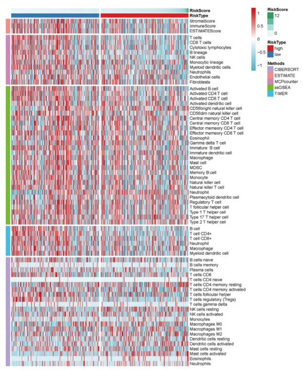

肿瘤免疫"景观"是把**多种算法**（TIMER、CIBERSORT、QUANTISEQ、MCPCOUNTER、XCELL、EPIC……）算出的浸润评分画进一张热图，样本按风险评分排序、高/低免疫的分裂在每个方法里同时可见 \[1\]。参考渲染两次——单张 `pheatmap`（Methods 行注释条 + 算法块间隙线）和 `ComplexHeatmap` 版（每个算法一张子热图、各配色带、纵向拼接）\。pheatmap、ComplexHeatmap、circlize、viridis 均已入锁；gplots/oompaBase 的调色板助手用 `colorRampPalette()` 替代：

## Example

{fig-alt="多算法免疫景观热图 DEMO" fig-align="center" width="60%"}

## Setup

-   系统要求：跨平台（Linux/MacOS/Windows）

-   编程语言：R

-   依赖包：`pheatmap`; `ComplexHeatmap`; `viridis`; `RColorBrewer`

```{r packages setup, message=FALSE, warning=FALSE, output=FALSE}
suppressPackageStartupMessages({
  library(RColorBrewer)
})
```

```{r}
sessioninfo::session_info("attached")
```

## 数据准备

120 样本 × 30 种免疫细胞、由 7 种算法打分，列名带算法后缀（`_<METHOD>`）与参考输入一致。带植入高/低结构的风险评分驱动样本排序与 `gaps_col` 分割。每个细胞类型的分数按列 z-score 化并在绘图前截断到 ±2：

```{r load data}
suppressPackageStartupMessages({
  library(pheatmap); library(ComplexHeatmap); library(viridis); library(RColorBrewer)
})
set.seed(39230)
methods <- c("TIMER", "CIBERSORT", "CIBERSORT-ABS", "QUANTISEQ",
             "MCPCOUNTER", "XCELL", "EPIC")
cells <- c("B cell", "T cell CD4+", "T cell CD8+", "NK cell",
           "Macrophage M1", "Macrophage M2", "Neutrophil", "DC", "Fibroblast")
n_sam <- 120
sam <- sprintf("TCGA-%02d", 1:n_sam)

## risk score: high-risk samples are cold (low immune), low-risk hot
riskScore <- rnorm(n_sam)
risk <- ifelse(riskScore > quantile(riskScore, 0.6), "high", "low")
risk_df <- data.frame(sample = sam, riskScore = riskScore, risk = risk)

imm <- NULL
for (m in methods) {
  base <- matrix(rexp(length(cells) * n_sam, 2), nrow = n_sam, ncol = length(cells))
  ## planted signal: high-risk samples get a shared immune-cold shift
  shift <- ifelse(risk == "high", -0.7, 0.4)
  base <- base + shift + rnorm(length(base), 0, 0.15)
  colnames(base) <- paste0(cells, "_", m)
  imm <- cbind(imm, base)
}
rownames(imm) <- sam
hmdat <- imm
risk_df <- risk_df[order(risk_df$riskScore), ]
samorder <- risk_df$sample
rownames(risk_df) <- risk_df$sample

immMethod <- sub(".*_", "", colnames(hmdat))
plotdata <- t(pmin(pmax(scale(hmdat), -2), 2))   # cells x samples, z per cell type, capped
plotdata <- plotdata[, colSums(plotdata) != 0, drop = FALSE]
```

## Visualization

### 单张 pheatmap：方法注释 + 间隙

原始渲染：一张矩阵，左侧 Methods 色条（每算法一色）、顶部 RiskScore 注释条 + RiskType 色条，`gaps_row`/`gaps_col` 在算法块之间和风险组之间插入白色分隔：

```{r}
#| label: fig-1.1ImmLandscapePheatmap
#| fig-cap: "单张 pheatmap 呈现的免疫景观：样本按风险评分排序（间隙分割高/低）、算法块按行分割、顶部 RiskScore 条；z-score 化、±2 截断。"
#| out.width: "95%"
#| fig-width: 9
#| fig-height: 9

annCol <- data.frame(RiskScore = scale(risk_df$riskScore),
                     RiskType = risk_df$risk,
                     row.names = samorder)
annRow <- data.frame(Methods = factor(immMethod, levels = methods),
                     row.names = rownames(plotdata))
methods.col <- setNames(brewer.pal(length(methods), "Paired"), methods)
annColors <- list(Methods = methods.col,
                  RiskScore = colorRampPalette(c("#5AAe61", "white", "#B2182B"))(64),
                  RiskType = c("high" = "red", "low" = "blue"))
pheatmap::pheatmap(mat = as.matrix(plotdata[, samorder]),
                   border_color = NA,
                   color = colorRampPalette(c("#2166AC", "white", "#B2182B"))(64),
                   cluster_rows = FALSE, cluster_cols = FALSE,
                   show_rownames = TRUE, show_colnames = FALSE,
                   annotation_col = annCol,
                   annotation_row = annRow,
                   annotation_colors = annColors,
                   gaps_col = sum(risk_df$risk == "low"),
                   gaps_row = cumsum(table(annRow$Methods)),
                   cellwidth = 0.8, cellheight = 6.5,
                   fontsize_row = 7)
```

### ComplexHeatmap 拼接版：每个算法一条色带

替代方案：按算法拆分矩阵、画七张**不同色带**的子热图、用 `%v%` 纵向拼接——色带本身承载"这是哪个算法"的信息层，注释条变得多余。图例推到底部：

```{r}
#| label: fig-2.1ImmLandscapeStack
#| fig-cap: "ComplexHeatmap 拼接渲染：每个算法一张子热图、各配色带（蓝红、绿红、蓝黄、inferno、viridis、magma），样本按风险评分同序排列。"
#| out.width: "95%"
#| fig-width: 7
#| fig-height: 10.5

ht_opt(message = FALSE)
annColors2 <- list("RiskScore" = colorRampPalette(c("#5AAe61", "white", "#B2182B"))(64),
                   "RiskType" = c("high" = "red", "low" = "blue"))
ramps <- list(colorRampPalette(c("#2166AC", "white", "#B2182B"))(64), colorRampPalette(c("#276B2F", "white", "#B2182B"))(64),
              colorRampPalette(c("#2166AC", "white", "#E7B21B"))(64),
              inferno(64), viridis(64), magma(64),
              colorRampPalette(c("#440154", "white", "#FDE725"))(64))
hms <- lapply(seq_along(methods), function(i) {
  sub <- plotdata[immMethod == methods[i], samorder, drop = FALSE]
  rownames(sub) <- sub("_[^_]+$", "", rownames(sub))
  args <- list(mat = as.matrix(sub),
               border_color = NA, color = ramps[[i]],
               cluster_rows = FALSE, cluster_cols = FALSE,
               show_rownames = TRUE, show_colnames = (i == 1),
               cellwidth = 0.9, cellheight = 7.5, fontsize_row = 7,
               gaps_col = sum(risk_df$risk == "low"),
               name = methods[i])
  ## only the first sub-heatmap carries the top annotation
  if (i == 1) {
    args$annotation_col <- annCol
    args$annotation_colors <- annColors2
  }
  do.call(ComplexHeatmap::pheatmap, args)
})
draw(Reduce(`%v%`, hms),
     heatmap_legend_side = "bottom",
     annotation_legend_side = "bottom")
```


## 应用场景

::: {{#fig-ImmuneLandscapeApplications1}}
{fig-alt="多算法免疫景观" fig-align="center" width="60%"}

多算法免疫景观
:::

堆叠分块版式并不限于免疫：任何"列来自多个来源"的矩阵都能这样读——同一通路的多组学分数、跨队列的 WGCNA 模块特征基因、或跨批次的 panel QC 指标。

## 参考文献

\[1\] Xiaofan Lu, et al. FigureYa: A Standardized Visualization Framework for Enhancing Biomedical Data Interpretation and Research Efficiency. iMetaMed. 2025. doi:10.1002/imm3.70005
