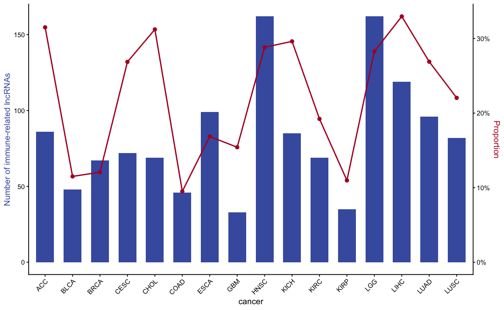

Identifying immune-related lncRNAs uses partial correlation between lncRNA expression and immune gene sets, followed by GSEA \[1\]. The canonical figure is a **dual-axis bar + line chart**: bars show the number of immune-related lncRNAs per cancer type (top y-axis) while a line shows the proportion (bottom y-axis).

## Example

{fig-alt="ImmuneLncrnaPlot DEMO" fig-align="center" width="60%"}

## Setup

-   System Requirements: Cross-platform (Linux/MacOS/Windows)

-   Programming Language: R

-   Dependent packages: `ggplot2`; `dplyr`; `scales`

```{r packages setup, message=FALSE, warning=FALSE, output=FALSE}
if (!requireNamespace("ggplot2", quietly = TRUE)) install.packages("ggplot2")
if (!requireNamespace("dplyr", quietly = TRUE)) install.packages("dplyr")
if (!requireNamespace("scales", quietly = TRUE)) install.packages("scales")

library(ggplot2)
library(dplyr)
library(scales)
```

```{r}
sessioninfo::session_info("attached")
```

## Data Preparation

With real data, immune-related lncRNAs are identified per cancer type via the ImmuLncRNA algorithm (partial correlation + GSEA). We simulate the per-cancer-type summary output: the number of immune-related lncRNAs and the total lncRNA count, from which the proportion is derived.

```{r load data, message=FALSE, warning=FALSE}
set.seed(1801)
cancers <- c("ACC", "BLCA", "BRCA", "CESC", "CHOL", "COAD", "ESCA", "GBM",
             "HNSC", "KICH", "KIRC", "KIRP", "LGG", "LIHC", "LUAD", "LUSC")
n_lnc_total <- sample(200:600, length(cancers))
n_immune    <- round(n_lnc_total * runif(length(cancers), 0.08, 0.35))

df <- data.frame(cancer = cancers,
                 total = n_lnc_total,
                 immune = n_immune) |>
  mutate(prop = immune / total)
head(df)
```

## Visualization

### 1. Dual-Axis Bar + Line Chart

```{r}
#| label: fig-1.1DualAxis
#| fig-cap: "Dual-axis chart: bars = number of immune-related lncRNAs (left), line = proportion of immune-related lncRNAs (right), per cancer type."
#| out.width: "95%"
#| warning: false
#| message: false
#| fig-width: 10
#| fig-height: 5

max_count <- max(df$immune)
max_prop  <- max(df$prop)

ggplot(df, aes(cancer, immune)) +
  geom_col(fill = "#445EAD", width = 0.65) +
  geom_line(aes(cancer, prop * max_count / max_prop, group = 1),
            colour = "#B2182B", linewidth = 0.8) +
  geom_point(aes(cancer, prop * max_count / max_prop),
             colour = "#B2182B", size = 2) +
  scale_y_continuous(
    name = "Number of immune-related lncRNAs",
    sec.axis = sec_axis(~ . * max_prop / max_count,
                        name = "Proportion",
                        labels = percent)) +
    labs(title = "Immune-related lncRNAs across cancer types") +
  theme_classic(base_size = 11) +
  theme(axis.text.x = element_text(angle = 45, hjust = 1),
        axis.title.y.left = element_text(colour = "#445EAD"),
        axis.title.y.right = element_text(colour = "#B2182B"))
```

::: callout-tip
**Practice tips**

-   The scaling factor `max_count / max_prop` aligns the two y-axes so the line sits within the bar range; adjust to avoid visual clutter.
-   Colour-code the two y-axis titles to match the bar and line colours — readers instinctively match axis title colour to the corresponding layer.
-   The reference workflow uses the ImmuLncRNA package (partial correlation + GSEA); the dual-axis chart is the summary visualisation of its output.
:::

## Application

Immune-related lncRNA identification is the first step in immune-lncRNA biomarker studies; the dual-axis chart compares yield across cancer types.

## Reference

\[1\] Xiaofan Lu, et al. FigureYa: A Standardized Visualization Framework for Enhancing Biomedical Data Interpretation and Research Efficiency. iMetaMed. 2025. doi:10.1002/imm3.70005
