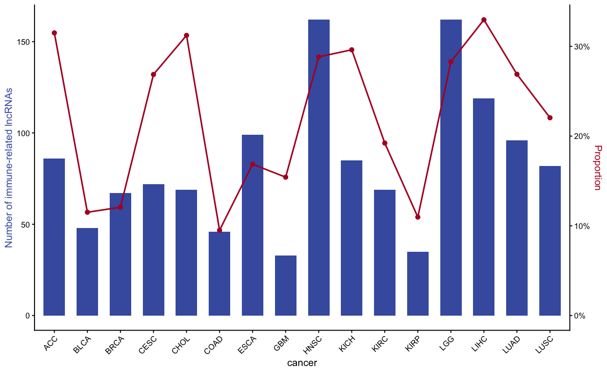

鉴定免疫相关 lncRNA 的方法是对 lncRNA 表达与免疫基因集做偏相关系数 + GSEA \[1\]。经典配图是**双轴柱+线图**：柱子展示每个癌种的免疫相关 lncRNA 数量（左 y 轴），线展示比例（右 y 轴）。

## Example

{fig-alt="ImmuneLncrnaPlot DEMO" fig-align="center" width="60%"}

## Setup

-   系统要求：跨平台（Linux/MacOS/Windows）

-   编程语言：R

-   依赖包： `ggplot2`; `dplyr`; `scales`

```{r packages setup, message=FALSE, warning=FALSE, output=FALSE}
if (!requireNamespace("ggplot2", quietly = TRUE)) install.packages("ggplot2")
if (!requireNamespace("dplyr", quietly = TRUE)) install.packages("dplyr")
if (!requireNamespace("scales", quietly = TRUE)) install.packages("scales")

library(ggplot2)
library(dplyr)
library(scales)
```

```{r}
sessioninfo::session_info("attached")
```

## Data Preparation

真实数据中，免疫相关 lncRNA 通过 ImmuLncRNA 算法（偏相关 + GSEA）逐癌种鉴定。我们模拟逐癌种的汇总输出：免疫相关 lncRNA 数量与 lncRNA 总数，比例由此推导。

```{r load data, message=FALSE, warning=FALSE}
set.seed(1801)
cancers <- c("ACC", "BLCA", "BRCA", "CESC", "CHOL", "COAD", "ESCA", "GBM",
             "HNSC", "KICH", "KIRC", "KIRP", "LGG", "LIHC", "LUAD", "LUSC")
n_lnc_total <- sample(200:600, length(cancers))
n_immune    <- round(n_lnc_total * runif(length(cancers), 0.08, 0.35))

df <- data.frame(cancer = cancers,
                 total = n_lnc_total,
                 immune = n_immune) |>
  mutate(prop = immune / total)
head(df)
```

## Visualization

### 1. 双轴柱+线图

```{r}
#| label: fig-1.1DualAxis
#| fig-cap: "双轴图：柱 = 免疫相关 lncRNA 数量（左），线 = 免疫相关 lncRNA 比例（右），逐癌种。"
#| out.width: "95%"
#| warning: false
#| message: false
#| fig-width: 10
#| fig-height: 5

max_count <- max(df$immune)
max_prop  <- max(df$prop)

ggplot(df, aes(cancer, immune)) +
  geom_col(fill = "#445EAD", width = 0.65) +
  geom_line(aes(cancer, prop * max_count / max_prop, group = 1),
            colour = "#B2182B", linewidth = 0.8) +
  geom_point(aes(cancer, prop * max_count / max_prop),
             colour = "#B2182B", size = 2) +
  scale_y_continuous(
    name = "Number of immune-related lncRNAs",
    sec.axis = sec_axis(~ . * max_prop / max_count,
                        name = "Proportion",
                        labels = percent)) +
    labs(title = "Immune-related lncRNAs across cancer types") +
  theme_classic(base_size = 11) +
  theme(axis.text.x = element_text(angle = 45, hjust = 1),
        axis.title.y.left = element_text(colour = "#445EAD"),
        axis.title.y.right = element_text(colour = "#B2182B"))
```

::: callout-tip
**Practice tips**

-   缩放因子 `max_count / max_prop` 将两个 y 轴对齐，使线落在柱的范围之内；可调整以避免视觉杂乱。
-   两个 y 轴标题的颜色分别与柱和线的颜色匹配——读者本能地将轴标题颜色与对应图层匹配。
-   参考工作流使用 ImmuLncRNA 包（偏相关 + GSEA）；双轴图是其输出的总结可视化。
:::

## Application

免疫相关 lncRNA 鉴定是免疫 lncRNA 生物标志物研究的第一步；双轴图跨癌种比较产出效率。

## Reference

\[1\] Xiaofan Lu, et al. FigureYa: A Standardized Visualization Framework for Enhancing Biomedical Data Interpretation and Research Efficiency. iMetaMed. 2025. doi:10.1002/imm3.70005
