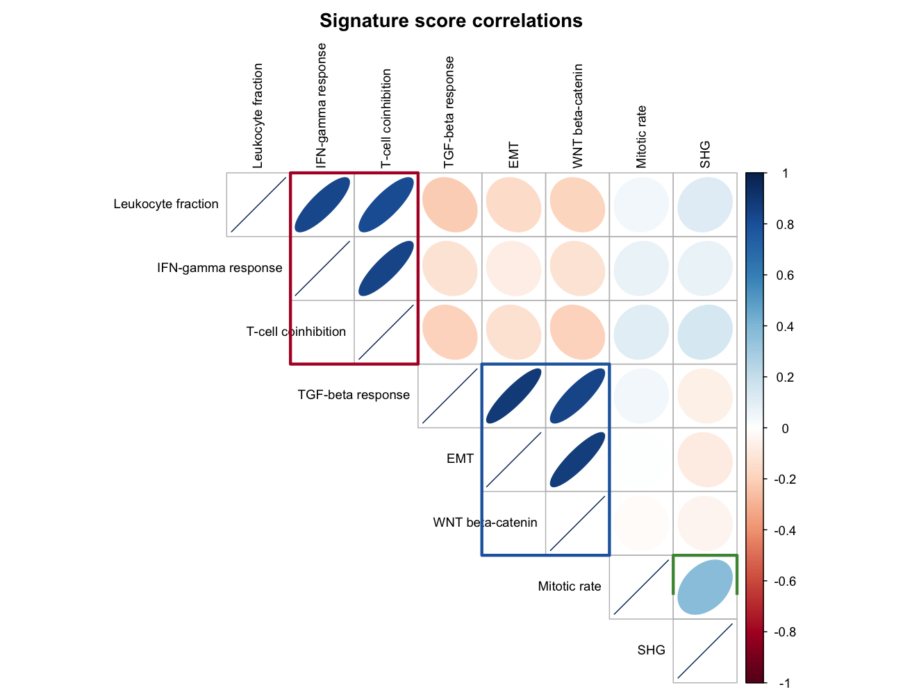

Clustering tumour samples by immune-infiltration signature scores is how the pan-cancer immune subtypes (C1–C6) of the reference paper were defined \[1\]: signature scores are correlated pairwise, modules of co-varying signatures are boxed, and samples are then clustered by the scores into subtypes whose score distributions characterise them. This tutorial reproduces that layout on simulated data: a module-structured correlation heatmap, sample clustering into subtypes, and the per-subtype score distributions that justify the naming.

## Example

{fig-alt="ImmuneSubtypePlot DEMO" fig-align="center" width="60%"}

## Setup

-   System Requirements: Cross-platform (Linux/MacOS/Windows)

-   Programming Language: R

-   Dependent packages: `ggplot2`; `dplyr`; `tidyr`; `corrplot`; `ComplexHeatmap`

```{r packages setup, message=FALSE, warning=FALSE, output=FALSE}
# Installing necessary packages
if (!requireNamespace("ggplot2", quietly = TRUE)) {
  install.packages("ggplot2")
}
if (!requireNamespace("dplyr", quietly = TRUE)) {
  install.packages("dplyr")
}
if (!requireNamespace("tidyr", quietly = TRUE)) {
  install.packages("tidyr")
}
if (!requireNamespace("corrplot", quietly = TRUE)) {
  install.packages("corrplot")
}
if (!requireNamespace("ComplexHeatmap", quietly = TRUE)) {
  BiocManager::install("ComplexHeatmap")
}

# Load packages
library(ggplot2)
library(dplyr)
library(tidyr)
library(corrplot)
library(ComplexHeatmap)
```

```{r}
sessioninfo::session_info("attached")
```

## Data Preparation

We simulate signature scores for 90 samples across 8 immune signatures, planted with three independent latent modules (leucocyte/IFN-γ/T-cell co-high on one factor; EMT/WNT co-high on a second; mitosis on a third) — block structure across signatures that consensus clustering resolves into well-separated immune subtypes.

```{r load data, message=FALSE, warning=FALSE}
set.seed(601)
signatures <- c("Leukocyte fraction", "IFN-gamma response", "T-cell coinhibition",
                "TGF-beta response", "EMT", "WNT beta-catenin", "Mitotic rate", "SHG")
n_sam <- 90
latent <- matrix(rnorm(n_sam * 3, sd = 1), nrow = n_sam)   # 3 latent factors

score_of <- function(factor_idx, coef, noise = 0.35) {
  as.numeric(latent[, factor_idx] %*% t(matrix(coef, 1)) + rnorm(n_sam, sd = noise))
}
sig_scores <- data.frame(
  sample = paste0("TCGA-", sprintf("%02d", 1:n_sam)),
  `Leukocyte fraction`  = score_of(1,  1.0),
  `IFN-gamma response`  = score_of(1,  0.9),
  `T-cell coinhibition` = score_of(1,  0.8),
  `TGF-beta response`   = score_of(2,  0.9),
  EMT                   = score_of(2,  0.9),
  `WNT beta-catenin`    = score_of(2,  0.7),
  `Mitotic rate`        = score_of(3,  1.0),
  SHG                   = score_of(3,  0.2),
  check.names = FALSE)

sig_mat <- as.matrix(sig_scores[, -1])
rownames(sig_mat) <- sig_scores$sample
head(sig_scores[, 1:4])
```

## Visualization

### 1. Signature-Correlation Modules

```{r}
#| label: fig-1.1SignatureModules
#| fig-cap: "Pairwise correlations of signature scores; rectangles mark the three co-varying modules."
#| out.width: "80%"
#| warning: false
#| message: false
#| fig-width: 7.5
#| fig-height: 6.5

cor_mat <- cor(sig_mat)
module <- c(1, 1, 1, 2, 2, 2, 3, 3)
mod_pal <- c("#B2182B", "#2166AC", "#4D9342")
mod_col <- mod_pal[module]

corrplot(cor_mat, method = "ellipse", type = "upper",
         tl.col = "black", tl.cex = 0.8, col.lim = c(-1, 1),
         mar = c(0, 0, 2, 0),
         title = "Signature score correlations")
## corrplot upper-triangle grid: cell (i, j) sits at x = j, y = 9 - i
for (k in seq_len(3)) {
  idx <- which(module == k)
  rect(min(idx) + 0.5, 9 - max(idx) - 0.5,
       max(idx) + 0.5, 9 - min(idx) + 0.5,
       border = mod_pal[k], lwd = 3, lend = 1)
}
```

The three rectangles group the signatures into co-varying modules — the structure the reference paper boxed around its consensus clusters.

### 2. Clustering Samples into Immune Subtypes

```{r}
#| label: fig-1.2SubtypeHeatmap
#| fig-cap: "Samples clustered by signature scores (top annotation = subtype); six subtypes emerge from the three modules."
#| out.width: "95%"
#| warning: false
#| message: false
#| fig-width: 9
#| fig-height: 4

## The reference uses ConsensusClusterPlus; hierarchical clustering on the
## z-scored matrix is the dependency-free stand-in
z_mat <- t(scale(sig_mat))     # signatures x samples, each signature z-scored
hcs <- hclust(dist(t(z_mat)), method = "ward.D2")
n_sub <- 6
subtype <- paste0("C", cutree(hcs, k = n_sub))

col_fun <- circlize::colorRamp2(c(-2, 0, 2), c("#2166AC", "white", "#B2182B"))
ha <- HeatmapAnnotation(Subtype = subtype,
                        col = list(Subtype = c("C1" = "#F2CCCC", "C2" = "#B31E22",
                                               "C3" = "#529B40", "C4" = "#020105",
                                               "C5" = "#383D8E", "C6" = "#EABF00")),
                        show_legend = FALSE)
Heatmap(z_mat, name = "Score (z)", top_annotation = ha,
        col = col_fun, cluster_columns = hcs,
        show_column_names = FALSE,
        row_names_gp = grid::gpar(fontsize = 8),
        column_split = 6,          # with a dendrogram, split takes k, not a factor
        column_gap = unit(1.5, "mm"),
        border = TRUE)
```

Each column split is one subtype; the colour blocks show which signatures dominate it. With real data the assignment step is the author's `ImmuneSubtypeClassifier` package, which is more robust than the original pipeline.

### 3. Score Distributions per Subtype

```{r}
#| label: fig-1.3SubtypeDistributions
#| fig-cap: "Distribution of three representative signature scores within the six subtypes (dashed line = overall median)."
#| out.width: "95%"
#| warning: false
#| message: false
#| fig-width: 9
#| fig-height: 4.5

show_sigs <- c("Leukocyte fraction", "TGF-beta response", "Mitotic rate")
dist_df <- sig_scores |>
  mutate(subtype = subtype) |>
  pivot_longer(all_of(show_sigs), names_to = "Signature", values_to = "Score")

ggplot(dist_df, aes(subtype, Score, fill = subtype)) +
  geom_boxplot(outlier.shape = NA, width = 0.65) +
  geom_hline(yintercept = 0, linetype = "dashed", colour = "grey40") +
  facet_wrap(~Signature, nrow = 1) +
  scale_fill_manual(values = c("C1" = "#F2CCCC", "C2" = "#B31E22", "C3" = "#529B40",
                               "C4" = "#020105", "C5" = "#383D8E", "C6" = "#EABF00")) +
  labs(x = NULL, y = "Signature score", fill = "Subtype") +
  theme_classic(base_size = 11) +
  theme(legend.position = "top", legend.key.size = unit(3, "mm"))
```

::: callout-tip
**Practice tips**

-   The reference pipeline is sensitive to the gene-quantification method — it does not work well on FPKM/RPKM/TPM; use the author's `ImmuneSubtypeClassifier` for real data.
-   Subtypes are *named* by their dominant modules (e.g. C2 = IFN-γ dominant, C6 = TGF-β dominant); with simulated data the box panels let you assign such names by eye.
-   Keep the module heatmap and the subtype split in one figure: reviewers check that the modules used for clustering are the ones the subtypes differ on.
:::

## Application

Immune-subtype assignment is the standard first annotation in immuno-oncology cohorts: it groups tumours before checkpoint-response or TMB comparisons. The layout above (module heatmap → subtype strip → score distributions) mirrors how the reference figure reports them.

## Reference

\[1\] Thorsson V, Gibbs DL, Brown SD, et al. The immune landscape of cancer. Immunity. 2018;48(4):812-830.e24. doi:10.1016/j.immuni.2018.03.023

\[2\] Xiaofan Lu, et al. FigureYa: A Standardized Visualization Framework for Enhancing Biomedical Data Interpretation and Research Efficiency. iMetaMed. 2025. doi:10.1002/imm3.70005
