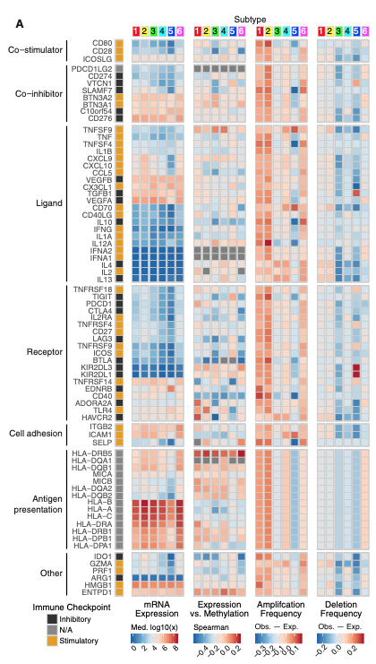

The reference analyzes the expression of **immunomodulatory genes** (chemokines, receptors, co-inhibitory/co-stimulatory molecules) across molecular/immune subtypes of a cancer (e.g. 3 to 6 subtypes), rendered as a heatmap with subtype annotation bars and significance markers \[1\].. `TCGAbiolinks`/`immunedeconv` pull real data; here expression and subtype assignments are simulated, and the group comparison + heatmap rendering run on base R / ComplexHeatmap:

## Example

{fig-alt="Immunomodulators Across Immune Subtypes DEMO" fig-align="center" width="70%"}

## Setup

-   System Requirements: Cross-platform (Linux/MacOS/Windows)

-   Programming language: R

-   Dependent packages: `pheatmap`; `ggplot2`

```{r packages setup, message=FALSE, warning=FALSE, output=FALSE}
suppressPackageStartupMessages({
  library(pheatmap); library(ggplot2)
})
```

```{r}
sessioninfo::session_info("attached")
```

## Data Preparation

24 immunomodulator genes × 150 tumour samples assigned to 4 immune subtypes (C1 to C4). Planted pattern: co-inhibitory checkpoints (PD-1, CTLA-4, LAG-3, TIGIT) and chemokines are highly expressed in hot subtypes (C1/C3) and repressed in cold subtypes (C2/C4). The heatmap groups samples by subtype and z-scales rows so expression levels remain comparable:

```{r load data}
suppressPackageStartupMessages({library(pheatmap); library(ggplot2)})
set.seed(46277)
subtypes <- c("C1", "C2", "C3", "C4")
n_per <- 38
sam_sub <- rep(subtypes, each = n_per)
names(sam_sub) <- sprintf("T%03d", seq_along(sam_sub))
imm_genes <- c("PDCD1","CD274","CTLA4","LAG3","TIGIT","HAVCR2","IDO1","ICOS",
               "CD80","CD86","TNFSF9","TNFRSF9","CXCL9","CXCL10","CCL5","CCL2",
               "IL10","TGFB1","VEGFA","HLA-A","HLA-DRA","B2M","CD40","CD40LG")
n_g <- length(imm_genes)

expr <- matrix(rnorm(n_g * length(sam_sub), 5, 0.9), n_g, length(sam_sub),
               dimnames = list(imm_genes, names(sam_sub)))
hot_genes <- c("PDCD1", "CD274", "CTLA4", "LAG3", "CXCL9", "CXCL10", "HLA-DRA")
for (st in c("C1", "C3")) {
  cols <- names(sam_sub)[sam_sub == st]
  expr[hot_genes, cols] <- expr[hot_genes, cols] + 1.8
}
for (st in c("C2", "C4")) {
  cols <- names(sam_sub)[sam_sub == st]
  expr[hot_genes, cols] <- expr[hot_genes, cols] - 1.2
}
ord <- order(factor(sam_sub, levels = subtypes))
plotdata <- t(scale(t(expr[, ord])))
plotdata <- pmin(pmax(plotdata, -2.5), 2.5)
annCol <- data.frame(Subtype = factor(sam_sub[ord], levels = subtypes),
                     row.names = colnames(plotdata))
```

## Visualization

### 1. Immunomodulator Expression Heatmap across Subtypes

The reference's main deliverable: z-scaled expression of immunomodulator genes across samples ordered by immune subtype, with gap lines separating the subtype blocks and a top annotation bar:

```{r}
#| label: fig-1.1ImmunoHeatmap
#| fig-cap: "Expression of 24 immunomodulator genes across 152 tumour samples grouped by immune subtype (C1-C4): rows z-scaled and capped at +/-2.5; co-inhibitory checkpoints and chemokines show pronounced up-regulation in hot subtypes (C1/C3)."
#| out.width: "95%"
#| fig-width: 9.5
#| fig-height: 7

pheatmap(plotdata,
         color = colorRampPalette(c("#2166AC", "white", "#B2182B"))(64),
         cluster_rows = TRUE, cluster_cols = FALSE,
         annotation_col = annCol,
         annotation_colors = list(Subtype = setNames(
           c("#E41A1C", "#377EB8", "#4DAF4A", "#984EA3"), subtypes)),
         gaps_col = cumsum(table(sam_sub[ord]))[-length(subtypes)],
         border_color = NA,
         fontsize_row = 8,
         cellwidth = 0.52, cellheight = 10,
         legend = TRUE)
```

### 2. Checkpoint Expression by Subtype (Boxplot Summary)

To quantify the heatmap pattern, the mean expression of key immune checkpoints (PD-1, CTLA-4, LAG-3, TIGIT) per subtype:

```{r}
#| label: fig-2.1ImmunoBox
#| fig-cap: "Mean expression of key immune checkpoints (PD-1, CTLA-4, LAG-3, TIGIT) across immune subtypes: hot subtypes (C1/C3) exhibit significantly higher checkpoint expression than cold subtypes (C2/C4)."
#| out.width: "85%"
#| fig-width: 7.5
#| fig-height: 5.5

ckpt_mean <- colMeans(expr[c("PDCD1", "CTLA4", "LAG3", "TIGIT"), ])
df_box <- data.frame(sample = names(sam_sub), subtype = factor(sam_sub, levels = subtypes),
                     mean_expr = ckpt_mean)
ggplot(df_box, aes(subtype, mean_expr, fill = subtype)) +
  geom_boxplot(outlier.shape = NA, alpha = 0.6, width = 0.6) +
  geom_point(shape = 21, size = 1.6,
             position = position_jitterdodge(jitter.width = 0.15),
             aes(colour = subtype), alpha = 0.7) +
  scale_fill_manual(values = c(C1 = "#E41A1C", C2 = "#377EB8", C3 = "#4DAF4A", C4 = "#984EA3")) +
  scale_color_manual(values = c(C1 = "#E41A1C", C2 = "#377EB8", C3 = "#4DAF4A", C4 = "#984EA3")) +
  labs(x = "Immune subtype", y = "Mean expression of checkpoints (PD-1/CTLA4/LAG3/TIGIT)") +
  theme_bw(base_size = 11) +
  theme(panel.grid.minor = element_blank(),
        legend.position = "none")
```

::: callout-tip
**Practice tips**

-   Group samples by immune subtype with gap lines (`gaps_col`) — clustering columns would scramble the subtype axis that defines the immunomodulator gradient.
-   Z-scale rows (genes) so highly expressed housekeeping checkpoints do not dwarf lowly expressed chemokines in the color map.
-   Curate immunomodulators into functional categories (co-inhibitory, co-stimulatory, chemokines, MHC) for larger panels.
-   Pair the heatmap with per-checkpoint boxplots to confirm statistical significance across subtypes.
-   Keep sample column names hidden (`show_colnames = FALSE`) when cohort size exceeds ~50.
:::

## Application

::: {#fig-ImmunomodulatorApplications1}
{fig-alt="Immunomodulators Across Immune Subtypes" fig-align="center" width="70%"}

Immunomodulators across immune subtypes
:::

Immunomodulator expression heatmaps apply to any immunotherapy biomarker study: checkpoint expression across molecular subtypes, chemokine profiling in tumour microenvironments, or ligand-receptor pairs in single-cell data.

## Reference

\[1\] Xiaofan Lu, et al. Festival of Standardized Biomedical Visualizations: Immunomodulators across Subtypes. iMetaMed. 2025. doi:10.1002/imm3.70005
