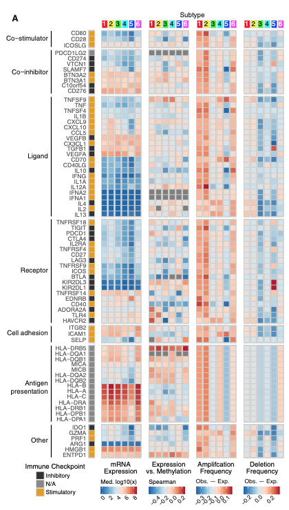

参考分析某种癌症中**免疫调节基因**（趋化因子、受体、共抑制/共刺激分子）在分子/免疫亚型（如 3 至 4 个亚型）中的表达，呈现为带亚型注释条与显著性标记的热图 \[\1\]。`TCGAbiolinks`/`immunedeconv` 拉取真实数据；此处模拟表达与亚型分配，分组比较与热图渲染在 pheatmap 上运行：

## Example

{fig-alt="免疫亚型间的免疫调节剂 DEMO" fig-align="center" width="60%"}

## Setup

-   系统要求：跨平台（Linux/MacOS/Windows）

-   编程语言：R

-   依赖包：`pheatmap`; `ggplot2`

```{r packages setup, message=FALSE, warning=FALSE, output=FALSE}
suppressPackageStartupMessages({
  library(pheatmap); library(ggplot2)
})
```

```{r}
sessioninfo::session_info("attached")
```

## 数据准备

24 个免疫调节子基因 × 150 个肿瘤样本分配到 4 个免疫亚型（C1 至 C4）。植入模式：共抑制检验点（PD-1、CTLA-4、LAG-3、TIGIT）与趋化因子在热亚型（C1/C3）中高表达、在冷亚型（C2/C4）中受抑。热图将样本按亚型分组、行 z 标度使表达水平可比：

```{r load data}
suppressPackageStartupMessages({library(pheatmap); library(ggplot2)})
set.seed(46277)
subtypes <- c("C1", "C2", "C3", "C4")
n_per <- 38
sam_sub <- rep(subtypes, each = n_per)
names(sam_sub) <- sprintf("T%03d", seq_along(sam_sub))
imm_genes <- c("PDCD1","CD274","CTLA4","LAG3","TIGIT","HAVCR2","IDO1","ICOS",
               "CD80","CD86","TNFSF9","TNFRSF9","CXCL9","CXCL10","CCL5","CCL2",
               "IL10","TGFB1","VEGFA","HLA-A","HLA-DRA","B2M","CD40","CD40LG")
n_g <- length(imm_genes)

expr <- matrix(rnorm(n_g * length(sam_sub), 5, 0.9), n_g, length(sam_sub),
               dimnames = list(imm_genes, names(sam_sub)))
hot_genes <- c("PDCD1", "CD274", "CTLA4", "LAG3", "CXCL9", "CXCL10", "HLA-DRA")
for (st in c("C1", "C3")) {
  cols <- names(sam_sub)[sam_sub == st]
  expr[hot_genes, cols] <- expr[hot_genes, cols] + 1.8
}
for (st in c("C2", "C4")) {
  cols <- names(sam_sub)[sam_sub == st]
  expr[hot_genes, cols] <- expr[hot_genes, cols] - 1.2
}
ord <- order(factor(sam_sub, levels = subtypes))
plotdata <- t(scale(t(expr[, ord])))
plotdata <- pmin(pmax(plotdata, -2.5), 2.5)
annCol <- data.frame(Subtype = factor(sam_sub[ord], levels = subtypes),
                     row.names = colnames(plotdata))
```

## Visualization

### 亚型间免疫调节剂表达热图

参考的主要交付物：免疫调节子基因在按免疫亚型排序样本上的 z 标度表达，亚型块间有间隙线加顶部注释条：

```{r}
#| label: fig-1.1ImmunoHeatmap
#| fig-cap: "24 个免疫调节子基因在按免疫亚型（C1-C4）分组的 152 个肿瘤样本中的表达：行 z 标度并截断 ±2.5；共抑制检查点与趋化因子在热亚型（C1/C3）中呈现显著上调。"
#| out.width: "95%"
#| fig-width: 9.5
#| fig-height: 7

pheatmap(plotdata,
         color = colorRampPalette(c("#2166AC", "white", "#B2182B"))(64),
         cluster_rows = TRUE, cluster_cols = FALSE,
         annotation_col = annCol,
         annotation_colors = list(Subtype = setNames(
           c("#E41A1C", "#377EB8", "#4DAF4A", "#984EA3"), subtypes)),
         gaps_col = cumsum(table(sam_sub[ord]))[-length(subtypes)],
         border_color = NA,
         fontsize_row = 8,
         cellwidth = 0.52, cellheight = 10,
         legend = TRUE)
```

### 按亚型的检验点表达（箱线图汇总）

量化热图模式：每个亚型中关键免疫检查点（PD-1、CTLA-4、LAG-3、TIGIT）的平均表达：

```{r}
#| label: fig-2.1ImmunoBox
#| fig-cap: "关键免疫检查点（PD-1、CTLA-4、LAG-3、TIGIT）在免疫亚型中的平均表达：热亚型（C1/C3）展示显著高于冷亚型（C2/C4）的检查点表达。"
#| out.width: "85%"
#| fig-width: 7.5
#| fig-height: 5.5

ckpt_mean <- colMeans(expr[c("PDCD1", "CTLA4", "LAG3", "TIGIT"), ])
df_box <- data.frame(sample = names(sam_sub), subtype = factor(sam_sub, levels = subtypes),
                     mean_expr = ckpt_mean)
ggplot(df_box, aes(subtype, mean_expr, fill = subtype)) +
  geom_boxplot(outlier.shape = NA, alpha = 0.6, width = 0.6) +
  geom_point(shape = 21, size = 1.6,
             position = position_jitterdodge(jitter.width = 0.15),
             aes(colour = subtype), alpha = 0.7) +
  scale_fill_manual(values = c(C1 = "#E41A1C", C2 = "#377EB8", C3 = "#4DAF4A", C4 = "#984EA3")) +
  scale_color_manual(values = c(C1 = "#E41A1C", C2 = "#377EB8", C3 = "#4DAF4A", C4 = "#984EA3")) +
  labs(x = "Immune subtype", y = "Mean expression of checkpoints (PD-1/CTLA4/LAG3/TIGIT)") +
  theme_bw(base_size = 11) +
  theme(panel.grid.minor = element_blank(),
        legend.position = "none")
```


## 应用场景

::: {{#fig-ImmunomodulatorApplications1}}
{fig-alt="免疫亚型间的免疫调节剂" fig-align="center" width="60%"}

免疫亚型间的免疫调节剂
:::

免疫调节子表达热图适用于任何免疫疗法生物标志物研究：分子亚型间的检验点表达、肿瘤微环境趋化因子 profiling、或单细胞中的配体-受体对。

## 参考文献

\[1\] Xiaofan Lu, et al. Festival of Standardized Biomedical Visualizations: Immunomodulators across Subtypes. iMetaMed. 2025. doi:10.1002/imm3.70005
