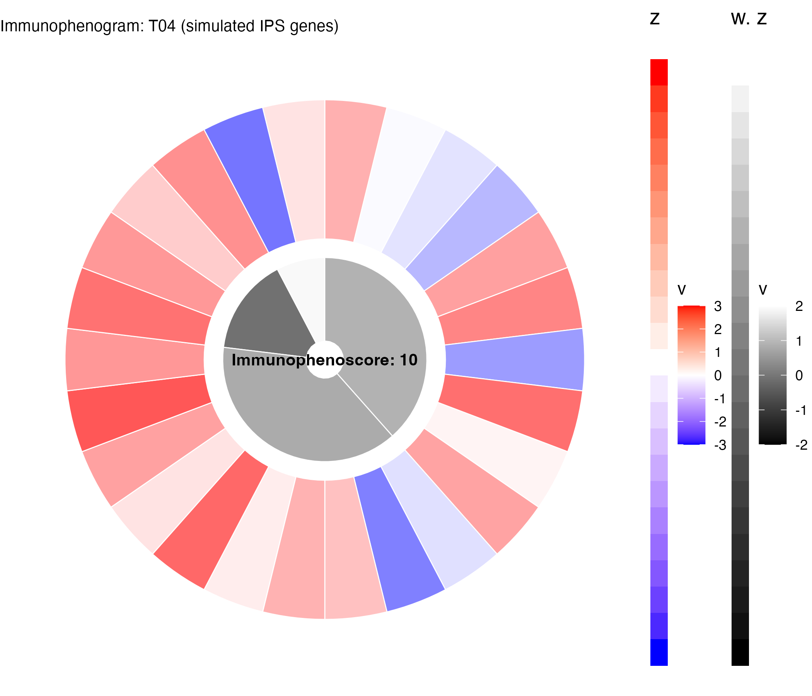

The **Immunophenoscore (IPS)** quantifies a tumour's immune phenotype from bulk RNA-seq: 26 gene groups (MHC antigen processing, checkpoint/immunomodulator, effector-cell, suppressor-cell) are z-scored against the whole transcriptome, weighted, averaged into four categories, and summed to a 0-10 score predicting checkpoint-blockade response \[1\]\[2\]. The reference renders the result as an **immunophenogram** — a polar chart with gene-level wedges (outer ring) and category summary wedges (inner ring) in blue-white-red and black-white ramps. The `Immunophenoscore` package is unavailable, so the algorithm is re-implemented inline below:

## Example

{fig-alt="Immunophenoscore (Immunophenogram) DEMO" fig-align="center" width="60%"}

## Setup

-   System Requirements: Cross-platform (Linux/MacOS/Windows)

-   Programming language: R

-   Dependent packages: `ggplot2`; `gridExtra`

```{r packages setup, message=FALSE, warning=FALSE, output=FALSE}
suppressPackageStartupMessages({
  library(ggplot2)
})
```

```{r}
sessioninfo::session_info("attached")
```

## Data Preparation

26 IPS gene groups (MHC 10, CP 10, EC 4, SC 2) x 4 simulated samples with the reference class structure and weights. The z-scores come from a larger simulated background so the per-sample z is meaningful:

```{r load data}
# ImmunophenoscorePlot prototype: polar immunophenogram (inline IPS algorithm)
suppressPackageStartupMessages({library(ggplot2); library(gridExtra)})
set.seed(20501)

## 26 gene groups with the IPS class structure: MHC 10, CP 10, EC 4, SC 2
groups <- c(rep("MHC", 10), rep("CP", 10), rep("EC", 4), rep("SC", 2))
gene_names <- c(paste0("HLA-", c("A", "B", "C", "E", "F", "G", "DMA", "DMB", "DOA", "DOB")),
                paste0("PD-", c("L1", "L2", "1"), "-like", c("", "", ""), c("", "", "")),
                paste0("CP", sprintf("%02d", 1:7)),
                paste0("Act ", c("CD8", "CD4", "NK", "Treg")),
                c("Treg", "MDSC"))
gene_names <- make.unique(gene_names, sep = "_")
n_total <- length(gene_names)   # 26
weights <- c(rep(1, 10), rep(2, 10), rep(3, 4), rep(1.5, 2))
n_samples <- 4
samples <- sprintf("T%02d", 1:n_samples)
## expression: group-level z means with noise
grp_z <- matrix(rnorm(26 * 400, 0, 1), 26, 400,
                dimnames = list(gene_names, paste0("B", 1:400)))
sim_expr <- grp_z[, 1:n_samples] + rnorm(26 * n_samples, 0, 0.3)
sim_expr <- round(sim_expr, 3)
rownames(sim_expr) <- gene_names; colnames(sim_expr) <- samples
mGE <- rowMeans(grp_z); sGE <- apply(grp_z, 1, sd)
z1 <- (sim_expr - mGE) / sGE
ipsmap <- function(x) if (x <= 0) 0 else if (x >= 3) 10 else round(x * 10 / 3, 0)
ips_list <- list()
for (i in seq_len(n_samples)) {
  wg <- z1[, i] * weights
  mig <- sapply(unique(groups), function(g) mean(wg[groups == g]))
  mig <- mig[names(which(table(groups) > 0))]
  MHC <- mean(wg[groups == "MHC"]); CP <- mean(wg[groups == "CP"])
  EC <- mean(wg[groups == "EC"]); SC <- mean(wg[groups == "SC"])
  az <- sum(MHC, CP, EC, SC)
  ips_list[[i]] <- data.frame(sample = samples[i], MHC = MHC, CP = CP, EC = EC, SC = SC,
                              AZ = az, IPS = ipsmap(az))
}
ips_out <- do.call(rbind, ips_list)
print(ips_out)

## immunophenogram for one sample
si <- which.max(ips_out$IPS)
z1s <- z1[, si]
mig <- sapply(unique(groups), function(g) mean(z1s[groups == g] * weights[groups == g]))
names(mig) <- unique(groups)
mig <- mig[names(which(table(groups) > 0))]
MHC <- mean(wg[groups == "MHC"]); CP <- mean(wg[groups == "CP"])
EC <- mean(wg[groups == "EC"]); SC <- mean(wg[groups == "SC"])
```

## Visualization

### 1. Immunophenogram with Legend Strips

The polar chart: outer ring = 26 gene wedges coloured by z-score (blue-white-red ramp), inner ring = EC/SC/CP/MHC summary wedges (black-white ramp), centre text reports the 0-10 IPS; the two legend strips reproduce the reference's z and weighted-z scales:

```{r}
#| label: fig-1.1Immunophenogram
#| fig-cap: "Immunophenogram of a simulated sample: outer ring = 26 gene wedges coloured by z-score, inner ring = EC/SC/CP/MHC summary wedges, centre reports the IPS; legend strips show the z and weighted-z colour scales."
#| out.width: "75%"
#| warning: false
#| message: false
#| fig-width: 7
#| fig-height: 6

bluewhitered <- colorRampPalette(c("blue", "white", "red"))(1000)
bw <- colorRampPalette(c("black", "white"))(1000)
mapcol <- function(x) bluewhitered[round(166.5 * pmin(3, pmax(-3, x)) + 500.5)]
mapbw <- function(x) bw[round(249.75 * pmin(2, pmax(-2, x)) + 500.5)]

## wedge geometry: outer ring gene wedges, inner ring summary wedges
wedge_order <- c(names(mig)[c(4, 3, 2, 1)])   # EC, SC, CP, MHC block order
wedge_width <- c(rep(10, 4), rep(10, 10), rep(10, 10), rep(15, 2))
blocks <- list(EC = 4, SC = 2, CP = 10, MHC = 10)
gdf <- data.frame(); pos <- 0
for (blk in c("EC", "SC", "CP", "MHC")) {
  gsel <- which(groups == blk)
  for (g in gsel) {
    gdf <- rbind(gdf, data.frame(start = pos, end = pos + wedge_width[1],
                                 y1 = 2.6, y2 = 5.6, z = mig[blk] * 0 + z1s[g],
                                 label = gene_names[g]))
    pos <- pos + wedge_width[1]
  }
}
## inner summary wedges must span the same total arc as the 26 gene wedges
## (26 x 10 = 260): MHC genes 1-100, CP 100-200, EC 200-240, SC 240-260
sdf <- data.frame(
  start = c(200, 240, 100, 0), end = c(240, 260, 200, 100),
  y1 = c(0.4, 0.4, 0.4, 0.4), y2 = c(2.2, 2.2, 2.2, 2.2),
  z = c(EC, SC, CP, MHC), label = c("EC", "SC", "CP", "MHC"))
gdf$vcol <- mapcol(gdf$z); sdf$vcol <- mapbw(sdf$z)
p_a <- ggplot(gdf) +
  geom_rect(aes(xmin = start, xmax = end, ymin = y1, ymax = y2, fill = vcol),
            colour = "white", linewidth = 0.3) +
  geom_rect(data = sdf, aes(xmin = start, xmax = end, ymin = y1, ymax = y2, fill = vcol),
            colour = "white", linewidth = 0.3) +
  scale_fill_identity() +
  coord_polar(theta = "x") +
  annotate("text", x = 130, y = 0, label = paste0("Immunophenoscore: ",
           ipsmap(ips_out$AZ[si])), size = 3.6, fontface = 2) +
  labs(x = NULL, y = NULL, title = paste0("Immunophenogram: ", samples[si],
       " (simulated IPS genes)")) +
  theme_void(base_size = 10) +
  theme(plot.title = element_text(size = 10), legend.position = "none")
## legend strips (B: z ramp -3..3; C: bw ramp -2..2)
ldf <- do.call(rbind, lapply(seq_len(23), function(i)
  data.frame(x = 1, y = i, v = -3 + (i - 1) * 6 / 22, strip = "B")))
ldf2 <- do.call(rbind, lapply(seq_len(23), function(i)
  data.frame(x = 1, y = i, v = -2 + (i - 1) * 4 / 22, strip = "C")))
p_b <- ggplot(ldf, aes(x, y, fill = v)) +
  geom_rect(aes(xmin = x - 0.5, xmax = x + 0.5, ymin = y - 0.5, ymax = y + 0.5)) +
  scale_fill_gradient2(low = "blue", mid = "white", high = "red", midpoint = 0,
                       limits = c(-3, 3)) + theme_void() + labs(title = "z")
p_c <- ggplot(ldf2, aes(x, y, fill = v)) +
  geom_rect(aes(xmin = x - 0.5, xmax = x + 0.5, ymin = y - 0.5, ymax = y + 0.5)) +
  scale_fill_gradient(low = "black", high = "white", limits = c(-2, 2)) +
  theme_void() + labs(title = "w. z")
p <- gridExtra::grid.arrange(p_a, p_b, p_c, ncol = 3, widths = c(0.8, 0.1, 0.1))
cat("p1 done; IPS table:\n"); print(ips_out)
```

::: callout-tip
**Practice tips**

-   The z-score is computed against the **whole transcriptome** mean/sd, not just the IPS genes — this anchors the colour scale so samples are comparable.
-   The inner summary wedges must span the same total arc as the 26 gene wedges (MHC genes 1-100, CP 100-200, EC 200-240, SC 240-260 out of 260) — a positional mismatch silently collapses the inner ring to a quadrant.
-   Gene renames (CAVIN2 -> SDPR, CCL3L3 -> CCL3L1) are required for real TCGA data; the reference documents them but a naive mapping silently produces NAs.
:::

## Applications

::: {#fig-IpsApplications1}
{fig-alt="Immunophenogram" fig-align="center" width="60%"}

Immunophenogram
:::

The immunophenogram applies to any single-sample immune profile: one figure per patient before/after treatment, or per tumour region in spatial transcriptomics.

## Reference

\[1\] Xiaofan Lu, et al. FigureYa: A Standardized Visualization Framework for Enhancing Biomedical Data Interpretation and Research Efficiency. iMetaMed. 2025. doi:10.1002/imm3.70005

\[2\} Charoentong P, Finotello F, Angelova M, et al. Pan-cancer immunogenomic analyses reveal genotype-immunophenotype relationships and predictors of response to checkpoint blockade. Cell Rep. 2017;18(1):248-262. doi:10.1016/j.celrep.2016.12.019