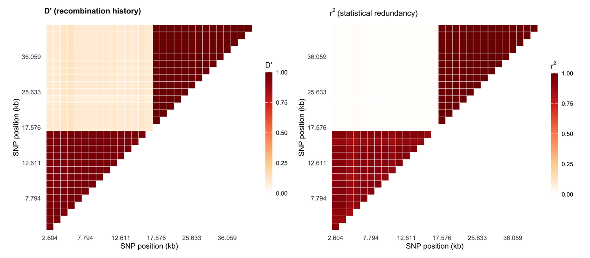

Linkage disequilibrium (LD) is the non-random co-occurrence of alleles at two loci, and the LD triangle plot is how association studies show it: each pair of SNPs is a cell whose colour is D′ or r², and blocks of high LD mark the haplotype segments that association testing can treat as a unit. The two statistics are *not* interchangeable — D′ stays high when one allele is rare, r² falls with allele frequency — so a single figure must either fix one statistic or show both.

This tutorial rebuilds the LDBlockShow / Haploview layout \[1,2\] in pure R: a D′ triangle and an r² triangle on the same SNP order with Haploview-style block boundaries, a gene track under the same axis, and optional faceting by population.

## Example

{fig-alt="Linkage Disequilibrium Plot DEMO" fig-align="center" width="85%"}

A linkage disequilibrium triangle for 30 SNPs across the HLA class II region: left is D' (recombination history) and right is r^2 (statistical redundancy), drawn on identical SNP order and identical colour limits so the two statistics can be compared cell by cell. With every common SNP here the two statistics agree closely; allele-frequency asymmetry would show up as cells hot in D' but cool in r^2, which this all-MAF-0.5 simulation deliberately does not contain.

## Setup

-   System Requirements: Cross-platform (Linux/MacOS/Windows)

-   Programming language: R

-   Dependent packages: `ggplot2`; `dplyr`; `tidyr`; `patchwork`; `scales`

```{r packages setup, message=FALSE, warning=FALSE, output=FALSE}
if (!requireNamespace("ggplot2", quietly = TRUE)) install.packages("ggplot2")
if (!requireNamespace("dplyr", quietly = TRUE)) install.packages("dplyr")
if (!requireNamespace("tidyr", quietly = TRUE)) install.packages("tidyr")
if (!requireNamespace("patchwork", quietly = TRUE)) install.packages("patchwork")
if (!requireNamespace("scales", quietly = TRUE)) install.packages("scales")

library(ggplot2)
library(dplyr)
library(tidyr)
library(patchwork)
library(scales)
```

```{r}
sessioninfo::session_info("attached")
```

## Data Preparation

Thirty SNPs spanning ~36 kb of the *HLA* class II region are simulated for two populations: a European-ancestry panel with two long conserved haplotype segments and an African-ancestry panel with three shorter ones, which mirrors the well-documented difference in LD extent between these populations. Haplotypes are built by segment-wise founder copying, so LD blocks arise by construction rather than by accident; D′ and r² are then computed from the dosage matrix with their textbook formulas. The breakpoints are fixed at SNP 15 for CEU and at SNPs 10 and 20 for YRI so the two- and three-segment designs are unambiguous; founder haplotypes, segregating sites and genotypes are still simulated.

```{r load data, message=FALSE, warning=FALSE}
set.seed(4353)

n_snp <- 30
snp_pos <- sort(sample(2e3:4.2e4, n_snp))

## Haplotype simulation by segment-wise founder copying. Breakpoints split
## the locus into segments; within a segment every simulated haplotype copies
## one of four founder haplotypes, with a small per-site error rate. Blocks of
## high LD therefore appear by construction, and D' / r^2 are computed from
## the resulting 0/1/2 dosage matrix — no value is painted into the figure.
simulate_pop <- function(n_ind, breaks, e = 0.001, mut = 0.001) {
  ## Breakpoints split the locus into segments; each simulated haplotype
  ## copies one founder haplotype within a segment. That is the standard
  ## four-founder / ancestral-haplotype caricature of LD. The founder pool
  ## is deliberately close to two ancestral states: f1 is all reference,
  ## f2 is all alternate, and f3/f4 carry rare derived alleles.
  segment <- cumsum(c(TRUE, seq_len(n_snp - 1) %in% breaks))
  n_seg <- max(segment)
  n_hap <- 120
  f1 <- rep(0L, n_snp)
  f2 <- rep(1L, n_snp)
  f3 <- f1; f3[runif(n_snp) < mut] <- 1L
  f4 <- f2; f4[runif(n_snp) < mut] <- 0L
  founder <- rbind(f1, f2, f3, f4)
  hap <- matrix(0L, n_hap, n_snp)
  for (k in seq_len(n_hap)) {
    for (seg in seq_len(n_seg)) {
      cols <- which(segment == seg)
      ## Draw a founder independently for every segment. A deterministic
      ## rotation would preserve the same haplotype across a breakpoint and
      ## silently erase the very LD boundary the example is meant to show.
      h <- sample.int(4, 1)
      hap[k, cols] <- founder[h, cols]
      flip <- which(runif(length(cols)) < e)
      hap[k, cols[flip]] <- 1L - hap[k, cols[flip]]
    }
  }
  a <- matrix(sample(seq_len(n_hap), n_ind * 2, replace = TRUE), n_ind, 2)
  list(hap = hap, segment = segment,
       geno = hap[a[, 1], , drop = FALSE] + hap[a[, 2], , drop = FALSE])
}

pops <- list(
  "European (CEU)" = simulate_pop(320, breaks = 15),
  "African (YRI)"  = simulate_pop(300, breaks = c(10, 20))
)
## Sanity check: every SNP must be polymorphic before LD is meaningful.
vapply(pops, function(p) {
  af <- colMeans(p$genotype <- p$geno) / 2
  sum(af > 0 & af < 1)
}, integer(1))

## D' and r^2 from a 0/1/2 dosage matrix (the formula used by PLINK --r2 and
## LDBlockShow): p_A, p_B from allele frequencies, D from joint haplotypes
## estimated by the composite ( EM-free ) count from genotypes.
ld_pair <- function(g1, g2) {
  ## g = 0/1/2 dosage. Cov(dosage1, dosage2) = 2 D, so D = Cov / 2.
  f1 <- mean(g1) / 2; f2 <- mean(g2) / 2
  if (f1 %in% c(0, 1) || f2 %in% c(0, 1)) return(c(Dprime = NA_real_, r2 = NA_real_))
  d <- stats::cov(g1, g2) / 2
  denom <- if (d >= 0) min(f1 * (1 - f2), (1 - f1) * f2) else
    min(f1 * f2, (1 - f1) * (1 - f2))
  dprime <- if (denom > 0) abs(d) / denom else NA_real_
  r2 <- d^2 / (f1 * (1 - f1) * f2 * (1 - f2))
  c(Dprime = min(dprime, 1), r2 = min(r2, 1))
}

ld_long <- function(geno, pop) {
  out <- list()
  for (i in 1:(n_snp - 1)) {
    for (j in (i + 1):n_snp) {
      v <- ld_pair(geno[, i], geno[, j])
      out[[length(out) + 1]] <- data.frame(pop = pop, i = i, j = j,
                                           Dprime = v["Dprime"], r2 = v["r2"],
                                           row.names = NULL)
    }
  }
  do.call(rbind, out)
}

ld <- bind_rows(lapply(names(pops), function(nm) ld_long(pops[[nm]]$geno, nm))) |>
  mutate(pop = factor(pop, levels = names(pops))) |>
  left_join(tibble(i = seq_len(n_snp), pos_i = snp_pos), by = "i") |>
  left_join(tibble(j = seq_len(n_snp), pos_j = snp_pos), by = "j")

## Verify the construction: report the LD across each fixed breakpoint and the
## number of strong adjacent pairs; the block figure calls blocks with the same
## D' > 0.7 and r^2 > 0.45 rule.
break_ld <- ld |>
  filter(j == i + 1, i %in% c(10, 15, 20)) |>
  group_by(pop) |>
  summarise(mean_Dprime = mean(Dprime, na.rm = TRUE),
            mean_r2 = mean(r2, na.rm = TRUE),
            .groups = "drop")

n_blocks <- ld |>
  filter(j == i + 1) |>
  mutate(strong = !is.na(Dprime) & !is.na(r2) & Dprime > 0.7 & r2 > 0.45) |>
  group_by(pop) |>
  summarise(n_strong = sum(strong), n_pairs = n(), .groups = "drop") |>
  ungroup()

list(break_ld = break_ld, n_blocks = n_blocks)
```

## Visualization

### 1. D′ and r² Triangles, Same SNP Order

The two panels share the SNP axis on purpose: the reader is meant to compare the same SNP pair across statistics. With this two-block simulation both statistics saturate near 1 inside a segment and collapse across the boundary (D′ to about 0.1, r² to about 0.01); on real data r² falls off faster than D′ with distance, which is why association power is summarised with r², not D′.

```{r}
#| label: fig-1.1LdTriangles
#| fig-cap: "Linkage disequilibrium triangle for 30 SNPs simulated for an HLA-like class II region (synthetic gene map): left, D' (recombination history); right, r^2 (statistical redundancy), on identical SNP order and identical colour limits so the two statistics can be compared cell by cell."
#| out.width: "100%"
#| warning: false
#| message: false
#| fig-width: 10.5
#| fig-height: 4.6
#| fig-dpi: 300

ceu <- filter(ld, pop == "European (CEU)")

ld_triangle <- function(dat, value, title) {
  ## Cells are indexed by SNP order (not physical position): every pair must
  ## get the same visual weight, and irregular SNP spacing would otherwise
  ## make far-apart pairs look like thin lines. The physical position is
  ## recovered from the axis labels.
  brk <- seq(1, n_snp, by = 5)
  ggplot(dat, aes(i, j)) +
    geom_tile(aes(fill = .data[[value]]), colour = "white", linewidth = 0.18) +
    scale_fill_gradientn(colours = c("#ffffff", "#fdd49e", "#fc8d59", "#d7301f",
                                     "#7f0000"),
                         limits = c(0, 1),
                         ## Identical breakpoints for D' and r^2: different
                         ## breakpoints under identical limits would make the
                         ## same colour mean different values per panel.
                         values = c(0, .25, .5, .75, 1),
                         na.value = "grey92",
                         name = if (value == "Dprime") "D'" else expression(r^2)) +
    scale_x_continuous(breaks = brk, labels = snp_pos[brk] / 1000,
                       expand = c(0.01, 0.01)) +
    scale_y_continuous(breaks = brk, labels = snp_pos[brk] / 1000,
                       expand = c(0.01, 0.01)) +
    coord_fixed() +
    labs(x = "SNP position (kb)", y = "SNP position (kb)", title = title) +
    theme_minimal(base_size = 9.5) +
    theme(panel.grid = element_blank(),
          plot.title = element_text(face = "bold", size = 10),
          axis.text = element_text(size = 8),
          legend.key.height = unit(1.1, "cm"),
          legend.key.width = unit(0.32, "cm"))
}

p_dp <- ld_triangle(ceu, "Dprime", "D' (recombination history)")
p_r2 <- ld_triangle(ceu, "r2", expression("r"^2 ~ "(statistical redundancy)"))

p_dp + p_r2 + plot_layout(ncol = 2)
```

::: callout-tip
**Practice tips**

-   Never put D′ and r² on one shared colour scale without labelling which is shown: the identical palette implies identical meaning, and a reviewer will read a dark cell as "tight LD" either way.
-   Fix the colour `limits = c(0, 1)` for both statistics. Auto-scaling per panel makes a weakly linked region look as saturated as a strong block.
-   Report the SNP count and window size in the caption; a triangle with 500 SNPs is unreadable at print size, and binning must then be disclosed.
-   Plot the triangle, not the full symmetric matrix, when space matters — the matrix wastes half the area on duplicated cells. Keep the square layout when readers need to trace a pair to both axes.
:::

### 2. LD Blocks with the Gene Track and Population Facets

The LD triangle alone does not say what the blocks *are*. LDBlockShow's contribution is to add the gene structure under the same coordinate axis and to facet by population, which turns the figure into a statement about haplotype diversity rather than a matrix of numbers.

```{r}
#| label: fig-1.2LdBlocksGenes
#| fig-cap: "LD blocks faceted by population with the simulated HLA-like gene model on a shared x axis: the European panel shows two long blocks and the African panel three shorter ones, which is the expected decay of LD — the block boundaries, not the colour, carry the message."
#| out.width: "100%"
#| warning: false
#| message: false
#| fig-width: 7.6
#| fig-height: 7.4
#| fig-dpi: 300

## Block calling on the composite LD measure: a boundary is a SNP pair whose
## linkage falls below the strong-LD threshold (a Gabriel-style composite
## rule; Gabriel et al. themselves use confidence bounds on D', not r^2).
blocks_of <- function(dat, thr = 0.7) {
  d <- filter(dat, j == i + 1) |>
    mutate(strong = !is.na(Dprime) & !is.na(r2) & Dprime > thr & r2 > 0.45)
  ## Consecutive strong pairs belong to the same block.
  block_id <- cumsum(c(TRUE, diff(d$i) > 1 | !d$strong[-length(d$strong)]))
  tibble(i = d$i, block = block_id) |>
    mutate(block = as.integer(factor(block)))
}

block_bounds <- ld |>
  group_by(pop) |>
  group_modify(~ blocks_of(.x)) |>
  ungroup()

## Gene coordinates are converted from kb to SNP order, so the gene track
## shares the heatmap's x axis exactly (index positions, not physical ones).
to_index <- function(kb) approx(snp_pos / 1000, seq_len(n_snp), xout = kb,
                                rule = 1)$y
genes <- tibble(
  start_kb = c(4.0, 6.2, 8.4, 12.1, 15.6, 20.4),
  end_kb = c(6.1, 8.3, 10.9, 15.4, 18.9, 24.8),
  strand = c(1, 1, 1, -1, -1, -1),
  name = c("HLA-DRA", "HLA-DRB1", "HLA-DQA1", "HLA-DQB1", "HLA-DPA1", "TAP1")
) |>
  mutate(start = to_index(start_kb), end = to_index(end_kb))

## Blocks are a property of each population, so the boundary lines are
## computed per facet and drawn as segments, not as a single global vline.
## Per-population block boundaries. A boundary between SNP b and b+1 is
## drawn as a vertical line spanning the upper triangle (j > b).
block_edges <- block_bounds |>
  group_by(pop) |>
  arrange(i) |>
  mutate(new_block = block != lag(block)) |>
  filter(!is.na(new_block) & new_block) |>
  ungroup() |>
  transmute(pop, i0 = i, j0 = i + 1, j1 = n_snp)

p_ld <- ggplot(ld, aes(i, j)) +
  geom_tile(aes(fill = r2), colour = "white", linewidth = 0.18) +
  geom_segment(data = block_edges,
               aes(x = i0, xend = i0, y = j0, yend = j1),
               inherit.aes = FALSE, colour = "#1f4e79", linewidth = 0.45,
               linetype = "22") +
  scale_fill_gradientn(colours = c("#ffffff", "#c6dbef", "#6baed6", "#2171b5",
                                   "#08306b"),
                       limits = c(0, 1), values = c(0, .2, .45, .7, 1),
                       na.value = "grey92", name = expression(r^2)) +
  ## No coord_fixed() here: the fixed aspect squeezed the two facets into
  ## the middle of the panel while p_gene filled the full width, so SNP k in
  ## the heatmaps sat at a different x than SNP k in the gene track.
  scale_x_continuous(breaks = seq(1, n_snp, 5), limits = c(0.5, n_snp + 0.5),
                     expand = c(0, 0)) +
  scale_y_continuous(breaks = seq(1, n_snp, 5)) +
  facet_wrap(~pop, ncol = 1) +
  labs(x = "SNP order (5 SNPs per tick)", y = "SNP order") +
  theme_minimal(base_size = 9.5) +
  theme(panel.grid = element_blank(),
        strip.text = element_text(face = "bold", size = 9.5, hjust = 0),
        axis.text = element_text(size = 7.8),
        plot.margin = margin(4, 6, 0, 6))

genes <- genes |>
  mutate(gene_id = row_number(),
         ## Alternate labels above / below the baseline so adjacent gene
         ## names never collide at this density.
         lab_y = if_else(gene_id %% 2 == 1, 0.72, 0.02),
         lab_x = if_else(gene_id %% 2 == 1, start + 0.1, end - 0.1),
         lab_h = if_else(gene_id %% 2 == 1, 0, 1))

p_gene <- ggplot(genes) +
  geom_segment(aes(x = 0.5, xend = n_snp + 0.5, y = 0.35, yend = 0.35),
               colour = "#bdbdbd", linewidth = 0.4) +
  geom_rect(aes(xmin = start, xmax = end, ymin = 0.26, ymax = 0.44),
            fill = "#4d4d4d", colour = NA) +
  geom_segment(aes(x = end - 0.35 * strand, xend = end, y = 0.35, yend = 0.35,
                   colour = factor(strand)),
               arrow = arrow(length = unit(1.3, "mm"), type = "closed"),
               linewidth = 0.4, show.legend = FALSE) +
  geom_segment(aes(x = lab_x, xend = lab_x, y = 0.44, yend = lab_y - 0.03),
               colour = "#9e9e9e", linewidth = 0.3) +
  geom_text(aes(x = lab_x, y = lab_y, label = name, hjust = lab_h),
            size = 2.35, colour = "#333333") +
  scale_colour_manual(values = c(`1` = "#4d4d4d", `-1` = "#4d4d4d")) +
  scale_x_continuous(limits = c(0.5, n_snp + 0.5), breaks = seq(1, n_snp, 5),
                     expand = c(0, 0)) +
  scale_y_continuous(limits = c(-0.06, 0.82)) +
  labs(x = "SNP order (5 SNPs per tick; panels label physical kb)", y = NULL) +
  theme_classic(base_size = 9) +
  theme(axis.line.y = element_blank(), axis.text.y = element_blank(),
        axis.ticks.y = element_blank(), axis.title.x = element_text(size = 8.2),
        axis.text.x = element_text(size = 7.8),
        axis.line.x = element_line(colour = "#bdbdbd", linewidth = 0.3),
        plot.margin = margin(0, 6, 4, 6))

p_ld / p_gene + plot_layout(heights = c(1, 0.20))
```

::: callout-tip
**Practice tips**

-   Call blocks with a stated rule (here a composite rule: adjacent SNPs are strong LD when D′ > 0.7 AND r² > 0.45; Gabriel's original rule uses 95% confidence bounds on D′) and print it in the caption; "blocks" without a rule are not reproducible.
-   Facet by population on identical colour limits. Long blocks in one population and short ones in another is a biological result, not a rendering difference.
-   Put the gene model under the *same* coordinate axis. A separate gene diagram elsewhere forces the reader to translate coordinates by eye.
-   Mark the gene of interest explicitly (for HLA analyses that is usually HLA-DRB1, an antigen-presenting gene rather than a regulator): the reader needs to know which blocks sit over which gene.
:::

## Application

LD triangles are the standard figure for candidate-gene and fine-mapping studies: they justify haplotype-tagging SNP selection, show whether a signal is a single variant or a haplotype, and let reviewers see how much of the locus is independent. The D′ / r² pairing is the most common reviewer request, because a strong association in a long D′ block with low r² means the causal variant is not necessarily the index SNP.

The same construction applies to any pairwise similarity matrix over ordered features — copy-number segments, methylation probes, or protein domains — as long as the value is bounded on [0, 1] and the feature order is meaningful.

## Reference

\[1\] Barrett JC, Fry B, Maller J, Daly MJ. Haploview: analysis and visualization of LD and haplotype maps. Bioinformatics. 2005;21(2):263-265. doi:10.1093/bioinformatics/bth457

\[2\] Dong SS, He WM, Ji JJ, et al. LDBlockShow: a fast and convenient tool for visualizing linkage disequilibrium and haplotype blocks based on variant call format files. Brief Bioinform. 2021;22(4):bbaa227. doi:10.1093/bib/bbaa227

\[3\] Gabriel SB, Schaffner SF, Nguyen H, et al. The structure of haplotype blocks in the human genome. Science. 2002;296(5576):2225-2229. doi:10.1126/science.1069424
