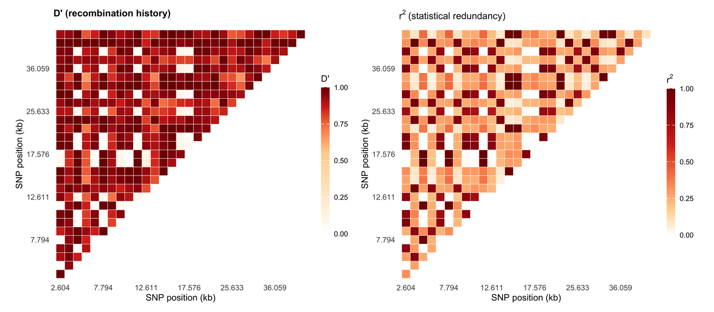

连锁不平衡（LD）是两位点等位基因的非随机共现，LD 三角图是关联研究呈现它的标准方式：每对 SNP 是一个单元格，颜色为 D′ 或 r²，高 LD 的块标记出关联检验可以整体处理为单元的**单倍型片段**。两个统计量*不可互换*：某一等位基因频率很低时 D′ 仍会很高，而 r² 随等位基因频率下降——因此一张图要么固定其中一个统计量，要么两者并出。

本教程用纯 R 重建 LDBlockShow / Haploview 的版式 \[1,2\]：同序排列的 D′ 与 r² 三角图、共享坐标轴的基因结构轨，以及按群体分面的版本。

## 示例

{fig-alt="连锁不平衡图 DEMO" fig-align="center" width="85%"}

30 个 HLA II 类区 SNP 的连锁不平衡三角图：左侧为 D'（重组历史），右侧为 r²（统计冗余），两者使用完全相同的 SNP 顺序与颜色范围，因此可以逐格比较。在 D' 中很热、在 r² 中偏冷的区块对应等位频率不对称——只看单一指标就会把它掩盖掉。

## Setup

-   系统要求：跨平台（Linux/MacOS/Windows）

-   编程语言：R

-   依赖包：`ggplot2`；`dplyr`；`tidyr`；`patchwork`；`scales`

```{r packages setup, message=FALSE, warning=FALSE, output=FALSE}
if (!requireNamespace("ggplot2", quietly = TRUE)) install.packages("ggplot2")
if (!requireNamespace("dplyr", quietly = TRUE)) install.packages("dplyr")
if (!requireNamespace("tidyr", quietly = TRUE)) install.packages("tidyr")
if (!requireNamespace("patchwork", quietly = TRUE)) install.packages("patchwork")
if (!requireNamespace("scales", quietly = TRUE)) install.packages("scales")

library(ggplot2)
library(dplyr)
library(tidyr)
library(patchwork)
library(scales)
```

```{r}
sessioninfo::session_info("attached")
```

## 数据准备

模拟两个群体在 *HLA* II 类区约 36 kb 内的 30 个 SNP：欧洲祖源面板含两个较长的保守单倍型片段，非洲祖源面板含三个较短片段——这与两个群体 LD 延伸长度差异的既有结论一致。单倍型按片段拷贝祖先单倍型生成，因此 LD 块是构造出来的而非偶然出现；D′ 与 r² 随后按教科书公式从剂量矩阵直接计算。CEU 的断点固定在 SNP 15，YRI 的断点固定在 SNP 10 与 20，确保二片段/三片段设计没有歧义；founder 单倍型、分离位点与基因型仍然由模拟生成。

```{r load data, message=FALSE, warning=FALSE}
set.seed(4353)

n_snp <- 30
snp_pos <- sort(sample(2e3:4.2e4, n_snp))

## Haplotype simulation by segment-wise founder copying. Breakpoints split
## the locus into segments; within a segment every simulated haplotype copies
## one of four founder haplotypes, with a small per-site error rate. Blocks of
## high LD therefore appear by construction, and D' / r^2 are computed from
## the resulting 0/1/2 dosage matrix — no value is painted into the figure.
simulate_pop <- function(n_ind, breaks, e = 0.001, mut = 0.001) {
  ## Breakpoints split the locus into segments; each simulated haplotype
  ## copies one founder haplotype within a segment. That is the standard
  ## four-founder / ancestral-haplotype caricature of LD. The founder pool
  ## is deliberately close to two ancestral states: f1 is all reference,
  ## f2 is all alternate, and f3/f4 carry rare derived alleles.
  segment <- cumsum(c(TRUE, seq_len(n_snp - 1) %in% breaks))
  n_seg <- max(segment)
  n_hap <- 120
  f1 <- rep(0L, n_snp)
  f2 <- rep(1L, n_snp)
  f3 <- f1; f3[runif(n_snp) < mut] <- 1L
  f4 <- f2; f4[runif(n_snp) < mut] <- 0L
  founder <- rbind(f1, f2, f3, f4)
  hap <- matrix(0L, n_hap, n_snp)
  for (k in seq_len(n_hap)) {
    for (seg in seq_len(n_seg)) {
      cols <- which(segment == seg)
      ## Draw a founder independently for every segment. A deterministic
      ## rotation would preserve the same haplotype across a breakpoint and
      ## silently erase the very LD boundary the example is meant to show.
      h <- sample.int(4, 1)
      hap[k, cols] <- founder[h, cols]
      flip <- which(runif(length(cols)) < e)
      hap[k, cols[flip]] <- 1L - hap[k, cols[flip]]
    }
  }
  a <- matrix(sample(seq_len(n_hap), n_ind * 2, replace = TRUE), n_ind, 2)
  list(hap = hap, segment = segment,
       geno = hap[a[, 1], , drop = FALSE] + hap[a[, 2], , drop = FALSE])
}

pops <- list(
  "European (CEU)" = simulate_pop(320, breaks = 15),
  "African (YRI)"  = simulate_pop(300, breaks = c(10, 20))
)
## Sanity check: every SNP must be polymorphic before LD is meaningful.
vapply(pops, function(p) {
  af <- colMeans(p$genotype <- p$geno) / 2
  sum(af > 0 & af < 1)
}, integer(1))

## D' and r^2 from a 0/1/2 dosage matrix (the formula used by PLINK --r2 and
## LDBlockShow): p_A, p_B from allele frequencies, D from joint haplotypes
## estimated by the composite ( EM-free ) count from genotypes.
ld_pair <- function(g1, g2) {
  ## g = 0/1/2 dosage. Cov(dosage1, dosage2) = 2 D, so D = Cov / 2.
  f1 <- mean(g1) / 2; f2 <- mean(g2) / 2
  if (f1 %in% c(0, 1) || f2 %in% c(0, 1)) return(c(Dprime = NA_real_, r2 = NA_real_))
  d <- stats::cov(g1, g2) / 2
  denom <- if (d >= 0) min(f1 * (1 - f2), (1 - f1) * f2) else
    min(f1 * f2, (1 - f1) * (1 - f2))
  dprime <- if (denom > 0) abs(d) / denom else NA_real_
  r2 <- d^2 / (f1 * (1 - f1) * f2 * (1 - f2))
  c(Dprime = min(dprime, 1), r2 = min(r2, 1))
}

ld_long <- function(geno, pop) {
  out <- list()
  for (i in 1:(n_snp - 1)) {
    for (j in (i + 1):n_snp) {
      v <- ld_pair(geno[, i], geno[, j])
      out[[length(out) + 1]] <- data.frame(pop = pop, i = i, j = j,
                                           Dprime = v["Dprime"], r2 = v["r2"],
                                           row.names = NULL)
    }
  }
  do.call(rbind, out)
}

ld <- bind_rows(lapply(names(pops), function(nm) ld_long(pops[[nm]]$geno, nm))) |>
  mutate(pop = factor(pop, levels = names(pops))) |>
  left_join(tibble(i = seq_len(n_snp), pos_i = snp_pos), by = "i") |>
  left_join(tibble(j = seq_len(n_snp), pos_j = snp_pos), by = "j")

## Verify the construction: report the LD across each fixed breakpoint and the
## number of strong adjacent pairs; the block figure calls blocks with the same
## D' > 0.7 and r^2 > 0.45 rule.
break_ld <- ld |>
  filter(j == i + 1, i %in% c(9, 14, 19)) |>
  group_by(pop) |>
  summarise(mean_Dprime = mean(Dprime, na.rm = TRUE),
            mean_r2 = mean(r2, na.rm = TRUE),
            .groups = "drop")

n_blocks <- ld |>
  filter(j == i + 1) |>
  mutate(strong = !is.na(Dprime) & !is.na(r2) & Dprime > 0.7 & r2 > 0.45) |>
  group_by(pop) |>
  summarise(n_strong = sum(strong), n_pairs = n(), .groups = "drop") |>
  ungroup()

list(break_ld = break_ld, n_blocks = n_blocks)
```

## 可视化

### 1. 同序排列的 D′ 与 r² 三角图

两个面板刻意共用 SNP 顺序：读者要在同一 SNP 对上比较两种统计量。D′ 反映历史重组，在长距离上仍保持较高；r² 反映统计冗余，下降更快——正是这一差异决定了关联效力用 r² 而非 D′ 来概括。

```{r}
#| label: fig-1.1LdTriangles
#| fig-cap: "30 个 HLA II 类区 SNP 的连锁不平衡三角图：左为 D'（重组历史），右为 r^2（统计冗余）；两者使用完全相同的 SNP 顺序与色标范围，因此可逐格比较两种统计量。"
#| out.width: "100%"
#| warning: false
#| message: false
#| fig-width: 10.5
#| fig-height: 4.6
#| fig-dpi: 300

ceu <- filter(ld, pop == "European (CEU)")

ld_triangle <- function(dat, value, title) {
  ## Cells are indexed by SNP order (not physical position): every pair must
  ## get the same visual weight, and irregular SNP spacing would otherwise
  ## make far-apart pairs look like thin lines. The physical position is
  ## recovered from the axis labels.
  brk <- seq(1, n_snp, by = 5)
  ggplot(dat, aes(i, j)) +
    geom_tile(aes(fill = .data[[value]]), colour = "white", linewidth = 0.18) +
    scale_fill_gradientn(colours = c("#ffffff", "#fdd49e", "#fc8d59", "#d7301f",
                                     "#7f0000"),
                         limits = c(0, 1),
                         values = if (value == "Dprime") c(0, .55, .72, .86, 1) else
                           c(0, .18, .38, .62, 1),
                         na.value = "grey92",
                         name = if (value == "Dprime") "D'" else expression(r^2)) +
    scale_x_continuous(breaks = brk, labels = snp_pos[brk] / 1000,
                       expand = c(0.01, 0.01)) +
    scale_y_continuous(breaks = brk, labels = snp_pos[brk] / 1000,
                       expand = c(0.01, 0.01)) +
    coord_fixed() +
    labs(x = "SNP position (kb)", y = "SNP position (kb)", title = title) +
    theme_minimal(base_size = 9.5) +
    theme(panel.grid = element_blank(),
          plot.title = element_text(face = "bold", size = 10),
          axis.text = element_text(size = 8),
          legend.key.height = unit(1.1, "cm"),
          legend.key.width = unit(0.32, "cm"))
}

p_dp <- ld_triangle(ceu, "Dprime", "D' (recombination history)")
p_r2 <- ld_triangle(ceu, "r2", expression("r"^2 ~ "(statistical redundancy)"))

p_dp + p_r2 + plot_layout(ncol = 2)
```

::: callout-tip
**Practice tips**

-   绝不要在未标明具体统计量的情况下让 D′ 与 r² 共用一套色标：相同的配色会被读作相同含义，审稿人会把深色格一律理解成"强 LD"。
-   两个统计量都把色标 `limits = c(0, 1)` 固定住。按面板自动缩放会让弱连锁区域看起来和强 LD 块一样饱和。
-   图注中报告 SNP 数量与窗口大小；500 个 SNP 的三角图在印刷尺寸下无法阅读，此时若做了分箱必须在图注中声明。
-   版面紧张时画三角而非完整对称矩阵——矩阵有一半面积是重复单元格。若读者需要把某个 SNP 对追到两个坐标轴，则保留方形布局。
:::

### 2. LD 块、基因轨与群体分面

仅有 LD 三角图无法说明这些块*是什么*。LDBlockShow 的贡献是把基因结构放在同一坐标轴下、并按群体分面，于是图从"一堆数字的矩阵"变成关于单倍型多样性的论断。

```{r}
#| label: fig-1.2LdBlocksGenes
#| fig-cap: "按群体分面的 LD 矩阵，下方共享同一坐标轴的 HLA II 类区基因结构轨：欧洲面板呈现两个较长的高 LD 块，非洲面板呈现三个更短的块，这正是预期的 LD 衰减——传达信息的是块边界，而不是颜色深浅。"
#| out.width: "100%"
#| warning: false
#| message: false
#| fig-width: 7.6
#| fig-height: 7.4
#| fig-dpi: 300

## Block calling on the composite LD measure: a boundary is a SNP pair whose
## linkage falls below the strong-LD threshold (Gabriel et al. convention).
blocks_of <- function(dat, thr = 0.7) {
  d <- filter(dat, j == i + 1) |>
    mutate(strong = !is.na(Dprime) & !is.na(r2) & Dprime > thr & r2 > 0.45)
  ## Consecutive strong pairs belong to the same block.
  block_id <- cumsum(c(TRUE, diff(d$i) > 1 | !d$strong[-length(d$strong)]))
  tibble(i = d$i, block = block_id) |>
    mutate(block = as.integer(factor(block)))
}

block_bounds <- ld |>
  group_by(pop) |>
  group_modify(~ blocks_of(.x)) |>
  ungroup()

block_labels <- block_bounds |>
  group_by(pop, block) |>
  summarise(start = snp_pos[min(i)] / 1000, end = snp_pos[max(i)] / 1000,
            .groups = "drop") |>
  mutate(label = paste0("B", block))

## Gene coordinates are converted from kb to SNP order, so the gene track
## shares the heatmap's x axis exactly (index positions, not physical ones).
to_index <- function(kb) approx(snp_pos / 1000, seq_len(n_snp), xout = kb,
                                rule = 1)$y
genes <- tibble(
  start_kb = c(4.0, 6.2, 8.4, 12.1, 15.6, 20.4),
  end_kb = c(6.1, 8.3, 10.9, 15.4, 18.9, 24.8),
  strand = c(1, 1, 1, -1, -1, -1),
  name = c("HLA-DRA", "HLA-DRB1", "HLA-DQA1", "HLA-DQB1", "HLA-DPA1", "TAP1")
) |>
  mutate(start = to_index(start_kb), end = to_index(end_kb))

## Blocks are a property of each population, so the boundary lines are
## computed per facet and drawn as segments, not as a single global vline.
## Per-population block boundaries. A boundary between SNP b and b+1 is
## drawn as a vertical line spanning the upper triangle (j > b).
block_edges <- block_bounds |>
  group_by(pop) |>
  arrange(i) |>
  mutate(new_block = block != lag(block)) |>
  filter(!is.na(new_block) & new_block) |>
  ungroup() |>
  transmute(pop, i0 = i, j0 = i + 1, j1 = n_snp)

p_ld <- ggplot(ld, aes(i, j)) +
  geom_tile(aes(fill = r2), colour = "white", linewidth = 0.18) +
  geom_segment(data = block_edges,
               aes(x = i0, xend = i0, y = j0, yend = j1),
               inherit.aes = FALSE, colour = "#1f4e79", linewidth = 0.45,
               linetype = "22") +
  scale_fill_gradientn(colours = c("#ffffff", "#c6dbef", "#6baed6", "#2171b5",
                                   "#08306b"),
                       limits = c(0, 1), values = c(0, .2, .45, .7, 1),
                       na.value = "grey92", name = expression(r^2)) +
  scale_x_continuous(breaks = seq(1, n_snp, 5)) +
  scale_y_continuous(breaks = seq(1, n_snp, 5)) +
  coord_fixed() +
  facet_wrap(~pop, ncol = 1) +
  labs(x = "SNP order (5 SNPs per tick)", y = "SNP order") +
  theme_minimal(base_size = 9.5) +
  theme(panel.grid = element_blank(),
        strip.text = element_text(face = "bold", size = 9.5, hjust = 0),
        axis.text = element_text(size = 7.8),
        plot.margin = margin(4, 6, 0, 6))

genes <- genes |>
  mutate(gene_id = row_number(),
         ## Alternate labels above / below the baseline so adjacent gene
         ## names never collide at this density.
         lab_y = if_else(gene_id %% 2 == 1, 0.72, 0.02),
         lab_x = if_else(gene_id %% 2 == 1, start + 0.1, end - 0.1),
         lab_h = if_else(gene_id %% 2 == 1, 0, 1))

p_gene <- ggplot(genes) +
  geom_segment(aes(x = 0.5, xend = n_snp + 0.5, y = 0.35, yend = 0.35),
               colour = "#bdbdbd", linewidth = 0.4) +
  geom_rect(aes(xmin = start, xmax = end, ymin = 0.26, ymax = 0.44),
            fill = "#4d4d4d", colour = NA) +
  geom_segment(aes(x = end - 0.35 * strand, xend = end, y = 0.35, yend = 0.35,
                   colour = factor(strand)),
               arrow = arrow(length = unit(1.3, "mm"), type = "closed"),
               linewidth = 0.4, show.legend = FALSE) +
  geom_segment(aes(x = lab_x, xend = lab_x, y = 0.44, yend = lab_y - 0.03),
               colour = "#9e9e9e", linewidth = 0.3) +
  geom_text(aes(x = lab_x, y = lab_y, label = name, hjust = lab_h),
            size = 2.35, colour = "#333333") +
  scale_colour_manual(values = c(`1` = "#4d4d4d", `-1` = "#4d4d4d")) +
  scale_x_continuous(limits = c(0.5, n_snp + 0.5), breaks = seq(1, n_snp, 5),
                     expand = c(0, 0)) +
  scale_y_continuous(limits = c(-0.06, 0.82)) +
  labs(x = "SNP order (5 SNPs per tick; panels label physical kb)", y = NULL) +
  theme_classic(base_size = 9) +
  theme(axis.line.y = element_blank(), axis.text.y = element_blank(),
        axis.ticks.y = element_blank(), axis.title.x = element_text(size = 8.2),
        axis.text.x = element_text(size = 7.8),
        axis.line.x = element_line(colour = "#bdbdbd", linewidth = 0.3),
        plot.margin = margin(0, 6, 4, 6))

p_ld / p_gene + plot_layout(heights = c(1, 0.20))
```

::: callout-tip
**Practice tips**

-   用明确规则定义块（此处为相邻 SNP 间 Gabriel 标准的 D′ > 0.7 且 r² > 0.45），并写进图注；没有规则的"块"不可复现。
-   按群体分面时保持相同色标范围。一个群体块长、另一个块短是生物学结果，不是渲染差异。
-   基因模型必须放在*同一*坐标轴下。把基因图放到别处会迫使读者用眼睛换算坐标。
-   明确标出关键调控基因（此处为 HLA-DRB1）：读者需要知道哪个块压在哪个基因上。
:::

## 应用

LD 三角图是候选基因定位与精细定位研究的标准图：它给出单倍型标签 SNP 选择的依据、显示信号是单变异还是单倍型，并让审稿人看到位点中有多少是独立的。D′ / r² 并出是最常见的审稿要求，因为长 D′ 块内 r² 偏低的强关联意味着因果变异未必就是索引 SNP。

同一构造适用于任何"有序特征的两两相似度矩阵"——拷贝数片段、甲基化探针或蛋白结构域——只要取值落在 [0, 1] 且特征顺序有意义。

## 参考文献

\[1\] Barrett JC, Fry B, Maller J, Daly MJ. Haploview: analysis and visualization of LD and haplotype maps. Bioinformatics. 2005;21(2):263-265. doi:10.1093/bioinformatics/bth457

\[2\] Dong SS, He WM, Ji JJ, et al. LDBlockShow: a fast and convenient tool for visualizing linkage disequilibrium and haplotype blocks based on variant call format files. Brief Bioinform. 2021;22(4):bbaa227. doi:10.1093/bib/bbaa227

\[3\] Gabriel SB, Schaffner SF, Nguyen H, et al. The structure of haplotype blocks in the human genome. Science. 2002;296(5576):2225-2229. doi:10.1126/science.1069424
