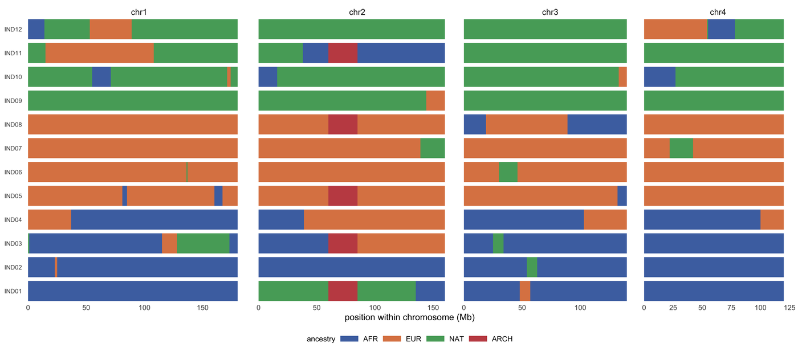

Local ancestry is a per-position, per-haplotype label: for each point in the genome, which source population did this copy come from. The figures built on it differ only in what they do with the label. An **ancestry painting** keeps every tract boundary; a **stacked area** averages the labels along a chromosome; a **coancestry matrix** reduces the whole genome to pairwise sharing \[1-4\]. The three are usually shown together because each one hides exactly what the previous one shows.

This tutorial builds all three from one simulated admixed cohort of 12 individuals, four chromosomes and a planted 25 Mb archaic haplotype, so the tract boundaries are known and can be checked against the figure.

## Example

{fig-alt="Local Ancestry Plot DEMO" fig-align="center" width="85%"}

Ancestry painting for 12 admixed individuals across four chromosomes: each row is one individual and each colour a source population (AFR, EUR, NAT; archaic in red). Tract lengths carry the signal, and the archaic haplotype is the single red block at chr2:60-85 Mb shared by five carriers. Facet widths are proportional to chromosome length, so blocks are comparable within a chromosome and not across them.

## Setup

-   System Requirements: Cross-platform (Linux/MacOS/Windows)

-   Programming language: R

-   Dependent packages: `ggplot2`; `dplyr`; `tidyr`; `patchwork`

```{r packages setup, message=FALSE, warning=FALSE, output=FALSE}
if (!requireNamespace("ggplot2", quietly = TRUE)) install.packages("ggplot2")
if (!requireNamespace("dplyr", quietly = TRUE)) install.packages("dplyr")
if (!requireNamespace("tidyr", quietly = TRUE)) install.packages("tidyr")
if (!requireNamespace("patchwork", quietly = TRUE)) install.packages("patchwork")

library(ggplot2)
library(dplyr)
library(tidyr)
library(patchwork)
```

```{r}
sessioninfo::session_info("attached")
```

## Data Preparation

The simulated cohort has 12 admixed individuals, four chromosomes, and one 25 Mb archaic haplotype shared by five individuals. Tracts come from a 1 Mb Markov chain with a 3% switch rate; because a switch often re-draws the same ancestry, realised tracts run to tens of Mb.

```{r load data, message=FALSE, warning=FALSE}
set.seed(43520)

## Four chromosomes, 12 admixed individuals from three source populations, and
## one 25 Mb archaic haplotype shared by five of them. Tracts are drawn from a
## 1 Mb Markov chain with a 3% switch rate (switches often re-draw the same
## ancestry, so realised tracts run to tens of Mb).
chroms <- data.frame(chr = paste0("chr", 1:4), len = c(180, 160, 140, 120))
inds <- sprintf("IND%02d", 1:12)
groups <- rep(c("AFR", "EUR", "NAT"), each = 4)
props <- list(AFR = c(AFR = .80, EUR = .15, NAT = .05),
              EUR = c(AFR = .10, EUR = .85, NAT = .05),
              NAT = c(AFR = .05, EUR = .10, NAT = .85))

tracts <- do.call(rbind, lapply(inds, function(id) {
  g <- groups[match(id, inds)]
  do.call(rbind, lapply(seq_len(nrow(chroms)), function(k) {
    n <- chroms$len[k]
    st <- character(n)
    cur <- sample(names(props[[g]]), 1, prob = props[[g]])
    for (i in seq_len(n)) {
      if (i > 1 && runif(1) < 0.03) cur <- sample(names(props[[g]]), 1, prob = props[[g]])
      st[i] <- cur
    }
    data.frame(ind = id, chr = chroms$chr[k], start = seq_len(n) - 1,
               end = seq_len(n), anc = st,
               run = cumsum(c(TRUE, st[-1] != st[-n])))
  }))
}))

## Collapse consecutive equal calls into one tract per run.
tracts <- tracts |>
  group_by(ind, chr, run) |>
  summarise(anc = first(anc), start = min(start), end = max(end), .groups = "drop")

## Plant the archaic haplotype: five carriers, chr2:60-85 Mb. Tracts that
## overlap the interval are split at its boundaries, not deleted: deleting a
## whole tract would leave the rest of that chromosome unpainted.
carriers <- c("IND01", "IND03", "IND05", "IND08", "IND11")
is_carrier <- function(d) d$ind %in% carriers & d$chr == "chr2"
left <- tracts |> filter(is_carrier(tracts), start < 60) |> mutate(end = pmin(end, 60))
right <- tracts |> filter(is_carrier(tracts), end > 85) |> mutate(start = pmax(start, 85))
seg <- tracts |> filter(!is_carrier(tracts)) |>
  bind_rows(left, right,
            data.frame(ind = carriers, chr = "chr2", anc = "ARCH",
                       start = 60, end = 85, run = 999)) |>
  mutate(anc = factor(anc, levels = c("AFR", "EUR", "NAT", "ARCH"))) |>
  arrange(ind, chr, start)

pal_anc <- c(AFR = "#4c72b0", EUR = "#dd8452", NAT = "#55a868", ARCH = "#c44e52")
ypos <- setNames(seq_along(inds), inds)
seg$y <- ypos[seg$ind]
```

## Visualization

### 1. Ancestry Painting Along the Chromosomes

Local-ancestry tools (RFMix, MOSAIC, tagore) output one ancestry label per position per haplotype; the painting is the direct rendering of that table, one row per individual and one colour per source population \[1,3\]. It is the only view that shows **tract structure**: the length of a colour block is the length of a segment inherited intact from one source, and that length is the quantity that dates an admixture event. A pie chart of genome-wide proportions would have the same colours and none of the information \[4\].

```{r}
#| label: fig-1AncestryPainting
#| fig-cap: "Simulated ancestry painting for 12 admixed individuals across four chromosomes: each row is one individual, each colour a source population (AFR, EUR, NAT; archaic in red). Tract lengths are the signal — a long block is a segment inherited intact — and the archaic haplotype is the single red block at chr2:60-85 Mb in the five carriers. Facet widths are proportional to chromosome length, so blocks are comparable within a chromosome and not across them."
#| out.width: "100%"
#| warning: false
#| message: false
#| fig-width: 10
#| fig-height: 4.4
#| fig-dpi: 300

ggplot(seg) +
  geom_rect(aes(xmin = start, xmax = end, ymin = y - 0.42, ymax = y + 0.42,
                fill = anc)) +
  facet_grid(~ chr, scales = "free_x", space = "free_x") +
  scale_fill_manual(values = pal_anc, name = "ancestry") +
  scale_y_continuous(breaks = seq_along(inds), labels = inds, expand = c(0, 0)) +
  scale_x_continuous(expand = expansion(mult = c(0.01, 0.07))) +
  labs(x = "position within chromosome (Mb)", y = NULL) +
  theme_minimal(base_size = 8) +
  theme(panel.grid = element_blank(),
        axis.text.y = element_text(size = 5.6),
        legend.position = "bottom", legend.direction = "horizontal",
        legend.key.height = unit(0.22, "cm"),
        legend.text = element_text(size = 6.6),
        legend.title = element_text(size = 6.8),
        strip.text = element_text(size = 7.5))
```

### 2. Ancestry Proportion Along One Chromosome

The same calls summarised as a stacked area along chr2, averaged over the 12 individuals in 1 Mb windows. The archaic haplotype at 60-85 Mb is a step in the red component: five of the twelve individuals carry it, so the population-level proportion rises to about 0.4 rather than to 1. Averaging is useful for reading selection and introgression, but it destroys the tract boundaries that the painting shows, so the two views belong together \[2,4\].

```{r}
#| label: fig-2AncestryProportion
#| fig-cap: "Mean ancestry proportion across the 12 individuals along chr2 in 1 Mb windows, stacked to 1. The archaic haplotype at 60-85 Mb raises the red component to about 0.4, the fraction of the sampled individuals that carry it, rather than to 1. The step boundaries are the same ones visible in the painting above."
#| out.width: "100%"
#| warning: false
#| message: false
#| fig-width: 6.4
#| fig-height: 3.0
#| fig-dpi: 300

## Population-level ancestry proportion along chr2: the mean over the 12
## individuals in each 1 Mb window. The archaic block is the step at 60-85 Mb.
d2 <- filter(seg, chr == "chr2")
## Population-level proportion = mean over the 12 individuals, each counted
## once. Taking the mean over tract rows would silently weight individuals by
## how many tracts they happen to carry (here 28 rows for 12 people).
carriers <- function(a, pos) mean(vapply(unique(d2$ind), function(id)
  any(d2$anc == a & d2$ind == id & d2$start <= pos & d2$end > pos), logical(1)))
win <- data.frame(pos = 0:159) |>
  rowwise() |>
  mutate(AFR = carriers("AFR", pos),
         EUR = carriers("EUR", pos),
         NAT = carriers("NAT", pos),
         ARCH = carriers("ARCH", pos)) |>
  ungroup() |>
  pivot_longer(c(AFR, EUR, NAT, ARCH), names_to = "anc", values_to = "frac") |>
  mutate(anc = factor(anc, levels = c("AFR", "EUR", "NAT", "ARCH")))

ggplot(win, aes(pos, frac, fill = anc)) +
  geom_area(position = "stack", colour = NA) +
  annotate("rect", xmin = 60, xmax = 85, ymin = 0, ymax = 1,
           fill = NA, colour = "#c44e52", linetype = 2, linewidth = 0.4) +
  annotate("text", x = 72.5, y = 1.04, label = "archaic haplotype",
           size = 2.4, colour = "#c44e52") +
  scale_fill_manual(values = pal_anc, name = "ancestry") +
  scale_x_continuous(expand = c(0.005, 0.005)) +
  scale_y_continuous(expand = c(0, 0), breaks = c(0, 0.5, 1), limits = c(0, 1.12)) +
  labs(x = "chr2 position (Mb)", y = "ancestry proportion") +
  theme_minimal(base_size = 8) +
  theme(panel.grid.minor = element_blank(), legend.position = "bottom",
        legend.direction = "horizontal", legend.key.height = unit(0.22, "cm"),
        legend.text = element_text(size = 6.6), legend.title = element_text(size = 6.8))
```

### 3. Coancestry Matrix From the Same Tracts

ChromoPainter and fineSTRUCTURE summarise relatedness as the number of shared haplotype chunks, which is a coancestry matrix; here the same idea is computed directly as the fraction of the genome on which two individuals carry the same ancestry label \[1\]. Clustering that matrix recovers the three source groups without being told them, and the five archaic carriers raise sharing across group boundaries. The matrix is a summary of the painting, not an independent experiment, and it should be read that way.

```{r}
#| label: fig-3CoancestryMatrix
#| fig-cap: "Pairwise coancestry among the 12 individuals, computed as the fraction of 1 Mb bins with the same ancestry label and clustered by 1 - similarity. Three high-similarity blocks recover the AFR, EUR and NAT groups without using the group labels, and the archaic carriers raise sharing between groups; the diagonal is grey because self-similarity is 1 by construction."
#| out.width: "100%"
#| warning: false
#| message: false
#| fig-width: 5.0
#| fig-height: 4.6
#| fig-dpi: 300

## Coancestry from the same tracts: the fraction of 1 Mb bins in which two
## individuals carry the same ancestry label, clustered by 1 - similarity.
state_vec <- function(id) {
  unlist(lapply(chroms$chr, function(ch) {
    a <- seg |> filter(ind == id, chr == ch) |> arrange(start)
    v <- rep(NA_character_, chroms$len[chroms$chr == ch])
    for (k in seq_len(nrow(a))) v[(a$start[k] + 1):a$end[k]] <- as.character(a$anc[k])
    v
  }))
}
states <- setNames(lapply(inds, state_vec), inds)
co <- expand.grid(ind1 = inds, ind2 = inds, stringsAsFactors = FALSE)
co$same <- mapply(function(a, b) mean(states[[a]] == states[[b]], na.rm = TRUE),
                  co$ind1, co$ind2)
mat <- co |> pivot_wider(names_from = ind2, values_from = same) |>
  tibble::column_to_rownames("ind1") |> as.matrix()
ord <- hclust(as.dist(1 - mat), method = "average")$order
co$ind1 <- factor(co$ind1, levels = inds[ord])
co$ind2 <- factor(co$ind2, levels = inds[ord])
co$same <- ifelse(co$ind1 == co$ind2, NA, co$same)

ggplot(co, aes(ind1, ind2, fill = same)) +
  geom_tile() +
  scale_fill_gradientn("shared\nancestry",
                       colours = c("#f7f7f7", "#fdae6b", "#a63603"),
                       limits = c(0, 1), na.value = "#e0e0e0") +
  coord_equal() +
  labs(x = NULL, y = NULL) +
  theme_minimal(base_size = 8) +
  theme(axis.text.x = element_text(angle = 90, hjust = 1, vjust = 0.5, size = 5.6),
        axis.text.y = element_text(size = 5.6), panel.grid = element_blank(),
        legend.key.height = unit(0.7, "cm"),
        legend.text = element_text(size = 6.2),
        legend.title = element_text(size = 6.6))
```

::: callout-tip
**Practice tips**

-   Draw one row per individual, not one row per population. The tract structure is the result; aggregating before the reader sees it removes the evidence for the admixture date.
-   Keep chromosome facets at their real relative widths, or state that they are not comparable. A 180 Mb chromosome drawn as wide as a 120 Mb one makes tract lengths look equal when they are not.
-   State the number of source populations and whether they were supplied or inferred. RFMix and tagore need reference panels; MOSAIC can infer the groups. The figure cannot tell the reader which was done.
-   Show the local-ancestry uncertainty if the caller provides it. A hard-call painting looks just as confident at a switch point as in the middle of a 30 Mb tract, which is rarely true.
-   Separate the painting from the summary. The stacked area answers "how much of this chromosome is archaic"; the painting answers "where". Do not use one to support the other's claim.
-   Label the archaic or introgressed block explicitly. An unlabelled red block reads as a fourth source population, which is a different biological statement.
:::

## Application

Local-ancestry figures are the basic plates of admixed-population genetics: the **painting** tests tract length against admixture date, the **chromosome profile** localises selection and introgression signals, and the **coancestry matrix** confirms structure and sample relatedness. All three share one tract table here, so if one contradicts the other two, the binning or the label definition should be suspected before the data.

## Reference
\[1\] Lawson DJ, Hellenthal G, Myers S, Falush D. Inference of population structure using dense haplotype data. PLoS Genet. 2012;8(1):e1002453. doi:10.1371/journal.pgen.1002453

\[2\] Salter-Townshend M, Myers S. Fine-scale inference of ancestry segments without prior knowledge of admixing groups. Genetics. 2019;212(3):869-889. doi:10.1534/genetics.119.302139

\[3\] Maples BK, Gravel S, Kenny EE, Bustamante CD. RFMix: a discriminative modeling approach for rapid and robust local-ancestry inference. Am J Hum Genet. 2013;93(2):278-288. doi:10.1016/j.ajhg.2013.06.020

\[4\] Korunes KL, Goldberg A. Human genetic admixture. PLoS Genet. 2021;17(3):e1009374. doi:10.1371/journal.pgen.1009374
