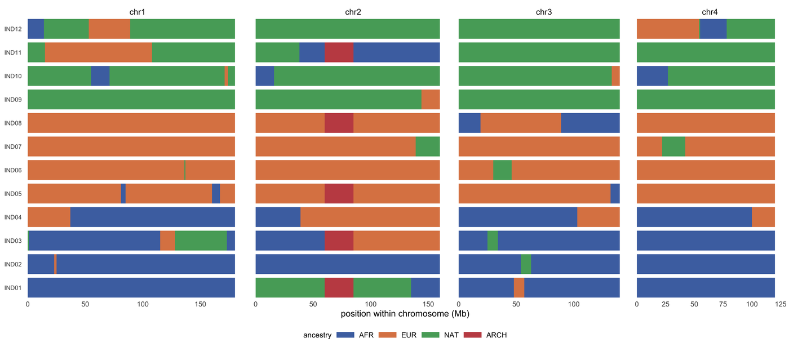

局部祖源是逐位置、逐单倍型的标签：基因组上的每一点，这一份拷贝来自哪个来源群体。建立在其上的图形区别只在于怎样处理这个标签。**祖源 painting** 保留每一条片段边界；**堆叠面积图**沿染色体对标签取平均；**共祖矩阵**把整个基因组压缩成两两共享度 \[1-4\]。三者通常一起展示，因为每一个恰好隐藏了前一个所展示的东西。

本教程用同一个模拟混合队列（12 个个体、4 条染色体、植入的 25 Mb 古老单倍型）画出这三种视图，因此片段边界是已知的，可以逐项核对图形。

## 示例

{fig-alt="局部祖源图 DEMO" fig-align="center" width="85%"}

12 个混合个体、覆盖 4 条染色体的祖源涂色图：每行一个个体，每种颜色代表一个源群体（AFR、EUR、NAT，古人类为红色）。信号体现在片段长度上，古人类单倍型就是 chr2:60-85 Mb 处那块由 5 个携带者共享的红色区段。分面宽度与染色体长度成正比，因此片段可在同一染色体内比较，但不能跨染色体比较。

## 环境配置

-   系统要求： 跨平台（Linux/MacOS/Windows）

-   编程语言：R

-   依赖包：`ggplot2`；`dplyr`；`tidyr`；`patchwork`

```{r packages setup, message=FALSE, warning=FALSE, output=FALSE}
if (!requireNamespace("ggplot2", quietly = TRUE)) install.packages("ggplot2")
if (!requireNamespace("dplyr", quietly = TRUE)) install.packages("dplyr")
if (!requireNamespace("tidyr", quietly = TRUE)) install.packages("tidyr")
if (!requireNamespace("patchwork", quietly = TRUE)) install.packages("patchwork")

library(ggplot2)
library(dplyr)
library(tidyr)
library(patchwork)
```

```{r}
sessioninfo::session_info("attached")
```

## 数据准备

模拟队列包含 12 个混合个体、4 条染色体与一段由 5 个个体共享的 25 Mb 古老单倍型。片段来自 1 Mb 马尔可夫链，切换率为 3%（平均片段约 33 Mb）。

```{r load data, message=FALSE, warning=FALSE}
set.seed(43520)

## Four chromosomes, 12 admixed individuals from three source populations, and
## one 25 Mb archaic haplotype shared by five of them. Tracts are drawn from a
## 1 Mb Markov chain with a 3% switch rate (mean tract about 33 Mb).
chroms <- data.frame(chr = paste0("chr", 1:4), len = c(180, 160, 140, 120))
inds <- sprintf("IND%02d", 1:12)
groups <- rep(c("AFR", "EUR", "NAT"), each = 4)
props <- list(AFR = c(AFR = .80, EUR = .15, NAT = .05),
              EUR = c(AFR = .10, EUR = .85, NAT = .05),
              NAT = c(AFR = .05, EUR = .10, NAT = .85))

tracts <- do.call(rbind, lapply(inds, function(id) {
  g <- groups[match(id, inds)]
  do.call(rbind, lapply(seq_len(nrow(chroms)), function(k) {
    n <- chroms$len[k]
    st <- character(n)
    cur <- sample(names(props[[g]]), 1, prob = props[[g]])
    for (i in seq_len(n)) {
      if (i > 1 && runif(1) < 0.03) cur <- sample(names(props[[g]]), 1, prob = props[[g]])
      st[i] <- cur
    }
    data.frame(ind = id, chr = chroms$chr[k], start = seq_len(n) - 1,
               end = seq_len(n), anc = st,
               run = cumsum(c(TRUE, st[-1] != st[-n])))
  }))
}))

## Collapse consecutive equal calls into one tract per run.
tracts <- tracts |>
  group_by(ind, chr, run) |>
  summarise(anc = first(anc), start = min(start), end = max(end), .groups = "drop")

## Plant the archaic haplotype: five carriers, chr2:60-85 Mb. Tracts that
## overlap the interval are split at its boundaries, not deleted: deleting a
## whole tract would leave the rest of that chromosome unpainted.
carriers <- c("IND01", "IND03", "IND05", "IND08", "IND11")
is_carrier <- function(d) d$ind %in% carriers & d$chr == "chr2"
left <- tracts |> filter(is_carrier(tracts), start < 60) |> mutate(end = pmin(end, 60))
right <- tracts |> filter(is_carrier(tracts), end > 85) |> mutate(start = pmax(start, 85))
seg <- tracts |> filter(!is_carrier(tracts)) |>
  bind_rows(left, right,
            data.frame(ind = carriers, chr = "chr2", anc = "ARCH",
                       start = 60, end = 85, run = 999)) |>
  mutate(anc = factor(anc, levels = c("AFR", "EUR", "NAT", "ARCH"))) |>
  arrange(ind, chr, start)

pal_anc <- c(AFR = "#4c72b0", EUR = "#dd8452", NAT = "#55a868", ARCH = "#c44e52")
ypos <- setNames(seq_along(inds), inds)
seg$y <- ypos[seg$ind]
```

## 可视化

### 1. 沿染色体的祖源 painting

局部祖源工具（RFMix、MOSAIC、tagore）为每个单倍型的每个位置输出一个祖源标签；painting 就是这张表的直接渲染，每个个体一行、每个来源群体一种颜色 \[1,3\]。它是唯一能展示**片段结构**的视图：一段颜色的长度就是从某个来源完整继承下来的片段长度，而这个长度正是用来推断混合事件年代的量。只画全基因组比例的饼图会有同样的颜色，却不含任何这类信息 \[4\]。

```{r}
#| label: fig-1AncestryPainting
#| fig-cap: "12 个混合个体、4 条染色体的祖源 painting：每行一个个体，每种颜色一个来源群体（AFR、EUR、NAT，古老祖源为红色）。片段长度才是信号——长块就是一段完整继承的片段——古老单倍型表现为 5 个携带者 chr2:60-85 Mb 上的单个红色块。分面宽度与染色体长度成比例，因此块在同一染色体内部可比，跨染色体不可比。"
#| out.width: "100%"
#| warning: false
#| message: false
#| fig-width: 10
#| fig-height: 4.4
#| fig-dpi: 300

ggplot(seg) +
  geom_rect(aes(xmin = start, xmax = end, ymin = y - 0.42, ymax = y + 0.42,
                fill = anc)) +
  facet_grid(~ chr, scales = "free_x", space = "free_x") +
  scale_fill_manual(values = pal_anc, name = "ancestry") +
  scale_y_continuous(breaks = seq_along(inds), labels = inds, expand = c(0, 0)) +
  scale_x_continuous(expand = c(0.01, 0)) +
  labs(x = "position within chromosome (Mb)", y = NULL) +
  theme_minimal(base_size = 8) +
  theme(panel.grid = element_blank(),
        axis.text.y = element_text(size = 5.6),
        legend.position = "bottom", legend.direction = "horizontal",
        legend.key.height = unit(0.22, "cm"),
        legend.text = element_text(size = 6.6),
        legend.title = element_text(size = 6.8),
        strip.text = element_text(size = 7.5))
```

### 2. 单条染色体上的祖源比例

把同样的调用沿 chr2 汇总成堆叠面积图，按 1 Mb 窗口对 12 个个体取平均。60-85 Mb 的古老单倍型表现为红色成分的一个台阶：12 个个体中有 5 个携带它，因此群体层面的比例升到约 0.4 而不是 1。平均有助于解读选择与渗入，但会抹掉 painting 所展示的片段边界，因此两种视图应当配套使用 \[2,4\]。

```{r}
#| label: fig-2AncestryProportion
#| fig-cap: "12 个个体在 chr2 上按 1 Mb 窗口取平均并堆叠到 1 的祖源比例。60-85 Mb 的古老单倍型把红色成分抬到约 0.4，即样本中携带它的个体比例，而不是 1。台阶边界与上方 painting 中的边界一致。"
#| out.width: "100%"
#| warning: false
#| message: false
#| fig-width: 6.4
#| fig-height: 3.0
#| fig-dpi: 300

## Population-level ancestry proportion along chr2: the mean over the 12
## individuals in each 1 Mb window. The archaic block is the step at 60-85 Mb.
d2 <- filter(seg, chr == "chr2")
win <- data.frame(pos = 0:159) |>
  rowwise() |>
  mutate(AFR = mean(as.character(d2$anc) == "AFR" & d2$start <= pos & d2$end > pos),
         EUR = mean(as.character(d2$anc) == "EUR" & d2$start <= pos & d2$end > pos),
         NAT = mean(as.character(d2$anc) == "NAT" & d2$start <= pos & d2$end > pos),
         ARCH = mean(as.character(d2$anc) == "ARCH" & d2$start <= pos & d2$end > pos)) |>
  ungroup() |>
  pivot_longer(c(AFR, EUR, NAT, ARCH), names_to = "anc", values_to = "frac") |>
  mutate(anc = factor(anc, levels = c("AFR", "EUR", "NAT", "ARCH")))

ggplot(win, aes(pos, frac, fill = anc)) +
  geom_area(position = "stack", colour = NA) +
  annotate("rect", xmin = 60, xmax = 85, ymin = 0, ymax = 1,
           fill = NA, colour = "#c44e52", linetype = 2, linewidth = 0.4) +
  annotate("text", x = 72.5, y = 1.04, label = "archaic haplotype",
           size = 2.4, colour = "#c44e52") +
  scale_fill_manual(values = pal_anc, name = "ancestry") +
  scale_x_continuous(expand = c(0.005, 0.005)) +
  scale_y_continuous(expand = c(0, 0), breaks = c(0, 0.5, 1)) +
  labs(x = "chr2 position (Mb)", y = "ancestry proportion") +
  theme_minimal(base_size = 8) +
  theme(panel.grid.minor = element_blank(), legend.position = "bottom",
        legend.direction = "horizontal", legend.key.height = unit(0.22, "cm"),
        legend.text = element_text(size = 6.6), legend.title = element_text(size = 6.8))
```

### 3. 由同一批片段计算的共祖矩阵

ChromoPainter 与 fineSTRUCTURE 用共享单倍型块的数量来概括亲缘关系，即共祖矩阵；这里把同一思想直接算成两个个体携带相同祖源标签的基因组比例 \[1\]。对该矩阵聚类，在没有被告知分组的情况下仍能还原三个来源群体，而 5 个古老单倍型携带者会提高跨群体的共享度。该矩阵是 painting 的汇总，不是独立实验，也应按此解读。

```{r}
#| label: fig-3CoancestryMatrix
#| fig-cap: "12 个个体两两之间的共祖度：定义为 1 Mb 分箱中祖源标签相同的比例，并按 1 减相似度聚类。三个高相似块在没有使用分组标签的情况下还原了 AFR、EUR 与 NAT 三组，古老单倍型携带者提高了组间共享度；对角线为灰色，因为自相似按定义为 1。"
#| out.width: "100%"
#| warning: false
#| message: false
#| fig-width: 5.0
#| fig-height: 4.6
#| fig-dpi: 300

## Coancestry from the same tracts: the fraction of 1 Mb bins in which two
## individuals carry the same ancestry label, clustered by 1 - similarity.
state_vec <- function(id) {
  unlist(lapply(chroms$chr, function(ch) {
    a <- seg |> filter(ind == id, chr == ch) |> arrange(start)
    v <- rep(NA_character_, chroms$len[chroms$chr == ch])
    for (k in seq_len(nrow(a))) v[(a$start[k] + 1):a$end[k]] <- as.character(a$anc[k])
    v
  }))
}
states <- setNames(lapply(inds, state_vec), inds)
co <- expand.grid(ind1 = inds, ind2 = inds, stringsAsFactors = FALSE)
co$same <- mapply(function(a, b) mean(states[[a]] == states[[b]], na.rm = TRUE),
                  co$ind1, co$ind2)
mat <- co |> pivot_wider(names_from = ind2, values_from = same) |>
  tibble::column_to_rownames("ind1") |> as.matrix()
ord <- hclust(as.dist(1 - mat), method = "average")$order
co$ind1 <- factor(co$ind1, levels = inds[ord])
co$ind2 <- factor(co$ind2, levels = inds[ord])
co$same <- ifelse(co$ind1 == co$ind2, NA, co$same)

ggplot(co, aes(ind1, ind2, fill = same)) +
  geom_tile() +
  scale_fill_gradientn("shared\nancestry",
                       colours = c("#f7f7f7", "#fdae6b", "#a63603"),
                       limits = c(0, 1), na.value = "#e0e0e0") +
  coord_equal() +
  labs(x = NULL, y = NULL) +
  theme_minimal(base_size = 8) +
  theme(axis.text.x = element_text(angle = 90, hjust = 1, vjust = 0.5, size = 5.6),
        axis.text.y = element_text(size = 5.6), panel.grid = element_blank(),
        legend.key.height = unit(0.7, "cm"),
        legend.text = element_text(size = 6.2),
        legend.title = element_text(size = 6.6))
```

::: callout-tip
**实践要点**

-   每个个体一行，而不是每个群体一行。片段结构本身就是结果；在读者看到它之前就聚合，会抹掉推断混合年代的证据。
-   染色体分面保持真实的相对宽度，或者明确声明彼此不可比。把 180 Mb 的染色体画得和 120 Mb 一样宽，会让本不相等的片段长度看起来相等。
-   写明来源群体的数量，以及它们是给定的还是推断的。RFMix 与 tagore 需要参考面板，MOSAIC 可以自行推断群体；图本身无法告诉读者做的是哪一种。
-   如果 caller 提供局部祖源的置信度，就展示它。硬调用 painting 在转换点与在 30 Mb 片段中部看起来一样确定，而后者通常并不成立。
-   把 painting 与汇总分开。堆叠面积回答“这条染色体有多少是古老成分”，painting 回答“在哪里”。不要用一个去支持另一个的结论。
-   显式标注古老或渗入片段。一个没有标注的红色块会被读成第四个来源群体，那是另一种生物学陈述。
:::

## 应用

局部祖源图是混合群体遗传学的基础图件：**painting** 用于检验片段长度与混合年代，**沿染色体比例**用于定位选择与渗入信号，**共祖矩阵**用于确认群体结构与样本关系。三张图共用同一份片段数据，任何一张与另外两张矛盾，首先应怀疑的是分箱或标签定义，而不是数据。

## 参考资料
\[1\] Lawson DJ, Hellenthal G, Myers S, Falush D. Inference of population structure using dense haplotype data. PLoS Genet. 2012;8(1):e1002453. doi:10.1371/journal.pgen.1002453

\[2\] Salter-Townshend M, Myers S. Fine-scale inference of ancestry segments without prior knowledge of admixing groups. Genetics. 2019;212(3):869-889. doi:10.1534/genetics.119.302139

\[3\] Maples BK, Gravel S, Kenny EE, Bustamante CD. RFMix: a discriminative modeling approach for rapid and robust local-ancestry inference. Am J Hum Genet. 2013;93(2):278-288. doi:10.1016/j.ajhg.2013.06.020

\[4\] Korunes KL, Goldberg A. Human genetic admixture. PLoS Genet. 2021;17(3):e1009374. doi:10.1371/journal.pgen.1009374
