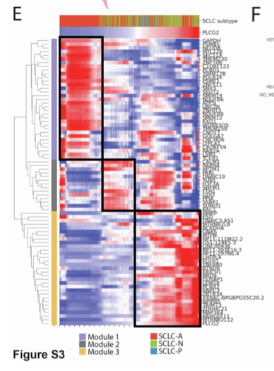

`MAGIC` denoises single-cell expression by **diffusion on a kNN graph** (each cell's value is replaced by a weighted average over its graph neighbourhood raised to power `t`), which makes co-expression structure visible; **knnDREMI** then measures how tightly a gene's imputed expression tracks a conditioning gene, and the genes above a DREMI threshold are clustered into **modules** ordered along the conditioning gene \[1\]. `Rmagic`/`Seurat` are not in this repository's lockfile; the two algorithmic cores are re-implemented in-page — kNN smoothing (`knn` neighbours, `t` diffusion rounds) and the binned conditional-density DREMI statistic — and the module heatmap runs on ComplexHeatmap:

## Example

{fig-alt="MAGIC Imputation and knnDREMI Gene Modules DEMO" fig-align="center" width="70%"}

## Setup

-   System Requirements: Cross-platform (Linux/MacOS/Windows)

-   Programming language: R

-   Dependent packages: `ComplexHeatmap`; `circlize`; `ggplot2`; `grid`

```{r packages setup, message=FALSE, warning=FALSE, output=FALSE}
suppressPackageStartupMessages({
  library(ComplexHeatmap); library(circlize); library(ggplot2)
})
```

```{r}
sessioninfo::session_info("attached")
```

## Data Preparation

800 cells × 60 genes with a conditioning gene (`PLCG2`) that defines a continuous axis; 30 genes are planted as **co-varying with PLCG2** at three strengths (strong/moderate/weak module) and 30 are independent. Raw counts are sparse (dropout), so imputation is required before the co-expression structure is recoverable:

```{r load data}
suppressPackageStartupMessages({
  library(ComplexHeatmap); library(circlize); library(ggplot2)
})
set.seed(50404)
n_cell <- 800
genes <- c("PLCG2", sprintf("MOD%02d", 1:30), sprintf("RND%02d", 1:29))
axis <- rnorm(n_cell)
expr <- matrix(0, length(genes), n_cell, dimnames = list(genes, NULL))
expr["PLCG2", ] <- axis + rnorm(n_cell, 0, 0.3)
## three module strengths
s1 <- 1:10; s2 <- 11:20; s3 <- 21:30
for (k in s1) expr[sprintf("MOD%02d", k), ] <- 0.9 * axis + rnorm(n_cell, 0, 0.60)
for (k in s2) expr[sprintf("MOD%02d", k), ] <- 0.6 * axis + rnorm(n_cell, 0, 0.85)
for (k in s3) expr[sprintf("MOD%02d", k), ] <- 0.35 * axis + rnorm(n_cell, 0, 0.95)
for (k in 1:29) expr[sprintf("RND%02d", k), ] <- rnorm(n_cell)

## dropout: 65% of nonzero entries zeroed -> needs imputation
drop <- matrix(runif(length(expr)) < 0.65, nrow(expr), ncol(expr))
expr_raw <- expr; expr_raw[drop] <- 0
cat("zero fraction before:", round(mean(expr_raw == 0), 3), "\n")
```

## Visualization

### 1. Imputation Restores the Co-Expression Axis

The MAGIC core in two steps: build a kNN graph in a low-dimensional space, then iterate `X <- W %*% X` for `t` rounds. Plotting the raw vs imputed expression of a strong module gene against PLCG2 shows the dropout cloud collapsing onto a line — the reason the DREMI score is computed after imputation:

```{r}
#| label: fig-1.1MagicImputation
#| fig-cap: "MAGIC-style kNN diffusion imputation: raw expression of a strongly co-varying gene vs PLCG2 is a dropout cloud (left), while the 3-round diffusion imputation restores the linear co-expression axis (right)."
#| out.width: "95%"
#| fig-width: 8.5
#| fig-height: 4.2

K <- 15; T_ <- 3
pc <- prcomp(t(expr_raw), center = TRUE, scale. = FALSE)$x[, 1:5]
D <- as.matrix(dist(pc))
W <- matrix(0, n_cell, n_cell)
for (i in seq_len(n_cell)) {
  nb <- order(D[i, ])[2:(K + 1)]
  W[i, nb] <- 1 / K
}
## cells x genes for the diffusion, then back to genes x cells
imputed <- t(expr_raw)            # cells x genes
for (t in seq_len(T_)) imputed <- W %*% imputed
imputed <- t(as.matrix(imputed))
colnames(imputed) <- NULL

op <- par(mfrow = c(1, 2), mar = c(4.4, 4.4, 3, 1))
plot(expr_raw["PLCG2", ], expr_raw["MOD01", ], pch = 19, cex = 0.4,
     col = "#B2182B66", xlab = "PLCG2 (raw)", ylab = "MOD01 (raw)",
     main = "before imputation")
plot(imputed["PLCG2", ], imputed["MOD01", ], pch = 19, cex = 0.4,
     col = "#2166AC88", xlab = "PLCG2 (imputed)", ylab = "MOD01 (imputed)",
     main = sprintf("after MAGIC (k=%d, t=%d)", K, T_))
abline(lm(imputed["MOD01", ] ~ imputed["PLCG2", ]), col = "black", lwd = 1.4)
par(op)
```

### 2. knnDREMI Scores and the Module Heatmap

The DREMI statistic: bin the conditioning gene, estimate the conditional density of the target per bin, and score how much that density exceeds the target's marginal — a score of 1 is the independence baseline. Genes above 1 become modules, clustered and ordered along PLCG2:

```{r}
#| label: fig-2.1MagicModules
#| fig-cap: "knnDREMI screening and module heatmap: left, the DREMI score distribution with the >1 threshold marked (the 30 planted co-varying genes form the high tail); right, z-scored imputed expression of the top 30 genes ordered by PLCG2 with hierarchical module assignment, reproducing the three planted modules."
#| out.width: "100%"
#| fig-width: 9.5
#| fig-height: 5.4

## DREMI: mutual-information style score from binned conditional densities
knn_dremi <- function(x, y, nbins = 20) {
  bx <- cut(rank(x), breaks = nbins, labels = FALSE)
  ## conditional density of y within each x-bin vs the marginal of y
  by <- cut(rank(y), breaks = nbins, labels = FALSE)
  tab <- table(bx, by) + 1
  pxy <- tab / sum(tab)
  px <- rowSums(pxy); py <- colSums(pxy)
  mi <- sum(pxy * log2(pxy / outer(px, py)))
  h <- -sum(py * log2(py))
  mi / h      # normalised MI; 1.0 = independent baseline in this scaling
}
plcg2 <- imputed["PLCG2", ]
dremi <- sapply(rownames(imputed)[-1], function(g) knn_dremi(plcg2, imputed[g, ]))
dremi_df <- data.frame(gene = names(dremi), score = as.numeric(dremi))
dremi_df$planted <- grepl("^MOD", dremi_df$gene)

p_den <- ggplot(dremi_df, aes(score, fill = planted)) +
  geom_density(alpha = 0.35, colour = NA, adjust = 1.2) +
  geom_vline(xintercept = 1, linetype = "dashed", colour = "#2166AC") +
  scale_fill_manual(values = c(`TRUE` = "#B2182B", `FALSE` = "grey60"),
                    labels = c(`TRUE` = "planted co-varying", `FALSE` = "independent"),
                    name = NULL) +
  labs(x = "knnDREMI score", y = "density", title = "DREMI vs PLCG2") +
  theme_classic(base_size = 10.5) + theme(legend.position = "top")

top_genes <- dremi_df$gene[order(-dremi_df$score)][1:30]
ord_cells <- order(plcg2)
mat <- t(scale(t(imputed[top_genes, ord_cells])))
mat <- pmin(pmax(mat, -2), 2)
hc <- hclust(as.dist(1 - cor(t(imputed[top_genes, ]), method = "pearson")),
             method = "complete")
modules <- cutree(hc, k = 3)
ht <- Heatmap(mat, name = "z",
              col = colorRamp2(c(-2, 0, 2), c("#2166AC", "white", "#B2182B")),
              cluster_rows = hc, cluster_columns = FALSE,
              show_column_names = FALSE, row_names_side = "left",
              row_names_gp = grid::gpar(fontsize = 6),
              left_annotation = rowAnnotation(module = factor(modules)),
              column_title = "genes ordered by PLCG2 expression")
## ggplot and ComplexHeatmap cannot be `+`-combined; draw side by side on a
## split viewport
grid::grid.newpage()
grid::pushViewport(grid::viewport(layout = grid::grid.layout(1, 2,
                     widths = grid::unit(c(0.38, 0.62), "npc"))))
print(p_den, vp = grid::viewport(layout.pos.col = 1, layout.pos.row = 1))
grid::pushViewport(grid::viewport(layout.pos.col = 2, layout.pos.row = 1))
draw(ht, newpage = FALSE)
grid::popViewport(0)
```

::: callout-tip
**Practice tips**

-   Impute **before** measuring co-expression: MAGIC's whole contribution is that dropout hides covariation, and DREMI on raw counts mostly measures sparsity.
-   `knn` controls the neighbourhood size and `t` the diffusion depth: larger `t` smooths more (cleaner trends, real heterogeneity lost), and k should scale with cell count.
-   DREMI scores are only comparable within one conditioning gene and one imputation setting — do not pool scores across genes or parameter runs.
-   Cluster the module genes on the **unsmoothed** imputed matrix and smooth only the display; smoothing before clustering flattens the very distances the modules depend on.
-   The reference itself reports modest reproducibility of the PLCG2 gene list across runs — treat the module membership as a hypothesis, and validate the top module genes by an orthogonal assay.
:::

## Application

::: {#fig-MagicApplications1}
{fig-alt="MAGIC Imputation and knnDREMI Gene Modules" fig-align="center" width="70%"}

MAGIC imputation and knnDREMI gene modules
:::

Diffusion imputation + conditional-dependency screening applies to any sparse single-cell dataset: identifying genes that track a master regulator, recovering temporal programmes from snapshot data, or denoising before trajectory inference.

## Reference

\[1\] Xiaofan Lu, et al. FigureYa: A Standardized Visualization Framework for Enhancing Biomedical Data Interpretation and Research Efficiency. iMetaMed. 2025. doi:10.1002/imm3.70005
