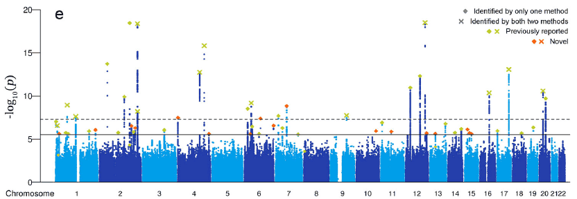
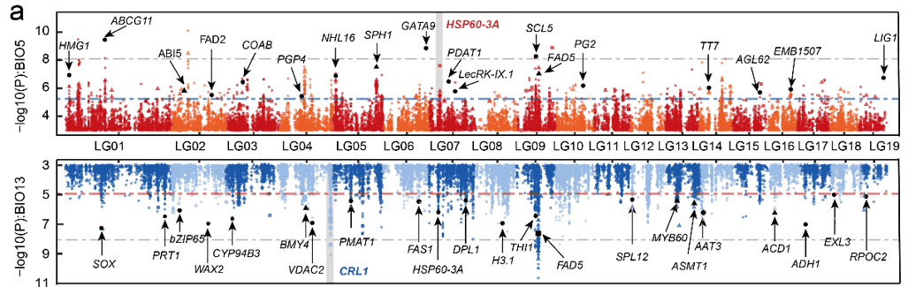

Manhattan plot is a graph used to describe the relationship between mutations on chromosomes and traits. It is named Manhattan plot because it resembles the urban landscape of Manhattan, USA. Manhattan plot is generally drawn in the form of scatter plot, but it can also be displayed in bar chart or line chart. It is usually drawn using R package qqman or directly using ggplot2.

{fig-alt="ManhattanPlot City" fig-align="center" width="60%"}

## Example

{fig-alt="ManhattanPlot DEMO" fig-align="center" width="60%"}

The horizontal axis of the Manhattan plot is the chromosome position, and the vertical axis is the P value or any value such as ΔSNP, ED, etc. that can indicate the strength of the association between the mutation site and the trait. The P value will be used as an example below.

## Setup

-   System Requirements: Cross-platform (Linux/MacOS/Windows)

-   Programming language: R

-   Dependent packages: `qqman`; `tidyverse`; `aplot`

```{r packages setup, message=FALSE, warning=FALSE, output=FALSE}
# Installing necessary packages
if (!requireNamespace("qqman", quietly = TRUE)) {
  install.packages("qqman")
}
if (!requireNamespace("tidyverse", quietly = TRUE)) {
  install.packages("tidyverse")
}
if (!requireNamespace("aplot", quietly = TRUE)) {
  install.packages("aplot")
}

# Load packages
library(qqman)
library(tidyverse)
library(aplot)
```

```{r}
sessioninfo::session_info("attached")
```

## Data Preparation

The data uses the `gwasResults` dataset that comes with qqman.

```{r load data, message=FALSE}
# View the dataset
head(gwasResults)
```

## Visualization

### 1. qqman draws Manhattan plot

`manhattan` and `qq` are the two most important functions in qqman, responsible for drawing Manhattan graphs and QQ graphs respectively:

::: callout-tip
**manhattan parameters:**

- `x`: input data, required format is dataframe
- `chr`: column name for recording chromosome information, must be a number
- `bp`: column name for recording base coordinate position information, must be a number
- `p`: column name for recording P value or other value information, must be a number
- `snp`: column name for recording SNP name
- `col`: alternating color setting
- `chrlabs`: chromosome name on X-axis, default is consistent with the name in dataframe
- `suggestiveline`: blue threshold line, not drawn when set to FALSE
- `genomewideline`: red threshold line, not drawn when set to FALSE
- `highlight`: highlighted SNP name
- `logp`: when set to TRUE, the vertical axis is -log10(P), when set to FALSE, the vertical axis is P
- `annotatePval`: set threshold, mark SNPs above the threshold in the figure
- `annotateTop`: mark only one highest SNP for each chromosome
:::

```{r}
#| label: fig-1.1Basicmanhattan
#| fig-cap: "Basic manhattan plot"
#| out.width: "95%"
#| warning: false
#| message: false

# Basic manhattan plot
manhattan(gwasResults)
```

This figure shows the association between all SNPs on the genome and traits, with an obvious peak on chromosome 3, indicating that there is a region on chromosome 3 that may be strongly correlated with the trait.

The color of chromosomes in `manhattan` can be modified by the `col` parameter:

```{r}
#| label: fig-1.2Color
#| fig-cap: "Color settings"
#| out.width: "95%"
#| warning: false
#| message: false

# Color settings
manhattan(gwasResults, col = c("#3E7B92","#F0E442","#BF242A"))
```

To highlight specific SNPs:

```{r}
#| label: fig-1.3Highlight
#| fig-cap: "Highlight settings"
#| out.width: "95%"
#| warning: false
#| message: false

# Highlight settings
manhattan(gwasResults, highlight ="rs3057")
```

Annotate SNPs above the threshold (one per chromosome):

```{r}
#| label: fig-1.4annotatePval
#| fig-cap: "Annotation Settings"
#| out.width: "95%"
#| warning: false
#| message: false

# Annotation Settings
manhattan(gwasResults, highlight ="rs3057", annotatePval=1e-5)
```

### 2. ggplot2 draws manhattan plot

Using qqman to draw a Manhattan map can meet most of the needs, but there are still some needs that cannot be met, such as setting the style and color of the threshold line. In this case, ggplot2 can be used for drawing.

```{r}
#| label: fig-2.1ggplot2
#| fig-cap: "ggplot2 draws manhattan plot"
#| out.width: "95%"
#| warning: false
#| message: false

# ggplot2 draws manhattan plot
df <- gwasResults
df$CHR <- factor(as.character(df$CHR),levels=unique(df$CHR))
len <- 
    df %>% 
    group_by(CHR) %>%  # CHR is the column name of chromosome information
    summarise(len=max(BP))  # BP is the column name for the location information
len <-  # Calculate the position of SNP in the graph
    len %>% mutate(pos=cumsum(len)-len)
rownames(len) <- unique(df$CHR)
df$BP <- df$BP+len$pos[match(df$CHR,rownames(len))]
X_axis <-  df %>% group_by(CHR) %>% summarize(center=( max(BP) + min(BP) ) / 2 ) # Calculate the position of chromosomes

# The P value is subjected to multiple corrections below. It is actually not advisable to use a fixed threshold for P in qqman.
bf <- max(df$P[p.adjust(df$P, method = "bonferroni")<0.05])  # Using the Bonferroni method
fdr<- max(df$P[p.adjust(df$P, method = "fdr")<0.05])  # Using the fdr method

col <- c("gray10", "gray60") # Set the chromosome color here
cols <- rep(col ,nrow(X_axis))
line_col1 <- "red" # Threshold line color here
line_col2 <- "blue"
line_type1 <- "dashed" # Here the threshold line type
line_type2 <- "dashed" 
ggplot()+
    geom_point(df,mapping=aes(x=BP,y=-log10(P),color=CHR),alpha=0.7,size=1,shape=16)+
    geom_hline(yintercept = -log10(bf),lty=line_type1 ,color= line_col1 )+
    geom_hline(yintercept = -log10(fdr),lty=line_type2 ,color= line_col2)+
    scale_color_manual(values = cols ) +
    theme_bw()+
    theme(panel.grid.major = element_blank(),panel.grid.minor=element_blank(),
          legend.position = 'none')+
    xlab("CHR")+ylab("-log10(P)")+ # Horizontal axis vertical axis title
    scale_x_continuous( limits = c(0, max(df$BP)),label = X_axis$CHR, breaks= X_axis$center ) +
    scale_y_continuous(expand = c(0,0)) 
```

The advantage of using ggplot2 to draw a Manhattan map is that the style of the image can be highly customized. You can notice that I have set several variables above. You only need to modify these variables to customize the color and threshold line style.

```{r}
#| label: fig-2.2Color
#| fig-cap: "ggplot2 modify colors"
#| out.width: "95%"
#| warning: false
#| message: false

col <- c("#3E7B92","#F0E442","#BF242A") # Set the chromosome color here
cols <- rep(col ,nrow(X_axis))
line_col1 <- "#DB5A6A" # Threshold line color here
line_col2 <- "#0050B7"
line_type1 <- "solid" # Here, the threshold line type can be set as follows: ”solid“,“blank”, “solid”, “dashed”, “dotted”, “dotdash”, “longdash”, “twodash”
line_type2 <- "dotdash" 
ggplot()+
    geom_point(df,mapping=aes(x=BP,y=-log10(P),color=CHR),alpha=0.7,size=1,shape=16)+
    geom_hline(yintercept = -log10(bf),lty=line_type1 ,color= line_col1 )+
    geom_hline(yintercept = -log10(fdr),lty=line_type2 ,color= line_col2)+
    scale_color_manual(values = cols ) +
    theme_bw()+
    theme(panel.grid.major = element_blank(),panel.grid.minor=element_blank(),
          legend.position = 'none')+
    xlab("CHR")+ylab("-log10(P)")+
    scale_x_continuous( limits = c(0, max(df$BP)),label = X_axis$CHR, breaks= X_axis$center ) +
    scale_y_continuous(expand = c(0,0)) 
```

Since ggplot2 plots images one by one, the screened SNPs can be superimposed on the original image using geom_point:

```{r}
#| label: fig-2.3Highlight
#| fig-cap: "Highlight or mark SNPs"
#| out.width: "95%"
#| warning: false
#| message: false

df2 <- df[df$P<bf,]
df3 <- df[df$SNP=="rs3057",]
col <- c("gray10", "gray60") # Set the chromosome color here
cols <- rep(col ,nrow(X_axis))
line_col1 <- "red" # Threshold line color here
line_col2 <- "blue"
line_type1 <- "dashed" # Here the threshold line type
line_type2 <- "dashed" 
ggplot()+
    geom_point(df,mapping=aes(x=BP,y=-log10(P),color=CHR),alpha=0.7,size=1,shape=16)+
    geom_point(df2,mapping=aes(x=BP,y=-log10(P)),color="blue",size=1,shape=16)+
    geom_point(df3,mapping=aes(x=BP,y=-log10(P)),color="red",size=3,shape=18)+
    geom_hline(yintercept = -log10(bf),lty=line_type1 ,color= line_col1 )+
    geom_hline(yintercept = -log10(fdr),lty=line_type2 ,color= line_col2)+
    scale_color_manual(values = cols ) +
    theme_bw()+
    theme(panel.grid.major = element_blank(),panel.grid.minor=element_blank(),
          legend.position = 'none')+
    xlab("CHR")+ylab("-log10(P)")+
    scale_x_continuous( limits = c(0, max(df$BP)),label = X_axis$CHR, breaks= X_axis$center ) +
    scale_y_continuous(limits = c(0, max(-log10(df$P))+1),expand = c(0,0)) 
```

When you have two traits, you may need to display the GWAS results of the two traits at the same time. You can use the following method to draw a two-way Manhattan plot. Here we only use one set of data as an example.

```{r}
#| label: fig-2.4double
#| fig-cap: "Bidirectional Manhattan plot"
#| out.width: "95%"
#| warning: false
#| message: false

col <- c("gray10", "gray60") # Set the chromosome color here
cols <- rep(col ,nrow(X_axis))
line_col1 <- "red" # Threshold line color here
line_col2 <- "blue"
line_type1 <- "dashed" # Here the threshold line type
line_type2 <- "dashed" 
p1 <- 
    ggplot()+
    geom_point(df,mapping=aes(x=BP,y=-log10(P),color=CHR),alpha=0.7,size=1,shape=16)+
    geom_hline(yintercept = -log10(bf),lty=line_type1 ,color= line_col1 )+
    geom_hline(yintercept = -log10(fdr),lty=line_type2 ,color= line_col2)+
    scale_color_manual(values = cols ) +
    theme_bw()+
    theme(panel.grid.major = element_blank(),panel.grid.minor=element_blank(),
          axis.text.x = element_text(vjust = -2),
          axis.title.x = element_blank(),
          legend.position = 'none')+
    ylab("-log10(P)")+ # Horizontal axis vertical axis title
    scale_x_continuous( limits = c(0, max(df$BP)),label = X_axis$CHR, breaks= X_axis$center ) +
    scale_y_continuous(expand = c(0,0)) 
p2 <- 
    ggplot()+
    geom_point(df,mapping=aes(x=BP,y=-log10(P),color=CHR),alpha=0.7,size=1,shape=16)+
    geom_hline(yintercept = -log10(bf),lty=line_type1 ,color= line_col1 )+
    geom_hline(yintercept = -log10(fdr),lty=line_type2 ,color= line_col2)+
    scale_color_manual(values = cols ) +
    theme_bw()+
    theme(panel.grid.major = element_blank(),panel.grid.minor=element_blank(),
          axis.text.x = element_blank(),axis.title.x = element_blank(),
          legend.position = 'none')+
    ylab("-log10(P)")+
    scale_x_continuous( limits = c(0, max(df$BP)),label = X_axis$CHR, breaks= X_axis$center ,position = 'top') +
    scale_y_reverse(expand = c(0,0))
p1/p2
```

### 13. Regional Association Panel (LocusZoom Style)

A Manhattan plot answers "which locus"; a **regional association panel** answers "what is going on inside that locus". The LocusZoom convention \[13\] stacks three tracks on one shared x axis: the association signal with points coloured by LD (r^2) to a chosen sentinel variant, the gene models under it, and the local recombination rate as a line. The three tracks are read together: a secondary signal that sits in a different LD block from the sentinel is an independent association, and the same signal in the same block is not.

```{r}
#| label: fig-13-1LocusZoomPanel
#| fig-cap: "Regional association panel around a sentinel variant (chr1:412.6 Mb, 1.2 Mb window): -log10 P coloured by r2 to the sentinel (diamond), gene models below and local recombination rate (cM/Mb) at the bottom. The second, weaker signal at +0.33 Mb falls outside the sentinel's LD block, so it is an independent signal rather than a shadow of the lead SNP."
#| out.width: "100%"
#| warning: false
#| message: false
#| fig-width: 9.5
#| fig-height: 6

suppressPackageStartupMessages({
  library(ggplot2)
  library(dplyr)
  library(patchwork)
})

set.seed(43505)
chr_len <- 620
sentinel <- 412.6          # Mb

## Variants in a 1.2 Mb window around the sentinel. r2 decays with distance
## (the colour channel); -log10 P carries two signals, one of which is only in
## LD with the sentinel because it is physically close.
reg <- data.frame(pos = seq(sentinel - 0.6, sentinel + 0.6, by = 0.004)) |>
  mutate(
    r2 = pmax(0, 1 - abs(pos - sentinel) / 0.62)^1.6,
    lp = -log10(pmax(1e-12, pmin(0.9,
      10^(-(2.1 + 6.4 * exp(-((pos - sentinel)^2) / (2 * 0.05^2)) +
              3.4 * exp(-((pos - (sentinel + 0.33))^2) / (2 * 0.035^2)) +
              runif(n()) * 1.6)))))
  )

genes <- data.frame(
  gene = c("GENEA", "GENEB", "GENEC", "GENED"),
  start = c(sentinel - 0.55, sentinel - 0.12, sentinel + 0.18, sentinel + 0.42),
  end   = c(sentinel - 0.35, sentinel + 0.06, sentinel + 0.40, sentinel + 0.57)
)
genes$mid <- (genes$start + genes$end) / 2
exons <- do.call(rbind, lapply(seq_len(nrow(genes)), function(i) {
  g <- genes[i, ]
  data.frame(gene = g$gene,
             x0 = seq(g$start, g$end - 0.02, length.out = 3),
             x1 = seq(g$start, g$end - 0.02, length.out = 3) + 0.025)
}))

rec <- data.frame(pos = seq(sentinel - 0.6, sentinel + 0.6, by = 0.01)) |>
  mutate(
    ## a recombination hotspot sits between the two signals, which is why they
    ## are in separate LD blocks
    cmmb = 0.8 + 1.6 * exp(-((pos - (sentinel + 0.16))^2) / (2 * 0.012^2)) +
      0.35 * exp(-((pos - (sentinel - 0.3))^2) / (2 * 0.08^2))
  )

## LD bins: the five-step palette that LocusZoom made standard.
ld_cols <- c("0-0.2" = "#d9d9d9", "0.2-0.4" = "#fdd49e",
             "0.4-0.6" = "#fdbb84", "0.6-0.8" = "#e34a33",
             "0.8-1" = "#b30000")
reg <- reg |>
  mutate(ld = cut(r2, breaks = c(-Inf, 0.2, 0.4, 0.6, 0.8, Inf),
                  labels = names(ld_cols), right = FALSE),
         is_sentinel = abs(pos - sentinel) < 0.0015)

xlim <- c(sentinel - 0.63, sentinel + 0.63)

p_assoc <- ggplot(reg, aes(pos, lp)) +
  geom_point(aes(colour = ld), size = 1.4, stroke = 0) +
  geom_point(data = filter(reg, is_sentinel), shape = 23, size = 3,
             fill = "#4d004b", colour = "black", stroke = 0.4) +
  annotate("text", x = sentinel, y = max(reg$lp) + 0.9, label = "sentinel",
           size = 2.4, colour = "#4d004b") +
  scale_colour_manual(values = ld_cols, name = expression(r^2), drop = FALSE) +
  scale_y_continuous(limits = c(0, max(reg$lp) + 1.6), expand = c(0, 0),
                     breaks = seq(0, 12, 3)) +
  scale_x_continuous(limits = xlim, expand = c(0, 0)) +
  labs(x = NULL, y = expression(-log[10]~italic(P))) +
  theme_minimal(base_size = 9) +
  theme(panel.grid.minor = element_blank(),
        axis.text.x = element_blank(),
        legend.key.size = unit(0.28, "cm"),
        legend.title = element_text(size = 7.5),
        legend.text = element_text(size = 7),
        plot.margin = margin(5, 5, 1, 5))

p_gene <- ggplot() +
  geom_segment(data = genes, aes(x = start, xend = end, y = mid, yend = mid),
               linewidth = 0.5, colour = "#525252") +
  geom_rect(data = exons, aes(xmin = x0, xmax = x1, ymin = -0.25, ymax = 0.25),
            fill = "#525252") +
  geom_text(data = genes, aes(x = mid, y = 0.52, label = gene), size = 2.1,
            colour = "#252525") +
  annotate("text", x = sentinel, y = -0.55, label = "sentinel", size = 2,
           colour = "#4d004b") +
  scale_x_continuous(limits = xlim, expand = c(0, 0)) +
  scale_y_continuous(limits = c(-0.75, 0.85), expand = c(0, 0)) +
  labs(x = NULL, y = NULL) +
  theme_void(base_size = 9) +
  theme(plot.margin = margin(0, 5, 0, 5))

p_rec <- ggplot(rec, aes(pos, cmmb)) +
  geom_line(colour = "#08519c", linewidth = 0.4) +
  scale_x_continuous(limits = xlim, expand = c(0, 0)) +
  scale_y_continuous(breaks = c(1, 2), expand = expansion(mult = c(0.05, 0.1))) +
  labs(x = sprintf("position on chr1 (Mb; chr1 length %s Mb)", chr_len),
       y = "cM/Mb") +
  theme_minimal(base_size = 9) +
  theme(panel.grid.minor = element_blank(),
        axis.text = element_text(size = 6.5),
        plot.margin = margin(1, 5, 5, 5))

p_assoc / p_gene / p_rec + plot_layout(heights = c(1, 0.22, 0.3))
```

::: callout-tip
**Practice tips**

-   Colour by LD to a **named sentinel**, never by LD to "the top SNP": the sentinel is the hypothesis, and it must be marked with its own shape so the reader can see what the colours are measured against.
-   Bin r^2 into five steps. Continuous LD colour scales hide the 0.8 threshold that separates "same signal" from "possibly independent", and discrete bins survive printing.
-   Draw the recombination rate in its own track with its own y axis. Overlaying a cM/Mb line on the P-value axis invites a comparison between two quantities that are not commensurable.
-   State the window and the gene annotation source; a regional panel with no stated boundary is impossible to reproduce.
-   Keep the y axis in -log10 P, not raw P: the reader's threshold intuitions (5e-8, 1e-6) are all calibrated on the log scale.
:::

## Application

::: {#fig-HistApplications}
{fig-alt="ManhattanApp1" fig-align="center" width="60%"}

Applications of Manhattan Plot
:::

This figure shows the association between SNP loci in poplar trees and temperature (top)/rainfall (bottom) \[1\]。

## Reference

\[1\] Sang Y, Long Z, Dan X, Feng J, Shi T, Jia C, Zhang X, Lai Q, Yang G, Zhang H, Xu X, Liu H, Jiang Y, Ingvarsson PK, Liu J, Mao K, Wang J. Genomic insights into local adaptation and future climate-induced vulnerability of a keystone forest tree in East Asia. Nat Commun. 2022 Nov 1;13(1):6541. doi: 10.1038/s41467-022-34206-8. PMID: 36319648; PMCID: PMC9626627.

\[13\] Pruim RJ, Welch RP, Sanna S, et al. LocusZoom: regional visualization of genome-wide association scan results. Bioinformatics. 2010;26(18):2336-2337. doi:10.1093/bioinformatics/btq419

\[14\] Boughton AP, Welch RP, Flickinger M, et al. LocusZoom.js: interactive and embeddable visualization of genetic association study results. Bioinformatics. 2021;37(18):3017-3018. doi:10.1093/bioinformatics/btab186

\[15\] Murphy MC, van der Velde KJ, van den Hoek S, et al. locuszoomr: an R package for visualizing and annotating regional association plots. Bioinform Adv. 2025;5(1):vbaf006. doi:10.1093/bioadv/vbaf006
