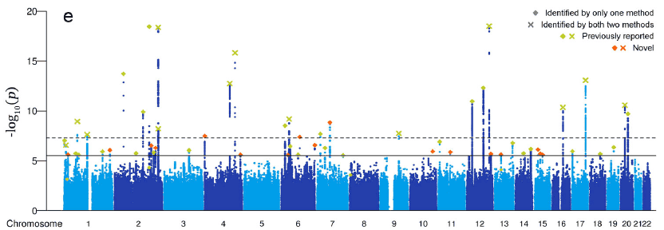
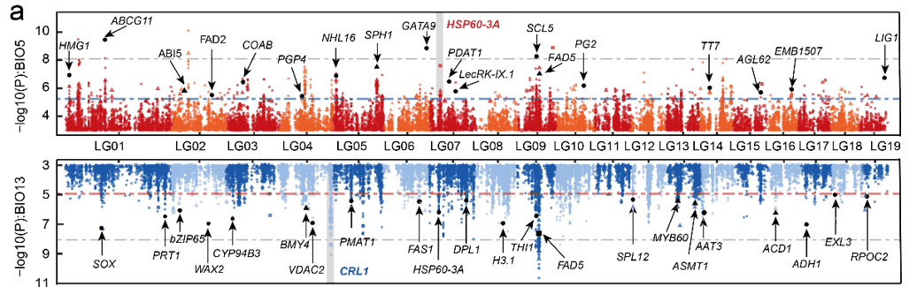

Manhattan plot，即曼哈顿图，是一种用于描述染色体上的突变与性状之间关联强弱的图，由于图形形似美国曼哈顿区的城市景观因此得名曼哈顿图。绘制曼哈顿图一般使用散点图的形式，但是也可以使用柱状图或折线图展示，常用R包qqman或者直接使用ggplot2绘制。

{fig-alt="ManhattanPlot City" fig-align="center" width="60%"}

## 示例

{fig-alt="ManhattanPlot DEMO" fig-align="center" width="60%"}

曼哈顿图的横坐标为染色体位置，纵坐标为Pvalue或者诸如ΔSNP、ED等一切可以表示突变位点与性状之间关联强弱的值。下面将使用Pvalue作为示例。

## 环境配置

-   系统要求： 跨平台（Linux/MacOS/Windows）

-   编程语言：R

-   依赖包：`qqman`; `tidyverse`; `aplot`

```{r packages setup, message=FALSE, warning=FALSE, output=FALSE}
# 安装包
if (!requireNamespace("qqman", quietly = TRUE)) {
  install.packages("qqman")
}
if (!requireNamespace("tidyverse", quietly = TRUE)) {
  install.packages("tidyverse")
}
if (!requireNamespace("aplot", quietly = TRUE)) {
  install.packages("aplot")
}
if (!requireNamespace("ggrepel", quietly = TRUE)) {
  install.packages("ggrepel")
}

# 加载包
library(qqman)
library(tidyverse)
library(aplot)
library(ggrepel)
```

```{r}
sessioninfo::session_info("attached")
```

## 数据准备

数据使用qqman中自带的`gwasResults`数据集。

```{r load data, message=FALSE}
# 查看数据集
head(gwasResults)
```

## 可视化

### 1. qqman绘制曼哈顿图

`manhattan`和`qq`是qqman中最重要的两个函数，分别负责绘制曼哈顿图和QQ图：

::: callout-tip
**manhattan 参数:**

- `x`：输入数据，要求格式为dataframe数据框
- `chr`：记录染色体信息的列名，必须是数字
- `bp`：记录碱基坐标位置信息的列名，必须是数字
- `p`：记录P值或其他值信息的列名，必须是数字
- `snp`：记录SNP名称的列名
- `col`：交替的颜色设置
- `chrlabs`：X轴上染色体的名称，默认与数据框中的名称一致
- `suggestiveline`：蓝色阈值线，设置为FALSE时不绘制
- `genomewideline`：红色阈值线，设置为FALSE时不绘制
- `highlight`：高亮的SNP名称
- `logp`：设置为TRUE时，纵轴为-log10(P)，设置为FALSE时纵轴为P
- `annotatePval`：设置阈值，标注图中高于该阈值的SNP
- `annotateTop`：每条染色体仅标注一个最高的SNP
:::

```{r}
#| label: fig-1.1Basicmanhattan
#| fig-cap: "基础曼哈顿图"
#| out.width: "95%"
#| warning: false
#| message: false

# 基础曼哈顿图
manhattan(gwasResults)
```

此图展示了基因组上所有SNP与性状的关联情况，其中三号染色体上存在一个明显的峰，表明三号染色体上存在一个可能是与性状强相关的区域。

`manhattan`中染色体的颜色可以通过`col`参数修改：

```{r}
#| label: fig-1.2Color
#| fig-cap: "颜色设置"
#| out.width: "95%"
#| warning: false
#| message: false

# 颜色设置
manhattan(gwasResults, col = c("#3E7B92","#F0E442","#BF242A"))
```

对特定SNP进行高亮显示：

```{r}
#| label: fig-1.3Highlight
#| fig-cap: "高亮设置"
#| out.width: "95%"
#| warning: false
#| message: false

# 高亮设置
manhattan(gwasResults, highlight ="rs3057")
```

标注高于阈值的SNP(每条染色体一个)：

```{r}
#| label: fig-1.4annotatePval
#| fig-cap: "注释设置"
#| out.width: "95%"
#| warning: false
#| message: false

# 注释设置
manhattan(gwasResults, highlight ="rs3057", annotatePval=1e-5)
```

### 2. ggplot2绘制曼哈顿图

使用qqman绘制曼哈顿图能满足大部分需求，然而仍有部分需求不能满足，例如设置阈值线的样式和颜色，此时可以用ggplot2绘图。

```{r}
#| label: fig-2.1ggplot2
#| fig-cap: "ggplot2绘制曼哈顿图"
#| out.width: "95%"
#| warning: false
#| message: false

# ggplot2绘制曼哈顿图
df <- gwasResults
df$CHR <- factor(as.character(df$CHR),levels=unique(df$CHR))
len <- 
    df %>% 
    group_by(CHR) %>%  # CHR为染色体信息的列名
    summarise(len=max(BP))  # BP为位置信息的列名
len <-  # 计算snp在图中的位置
    len %>% mutate(pos=cumsum(len)-len)
rownames(len) <- unique(df$CHR)
df$BP <- df$BP+len$pos[match(df$CHR,rownames(len))]
X_axis <-  df %>% group_by(CHR) %>% summarize(center=( max(BP) + min(BP) ) / 2 ) # 计算染色体的位置

# 下面对P值进行多重矫正，qqman中对P取固定的阈值其实是不可取的。
bf <- max(df$P[p.adjust(df$P, method = "bonferroni")<0.05])  # 使用bonferroni法
fdr<- max(df$P[p.adjust(df$P, method = "fdr")<0.05])  # 使用fdr法

col <- c("gray10", "gray60") # 此处设置染色体颜色
cols <- rep(col ,nrow(X_axis))
line_col1 <- "red" # 此处阈值线颜色
line_col2 <- "blue"
line_type1 <- "dashed" # 此处阈值线类型
line_type2 <- "dashed" 
ggplot()+
    geom_point(df,mapping=aes(x=BP,y=-log10(P),color=CHR),alpha=0.7,size=1,shape=16)+
    geom_hline(yintercept = -log10(bf),lty=line_type1 ,color= line_col1 )+
    geom_hline(yintercept = -log10(fdr),lty=line_type2 ,color= line_col2)+
    scale_color_manual(values = cols ) +
    theme_bw()+
    theme(panel.grid.major = element_blank(),panel.grid.minor=element_blank(),
          legend.position = 'none')+
    xlab("CHR")+ylab("-log10(P)")+ #横轴纵轴标题
    scale_x_continuous( limits = c(0, max(df$BP)),label = X_axis$CHR, breaks= X_axis$center ) +
    scale_y_continuous(expand = c(0,0)) 
```

使用ggplot2绘制曼哈顿图的好处在于可以高度自定义图像的风格，可以注意到在上面我已经设置好了几个变量，只需要对这些变量进行修改即可自定义颜色以及阈值线样式。

```{r}
#| label: fig-2.2Color
#| fig-cap: "ggplot2修改颜色"
#| out.width: "95%"
#| warning: false
#| message: false

col <- c("#3E7B92","#F0E442","#BF242A") #此处设置染色体颜色
cols <- rep(col ,nrow(X_axis))
line_col1 <- "#DB5A6A" #此处阈值线颜色
line_col2 <- "#0050B7"
line_type1 <- "solid" #此处阈值线类型，可以设置的线条类型有：”solid“,“blank”, “solid”, “dashed”, “dotted”, “dotdash”, “longdash”, “twodash”
line_type2 <- "dotdash" 
ggplot()+
    geom_point(df,mapping=aes(x=BP,y=-log10(P),color=CHR),alpha=0.7,size=1,shape=16)+
    geom_hline(yintercept = -log10(bf),lty=line_type1 ,color= line_col1 )+
    geom_hline(yintercept = -log10(fdr),lty=line_type2 ,color= line_col2)+
    scale_color_manual(values = cols ) +
    theme_bw()+
    theme(panel.grid.major = element_blank(),panel.grid.minor=element_blank(),
          legend.position = 'none')+
    xlab("CHR")+ylab("-log10(P)")+
    scale_x_continuous( limits = c(0, max(df$BP)),label = X_axis$CHR, breaks= X_axis$center ) +
    scale_y_continuous(expand = c(0,0)) 
```

由于ggplot2绘图是将一张张图叠加起来，因此可以将筛选后的SNP用geom_point叠加到原图上：

```{r}
#| label: fig-2.3Highlight
#| fig-cap: "高亮或标记snp"
#| out.width: "95%"
#| warning: false
#| message: false

df2 <- df[df$P<bf,]
df3 <- df[df$SNP=="rs3057",]
col <- c("gray10", "gray60") #此处设置染色体颜色
cols <- rep(col ,nrow(X_axis))
line_col1 <- "red" #此处阈值线颜色
line_col2 <- "blue"
line_type1 <- "dashed" #此处阈值线类型
line_type2 <- "dashed" 
ggplot()+
    geom_point(df,mapping=aes(x=BP,y=-log10(P),color=CHR),alpha=0.7,size=1,shape=16)+
    geom_point(df2,mapping=aes(x=BP,y=-log10(P)),color="blue",size=1,shape=16)+
    geom_point(df3,mapping=aes(x=BP,y=-log10(P)),color="red",size=3,shape=18)+
    geom_hline(yintercept = -log10(bf),lty=line_type1 ,color= line_col1 )+
    geom_hline(yintercept = -log10(fdr),lty=line_type2 ,color= line_col2)+
    scale_color_manual(values = cols ) +
    theme_bw()+
    theme(panel.grid.major = element_blank(),panel.grid.minor=element_blank(),
          legend.position = 'none')+
    xlab("CHR")+ylab("-log10(P)")+
    scale_x_continuous( limits = c(0, max(df$BP)),label = X_axis$CHR, breaks= X_axis$center ) +
    scale_y_continuous(limits = c(0, max(-log10(df$P))+1),expand = c(0,0)) 
```

当你有两个性状时可能需要将两个性状的GWAS结果同时展现在结果上，可以使用下列方法绘制双向曼哈顿图。这里只用一组数据作为示例。

```{r}
#| label: fig-2.4double
#| fig-cap: "双向曼哈顿图"
#| out.width: "95%"
#| warning: false
#| message: false

col <- c("gray10", "gray60") #此处设置染色体颜色
cols <- rep(col ,nrow(X_axis))
line_col1 <- "red" #此处阈值线颜色
line_col2 <- "blue"
line_type1 <- "dashed" #此处阈值线类型
line_type2 <- "dashed" 
p1 <- 
    ggplot()+
    geom_point(df,mapping=aes(x=BP,y=-log10(P),color=CHR),alpha=0.7,size=1,shape=16)+
    geom_hline(yintercept = -log10(bf),lty=line_type1 ,color= line_col1 )+
    geom_hline(yintercept = -log10(fdr),lty=line_type2 ,color= line_col2)+
    scale_color_manual(values = cols ) +
    theme_bw()+
    theme(panel.grid.major = element_blank(),panel.grid.minor=element_blank(),
          axis.text.x = element_text(vjust = -2),
          axis.title.x = element_blank(),
          legend.position = 'none')+
    ylab("-log10(P)")+ #横轴纵轴标题
    scale_x_continuous( limits = c(0, max(df$BP)),label = X_axis$CHR, breaks= X_axis$center ) +
    scale_y_continuous(expand = c(0,0)) 
p2 <- 
    ggplot()+
    geom_point(df,mapping=aes(x=BP,y=-log10(P),color=CHR),alpha=0.7,size=1,shape=16)+
    geom_hline(yintercept = -log10(bf),lty=line_type1 ,color= line_col1 )+
    geom_hline(yintercept = -log10(fdr),lty=line_type2 ,color= line_col2)+
    scale_color_manual(values = cols ) +
    theme_bw()+
    theme(panel.grid.major = element_blank(),panel.grid.minor=element_blank(),
          axis.text.x = element_blank(),axis.title.x = element_blank(),
          legend.position = 'none')+
    ylab("-log10(P)")+
    scale_x_continuous( limits = c(0, max(df$BP)),label = X_axis$CHR, breaks= X_axis$center ,position = 'top') +
    scale_y_reverse(expand = c(0,0))
p1/p2
```

### 3. 避让标签与逐染色体配色（ggplot2）

qqman 路线不打任何标签。FigureYa43 版式 \[2\] 用 ggplot2 重造曼哈顿图换取三件事：手工指定的交替染色体配色、**红色阈值线**（线上点用 `size = pcut` 放大），以及带箭头、携带"基因 + rs 号"双行标签的 `geom_label_repel()`，标签区域约束在阈值之上。累计偏移 x 轴（`chrx` join）是把染色体并排放置的关键：

```{r}
#| label: fig-3.1ManhattanRepel
#| fig-cap: "8 条模拟染色体（每条 2,500 个 SNP）的曼哈顿图：-log10(P) = 5 处红色阈值线，线上点放大并用 ggrepel 标注基因 + rs 号；染色体交替配色。"
#| out.width: "100%"
#| warning: false
#| message: false
#| fig-width: 9.5
#| fig-height: 5.2

set.seed(4301)
n_chr <- 8
snp_per <- 2500
gwas <- do.call(rbind, lapply(1:n_chr, function(cc) {
  data.frame(CHR = cc, SNP = paste0("rs", cc, sample(1e5:9e5, snp_per)),
             POS = sort(sample(1:7e7, snp_per)),
             P_value = rexp(snp_per, 0.35),
             gene = NA)
}))
gwas$P_value <- pmin(1, gwas$P_value)
hits <- sample(nrow(gwas), 14)
gwas$P_value[hits] <- 10^(-runif(14, 5.2, 9))
gwas$gene[hits] <- paste0("GENE", 1:14)
gwas$chr <- factor(gwas$CHR, levels = 1:n_chr)

chrx <- gwas %>% group_by(chr) %>% summarise(chr_len = max(POS)) %>%
  mutate(chrx = cumsum(chr_len) - chr_len) %>% select(-chr_len) %>% data.frame()
gwas <- left_join(gwas, chrx, by = c("chr" = "chr")) %>%
  mutate(SNPx = POS + chrx, SNPy = -log10(P_value))
axisdf <- gwas %>% group_by(chr) %>% summarize(center = (max(SNPx) + min(SNPx)) / 2)
logPcutoff <- 5
gwas$pcut <- ifelse(gwas$SNPy > logPcutoff, "1", "0")
gwas$label <- paste0(gwas$gene, "\n", gwas$SNP)
gwas$label[is.na(gwas$gene)] <- NA
mycol <- rep(c("#223D6C", "#D20A13"), length.out = n_chr)

ggplot(gwas, aes(SNPx, SNPy)) +
  geom_point(aes(colour = chr, size = pcut), alpha = 0.85) +
  scale_colour_manual(values = mycol, guide = "none") +
  scale_size_discrete(range = c(0.6, 2.2), guide = "none") +
  geom_hline(yintercept = logPcutoff, colour = "red", linewidth = 0.4) +
  geom_label_repel(data = subset(gwas, !is.na(label)),
                   aes(label = label), size = 2.4,
                   segment.colour = "black", segment.size = 0.35,
                   arrow = arrow(angle = 20, length = unit(0.04, "inches")),
                   min.segment.length = 0, na.rm = TRUE,
                   box.padding = 0.35, max.overlaps = 30, show.legend = FALSE) +
  scale_x_continuous(breaks = axisdf$center, labels = axisdf$chr,
                     expand = expansion(mult = c(0, 0.02))) +
  scale_y_continuous(expand = expansion(mult = c(0, 0.06))) +
  labs(x = "Chromosome", y = expression(-log[10](P)),
       title = "GWAS Manhattan plot with repelled labels (simulated)") +
  theme_bw(base_size = 11) +
  theme(panel.grid = element_blank(), panel.border = element_blank(),
        axis.line = element_line(colour = "black"),
        axis.text = element_text(size = rel(0.85)))
```

::: callout-tip
**实践要点**

-   只给过阈值的点打标签，且**基因 + rs 号分两行**——GWAS 密度下单行标签立刻相撞。
-   `max.overlaps = 30` 防止 ggrepel 在拥挤的顶部区域静默丢标签——请检查 dropped-label 警告而不是相信图本身。
-   染色体偏移必须来自按 `max(POS)` 分组的 join，而不是行顺序——`POS` 列未排序会打乱交替配色。
:::

## 应用场景

::: {#fig-HistApplications}
{fig-alt="ManhattanApp1" fig-align="center" width="60%"}

曼哈顿图应用
:::

此图展示了杨树上的SNP位点与温度（上图）/降雨（下图）之间的关联 \[1\]。

## 参考文献

\[1\] Sang Y, Long Z, Dan X, Feng J, Shi T, Jia C, Zhang X, Lai Q, Yang G, Zhang H, Xu X, Liu H, Jiang Y, Ingvarsson PK, Liu J, Mao K, Wang J. Genomic insights into local adaptation and future climate-induced vulnerability of a keystone forest tree in East Asia. Nat Commun. 2022 Nov 1;13(1):6541. doi: 10.1038/s41467-022-34206-8. PMID: 36319648; PMCID: PMC9626627.

\[2\] Xiaofan Lu, et al. FigureYa: A Standardized Visualization Framework for Enhancing Biomedical Data Interpretation and Research Efficiency. iMetaMed. 2025. doi:10.1002/imm3.70005
