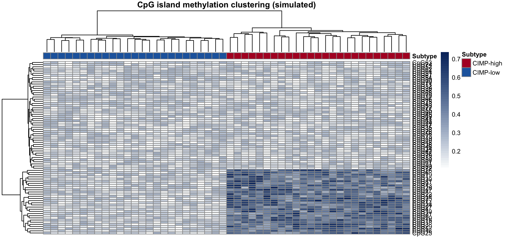

CpG island methylation patterns stratify tumours into CIMP-high and CIMP-low epigenetic subtypes. The FigureYa121 workflow clusters CpG probes by methylation beta value and overlays subtype annotations \[1\]. This tutorial reproduces the heatmap on a simulated CpG matrix with an island/shore/open-sea annotation:

## Example

{fig-alt="MethCgiClusterPlot DEMO" fig-align="center" width="60%"}

## Setup

-   System Requirements: Cross-platform (Linux/MacOS/Windows)

-   Programming language: R

-   Dependent packages: `pheatmap`; `ggplot2`; `dplyr`

```{r packages setup, message=FALSE, warning=FALSE, output=FALSE}
suppressPackageStartupMessages({
  library(pheatmap)
  library(ggplot2)
  library(dplyr)
})
```

```{r}
sessioninfo::session_info("attached")
```

## Data Preparation

Simulated beta values for 80 CpG probes across 50 samples: island probes gain 0.15-0.45 methylation in CIMP-high samples, shore and open-sea probes stay low — the pattern that defines the CIMP phenotype:

```{r load data}
set.seed(12101)
n_sm3 <- 50; n_cpg <- 80
cpg_types <- factor(rep(c("island", "shore", "open-sea"), c(30, 25, 25)))
subtype <- factor(rep(c("CIMP-high", "CIMP-low"), each = n_sm3 / 2))
beta <- matrix(runif(n_cpg * n_sm3, 0.1, 0.3), n_cpg, n_sm3)
beta[cpg_types == "island", subtype == "CIMP-high"] <-
  beta[cpg_types == "island", subtype == "CIMP-high"] + runif(30 * 25, 0.15, 0.45)
beta <- pmin(beta, 1)
rownames(beta) <- paste0("CpG", 1:n_cpg)
colnames(beta) <- paste0("M", 1:n_sm3)
ann3 <- data.frame(Subtype = subtype, row.names = colnames(beta))
cpg_anno <- data.frame(Region = cpg_types); rownames(cpg_anno) = rownames(beta)
```

## Visualization

### 1. CpG Methylation Heatmap with Dual Annotations

```{r}
#| label: fig-1.1CimpHeatmap
#| fig-cap: "CpG methylation clustering (80 probes x 50 samples): column annotation = CIMP subtype, row annotation = CpG region class; island probes in CIMP-high samples show the characteristic gain."
#| out.width: "100%"
#| warning: false
#| message: false
#| fig-width: 9.5
#| fig-height: 5.5

pheatmap(beta, cluster_rows = TRUE, cluster_cols = TRUE,
         annotation_col = ann3, annotation_row = cpg_anno,
         annotation_colors = list(
           Subtype = c(`CIMP-high` = "#B2182B", `CIMP-low` = "#2166AC"),
           Region = c(island = "#4D9342", shore = "#EABF00", `open-sea` = "grey75")),
         color = colorRampPalette(c("white", "#08306B"))(50),
         show_colnames = FALSE, fontsize = 8,
         main = "CpG island methylation clustering (simulated)")
```

### 2. Mean Beta by Region x Subtype

```{r}
#| label: fig-2.1CimpMeans
#| fig-cap: "Mean beta value by CpG region and CIMP subtype: island probes separate the subtypes; shore and open-sea probes do not."
#| out.width: "70%"
#| warning: false
#| message: false
#| fig-width: 6
#| fig-height: 4.5

mean_df <- data.frame(
  Region = rep(cpg_types, n_sm3),
  Subtype = rep(subtype, each = n_cpg),
  Beta = as.vector(beta))
mean_sum <- mean_df %>%
  dplyr::group_by(Region, Subtype) %>%
  dplyr::summarise(mean_beta = mean(Beta), se = sd(Beta) / sqrt(dplyr::n()), .groups = "drop")
ggplot(mean_sum, aes(Region, mean_beta, fill = Subtype)) +
  geom_col(position = position_dodge(0.7), width = 0.65,
           colour = "grey25", linewidth = 0.3) +
  geom_errorbar(aes(ymin = mean_beta - se, ymax = mean_beta + se),
                position = position_dodge(0.7), width = 0.25, linewidth = 0.35) +
  scale_fill_manual(values = c(`CIMP-high` = "#B2182B", `CIMP-low` = "#2166AC"), name = NULL) +
  labs(y = "Mean beta value", title = "Methylation by region and CIMP subtype") +
  theme_bw(base_size = 11) +
  theme(panel.grid = element_blank(), legend.position = "top")
```

::: callout-tip
**Practice tips**

-   Include the **row annotation** (island / shore / open-sea): without it, the clustered heatmap cannot show that the methylation gain is island-specific — the key biological claim.
-   The ChAMP/minfi pipelines normalise beta values before clustering; this tutorial uses raw simulated betas — state the normalisation when using real data.
-   CIMP subtyping traditionally uses a fixed 50-200 CpG island panel; a data-driven cut (`cutree(k = 2)`) on the clustered samples is an exploratory alternative — cross-check both.
:::

## Applications

::: {#fig-MethCgiClusterApplications1}
{fig-alt="MethCgiClusterPlot Application" fig-align="center" width="60%"}

CIMP subtype heatmap
:::

The same heatmap layout applies to any methylation array (450K, EPIC) or WGBS data where CpG class and tumour subtype are the two annotations.

## Reference

\[1\] Xiaofan Lu, et al. FigureYa: A Standardized Visualization Framework for Enhancing Biomedical Data Interpretation and Research Efficiency. iMetaMed. 2025. doi:10.1002/imm3.70005
