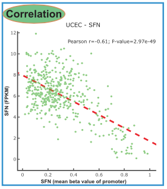

The reference's recipe: for a gene of interest, find which 450K methylation probes sit in its **promoter** (the TSS1500 / TSS200 / 5'UTR / 1st-exon regions of the probe annotation), then correlate each probe's beta value with the gene's expression across samples — promoter hypermethylation represses transcription, so the expected picture is a negative slope with per-probe scatter \[1\]. TCGAbiolinks/ChAMPdata pull the real annotation; here a probe-features table is simulated with the same region vocabulary, and the analysis (region filtering, per-probe Spearman, combined scatter) runs dependency-free:

## Example

{fig-alt="Promoter Methylation vs Expression DEMO" fig-align="center" width="60%"}

## Setup

-   System Requirements: Cross-platform (Linux/MacOS/Windows)

-   Programming language: R

-   Dependent packages: `ggplot2`; `patchwork`

```{r packages setup, message=FALSE, warning=FALSE, output=FALSE}
suppressPackageStartupMessages({
  library(ggplot2); library(patchwork)
})
```

```{r}
sessioninfo::session_info("attached")
```

## Data Preparation

450K-style probe annotation for 60 probes around one gene's TSS — each probe assigned a region class exactly in the `probe.features` vocabulary (`TSS1500`, `TSS200`, `5'UTR`, `1stExon`, `Body`, `3'UTR`) plus its distance to the TSS. For 120 samples: promoter-region beta values are planted **anti-correlated** with the gene's expression (the silencing effect), gene-body probes positively correlated, and intergenic probes uncorrelated:

```{r load data}
suppressPackageStartupMessages({library(ggplot2); library(patchwork)})
set.seed(41242)
n_sam <- 120
regions <- c("TSS1500", "TSS200", "5'UTR", "1stExon", "Body", "3'UTR")
probe.anno <- data.frame(
  probe = sprintf("cg%08d", 1:60),
  region = factor(sample(rep(regions, c(8, 8, 6, 6, 20, 12))),
                  levels = regions),
  distance_to_tss = NA)
## promoter probes cluster near the TSS, body probes downstream
prom <- probe.anno$region %in% c("TSS1500", "TSS200", "5'UTR", "1stExon")
probe.anno$distance_to_tss[prom] <- sample(-(0:1500), sum(prom))
probe.anno$distance_to_tss[!prom] <- sample(1000:20000, sum(!prom))
## expression drives methylation direction
expr <- rnorm(n_sam, 4, 1)
beta <- sapply(seq_len(60), function(i) {
  rg <- as.character(probe.anno$region[i])
  eff <- switch(rg, TSS1500 = -0.55, TSS200 = -0.62,
                "5'UTR" = -0.45, "1stExon" = -0.4,
                Body = 0.35, "3'UTR" = 0.05)
  pmin(pmax(0.5 + eff * scale(expr)[, 1] / 6 + rnorm(n_sam, 0, 0.12), 0), 1)
})
colnames(beta) <- probe.anno$probe

## per-probe Spearman
res <- do.call(rbind, lapply(probe.anno$probe, function(p) {
  ct <- suppressWarnings(cor.test(beta[, p], expr, method = "spearman"))
  data.frame(probe = p, region = probe.anno$region[probe.anno$probe == p],
             rho = unname(ct$estimate), p.value = ct$p.value)
}))
res$significant <- res$p.value < 0.05
res$region_col <- ifelse(grepl("TSS|5'UTR|1stExon", res$region),
                         "promoter", as.character(res$region))
```

## Visualization

### 1. Per-Region Correlation Summary

Every probe's Spearman ρ, colored by region class and shaped by significance: promoter probes (TSS1500/TSS200/5'UTR/1stExon) sit below zero, body probes above — the annotation-table logic that makes "which probes are promoter" a one-line filter:

```{r}
#| label: fig-1.1MethExprSummary
#| fig-cap: "Spearman rho of each 450K probe against gene expression, colored by annotation region: promoter-class probes (TSS1500/TSS200/5'UTR/1stExon) are negative (silencing), body probes positive, filled squares = p<0.05."
#| out.width: "85%"
#| fig-width: 8
#| fig-height: 5.6

ggplot(res, aes(probe, rho, colour = region, shape = significant)) +
  geom_point(size = 2.6) +
  geom_hline(yintercept = 0, colour = "grey55", linetype = "dashed") +
  scale_colour_manual(values = c(TSS1500 = "#B2182B", TSS200 = "#D6604D",
                                 "5'UTR" = "#EF8A62", "1stExon" = "#FDDBC7",
                                 Body = "#2166AC", "3'UTR" = "#92C5DE"),
                      name = NULL) +
  scale_shape_manual(values = c(`TRUE` = 15, `FALSE` = 21),
                     labels = c(`TRUE` = "p<0.05", `FALSE` = "p>=0.05")) +
  labs(x = NULL, y = "Spearman rho (methylation vs expression)") +
  theme_bw(base_size = 10) +
  theme(axis.text.x = element_text(angle = 90, size = 5.5, vjust = 0.5),
        panel.grid.minor = element_blank())
```

### 2. The Silencing Scatter, Split by Region Class

The reference's scatter for a chosen promoter probe vs the gene expression — shown here for one promoter probe (negative slope, the biology) and one body probe (positive slope) side by side, so the contrast that drives the whole analysis is visible:

```{r}
#| label: fig-2.1MethExprScatter
#| fig-cap: "Beta value vs expression for one promoter probe (left, negative slope: methylation represses transcription) and one body probe (right, positive slope); Spearman rho annotated in each panel."
#| out.width: "90%"
#| fig-width: 8
#| fig-height: 4.6

sel_prom <- res$probe[res$region == "TSS200"][1]
sel_body <- res$probe[res$region == "Body"][1]
df <- rbind(
  data.frame(beta = beta[, sel_prom], expr = expr,
             probe = sel_prom, class = "promoter (TSS200)",
             rho = res$rho[res$probe == sel_prom]),
  data.frame(beta = beta[, sel_body], expr = expr,
             probe = sel_body, class = "body",
             rho = res$rho[res$probe == sel_body]))
ggplot(df, aes(beta, expr)) +
  geom_point(colour = "#3B4CC0", size = 1.6, alpha = 0.7) +
  geom_smooth(method = "lm", se = TRUE, colour = "#B2182B", linewidth = 0.5) +
  facet_wrap(~ class + sprintf("rho = %.2f", rho), scales = "free_x") +
  labs(x = "DNA methylation beta value", y = "gene expression (log2)") +
  theme_bw(base_size = 10) +
  theme(panel.grid.minor = element_blank())
```

::: callout-tip
**Practice tips**

-   Filter probes by the annotation's region column, not by distance alone: a probe 800 bp upstream of the TSS of an *adjacent* gene is not this gene's promoter.
-   Promoter methylation represses, gene-body methylation often correlates positively — a single "methylation vs expression" correlation over all probes averages these two opposite effects into noise.
-   Report Spearman: beta values are bounded [0, 1] and their relation to expression is monotone rather than linear.
-   With many probes per gene, show the per-probe rho summary **and** one canonical scatter — the summary finds the pattern, the scatter proves it.
-   XENA-style methylation matrices already contain beta values; if you start from IDATs, normalize within-probe first (beta = M/(M+U+100)) or batch effects will masquerade as correlations.
:::

## Application

::: {#fig-MethExprApplications1}
{fig-alt="Promoter Methylation vs Expression" fig-align="center" width="60%"}

Promoter methylation vs expression
:::

The region-filter + correlation recipe extends to any paired methylation/expression cohort: gene-body vs promoter contrast for imprinting studies, enhancer probes (Enhancer/IGR regions) vs target-gene expression, or TSS1500-only panels for a candidate gene list.

## Reference

\[1\] Xiaofan Lu, et al. FigureYa: A Standardized Visualization Framework for Enhancing Biomedical Data Interpretation and Research Efficiency. iMetaMed. 2025. doi:10.1002/imm3.70005
