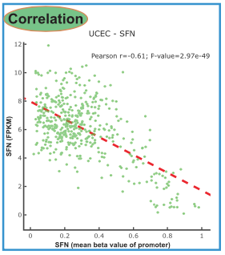

参考的配方：对目标基因，找出哪些 450K 甲基化探针落在其**启动子**（探针注释的 TSS1500 / TSS200 / 5\'UTR / 1st Exon 区域），再把每个探针的 beta 值与基因表达跨样本做相关——启动子超甲基化抑制转录，预期图像是负斜率的逐探针散点 \[1\]。TCGA-biolinks/ChAMPdata 拉取真实注释；此处模拟一张带相同区域词汇表的 probe-features 表，分析（区域过滤、逐探针 Spearman、组合散点）免依赖运行：

## Example

{fig-alt="启动子甲基化 vs 表达 DEMO" fig-align="center" width="60%"}

## Setup

-   系统要求：跨平台（Linux/MacOS/Windows）

-   编程语言：R

-   依赖包：`ggplot2`; `patchwork`

```{r packages setup, message=FALSE, warning=FALSE, output=FALSE}
suppressPackageStartupMessages({
  library(ggplot2); library(patchwork)
})
```

```{r}
sessioninfo::session_info("attached")
```

## 数据准备

一个基因 TSS 附近 60 个探针的 450K 式注释——每个探针按 `probe.features` 的区域词汇（`TSS1500`、`TSS200`、`5'UTR`、`1stExon`、`Body`、`3'UTR`）分类并记录与 TSS 的距离。120 个样本：启动子区域 beta 值与基因表达**负相关**（沉默效应）、基因体探针正相关、基因间区探针不相关：

```{r load data}
suppressPackageStartupMessages({library(ggplot2); library(patchwork)})
set.seed(41242)
n_sam <- 120
regions <- c("TSS1500", "TSS200", "5'UTR", "1stExon", "Body", "3'UTR")
probe.anno <- data.frame(
  probe = sprintf("cg%08d", 1:60),
  region = factor(sample(rep(regions, c(8, 8, 6, 6, 20, 12))),
                  levels = regions),
  distance_to_tss = NA)
## promoter probes cluster near the TSS, body probes downstream
prom <- probe.anno$region %in% c("TSS1500", "TSS200", "5'UTR", "1stExon")
probe.anno$distance_to_tss[prom] <- sample(-(0:1500), sum(prom))
probe.anno$distance_to_tss[!prom] <- sample(1000:20000, sum(!prom))
## expression drives methylation direction
expr <- rnorm(n_sam, 4, 1)
beta <- sapply(seq_len(60), function(i) {
  rg <- as.character(probe.anno$region[i])
  eff <- switch(rg, TSS1500 = -0.55, TSS200 = -0.62,
                "5'UTR" = -0.45, "1stExon" = -0.4,
                Body = 0.35, "3'UTR" = 0.05)
  pmin(pmax(0.5 + eff * scale(expr)[, 1] / 6 + rnorm(n_sam, 0, 0.12), 0), 1)
})
colnames(beta) <- probe.anno$probe

## per-probe Spearman
res <- do.call(rbind, lapply(probe.anno$probe, function(p) {
  ct <- suppressWarnings(cor.test(beta[, p], expr, method = "spearman"))
  data.frame(probe = p, region = probe.anno$region[probe.anno$probe == p],
             rho = unname(ct$estimate), p.value = ct$p.value)
}))
res$significant <- res$p.value < 0.05
res$region_col <- ifelse(grepl("TSS|5'UTR|1stExon", res$region),
                         "promoter", as.character(res$region))
```

## Visualization

### 逐区域相关汇总

每个探针的 Spearman ρ、按区域类着色、显著性分形状：启动子类探针（TSS1500/TSS200/5'UTR/1stExon）位于零下、基因体探针位于零上——把"哪些探针是启动子"变成一行过滤的正是注释表逻辑：

```{r}
#| label: fig-1.1MethExprSummary
#| fig-cap: "每个 450K 探针与基因表达的 Spearman rho、按注释区域着色：启动子类探针（TSS1500/TSS200/5'UTR/1stExon）为负（沉默）、基因体为正、实心方块 = p<0.05。"
#| out.width: "85%"
#| fig-width: 8
#| fig-height: 5.6

ggplot(res, aes(probe, rho, colour = region, shape = significant)) +
  geom_point(size = 2.6) +
  geom_hline(yintercept = 0, colour = "grey55", linetype = "dashed") +
  scale_colour_manual(values = c(TSS1500 = "#B2182B", TSS200 = "#D6604D",
                                 "5'UTR" = "#EF8A62", "1stExon" = "#FDDBC7",
                                 Body = "#2166AC", "3'UTR" = "#92C5DE"),
                      name = NULL) +
  scale_shape_manual(values = c(`TRUE` = 15, `FALSE` = 21),
                     labels = c(`TRUE` = "p<0.05", `FALSE` = "p>=0.05")) +
  labs(x = NULL, y = "Spearman rho (methylation vs expression)") +
  theme_bw(base_size = 10) +
  theme(axis.text.x = element_text(angle = 90, size = 5.5, vjust = 0.5),
        panel.grid.minor = element_blank())
```

### 沉默散点、按区域类拆分

参考对选定启动子探针的表达散点——此处并排展示一个启动子探针（负斜率，生物学所在）与一个基因体探针（正斜率），驱动整个分析的对照关系一目了然：

```{r}
#| label: fig-2.1MethExprScatter
#| fig-cap: "一个启动子探针（左，负斜率：甲基化抑制转录）与一个基因体探针（右，正斜率）的 beta 值 vs 表达散点；每个面板标注 Spearman rho。"
#| out.width: "90%"
#| fig-width: 8
#| fig-height: 4.6

sel_prom <- res$probe[res$region == "TSS200"][1]
sel_body <- res$probe[res$region == "Body"][1]
df <- rbind(
  data.frame(beta = beta[, sel_prom], expr = expr,
             probe = sel_prom, class = "promoter (TSS200)",
             rho = res$rho[res$probe == sel_prom]),
  data.frame(beta = beta[, sel_body], expr = expr,
             probe = sel_body, class = "body",
             rho = res$rho[res$probe == sel_body]))
ggplot(df, aes(beta, expr)) +
  geom_point(colour = "#3B4CC0", size = 1.6, alpha = 0.7) +
  geom_smooth(method = "lm", se = TRUE, colour = "#B2182B", linewidth = 0.5) +
  facet_wrap(~ class + sprintf("rho = %.2f", rho), scales = "free_x") +
  labs(x = "DNA methylation beta value", y = "gene expression (log2)") +
  theme_bw(base_size = 10) +
  theme(panel.grid.minor = element_blank())
```


## 应用场景

::: {{#fig-MethExprApplications1}}
{fig-alt="启动子甲基化 vs 表达" fig-align="center" width="60%"}

启动子甲基化 vs 表达
:::

区域过滤 + 相关的配方适用于任何配对甲基化/表达队列：印记研究的基因体 vs 启动子对照、增强子探针（Enhancer/IGR 区域）vs 靶基因表达、或候选基因清单的 TSS1500-only 面板。

## 参考文献

\[1\] Xiaofan Lu, et al. FigureYa: A Standardized Visualization Framework for Enhancing Biomedical Data Interpretation and Research Efficiency. iMetaMed. 2025. doi:10.1002/imm3.70005
