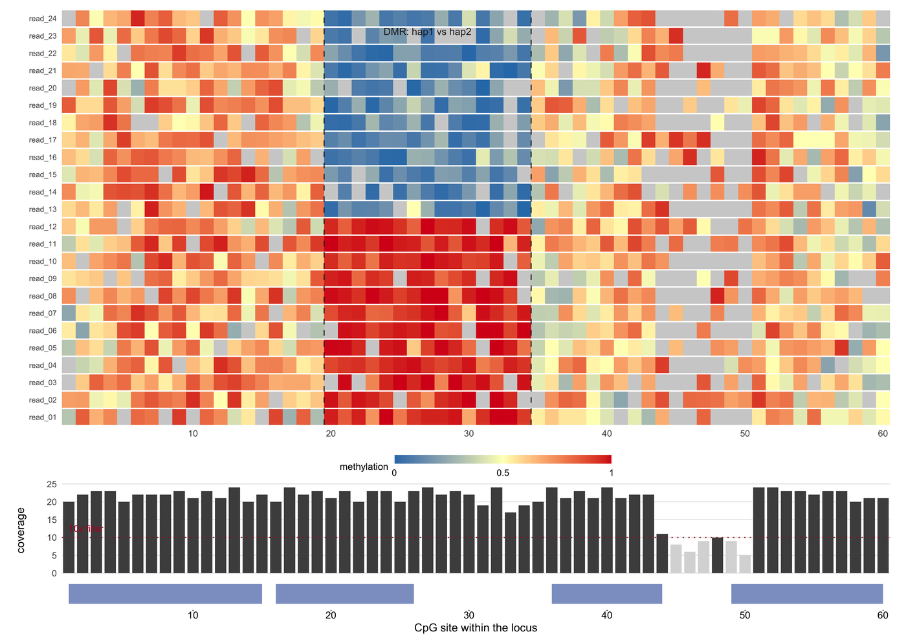

A methylation track has to answer a question that a table of CpG calls does not: **which reads carry the mark, and does the mark differ between haplotypes or between conditions**. methylartist, NanoMethViz, modbamtools and methplotlib all draw the same two objects — a per-read matrix and a coverage track — and add the sort of summary that fits the claim. For nanopore data there is a third object underneath both: the raw current that the caller actually measured.

This tutorial builds those three views from one simulated locus: a per-read matrix with its coverage and gene model, a sorted methylation ladder with binomial intervals, and a raw-current signal panel that shows what a modified base does to the measurement.

## Example

{fig-alt="Methylation Track DEMO" fig-align="center" width="85%"}

A per-read methylation matrix for 60 CpG sites and 24 reads split into two haplotypes, with a differentially methylated region at sites 20-34 (dashed box). Filled cells are methylation calls (blue 0, red 1) and grey cells are sites with no call; the coverage track below applies a 10x filter, and the gene model sits on the same axis. The DMR is invisible in both marginal summaries yet obvious in the matrix.

## Setup

-   System Requirements: Cross-platform (Linux/MacOS/Windows)

-   Programming language: R

-   Dependent packages: `ggplot2`; `dplyr`; `patchwork`

```{r packages setup, message=FALSE, warning=FALSE, output=FALSE}
if (!requireNamespace("ggplot2", quietly = TRUE)) install.packages("ggplot2")
if (!requireNamespace("dplyr", quietly = TRUE)) install.packages("dplyr")
if (!requireNamespace("patchwork", quietly = TRUE)) install.packages("patchwork")

library(ggplot2)
library(dplyr)
library(patchwork)
```

```{r}
sessioninfo::session_info("attached")
```

## Data Preparation

The figure set uses one simulated locus with 60 CpG sites and 24 reads. Reads are split into two haplotypes and sites 20-34 are a differentially methylated region, so there is a signal that a per-site average would blur away.

```{r load data, message=FALSE, warning=FALSE}
set.seed(43517)

## One locus: 60 CpG sites and 24 reads. Reads are split into two haplotypes;
## sites 20-34 are a differentially methylated region (DMR), so the figure has
## a signal that a per-site average would blur away.
n_sites <- 60
n_reads <- 24
reads <- sprintf("read_%02d", 1:n_reads)
hap <- rep(c("hap1", "hap2"), each = n_reads / 2)

bg <- 0.55 + 0.22 * sin(seq_len(n_sites) / 6)
p_h1 <- bg
p_h2 <- bg
p_h1[20:34] <- 0.92
p_h2[20:34] <- 0.10

## Per-read, per-site methylation calls. `cov` is FALSE where the read has no
## call: random dropout plus a low-coverage stretch at sites 44-50.
meth <- expand.grid(site = seq_len(n_sites), read = reads, stringsAsFactors = FALSE) |>
  mutate(hap = hap[match(read, reads)],
         mu = ifelse(hap == "hap1", p_h1[site], p_h2[site]),
         meth = pmin(1, pmax(0, rbeta(n(), mu * 9, (1 - mu) * 9))),
         cov = !(runif(n()) < 0.08 | (site %in% 44:50 & runif(n()) < 0.6)))

## Per-site coverage and mean methylation, plus the hap1-only summary used by
## the sorted ladder. A site passes at 10x (all reads) or 5x (hap1 reads).
site_sum <- meth |>
  filter(cov) |>
  group_by(site) |>
  summarise(cov_n = n(), mean_meth = mean(meth), .groups = "drop") |>
  right_join(data.frame(site = seq_len(n_sites)), by = "site") |>
  mutate(cov_n = ifelse(is.na(cov_n), 0L, cov_n),
         pass = cov_n >= 10)

site_h1 <- meth |>
  filter(cov, hap == "hap1") |>
  group_by(site) |>
  summarise(cov_n = n(), mean_meth = mean(meth), .groups = "drop") |>
  right_join(data.frame(site = seq_len(n_sites)), by = "site") |>
  mutate(cov_n = ifelse(is.na(cov_n), 0L, cov_n),
         pass = cov_n >= 5,
         ci = qnorm(0.975) * sqrt(mean_meth * (1 - mean_meth) / pmax(cov_n, 1)),
         lo = pmax(0, mean_meth - ci),
         hi = pmin(1, mean_meth + ci)) |>
  arrange(mean_meth) |>
  mutate(rank = row_number())

## Gene model in the same site space: four exons.
gene <- data.frame(x0 = c(1, 16, 36, 49), x1 = c(15, 26, 44, 60))
```

## Visualization

### 1. Per-Read Methylation Matrix Above Its Coverage Track

NanoMethViz, modbamtools and methylartist share one layout: reads as rows, CpG sites as columns, methylation as colour, and a coverage track underneath on the same x axis \[1,2\]. The per-read view is what makes a **haplotype-specific** DMR visible; a per-site average would produce a single flat line at 0.5 through the region and the two haplotypes would disappear. Grey cells are sites with no call, not zero methylation, and they must stay in the matrix: hiding them turns missing data into a confident-looking call \[3\].

```{r}
#| label: fig-1MethylationReads
#| fig-cap: "Per-read methylation matrix for 60 CpG sites and 24 reads, split into two haplotypes with a differentially methylated region at sites 20-34 (dashed). Filled cells are methylation (blue 0, red 1); grey cells are sites with no call. Below: coverage per site, with the 10x filter drawn and the 5 sites that fail it in grey; bottom: the four-exon gene model on the same axis. The DMR is invisible in either marginal summary but obvious in the matrix."
#| out.width: "100%"
#| warning: false
#| message: false
#| fig-width: 9
#| fig-height: 6.4
#| fig-dpi: 300

p_reads <- ggplot(meth) +
  geom_rect(aes(xmin = site - 0.5, xmax = site + 0.5,
                ymin = as.numeric(factor(read)) - 0.46,
                ymax = as.numeric(factor(read)) + 0.46,
                fill = meth), colour = NA) +
  ## Sites with no call are drawn grey rather than dropped: a gap in the matrix
  ## is itself a coverage statement.
  geom_rect(data = filter(meth, !cov),
            aes(xmin = site - 0.5, xmax = site + 0.5,
                ymin = as.numeric(factor(read)) - 0.46,
                ymax = as.numeric(factor(read)) + 0.46),
            fill = "#d0d0d0", colour = NA) +
  geom_vline(xintercept = c(19.5, 34.5), linetype = 2, linewidth = 0.35,
             colour = "#252525") +
  annotate("text", x = 27, y = n_reads + 1.1, label = "DMR: hap1 vs hap2",
           size = 2.5, colour = "#252525") +
  scale_fill_gradientn("methylation", colours = c("#2c7bb6", "#ffffbf", "#d7191c"),
                       limits = c(0, 1), na.value = "#d0d0d0",
                       breaks = c(0, 0.5, 1), labels = c("0", "0.5", "1")) +
  scale_y_continuous(breaks = seq_len(n_reads), labels = reads, expand = c(0, 0)) +
  scale_x_continuous(limits = c(0.5, n_sites + 0.5), expand = c(0, 0)) +
  labs(x = NULL, y = NULL) +
  theme_minimal(base_size = 8) +
  theme(panel.grid = element_blank(),
        axis.text.y = element_text(size = 5.4, margin = margin(r = 1)),
        legend.position = "bottom", legend.direction = "horizontal",
        legend.key.height = unit(0.22, "cm"), legend.key.width = unit(1.1, "cm"),
        legend.text = element_text(size = 6.5), legend.title = element_text(size = 6.8),
        plot.margin = margin(2, 6, 0, 6))

p_cov <- ggplot(site_sum) +
  geom_col(aes(site, cov_n, fill = pass), width = 0.82) +
  geom_hline(yintercept = 10, linetype = 3, linewidth = 0.35, colour = "#b2182b") +
  annotate("text", x = 1, y = 12.5, label = "10x filter", size = 2.3,
           colour = "#b2182b", hjust = 0) +
  scale_fill_manual(values = c(`TRUE` = "#4d4d4d", `FALSE` = "#d9d9d9"), guide = "none") +
  scale_x_continuous(limits = c(0.5, n_sites + 0.5), expand = c(0, 0)) +
  labs(x = NULL, y = "coverage") +
  theme_minimal(base_size = 8) +
  theme(panel.grid.minor = element_blank(), panel.grid.major.x = element_blank(),
        axis.text.x = element_blank(), axis.ticks.x = element_blank(),
        plot.margin = margin(0, 6, 0, 6))

p_gene <- ggplot() +
  geom_rect(data = gene, aes(xmin = x0, xmax = x1, ymin = 0.2, ymax = 0.8),
            fill = "#8da0cb", colour = NA) +
  scale_x_continuous(limits = c(0.5, n_sites + 0.5), expand = c(0, 0)) +
  scale_y_continuous(limits = c(0, 1), expand = c(0, 0)) +
  labs(x = "CpG site within the locus", y = NULL) +
  theme_void(base_size = 8) +
  theme(axis.title.x = element_text(size = 8, margin = margin(t = 2)),
        axis.text.x = element_text(size = 7), axis.ticks.x = element_line(),
        plot.margin = margin(0, 6, 2, 6))

p_reads / p_cov / p_gene + plot_layout(heights = c(4.4, 1.0, 0.35))
```

### 2. Sorted Methylation Ladder With Coverage-Scaled Points

A waterfall (methplotlib calls it a methylation frequency plot) sorts sites by methylation and shows the confidence of each estimate \[4\]. The 95% interval is binomial, so it widens exactly where coverage is thin, and sizing the point by read count makes the same fact visible twice. Sites below the declared coverage floor are drawn grey rather than removed: the reader needs to see how many positions the threshold discarded, which is the number that turns a clean figure into an honest one \[5\].

```{r}
#| label: fig-2MethylationLadder
#| fig-cap: "Sorted methylation ladder for the haplotype-1 reads: sites ordered by mean methylation, with a binomial 95% interval, point size proportional to read count, and sites below 5x drawn grey. The 3 sites that fail the coverage floor are kept in the plot so the discarded fraction is visible; the interval widens exactly where the point is small."
#| out.width: "100%"
#| warning: false
#| message: false
#| fig-width: 5.2
#| fig-height: 4.2
#| fig-dpi: 300

ggplot(site_h1) +
  geom_hline(yintercept = c(0, 1), colour = "#d9d9d9", linewidth = 0.3) +
  geom_errorbar(aes(rank, ymin = lo, ymax = hi, colour = pass),
                width = 0, linewidth = 0.35) +
  geom_point(aes(rank, mean_meth, colour = pass, size = cov_n), shape = 16) +
  annotate("rect", xmin = 1, xmax = 4, ymin = 0, ymax = 1,
           fill = "#2c7bb6", alpha = 0.05) +
  annotate("text", x = 30, y = 0.04,
           label = paste0(sum(!site_h1$pass), " sites below 5x"),
           size = 2.4, colour = "#7f7f7f") +
  scale_colour_manual(values = c(`TRUE` = "#333333", `FALSE` = "#bdbdbd"),
                      guide = "none") +
  scale_size_continuous("reads (hap1)", range = c(0.6, 3.0), breaks = c(2, 6, 10)) +
  scale_y_continuous(limits = c(-0.02, 1.02), breaks = c(0, 0.5, 1)) +
  labs(x = "CpG site, sorted by methylation", y = "methylation (95% CI)") +
  theme_minimal(base_size = 8) +
  theme(legend.position = "bottom", legend.direction = "horizontal",
        legend.key.height = unit(0.2, "cm"), legend.text = element_text(size = 6.4),
        legend.title = element_text(size = 6.6), panel.grid.minor = element_blank())
```

### 3. Nanopore Current Signal: Where the Modification Actually Lives

Base modification callers work on the **raw current**, not on the sequence, so the signal view is the ground truth behind a methylation call \[6\]. Squigualiser and CurrentView draw the same object: per-read current traces aligned to a k-mer window, with the modified position shaded. Here three reads carry a 6mA and three do not; the two groups differ by an 11 pA bump at one position and by nothing else. That is what a call has to detect, and what a reviewer should be shown when the call is contested.

```{r}
#| label: fig-3NanoporeSignal
#| fig-cap: "Raw nanopore current for six reads over a 90-sample window: three reads carry a 6mA at sample 46 (orange) and three do not (blue). Thin lines are individual reads, thick lines the group means; the shaded band marks the modified k-mer. The only systematic difference between the groups is an 11 pA rise at that position."
#| out.width: "100%"
#| warning: false
#| message: false
#| fig-width: 5.2
#| fig-height: 4.2
#| fig-dpi: 300

## Six reads aligned to one k-mer window. Three carry a 6mA modification at
## sample 46, which shifts the measured current by about 11 pA; the two groups
## differ only by that shift, so the band is the whole evidence.
n_samp <- 90
pos_mark <- 46
sig <- do.call(rbind, lapply(seq_len(6), function(i) {
  base <- 62 + 5.5 * sin(seq_len(n_samp) / 7) + rnorm(n_samp, 0, 1.2)
  mod <- if (i <= 3) 11 * exp(-((seq_len(n_samp) - pos_mark)^2) / (2 * 3.0^2)) else 0
  data.frame(read = sprintf("read_%02d", i), sample = seq_len(n_samp),
             current = base + mod,
             group = if (i <= 3) "6mA" else "unmodified")
}))
cons <- sig |>
  group_by(sample, group) |>
  summarise(current = mean(current), .groups = "drop")

ggplot(sig, aes(sample, current)) +
  annotate("rect", xmin = pos_mark - 8, xmax = pos_mark + 8, ymin = 35, ymax = 95,
           fill = "#fee08b", alpha = 0.35) +
  geom_line(aes(group = read, colour = group), linewidth = 0.25, alpha = 0.55) +
  geom_line(data = cons, aes(colour = group), linewidth = 1.0) +
  annotate("text", x = pos_mark, y = 90, label = "6mA position",
           size = 2.3, colour = "#7f3b08") +
  annotate("text", x = 3, y = 86, label = "6mA (n = 3)", size = 2.3,
           colour = "#e08214", hjust = 0) +
  annotate("text", x = 3, y = 81, label = "unmodified (n = 3)", size = 2.3,
           colour = "#4c72b0", hjust = 0) +
  scale_colour_manual(values = c(`6mA` = "#e08214", unmodified = "#4c72b0"),
                      guide = "none") +
  scale_y_continuous(limits = c(35, 92), expand = c(0, 0)) +
  labs(x = "signal sample", y = "current (pA)") +
  theme_minimal(base_size = 8) +
  theme(panel.grid.minor = element_blank())
```

::: callout-tip
**Practice tips**

-   Declare the minimum coverage threshold and print the number of sites it removed. This is the single most important sentence in any methylation figure; without it the reader cannot tell a hypomethylated site from an uncovered one.
-   Keep no-call cells in the per-read matrix as a distinct colour. A white or zero cell that means "no data" will be read as "unmethylated", which changes the biological conclusion.
-   Compute intervals for per-site methylation. A site with 3 reads at 100% is not the same evidence as a site with 30 reads at 100%, and a point without an interval hides that difference.
-   State whether the reported value is a per-read fraction, a per-site fraction, or a per-haplotype fraction. The three are not interchangeable and are the usual source of disagreement between two figures from the same BAM.
-   For nanopore data, show the raw current when the modification call is the claim. A binary methylation track cannot distinguish a real modification from a mis-mapped k-mer or a pore artefact.
-   Name the base modification and its caller version (5mC, 6mA, BrdU; modkit, megalodon, dorado). Different callers define the modified fraction differently.
:::

## Application

Methylation tracks are the working figure of epigenetics, tumour heterogeneity and imprinting analysis. **Haplotype-specific DMRs** need the per-read matrix; **cohort-level methylation differences** are best read from the sorted ladder with intervals; and **validating a nanopore modification call** has to go back to the raw current. All three share one data preparation here precisely so that they cannot tell three different stories.

## Reference
\[1\] Su S, Gouil Q, Blewitt ME, Cook D, Hickey PF, Ritchie ME. NanoMethViz: an R/Bioconductor package for visualizing long-read methylation data. PLoS Comput Biol. 2021;17(10):e1009524. doi:10.1371/journal.pcbi.1009524

\[2\] Razaghi R, Hook PW, Ou S, Schatz MC. Modbamtools: analysis of single-molecule epigenetic data for long-range profiling, heterogeneity, and clustering. bioRxiv. 2022. doi:10.1101/2022.07.07.499188

\[3\] Wenger AM, Peluso P, Rowell WJ, et al. Accurate circular consensus long-read sequencing improves variant detection and assembly of a human genome. Nat Biotechnol. 2019;37(10):1155-1162. doi:10.1038/s41587-019-0217-9

\[4\] De Coster W, Van Parys A, Van de Sompele S, et al. Methplotlib: analysis of modified nucleotides from nanopore sequencing. Bioinformatics. 2020;36(10):3236-3238. doi:10.1093/bioinformatics/btaa093

\[5\] Simpson JT, Workman RE, Zuzarte PC, et al. Detecting DNA cytosine methylation using nanopore sequencing. Nat Methods. 2017;14(4):407-410. doi:10.1038/nmeth.4184

\[6\] Samarakoon H, Liyanage K, Ferguson JM, Parameswaran S, et al. Interactive visualization of nanopore sequencing signal data with Squigualiser. Bioinformatics. 2024;40(8):btae501. doi:10.1093/bioinformatics/btae501
