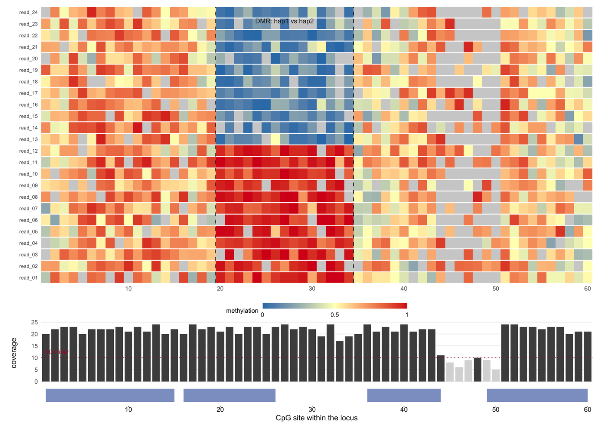

甲基化轨道图必须回答一个 CpG 调用表回答不了的问题：**哪些读段携带修饰，以及修饰在单倍型之间或条件之间是否存在差异**。methylartist、NanoMethViz、modbamtools 与 methplotlib 画的是同样的两个对象——逐读段矩阵与覆盖度轨道——再按主张补上合适的汇总。对纳米孔数据而言，这两者之下还有第三个对象：caller 实际测到的原始电流。

本教程用同一个模拟位点画出这三种视图：带覆盖度与基因模型的逐读段矩阵、带二项区间的排序甲基化阶梯图，以及展示修饰碱基如何改变测量的原始电流面板。

## 示例

{fig-alt="甲基化轨道图 DEMO" fig-align="center" width="85%"}

60 个 CpG 位点、24 条 reads 分属两个单倍型的逐 read 甲基化矩阵，第 20-34 位为差异甲基化区域（虚线框）。实心格是甲基化判定（蓝 0、红 1），灰格是无判定的位点；下方覆盖度轨道施加 10x 过滤，基因模型共用同一坐标轴。这个 DMR 在两个边际汇总里都看不出来，在矩阵里却一目了然。

## 环境配置

-   系统要求： 跨平台（Linux/MacOS/Windows）

-   编程语言：R

-   依赖包：`ggplot2`；`dplyr`；`patchwork`

```{r packages setup, message=FALSE, warning=FALSE, output=FALSE}
if (!requireNamespace("ggplot2", quietly = TRUE)) install.packages("ggplot2")
if (!requireNamespace("dplyr", quietly = TRUE)) install.packages("dplyr")
if (!requireNamespace("patchwork", quietly = TRUE)) install.packages("patchwork")

library(ggplot2)
library(dplyr)
library(patchwork)
```

```{r}
sessioninfo::session_info("attached")
```

## 数据准备

本图集使用一个 60 个 CpG 位点、24 条读段的模拟位点。读段按单倍型分成两组，位点 20-34 是差异甲基化区域，因此图中存在一个会被逐位点平均值抹掉的信号。

```{r load data, message=FALSE, warning=FALSE}
set.seed(43517)

## One locus: 60 CpG sites and 24 reads. Reads are split into two haplotypes;
## sites 20-34 are a differentially methylated region (DMR), so the figure has
## a signal that a per-site average would blur away.
n_sites <- 60
n_reads <- 24
reads <- sprintf("read_%02d", 1:n_reads)
hap <- rep(c("hap1", "hap2"), each = n_reads / 2)

bg <- 0.55 + 0.22 * sin(seq_len(n_sites) / 6)
p_h1 <- bg
p_h2 <- bg
p_h1[20:34] <- 0.92
p_h2[20:34] <- 0.10

## Per-read, per-site methylation calls. `cov` is FALSE where the read has no
## call: random dropout plus a low-coverage stretch at sites 44-50.
meth <- expand.grid(site = seq_len(n_sites), read = reads, stringsAsFactors = FALSE) |>
  mutate(hap = hap[match(read, reads)],
         mu = ifelse(hap == "hap1", p_h1[site], p_h2[site]),
         meth = pmin(1, pmax(0, rbeta(n(), mu * 9, (1 - mu) * 9))),
         cov = !(runif(n()) < 0.08 | (site %in% 44:50 & runif(n()) < 0.6)))

## Per-site coverage and mean methylation, plus the hap1-only summary used by
## the sorted ladder. A site passes at 10x (all reads) or 5x (hap1 reads).
site_sum <- meth |>
  filter(cov) |>
  group_by(site) |>
  summarise(cov_n = n(), mean_meth = mean(meth), .groups = "drop") |>
  right_join(data.frame(site = seq_len(n_sites)), by = "site") |>
  mutate(cov_n = ifelse(is.na(cov_n), 0L, cov_n),
         pass = cov_n >= 10)

site_h1 <- meth |>
  filter(cov, hap == "hap1") |>
  group_by(site) |>
  summarise(cov_n = n(), mean_meth = mean(meth), .groups = "drop") |>
  right_join(data.frame(site = seq_len(n_sites)), by = "site") |>
  mutate(cov_n = ifelse(is.na(cov_n), 0L, cov_n),
         pass = cov_n >= 5,
         ci = qnorm(0.975) * sqrt(mean_meth * (1 - mean_meth) / pmax(cov_n, 1)),
         lo = pmax(0, mean_meth - ci),
         hi = pmin(1, mean_meth + ci)) |>
  arrange(mean_meth) |>
  mutate(rank = row_number())

## Gene model in the same site space: four exons.
gene <- data.frame(x0 = c(1, 16, 36, 49), x1 = c(15, 26, 44, 60))
```

## 可视化

### 1. 逐读段甲基化矩阵与下方覆盖度轨道

NanoMethViz、modbamtools 与 methylartist 共用同一套版式：读段作行、CpG 位点作列、甲基化程度作颜色，下方在同一 x 轴上画覆盖度轨道 \[1,2\]。正是逐读段视图让**单倍型特异**的 DMR 变得可见；若只看逐位点平均值，该区域会退化成一条 0.5 的平线，两个单倍型随之消失。灰色格子表示该位点没有调用，而不是甲基化为零，它们必须留在矩阵里：把缺失藏起来，就等于把缺失数据变成了看似确定的结论 \[3\]。

```{r}
#| label: fig-1MethylationReads
#| fig-cap: "60 个 CpG 位点、24 条读段的逐读段甲基化矩阵，读段分成两个单倍型，位点 20-34 为差异甲基化区域（虚线）。有颜色的格子是甲基化程度（蓝 0、红 1），灰色格子是无调用的位点。下方为逐位点覆盖度，画出 10x 过滤线，未达标的 5 个位点标灰；最下方是同一坐标上的四外显子基因模型。该 DMR 在任何边缘汇总里都看不出来，在矩阵里却一目了然。"
#| out.width: "100%"
#| warning: false
#| message: false
#| fig-width: 9
#| fig-height: 6.4
#| fig-dpi: 300

p_reads <- ggplot(meth) +
  geom_rect(aes(xmin = site - 0.5, xmax = site + 0.5,
                ymin = as.numeric(factor(read)) - 0.46,
                ymax = as.numeric(factor(read)) + 0.46,
                fill = meth), colour = NA) +
  ## Sites with no call are drawn grey rather than dropped: a gap in the matrix
  ## is itself a coverage statement.
  geom_rect(data = filter(meth, !cov),
            aes(xmin = site - 0.5, xmax = site + 0.5,
                ymin = as.numeric(factor(read)) - 0.46,
                ymax = as.numeric(factor(read)) + 0.46),
            fill = "#d0d0d0", colour = NA) +
  geom_vline(xintercept = c(19.5, 34.5), linetype = 2, linewidth = 0.35,
             colour = "#252525") +
  annotate("text", x = 27, y = n_reads + 1.1, label = "DMR: hap1 vs hap2",
           size = 2.5, colour = "#252525") +
  scale_fill_gradientn("methylation", colours = c("#2c7bb6", "#ffffbf", "#d7191c"),
                       limits = c(0, 1), na.value = "#d0d0d0",
                       breaks = c(0, 0.5, 1), labels = c("0", "0.5", "1")) +
  scale_y_continuous(breaks = seq_len(n_reads), labels = reads, expand = c(0, 0)) +
  scale_x_continuous(limits = c(0.5, n_sites + 0.5), expand = c(0, 0)) +
  labs(x = NULL, y = NULL) +
  theme_minimal(base_size = 8) +
  theme(panel.grid = element_blank(),
        axis.text.y = element_text(size = 5.4, margin = margin(r = 1)),
        legend.position = "bottom", legend.direction = "horizontal",
        legend.key.height = unit(0.22, "cm"), legend.key.width = unit(1.1, "cm"),
        legend.text = element_text(size = 6.5), legend.title = element_text(size = 6.8),
        plot.margin = margin(2, 6, 0, 6))

p_cov <- ggplot(site_sum) +
  geom_col(aes(site, cov_n, fill = pass), width = 0.82) +
  geom_hline(yintercept = 10, linetype = 3, linewidth = 0.35, colour = "#b2182b") +
  annotate("text", x = 1, y = 12.5, label = "10x filter", size = 2.3,
           colour = "#b2182b", hjust = 0) +
  scale_fill_manual(values = c(`TRUE` = "#4d4d4d", `FALSE` = "#d9d9d9"), guide = "none") +
  scale_x_continuous(limits = c(0.5, n_sites + 0.5), expand = c(0, 0)) +
  labs(x = NULL, y = "coverage") +
  theme_minimal(base_size = 8) +
  theme(panel.grid.minor = element_blank(), panel.grid.major.x = element_blank(),
        axis.text.x = element_blank(), axis.ticks.x = element_blank(),
        plot.margin = margin(0, 6, 0, 6))

p_gene <- ggplot() +
  geom_rect(data = gene, aes(xmin = x0, xmax = x1, ymin = 0.2, ymax = 0.8),
            fill = "#8da0cb", colour = NA) +
  scale_x_continuous(limits = c(0.5, n_sites + 0.5), expand = c(0, 0)) +
  scale_y_continuous(limits = c(0, 1), expand = c(0, 0)) +
  labs(x = "CpG site within the locus", y = NULL) +
  theme_void(base_size = 8) +
  theme(axis.title.x = element_text(size = 8, margin = margin(t = 2)),
        axis.text.x = element_text(size = 7), axis.ticks.x = element_line(),
        plot.margin = margin(0, 6, 2, 6))

p_reads / p_cov / p_gene + plot_layout(heights = c(4.4, 1.0, 0.35))
```

### 2. 按甲基化排序的阶梯图与覆盖度定尺寸的点

瀑布图（methplotlib 称之为 methylation frequency plot）按甲基化程度给位点排序，并展示每个估计的置信度 \[4\]。95% 区间是二项区间，因此恰好在覆盖度薄的地方变宽；再用读段数决定点的大小，同一个事实就被展示了两次。低于已声明覆盖度下限的位点画成灰色而不是删掉：读者需要看到阈值究竟丢弃了多少个位点，正是这个数字让一张干净的图变成一张诚实的图 \[5\]。

```{r}
#| label: fig-2MethylationLadder
#| fig-cap: "单倍型 1 读段按平均甲基化排序的阶梯图：二项 95% 区间、点大小与读段数成正比、低于 5x 的位点画灰。未达覆盖度下限的 3 个位点仍保留在图中，使被丢弃的比例可见；区间恰好在点最小的地方变宽。"
#| out.width: "100%"
#| warning: false
#| message: false
#| fig-width: 5.2
#| fig-height: 4.2
#| fig-dpi: 300

ggplot(site_h1) +
  geom_hline(yintercept = c(0, 1), colour = "#d9d9d9", linewidth = 0.3) +
  geom_errorbar(aes(rank, ymin = lo, ymax = hi, colour = pass),
                width = 0, linewidth = 0.35) +
  geom_point(aes(rank, mean_meth, colour = pass, size = cov_n), shape = 16) +
  annotate("rect", xmin = 1, xmax = 4, ymin = 0, ymax = 1,
           fill = "#2c7bb6", alpha = 0.05) +
  annotate("text", x = 30, y = 0.04,
           label = paste0(sum(!site_h1$pass), " sites below 5x"),
           size = 2.4, colour = "#7f7f7f") +
  scale_colour_manual(values = c(`TRUE` = "#333333", `FALSE` = "#bdbdbd"),
                      guide = "none") +
  scale_size_continuous("reads (hap1)", range = c(0.6, 3.0), breaks = c(2, 6, 10)) +
  scale_y_continuous(limits = c(-0.02, 1.02), breaks = c(0, 0.5, 1)) +
  labs(x = "CpG site, sorted by methylation", y = "methylation (95% CI)") +
  theme_minimal(base_size = 8) +
  theme(legend.position = "bottom", legend.direction = "horizontal",
        legend.key.height = unit(0.2, "cm"), legend.text = element_text(size = 6.4),
        legend.title = element_text(size = 6.6), panel.grid.minor = element_blank())
```

### 3. 纳米孔电流信号：修饰究竟发生在哪里

碱基修饰 caller 依据的是**原始电流**而不是序列，因此信号视图是甲基化调用背后的 ground truth \[6\]。Squigualiser 与 CurrentView 画的是同一个对象：逐读段电流轨迹对齐到 k-mer 窗口，并给修饰位点打上阴影。这里 3 条读段携带 6mA、3 条不带；两组只在一个位置上相差约 11 pA 的电流抬升，除此之外完全一致。这正是 caller 必须检测的信号，也是在结论受到质疑时应该拿给审稿人看的证据。

```{r}
#| label: fig-3NanoporeSignal
#| fig-cap: "6 条读段在 90 个采样点窗口上的纳米孔原始电流：3 条在读段第 46 个采样点携带 6mA（橙色），3 条不带（蓝色）。细线是单条读段，粗线是组均值；阴影标出被修饰的 k-mer。两组之间唯一系统性的差异就是该位置约 11 pA 的抬升。"
#| out.width: "100%"
#| warning: false
#| message: false
#| fig-width: 5.2
#| fig-height: 4.2
#| fig-dpi: 300

## Six reads aligned to one k-mer window. Three carry a 6mA modification at
## sample 46, which shifts the measured current by about 11 pA; the two groups
## differ only by that shift, so the band is the whole evidence.
n_samp <- 90
pos_mark <- 46
sig <- do.call(rbind, lapply(seq_len(6), function(i) {
  base <- 62 + 5.5 * sin(seq_len(n_samp) / 7) + rnorm(n_samp, 0, 1.2)
  mod <- if (i <= 3) 11 * exp(-((seq_len(n_samp) - pos_mark)^2) / (2 * 3.0^2)) else 0
  data.frame(read = sprintf("read_%02d", i), sample = seq_len(n_samp),
             current = base + mod,
             group = if (i <= 3) "6mA" else "unmodified")
}))
cons <- sig |>
  group_by(sample, group) |>
  summarise(current = mean(current), .groups = "drop")

ggplot(sig, aes(sample, current)) +
  annotate("rect", xmin = pos_mark - 8, xmax = pos_mark + 8, ymin = 35, ymax = 95,
           fill = "#fee08b", alpha = 0.35) +
  geom_line(aes(group = read, colour = group), linewidth = 0.25, alpha = 0.55) +
  geom_line(data = cons, aes(colour = group), linewidth = 1.0) +
  annotate("text", x = pos_mark, y = 90, label = "6mA position",
           size = 2.3, colour = "#7f3b08") +
  annotate("text", x = 3, y = 86, label = "6mA (n = 3)", size = 2.3,
           colour = "#e08214", hjust = 0) +
  annotate("text", x = 3, y = 81, label = "unmodified (n = 3)", size = 2.3,
           colour = "#4c72b0", hjust = 0) +
  scale_colour_manual(values = c(`6mA` = "#e08214", unmodified = "#4c72b0"),
                      guide = "none") +
  scale_y_continuous(limits = c(35, 92), expand = c(0, 0)) +
  labs(x = "signal sample", y = "current (pA)") +
  theme_minimal(base_size = 8) +
  theme(panel.grid.minor = element_blank())
```

::: callout-tip
**实践要点**

-   声明最小覆盖度阈值，并写出因此被移除的位点数。这是任何甲基化图里最重要的一句话；没有它，读者无法区分“低甲基化位点”和“没有覆盖的位点”。
-   逐读段矩阵里保留无调用格子，并用独立颜色表示。把“无数据”画成白色或零，会被读成“未甲基化”，从而改变生物学结论。
-   为逐位点甲基化计算区间。3 条读段全部甲基化与 30 条读段全部甲基化不是同等证据，而不带区间的点会把这一差别藏起来。
-   声明报告的是逐读段比例、逐位点比例还是逐单倍型比例。三者不可互换，也是同一份 BAM 出两张图却互相矛盾的最常见原因。
-   纳米孔数据在主张修饰调用时，要展示原始电流。二元甲基化轨道无法区分真实修饰、错误比对的 k-mer 与孔道伪影。
-   写明修饰类型与 caller 版本（5mC、6mA、BrdU；modkit、megalodon、dorado）。不同 caller 对修饰比例的定义并不相同。
:::

## 应用

甲基化轨道是表观遗传学、肿瘤异质性与印记分析的日常工作图。**单倍型特异的 DMR** 需要逐读段矩阵；**大队列甲基化差异**适合排序阶梯图加区间；**纳米孔修饰调用**的验证则必须回到原始电流。三者共享同一份数据准备，正是为了保证三张图在讲同一件事。

## 参考资料
\[1\] Su S, Gouil Q, Blewitt ME, Cook D, Hickey PF, Ritchie ME. NanoMethViz: an R/Bioconductor package for visualizing long-read methylation data. PLoS Comput Biol. 2021;17(10):e1009524. doi:10.1371/journal.pcbi.1009524

\[2\] Razaghi R, Hook PW, Ou S, Schatz MC. Modbamtools: analysis of single-molecule epigenetic data for long-range profiling, heterogeneity, and clustering. bioRxiv. 2022. doi:10.1101/2022.07.07.499188

\[3\] Wenger AM, Peluso P, Rowell WJ, et al. Accurate circular consensus long-read sequencing improves variant detection and assembly of a human genome. Nat Biotechnol. 2019;37(10):1155-1162. doi:10.1038/s41587-019-0217-9

\[4\] De Coster W, Van Parys A, Van de Sompele S, et al. Methplotlib: analysis of modified nucleotides from nanopore sequencing. Bioinformatics. 2020;36(10):3236-3238. doi:10.1093/bioinformatics/btaa093

\[5\] Simpson JT, Workman RE, Zuzarte PC, et al. Detecting DNA cytosine methylation using nanopore sequencing. Nat Methods. 2017;14(4):407-410. doi:10.1038/nmeth.4184

\[6\] Samarakoon H, Liyanage K, Ferguson JM, Parameswaran S, et al. Interactive visualization of nanopore sequencing signal data with Squigualiser. Bioinformatics. 2024;40(8):btae501. doi:10.1093/bioinformatics/btae501
