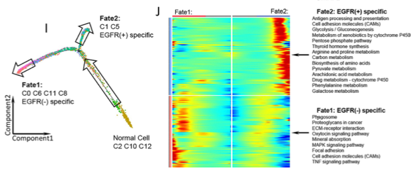

Monocle orders single cells along a **pseudotime trajectory** to reconstruct developmental or differentiation lineages, visualized as a tree or trajectory graph projected onto UMAP embeddings with cells colored by pseudotime progression \[1\]. `Monocle` and Seurat are not in this repository's lockfile; pseudotime values and trajectory branches are simulated here, and the UMAP trajectory scatter renders on ggplot2:

## Example

{fig-alt="Monocle Pseudotime Trajectory UMAP DEMO" fig-align="center" width="75%"}

## Setup

-   System Requirements: Cross-platform (Linux/MacOS/Windows)

-   Programming language: R

-   Dependent packages: `ggplot2`; `patchwork`

```{r packages setup, message=FALSE, warning=FALSE, output=FALSE}
suppressPackageStartupMessages({
  library(ggplot2); library(patchwork)
})
```

```{r}
sessioninfo::session_info("attached")
```

## Data Preparation

1500 single cells with a branching trajectory (root state splitting into two developmental fates). Pseudotime values (0 to 20) are assigned along the paths, and branch states are annotated:

```{r load data}
suppressPackageStartupMessages({library(ggplot2); library(patchwork)})
set.seed(47283)
n_cell <- 1500
branch <- sample(c("State 1", "State 2", "State 3"), n_cell, TRUE, prob = c(0.4, 0.3, 0.3))
## root state spans early pseudotime, terminal fates the later range
t_val <- ifelse(branch == "State 1", runif(sum(branch == "State 1"), 0, 10),
                runif(sum(branch != "State 1"), 7, 20))

## branched UMAP coords
umap1 <- ifelse(branch == "State 1", t_val * 0.4 + rnorm(n_cell, 0, 0.4),
                ifelse(branch == "State 2", 8 + (t_val - 10) * 0.5 + rnorm(n_cell, 0, 0.4),
                       8 - (t_val - 10) * 0.3 + rnorm(n_cell, 0, 0.4)))
umap2 <- ifelse(branch == "State 1", t_val * 0.3 + rnorm(n_cell, 0, 0.4),
                ifelse(branch == "State 2", 3 + (t_val - 10) * 0.6 + rnorm(n_cell, 0, 0.4),
                       3 - (t_val - 10) * 0.6 + rnorm(n_cell, 0, 0.4)))

mono_df <- data.frame(
  UMAP1 = umap1,
  UMAP2 = umap2,
  pseudotime = t_val,
  branch = branch
)

## CD8 T-cell subclusters (FigureYa40lineage): naive LEF1+ sits at the root,
## CX3CR1+ memory spans mid pseudotime, effectors GZMK+ / LAYN+ dominate the
## two terminal fates
mono_df$majorCluster <- with(mono_df, ifelse(
  pseudotime < 7, "CD8-LEF1",
  ifelse(pseudotime < 12, "CD8-CX3CR1",
         ifelse(branch == "State 2", "CD8-GZMK", "CD8-LAYN"))))
```

## Visualization

### 1. Pseudotime Gradient and Branch States on UMAP

The reference's main deliverable: dual UMAP scatter plots colored by pseudotime progression (viridis gradient) and by developmental branch state:

```{r}
#| label: fig-1.1MonocleUmap
#| fig-cap: "Single-cell pseudotime trajectory (Monocle-style) on UMAP embedding: cells coloured by pseudotime progression (left, viridis gradient) and by developmental branch state (right, 3 states)."
#| out.width: "100%"
#| fig-width: 10
#| fig-height: 4.6

p1 <- ggplot(mono_df, aes(UMAP1, UMAP2, colour = pseudotime)) +
  geom_point(size = 0.8, alpha = 0.85) +
  scale_colour_viridis_c(option = "viridis", name = "Pseudotime") +
  labs(title = "Pseudotime progression") +
  theme_bw(base_size = 10) + theme(panel.grid = element_blank())

p2 <- ggplot(mono_df, aes(UMAP1, UMAP2, colour = branch)) +
  geom_point(size = 0.8, alpha = 0.85) +
  scale_colour_brewer(palette = "Set1", name = "Branch state") +
  labs(title = "Developmental branches") +
  theme_bw(base_size = 10) + theme(panel.grid = element_blank())

p1 + p2
```

### 2. CD8 Subclusters Mapped onto the Trajectory (FigureYa40lineage)

FigureYa40lineage runs Monocle separately per CD8 T-cell subcluster and colours the trajectory by **majorCluster** instead of pseudotime: mapping the known subclusters onto the states shows which populations occupy which branch — here naive LEF1+ at the root, memory CX3CR1+ in mid-pseudotime, and effectors GZMK+/LAYN+ splitting into the two terminal fates:

```{r}
#| label: fig-2.1MonocleCluster
#| fig-cap: "CD8 T-cell subclusters on the same trajectory (left): LEF1+ (naive) at the root, CX3CR1+ (memory) spread through mid-trajectory, and GZMK+/LAYN+ (effector/exhausted) occupying the two terminal branches; right, cluster composition per branch state — each late state is dominated by one effector subcluster."
#| out.width: "100%"
#| fig-width: 10
#| fig-height: 4.6

p3 <- ggplot(mono_df, aes(UMAP1, UMAP2, colour = majorCluster)) +
  geom_point(size = 0.8, alpha = 0.85) +
  scale_colour_manual(values = c(`CD8-LEF1` = "#4472C4", `CD8-CX3CR1` = "#8EA325",
                                 `CD8-GZMK` = "#E08214", `CD8-LAYN` = "#B2182B"),
                      name = "Subcluster") +
  labs(title = "Cells coloured by subcluster") +
  theme_bw(base_size = 10) + theme(panel.grid = element_blank())

comp <- as.data.frame(table(branch = mono_df$branch,
                            cluster = mono_df$majorCluster))
comp$branch <- factor(comp$branch, levels = c("State 1", "State 2", "State 3"))
p4 <- ggplot(comp, aes(branch, Freq, fill = cluster)) +
  geom_col(position = "fill", width = 0.72, colour = "white", linewidth = 0.3) +
  scale_fill_manual(values = c(`CD8-LEF1` = "#4472C4", `CD8-CX3CR1` = "#8EA325",
                               `CD8-GZMK` = "#E08214", `CD8-LAYN` = "#B2182B"),
                    name = "Subcluster") +
  labs(x = NULL, y = "Fraction of cells") +
  theme_bw(base_size = 10) +
  theme(panel.grid.minor = element_blank(), legend.position = "bottom") +
  guides(fill = guide_legend(nrow = 2, byrow = TRUE))

p3 + p4
```

::: callout-tip
**Practice tips**
-   Color cells by continuous pseudotime (viridis) in one panel and discrete branch states in the adjacent panel.
-   Keep point size small (0.6-0.8) on dense trajectory embeddings to preserve density gradients.
-   Ensure root states are clearly marked on trajectory graphs.
-   Verify that branch points correspond to biologically meaningful cell fate decisions.
-   Use Monocle 3 or similar modern trajectory tools for robust multi-branch trajectory graph construction.
-   **FigureYa40lineage**: when subclusters are pre-defined (Seurat clusters), colour a second panel by cluster and cross-tabulate cluster × state — a terminal state dominated by one subcluster is the evidence that the branch corresponds to a known population.
:::

## Application

::: {#fig-MonocleApplications1}
{fig-alt="Monocle Pseudotime Trajectory UMAP" fig-align="center" width="75%"}

Monocle pseudotime trajectory UMAP
:::

Pseudotime trajectories apply to any dynamic single-cell process: stem cell differentiation, immune cell activation, or cancer cell evolution.

## Reference

\[1\] Xiaofan Lu, et al. FigureYa: A Standardized Visualization Framework for Enhancing Biomedical Data Interpretation and Research Efficiency. iMetaMed. 2025. doi:10.1002/imm3.70005
