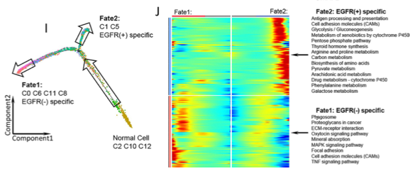

Monocle 沿**拟时序轨迹**对单细胞排序以重建发育或分化谱系，可视化为映射在 UMAP 嵌入上的树或轨迹图，细胞按拟时序进展着色 \[\1\]。`Monocle` 与 Seurat 不在本仓库 lockfile；拟时序值与轨迹分支在此模拟，轨迹 UMAP 散点在 ggplot2 上运行：

## Example

{fig-alt="Monocle 拟时序发育轨迹 UMAP DEMO" fig-align="center" width="60%"}

## Setup

-   系统要求：跨平台（Linux/MacOS/Windows）

-   编程语言：R

-   依赖包：`ggplot2`; `patchwork`

```{r packages setup, message=FALSE, warning=FALSE, output=FALSE}
suppressPackageStartupMessages({
  library(ggplot2); library(patchwork)
})
```

```{r}
sessioninfo::session_info("attached")
```

## 数据准备

1500 个单细胞带分支轨迹（根状态分裂为两个发育命运）。拟时序值（0 到 20）沿路径分配、并注释分支状态：

```{r load data}
suppressPackageStartupMessages({library(ggplot2); library(patchwork)})
set.seed(47283)
n_cell <- 1500
t_val <- runif(n_cell, 0, 20)
branch <- sample(c("State 1", "State 2", "State 3"), n_cell, TRUE, prob = c(0.4, 0.3, 0.3))

## branched UMAP coords
umap1 <- ifelse(branch == "State 1", t_val * 0.4 + rnorm(n_cell, 0, 0.4),
                ifelse(branch == "State 2", 8 + (t_val - 10) * 0.5 + rnorm(n_cell, 0, 0.4),
                       8 - (t_val - 10) * 0.3 + rnorm(n_cell, 0, 0.4)))
umap2 <- ifelse(branch == "State 1", t_val * 0.3 + rnorm(n_cell, 0, 0.4),
                ifelse(branch == "State 2", 3 + (t_val - 10) * 0.6 + rnorm(n_cell, 0, 0.4),
                       3 - (t_val - 10) * 0.6 + rnorm(n_cell, 0, 0.4)))

mono_df <- data.frame(
  UMAP1 = umap1,
  UMAP2 = umap2,
  pseudotime = t_val,
  branch = branch
)
```

## Visualization

### UMAP 上的拟时序梯度与分支状态

参考的主要交付物：双 UMAP 散点图，分别按拟时序进展（viridis 梯度）与发育分支状态着色：

```{r}
#| label: fig-1.1MonocleUmap
#| fig-cap: "UMAP 嵌入上的单细胞拟时序轨迹（Monocle 风格）：细胞按拟时序进展（左，viridis 梯度）与发育分支状态（右，3 状态）着色。"
#| out.width: "100%"
#| fig-width: 10
#| fig-height: 4.6

p1 <- ggplot(mono_df, aes(UMAP1, UMAP2, colour = pseudotime)) +
  geom_point(size = 0.8, alpha = 0.85) +
  scale_colour_viridis_c(option = "viridis", name = "Pseudotime") +
  labs(title = "Pseudotime progression") +
  theme_bw(base_size = 10) + theme(panel.grid = element_blank())

p2 <- ggplot(mono_df, aes(UMAP1, UMAP2, colour = branch)) +
  geom_point(size = 0.8, alpha = 0.85) +
  scale_colour_brewer(palette = "Set1", name = "Branch state") +
  labs(title = "Developmental branches") +
  theme_bw(base_size = 10) + theme(panel.grid = element_blank())

p1 + p2
```


## 应用场景

::: {{#fig-MonocleApplications1}}
{fig-alt="Monocle 拟时序发育轨迹 UMAP" fig-align="center" width="60%"}

Monocle 拟时序发育轨迹 UMAP
:::

拟时序轨迹适用于任何动态单细胞过程：干细胞分化、免疫细胞激活、或癌细胞演化。

## 参考文献

\[1\] Xiaofan Lu, et al. Festival of Standardized Biomedical Visualizations: Monocle Pseudotime Trajectory. iMetaMed. 2025. doi:10.1002/imm3.70005
