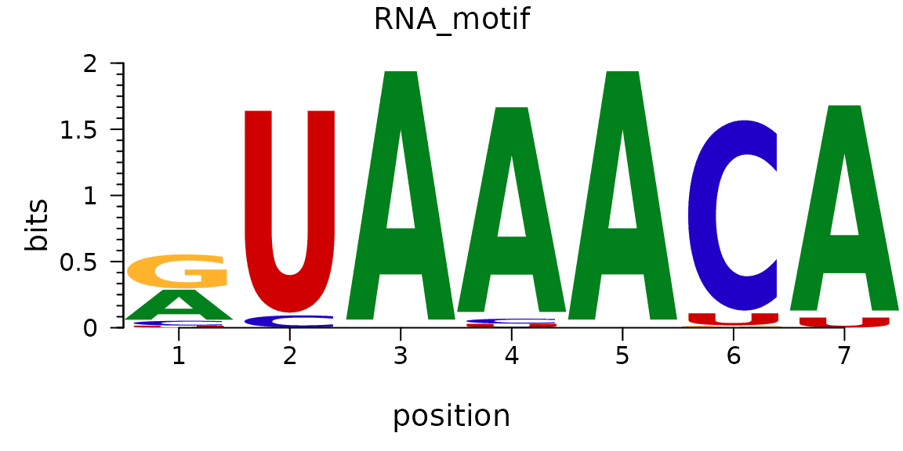

For visualizing motif logos, ggseqlogo is an R package based on ggplot2 specifically designed for plotting logos from sequence motifs. Compared to other motif visualization tools, ggseqlogo boasts advantages such as concise syntax, flexible output formats, and full compatibility with the ggplot2 ecosystem. The package supports various sequence input formats, including position-frequency matrices (PFM), position-weight matrices (PWM), and sequence vectors, and provides rich customization options to adjust the appearance of the logo plot.

## Example

{fig-alt="MotifPlot DEMO1" fig-align="center" width="60%"}

Motif logo images are graphics used to display conserved patterns in DNA, RNA, or protein sequences, using the size of the characters at each location to indicate the information content of that location.

## Setup

-   System Requirements: Cross-platform (Linux/MacOS/Windows)

-   Programming language: R

-   Dependent packages: `ggplot2`, `ggseqlogo`, `cowplot`, `gridExtra`

```{r packages setup, message=FALSE, warning=FALSE, output=FALSE}
# Installing packages
if (!requireNamespace("ggplot2", quietly = TRUE)) {
  install.packages("ggplot2")
}
if (!requireNamespace("ggseqlogo", quietly = TRUE)) {
  install.packages("ggseqlogo")
}
if (!requireNamespace("cowplot", quietly = TRUE)) {
  install.packages("cowplot")
}
if (!requireNamespace("gridExtra", quietly = TRUE)) {
  install.packages("gridExtra")
}

# Load packages
library(ggplot2)
library(ggseqlogo)
library(cowplot)
library(gridExtra)
```

```{r}
sessioninfo::session_info("attached")
```

## Data Preparation

Using the built-in dataset `ggseqlogo_sample`, which contains three variables and two different input formats:
- seqs_dna: Binding sites of 12 transcription factors obtained from the JASPAR FASTA file. The format is a list of string vectors, with the list name representing the JASPAR ID.
- seqs_aa: Phosphorylation sites of kinase substrates obtained from Wagih et al. The format is the same as seqs_dna.
- pfms_dna: A list of position-frequency matrices of four transcription factors obtained from JASPAR, with the list name representing the JASPAR ID.

```{r load data, message=FALSE, warning=FALSE}
data(ggseqlogo_sample)

head(pfms_dna,n = 1)

head(seqs_aa, n = 1)[[1]][1:3]
```

## Visualization

### 1. Basic Motif

The ggseqlogo package can use the `geom_logo` function to plot data based on ggplot2 syntax, or it can use the encapsulated function `ggseqlogo` to plot data, and both share the same parameters.

```{r}
#| label: fig-1BasicMotif
#| fig-cap: "Basic Motif"
#| out.width: "95%"
#| warning: false

# Using sequence vectors
ggseqlogo(seqs_dna$MA0001.1)
# Using PFM matrix
ggseqlogo(pfms_dna$MA0018.2)
# Plotting using ggplot syntax
ggplot() + geom_logo( seqs_dna$MA0001.1 ) + theme_logo()
```

The image above shows the motif result of MA0001.1.

::: callout-tip
**Key parameters: **

- data: Input data: sequence vector, matrix, or list
- method = "bits": Calculation method: "bits" or "probability"
- seq_type = "auto": Sequence type: "auto", "dna", "rna", "aa"
- namespace = NULL: Custom character namespace
- font = "roboto_medium": Font type
- stack_width = 0.95: Character stack width
- rev_stack_order = FALSE: Whether to reverse the stacking order
- col_scheme = "auto": Color scheme
- low_col = 'black': Low-bits/probability color
- high_col = 'yellow': High-bits/probability color
- na_col = 'grey20': NA value color
- plot = TRUE: Whether to plot immediately
:::

### 2. Multi-motif plot

You can use `facet_wrap` or `facet_grid` to combine multiple logo images:

```{r}
#| label: fig-2MultiMotif
#| fig-cap: "Multi-motif plot"
#| out.width: "95%"
#| warning: false

# Draw multiple motifs
ggseqlogo(seqs_dna, ncol=4)

# Equivalent to
p <- ggplot() + geom_logo(seqs_dna) + theme_logo() + 
  facet_wrap(~seq_group, ncol=4, scales='free_x')
```

### 3. Motif plot beautify

#### 3.1 Adjust color scheme

ggseqlogo offers a variety of preset and custom color schemes:

```{r}
#| label: fig-3-1ColorMotif1
#| fig-cap: "Adjust color scheme 1"
#| out.width: "95%"
#| warning: false

# Preset color scheme for DNA sequences
ggseqlogo(seqs_dna$MA0001.1, col_scheme='nucleotide')
```

```{r}
#| label: fig-3-1ColorMotif2
#| fig-cap: "Adjust color scheme 2"
#| out.width: "95%"
#| warning: false

# Color scheme of amino acid sequences
ggseqlogo(seqs_aa$AKT1, col_scheme='chemistry')
```

```{r}
#| label: fig-3-1ColorMotif3
#| fig-cap: "Adjust color scheme 3"
#| out.width: "95%"
#| warning: false

# Custom discrete color scheme
cs1 <- make_col_scheme(chars=c('A', 'T', 'C', 'G'), 
                      groups=c('gr1', 'gr1', 'gr2', 'gr2'), 
                      cols=c('purple', 'purple', 'blue', 'blue'))
ggseqlogo(seqs_dna$MA0001.1, col_scheme=cs1)
```

```{r}
#| label: fig-3-1ColorMotif4
#| fig-cap: "Adjust color scheme 4"
#| out.width: "95%"
#| warning: false

# Custom continuous color scheme
cs2 <- make_col_scheme(chars=c('A', 'T', 'C', 'G'), values=1:4)
ggseqlogo(seqs_dna$MA0001.1, col_scheme=cs2)
```

#### 3.2 Adjust font and stacking

```{r}
#| label: fig-3-2FontMotif
#| fig-cap: "Adjust font and stacking"
#| out.width: "95%"
#| warning: false

# View all available fonts
list_fonts(F)

# Use a specific font
ggseqlogo(seqs_dna$MA0001.1, font='helvetica_bold', stack_width=0.8)
```

#### 3.3 Adjust the axes and themes

```{r}
#| label: fig-3-3ThemeMotif
#| fig-cap: "Adjust the axes and themes"
#| out.width: "95%"
#| warning: false

ggseqlogo(seqs_dna$MA0001.1) + 
  theme_classic() +
  theme(axis.text.x = element_text(angle=45, hjust=1)) +
  labs(x='Position', y='Bits', title='Transcription Factor Binding Motif')
```

### 4. Advanced features

Drawing method selection:

ggseqlogo supports two sequence logo calculation methods:

```{r}
#| label: fig-4MethodMotif
#| fig-cap: "Sequence logo calculation method"
#| out.width: "95%"
#| warning: false

p1 <- ggseqlogo(seqs_dna$MA0001.1, method='bits')  # Information content
p2 <- ggseqlogo(seqs_dna$MA0001.1, method='prob')  # probability
gridExtra::grid.arrange(p1, p2, ncol=2)
```

Custom sequence types and namespaces:

```{r}
#| label: fig-4NamespaceMotif1
#| fig-cap: "Sequence types and namespaces 1"
#| out.width: "95%"
#| warning: false

# Numerical sequence
seqs_numeric <- chartr('ATGC', '1234', seqs_dna$MA0001.1)
ggseqlogo(seqs_numeric, method='prob', namespace=1:4)
```

```{r}
#| label: fig-4NamespaceMotif2
#| fig-cap: "Sequence types and namespaces 2"
#| out.width: "95%"
#| warning: false

# Greek alphabet sequence
seqs_greek <- chartr('ATGC', 'δεψλ', seqs_dna$MA0001.1)
ggseqlogo(seqs_greek, namespace='δεψλ', method='bits')
```

Custom height logo:

```{r}
#| label: fig-4CustomHeightMotif
#| fig-cap: "Custom height logo"
#| out.width: "95%"
#| warning: false

# Create a custom height matrix
custom_mat <- matrix(rnorm(20), nrow=4, 
                    dimnames=list(c('A', 'T', 'G', 'C')))
ggseqlogo(custom_mat, method='custom', seq_type='dna') + 
  ylab('my custom height')
```

Sequence identifier:

```{r}
#| label: fig-4LabelMotif
#| fig-cap: "Sequence identifier"
#| out.width: "95%"
#| warning: false

ggplot() + 
  annotate('rect', xmin=0.5, xmax=3.5, ymin=-0.05, ymax=1.9, 
           alpha=0.1, col='black', fill='yellow') +
  geom_logo(seqs_dna$MA0001.1, stack_width=0.90) + 
  annotate('segment', x=4, xend=8, y=1.2, yend=1.2, size=2) +  # Note that starting with ggplot2 version 3.4.0, the size parameter for adjusting line thickness has been changed to the linewidth parameter. Users of the new version of ggplot2 are advised to change size to linewidth.
  annotate('text', x=6, y=1.3, label='Text annotation') + 
  theme_logo()
```

Combining multiple plots:

```{r}
#| label: fig-4CowplotMotif
#| fig-cap: "Combining multiple plots"
#| out.width: "95%"
#| warning: false

# Generate sequence logo
p1 <- ggseqlogo(seqs_dna$MA0008.1) + 
  theme(axis.text.x=element_blank())

# Create sequence alignment data
aln <- data.frame(
  letter=strsplit('AGATAAGATGATAAAAAGATAAGA', '')[[1]], 
  species=rep(c('a', 'b', 'c'), each=8),
  x=rep(1:8, 3)
)
aln$mut <- 'no'
aln$mut[c(2,15,20,23)] <- 'yes'

# Generate sequence alignment plot
p2 <- ggplot(aln, aes(x, species)) +
  geom_text(aes(label=letter, color=mut, size=mut)) + 
  scale_x_continuous(breaks=1:10, expand=c(0.105, 0)) + 
  xlab('') + 
  scale_color_manual(values=c('black', 'red')) + 
  scale_size_manual(values=c(5, 6)) + 
  theme_logo() + 
  theme(legend.position='none', axis.text.x=element_blank())

# Creating a conservative bar chart
bp_data <- data.frame(x=1:8, conservation=sample(1:100, 8))
p3 <- ggplot(bp_data, aes(x, conservation)) +
  geom_bar(stat='identity', fill='grey') + 
  theme_logo() + 
  scale_x_continuous(breaks=1:10, expand=c(0.105, 0)) + 
  xlab('')

# Composite plots
cowplot::plot_grid(p1, p2, p3, ncol=1, align='v')
```

Integration with other tools:

ggseqlogo can be used with other bioinformatics packages. For example, the ggmotif package can directly extract motifs from MEME result files and visualize them using ggseqlogo. The universalmotif package also provides integration functionality with ggseqlogo.

### 5. RNA Structure Logo: A Logo With Base-Pair Arcs

A sequence logo says what each column contains; an **RNA structure logo** additionally says which columns pair with which \[2\]. Stem-loop motifs (pre-miRNA hairpins, riboswitches, viral RNA elements) are defined by that pairing, so a logo drawn without the arcs can show a perfectly conserved motif whose base-pairing is not conserved at all — and that is a different biological claim. This section draws the arcs from a covariance-derived pairing table, the way LogoJS and the R-scape summary plots do.

```{r}
#| label: fig-5-1RnaStructureLogo
#| fig-cap: "RNA structure logo for a 24-nt stem-loop: information content per column on top (bits), sequence letters scaled by information below it, and base-pair arcs joining the paired columns. The five-pair stem (columns 4-8 with 17-21) is drawn solid; the single pair with weak covariation support (columns 10 and 15) is drawn dashed, because a pairing seen in one sequence is not evidence of conserved structure."
#| out.width: "100%"
#| warning: false
#| message: false
#| fig-width: 8.5
#| fig-height: 4.6
#| fig-dpi: 300

suppressPackageStartupMessages({
  library(ggplot2)
  library(dplyr)
  library(tidyr)
  library(tibble)
})

set.seed(43514)

## Position probability matrix for a 24-nt stem-loop: a GC-rich stem
## (4-8 paired with 17-21), a 5-nt loop (9-13) and two unpaired flanks.
pfm <- matrix(0.025, nrow = 4, ncol = 24,
              dimnames = list(c("A", "C", "G", "U"), NULL))
pfm[1, 1:3] <- c(0.7, 0.1, 0.1)
pfm[2, 1:3] <- c(0.1, 0.7, 0.1)
pfm[3, 1:3] <- c(0.1, 0.1, 0.7)
pfm[4, 1:3] <- c(0.1, 0.1, 0.1)
for (k in 1:5) {                       # stem: G-C x 3, then A-U, G-C
  b <- list(c("G", "C"), c("G", "C"), c("G", "C"), c("A", "U"),
            c("G", "C"))[[k]]
  pfm[, 3 + k] <- 0.025
  pfm[b[1], 3 + k] <- 0.85
  pfm[b[2], 16 + k] <- 0.85
  pfm[b[2], 3 + k] <- 0.05
  pfm[b[1], 16 + k] <- 0.05
}
for (k in 9:13) {                      # loop
  pfm[, k] <- c(0.4, 0.2, 0.2, 0.2)
}
pfm[, 14:15] <- c(0.25, 0.25, 0.25, 0.25)
pfm <- sweep(pfm, 2, colSums(pfm), "/")

## Information content per column (bits, max 2 for RNA).
ic <- apply(pfm, 2, function(p) 2 + sum(p * log2(p)))
letters_df <- as.data.frame(pfm) |>
  rownames_to_column("base") |>
  pivot_longer(-base, names_to = "col", values_to = "p") |>
  mutate(col = as.integer(sub("V", "", col)),
         ic = ic[col],
         h = p * ic) |>
  filter(p > 0.02) |>
  arrange(col, h) |>
  group_by(col) |>
  mutate(stack = cumsum(h), mid = stack - h / 2) |>
  ungroup()

## Pairing table: five supported stem pairs plus one weak candidate.
pairs <- data.frame(
  i = c(4, 5, 6, 7, 8, 10),
  j = c(21, 20, 19, 18, 17, 15),
  support = c("supported", "supported", "supported", "supported",
              "supported", "weak")
)

arc <- do.call(rbind, lapply(seq_len(nrow(pairs)), function(k) {
  p <- pairs[k, ]
  t <- seq(0, pi, length.out = 60)
  span <- p$j - p$i
  data.frame(x = p$i + span * (1 - cos(t)) / 2,
             y = 2.9 + span * 0.22 * sin(t) + k * 0.02,
             support = p$support, id = k)
}))

base_cols <- c(A = "#1b7837", C = "#2166ac", G = "#d95f02", U = "#7570b3")

p <- ggplot() +
  ## information content
  geom_col(data = data.frame(col = 1:24, ic = ic),
           aes(col, ic), fill = "#cfcfcf", width = 0.72) +
  ## letters, stacked by information and scaled by frequency
  geom_text(data = letters_df,
            aes(col, mid, label = base, size = h, colour = base),
            family = "mono", fontface = "bold", show.legend = FALSE) +
  scale_size_continuous(range = c(0.6, 5.2), guide = "none") +
  scale_colour_manual(values = base_cols, guide = "none") +
  ## base-pair arcs
  geom_path(data = arc, aes(x, y, group = id, linetype = support),
            colour = "#542788", linewidth = 0.45) +
  scale_linetype_manual(values = c(supported = "solid", weak = "22"),
                        name = "pairing") +
  annotate("text", x = 11, y = 3.6, label = "loop (unpaired)", size = 2.3,
           colour = "#525252") +
  scale_y_continuous(limits = c(0, 4.4), expand = c(0, 0)) +
  scale_x_continuous(breaks = seq(2, 24, 2), expand = c(0.01, 0)) +
  labs(x = "alignment column", y = "information (bits)") +
  theme_minimal(base_size = 9) +
  theme(panel.grid.minor = element_blank(),
        legend.position = "bottom",
        legend.key.size = unit(0.4, "cm"),
        legend.text = element_text(size = 7))

p
```

::: callout-tip
**Practice tips**

-   Draw the arcs, and encode their evidence: a solid arc for a covariation-supported pair and a dashed arc for a single-sequence candidate. The base-pairing is a claim, and the figure should say how strong it is.
-   Keep the information-content bar above or behind the letters. It is the column-level summary the reader uses to find the motif, and without it a logo of mostly-0.25 columns looks uniform.
-   Colour by base identity with a standard palette (A/C/G/U) rather than by position; reusing one colour for two bases makes the stem look conserved when only its pairing is.
-   Never normalise a logo to the observed maximum. The bits axis is absolute (2 for RNA, 4.33 for protein); rescaling hides low-information columns that are often the biologically interesting ones.
-   State the motif source and the number of sequences behind it: a logo from 6 sequences and a logo from 6000 look identical and support very different claims.
:::

## Application

Motif maps are widely used in genomics and molecular biology research:

1. **Transcription factor binding site analysis:** Displays conserved binding patterns of transcription factors in DNA sequences.

2. **Protein domain analysis:** Shows conserved amino acids in functional domains of protein sequences.

3. **Multiple sequence alignment visualization:** Displays conserved regions in multiple sequence alignments.

4. **ChIP-seq analysis:** Visualizes enriched motifs identified by ChIP-seq experiments.

5. **Genomic feature analysis:** Displays sequence features of specific regions of the genome.

## Reference

\[1\] Wagih O. ggseqlogo: a versatile R package for drawing sequence logos. Bioinformatics. 2017;33(22):3645-3647. doi:10.1093/bioinformatics/btx469

\[2\] Rivas E, Clements J, Eddy SR. A statistical test for conserved RNA structure shows lack of evidence for structure in lncRNAs. Nature Methods. 2017;14(1):45-48. doi:10.1038/nmeth.4066
