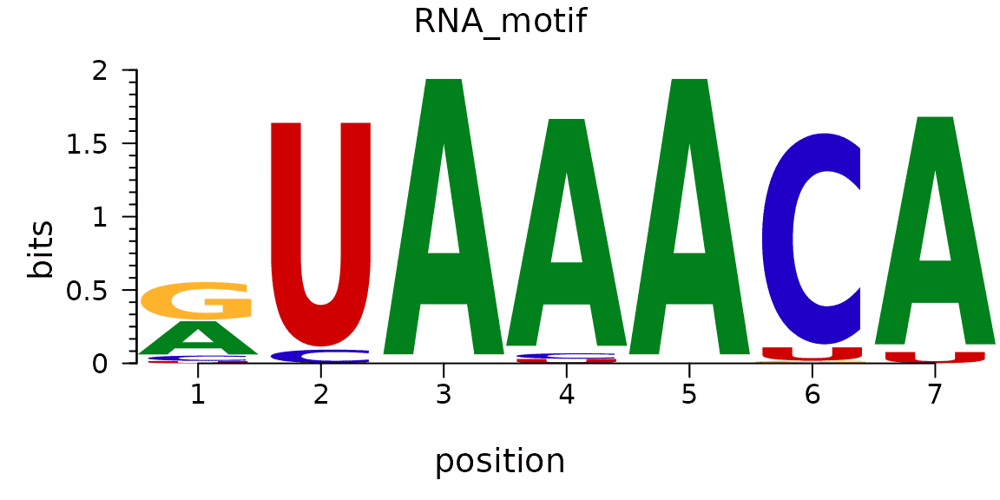

对于motif logo图的可视化，ggseqlogo是一个基于ggplot2的R包，专门用于绘制序列motif的logo图。相比于其他motif可视化工具，ggseqlogo具有语法简洁、输出格式灵活、与ggplot2生态系统完全兼容等优点。该包支持多种序列格式输入，包括位置频率矩阵(PFM)、位置权重矩阵(PWM)和序列向量，并提供了丰富的自定义选项来调整logo图的外观。

## 示例

{fig-alt="MotifPlot DEMO1" fig-align="center" width="60%"}

Motif logo图是用于展示DNA、RNA或蛋白质序列中保守模式的图形，通过每个位置的字符大小来显示该位置的信息含量。

## 环境配置

-   系统要求： 跨平台（Linux/MacOS/Windows）

-   编程语言：R

-   依赖包：`ggplot2`, `ggseqlogo`, `cowplot`, `gridExtra`

```{r packages setup, message=FALSE, warning=FALSE, output=FALSE}
# 安装包
if (!requireNamespace("ggplot2", quietly = TRUE)) {
  install.packages("ggplot2")
}
if (!requireNamespace("ggseqlogo", quietly = TRUE)) {
  install.packages("ggseqlogo")
}
if (!requireNamespace("cowplot", quietly = TRUE)) {
  install.packages("cowplot")
}
if (!requireNamespace("gridExtra", quietly = TRUE)) {
  install.packages("gridExtra")
}

# 加载包
library(ggplot2)
library(ggseqlogo)
library(cowplot)
library(gridExtra)
```

```{r}
sessioninfo::session_info("attached")
```

## 数据准备

使用内置数据集 `ggseqlogo_sample`，该数据集包含三个变量、两种不同的输入形式：
- seqs_dna：从JASPAR的FASTA文件中获得的12个转录因子的结合位点。格式为字符串向量组成的list，list的名称表示JASPAR ID。
- seqs_aa：从Wagih等人获得的激酶底物磷酸化位点组。格式与seqs_dna相同。
- pfms_dna：从JASPAR获得的四个转录因子的位置频率matrix组成的list，list的名称表示JASPAR ID。

```{r load data, message=FALSE, warning=FALSE}
data(ggseqlogo_sample)

head(pfms_dna,n = 1)

head(seqs_aa, n = 1)[[1]][1:3]
```

## 可视化

### 1. 基础Motif图

ggseqlogo 包可以使用 `geom_logo` 函数并基于 ggplot2 语法进行绘制，也可以使用封装后的函数 `ggseqlogo` 函数进行绘制，二者共享相同的参数。

```{r}
#| label: fig-1BasicMotif
#| fig-cap: "基础motif图"
#| out.width: "95%"
#| warning: false

# 使用序列向量
ggseqlogo(seqs_dna$MA0001.1)
# 使用PFM矩阵
ggseqlogo(pfms_dna$MA0018.2)
#使用ggplot语法绘图
ggplot() + geom_logo( seqs_dna$MA0001.1 ) + theme_logo()
```

上图为MA0001.1的motif结果展示

::: callout-tip
**关键参数: **

- data：输入数据：序列向量、矩阵或列表
- method = "bits"：计算方法："bits"或"probability"
- seq_type = "auto"：序列类型："auto"、"dna"、"rna"、"aa"
- namespace = NULL：自定义字符命名空间
- font = "roboto_medium"：字体类型
- stack_width = 0.95：字符堆叠宽度
- rev_stack_order = FALSE：是否反转堆叠顺序
- col_scheme = "auto"：颜色方案
- low_col = 'black'：低bits/probability颜色
- high_col = 'yellow'：高bits/probability颜色
- na_col = 'grey20'：NA值颜色
- plot = TRUE：是否立即绘图
-   **SNP 会破坏 motif 吗？（FigureYa86）**：Bioconductor 的 `motifbreakR` 给出定量答案——用 `SNPlocs.Hsapiens` 从 rs 编号构建 `snpList`，对 `MotifDb` 的 PWM 打参考等位与突变等位的分，读每个 SNP×motif 的 p 值与分差；`plotMB()` 直接画出双等位 logo。其依赖树（MotifDb + SNPlocs，数 GB，外加 GSL 系统库）在本仓库 lockfile 之外，请在自己的环境里从 Bioconductor 安装该包。
:::

### 2. 多motif绘图

你可以使用facet_wrap或facet_grid来组合多个logo图：

```{r}
#| label: fig-2MultiMotif
#| fig-cap: "多motif绘图"
#| out.width: "95%"
#| warning: false

# 绘制多个motif
ggseqlogo(seqs_dna, ncol=4)

# 等价于
p <- ggplot() + geom_logo(seqs_dna) + theme_logo() + 
  facet_wrap(~seq_group, ncol=4, scales='free_x')
```

### 3. Motif图美化

#### 3.1 调整颜色方案

ggseqlogo 提供了多种预设和自定义颜色方案：

```{r}
#| label: fig-3-1ColorMotif1
#| fig-cap: "调整颜色方案1"
#| out.width: "95%"
#| warning: false

# DNA序列的预设颜色方案
ggseqlogo(seqs_dna$MA0001.1, col_scheme='nucleotide')
```

```{r}
#| label: fig-3-1ColorMotif2
#| fig-cap: "调整颜色方案2"
#| out.width: "95%"
#| warning: false

# 氨基酸序列的颜色方案
ggseqlogo(seqs_aa$AKT1, col_scheme='chemistry')
```

```{r}
#| label: fig-3-1ColorMotif3
#| fig-cap: "调整颜色方案3"
#| out.width: "95%"
#| warning: false

# 自定义离散颜色方案
cs1 <- make_col_scheme(chars=c('A', 'T', 'C', 'G'), 
                      groups=c('gr1', 'gr1', 'gr2', 'gr2'), 
                      cols=c('purple', 'purple', 'blue', 'blue'))
ggseqlogo(seqs_dna$MA0001.1, col_scheme=cs1)
```

```{r}
#| label: fig-3-1ColorMotif4
#| fig-cap: "调整颜色方案4"
#| out.width: "95%"
#| warning: false

# 自定义连续颜色方案
cs2 <- make_col_scheme(chars=c('A', 'T', 'C', 'G'), values=1:4)
ggseqlogo(seqs_dna$MA0001.1, col_scheme=cs2)
```

#### 3.2 调整字体和堆叠

```{r}
#| label: fig-3-2FontMotif
#| fig-cap: "调整字体和堆叠"
#| out.width: "95%"
#| warning: false

# 查看所有可用字体
list_fonts(F)

# 使用特定字体
ggseqlogo(seqs_dna$MA0001.1, font='helvetica_bold', stack_width=0.8)
```

#### 3.3 调整坐标轴和主题

```{r}
#| label: fig-3-3ThemeMotif
#| fig-cap: "调整坐标轴和主题"
#| out.width: "95%"
#| warning: false

ggseqlogo(seqs_dna$MA0001.1) + 
  theme_classic() +
  theme(axis.text.x = element_text(angle=45, hjust=1)) +
  labs(x='Position', y='Bits', title='Transcription Factor Binding Motif')
```

### 4. 高级功能

绘图方法选择：

ggseqlogo 支持两种序列 logo 计算方法：

```{r}
#| label: fig-4MethodMotif
#| fig-cap: "序列 logo 计算方法"
#| out.width: "95%"
#| warning: false

p1 <- ggseqlogo(seqs_dna$MA0001.1, method='bits')  # 信息量
p2 <- ggseqlogo(seqs_dna$MA0001.1, method='prob')  # 概率
gridExtra::grid.arrange(p1, p2, ncol=2)
```

自定义序列类型和命名空间：

```{r}
#| label: fig-4NamespaceMotif1
#| fig-cap: "序列类型和命名空间1"
#| out.width: "95%"
#| warning: false

# 数值序列
seqs_numeric <- chartr('ATGC', '1234', seqs_dna$MA0001.1)
ggseqlogo(seqs_numeric, method='prob', namespace=1:4)
```

```{r}
#| label: fig-4NamespaceMotif2
#| fig-cap: "序列类型和命名空间2"
#| out.width: "95%"
#| warning: false

# 希腊字母序列
seqs_greek <- chartr('ATGC', 'δεψλ', seqs_dna$MA0001.1)
ggseqlogo(seqs_greek, namespace='δεψλ', method='bits')
```

自定义高度logo：

```{r}
#| label: fig-4CustomHeightMotif
#| fig-cap: "自定义高度logo"
#| out.width: "95%"
#| warning: false

# 创建自定义高度矩阵
custom_mat <- matrix(rnorm(20), nrow=4, 
                    dimnames=list(c('A', 'T', 'G', 'C')))
ggseqlogo(custom_mat, method='custom', seq_type='dna') + 
  ylab('my custom height')
```

序列标识：

```{r}
#| label: fig-4LabelMotif
#| fig-cap: "序列标识"
#| out.width: "95%"
#| warning: false

ggplot() + 
  annotate('rect', xmin=0.5, xmax=3.5, ymin=-0.05, ymax=1.9, 
           alpha=0.1, col='black', fill='yellow') +
  geom_logo(seqs_dna$MA0001.1, stack_width=0.90) + 
  annotate('segment', x=4, xend=8, y=1.2, yend=1.2, size=2) +  #需要注意的是在ggplot2 3.4.0版本开始，调整线条粗细的size参数已经改变为了linewidth参数，建议使用新版本ggplot2的用户将size改为linewidth。
  annotate('text', x=6, y=1.3, label='Text annotation') + 
  theme_logo()
```

组合多种图形：

```{r}
#| label: fig-4CowplotMotif
#| fig-cap: "组合多种图形"
#| out.width: "95%"
#| warning: false

# 生成序列logo
p1 <- ggseqlogo(seqs_dna$MA0008.1) + 
  theme(axis.text.x=element_blank())

# 创建序列比对数据
aln <- data.frame(
  letter=strsplit('AGATAAGATGATAAAAAGATAAGA', '')[[1]], 
  species=rep(c('a', 'b', 'c'), each=8),
  x=rep(1:8, 3)
)
aln$mut <- 'no'
aln$mut[c(2,15,20,23)] <- 'yes'

# 生成序列比对图
p2 <- ggplot(aln, aes(x, species)) +
  geom_text(aes(label=letter, color=mut, size=mut)) + 
  scale_x_continuous(breaks=1:10, expand=c(0.105, 0)) + 
  xlab('') + 
  scale_color_manual(values=c('black', 'red')) + 
  scale_size_manual(values=c(5, 6)) + 
  theme_logo() + 
  theme(legend.position='none', axis.text.x=element_blank())

# 创建保守性柱状图
bp_data <- data.frame(x=1:8, conservation=sample(1:100, 8))
p3 <- ggplot(bp_data, aes(x, conservation)) +
  geom_bar(stat='identity', fill='grey') + 
  theme_logo() + 
  scale_x_continuous(breaks=1:10, expand=c(0.105, 0)) + 
  xlab('')

# 组合图形
cowplot::plot_grid(p1, p2, p3, ncol=1, align='v')
```

与其他工具集成：

ggseqlogo 可以与其他生物信息学包配合使用，如 ggmotif 包可以直接从 MEME 结果文件中提取 motif 并使用 ggseqlogo 进行可视化，universalmotif 包也提供了与 ggseqlogo 的集成功能。

### 5. RNA 结构 logo：带碱基配对弧的序列 logo

序列 logo 只说明每一列包含什么；**RNA 结构 logo** 还说明哪些列彼此配对 \[2\]。茎环型 motif（pre-miRNA 发夹、核糖开关、病毒 RNA 元件）正是由这种配对定义的，因此不带弧线的 logo 可能展示一个完全保守、但碱基配对毫不保守的 motif——那是完全不同的生物学主张。本节按协变导出的配对表绘制弧线，做法与 LogoJS 及 R-scape 的汇总图一致。

```{r}
#| label: fig-5-1RnaStructureLogo
#| fig-cap: "模拟 24 nt 茎环的 RNA 结构 logo：逐列信息量（bits，灰色柱）叠加序列字母，其上方为连接配对列的碱基配对弧。5 对茎区（第 4-8 列与 17-21 列）用实线，单一候选配对（第 10 与 15 列，仅一条序列支持）用虚线。配对表为手工指定；真实分析中应由共变推导。"
#| out.width: "100%"
#| warning: false
#| message: false
#| fig-width: 8.5
#| fig-height: 4.6
#| fig-dpi: 300

suppressPackageStartupMessages({
  library(ggplot2)
  library(dplyr)
  library(tidyr)
  library(tibble)
})


## 24 nt 茎环的位置概率矩阵：一段 GC 富集的茎区
## （4-8 与 17-21 配对）、8 nt 环区（9-16）以及两端未配对的侧翼。
pfm <- matrix(0.025, nrow = 4, ncol = 24,
              dimnames = list(c("A", "C", "G", "U"), NULL))
pfm[1, 1:3] <- c(0.7, 0.1, 0.1)
pfm[2, 1:3] <- c(0.1, 0.7, 0.1)
pfm[3, 1:3] <- c(0.1, 0.1, 0.7)
pfm[4, 1:3] <- c(0.1, 0.1, 0.1)
for (k in 1:5) {                       # 茎区：G-C x 3，然后 A-U、G-C
  b <- list(c("G", "C"), c("G", "C"), c("G", "C"), c("A", "U"),
            c("G", "C"))[[k]]
  pfm[, 3 + k] <- 0.025
  pfm[b[1], 3 + k] <- 0.85
  pfm[b[2], 16 + k] <- 0.85
  pfm[b[2], 3 + k] <- 0.05
  pfm[b[1], 16 + k] <- 0.05
}
for (k in 9:13) {                      # 环区
  pfm[, k] <- c(0.4, 0.2, 0.2, 0.2)
}
pfm[, 14:15] <- c(0.25, 0.25, 0.25, 0.25)
pfm <- sweep(pfm, 2, colSums(pfm), "/")

## 逐列信息量（bits，RNA 上限为 2）。
ic <- apply(pfm, 2, function(p) 2 + sum(p * log2(p)))
letters_df <- as.data.frame(pfm) |>
  rownames_to_column("base") |>
  pivot_longer(-base, names_to = "col", values_to = "p") |>
  mutate(col = as.integer(sub("V", "", col)),
         ic = ic[col],
         h = p * ic) |>
  filter(p > 0.02) |>
  arrange(col, h) |>
  group_by(col) |>
  mutate(stack = cumsum(h), mid = stack - h / 2) |>
  ungroup()

## 配对表：5 对受支持的茎区配对，外加 1 个弱候选。
pairs <- data.frame(
  i = c(4, 5, 6, 7, 8, 10),
  j = c(21, 20, 19, 18, 17, 15),
  support = c("supported", "supported", "supported", "supported",
              "supported", "weak")
)

arc <- do.call(rbind, lapply(seq_len(nrow(pairs)), function(k) {
  p <- pairs[k, ]
  t <- seq(0, pi, length.out = 60)
  span <- p$j - p$i
  data.frame(x = p$i + span * (1 - cos(t)) / 2,
             y = 2.9 + span * 0.08 * sin(t) + k * 0.02,
             support = p$support, id = k)
}))

base_cols <- c(A = "#1b7837", C = "#2166ac", G = "#d95f02", U = "#7570b3")

p <- ggplot() +
  ## information content
  geom_col(data = data.frame(col = 1:24, ic = ic),
           aes(col, ic), fill = "#cfcfcf", width = 0.72) +
  ## letters, stacked by information and scaled by frequency
  geom_text(data = letters_df,
            aes(col, mid, label = base, size = h * 2.4, colour = base),
            family = "mono", fontface = "bold", show.legend = FALSE) +
  ## Absolute size: 2.4 mm per bit, so letter size is read directly on the
  ## bits scale and is never normalised to the observed maximum.
  scale_size_identity(guide = "none") +
  scale_colour_manual(values = base_cols, guide = "none") +
  ## base-pair arcs
  geom_path(data = arc, aes(x, y, group = id, linetype = support),
            colour = "#542788", linewidth = 0.45) +
  scale_linetype_manual(values = c(supported = "solid", weak = "22"),
                        name = "pairing") +
  annotate("text", x = 11, y = 3.6, label = "loop (unpaired)", size = 2.3,
           colour = "#525252") +
  scale_y_continuous(limits = c(0, 4.4), expand = c(0, 0)) +
  scale_x_continuous(breaks = seq(2, 24, 2), expand = c(0.01, 0)) +
  labs(x = "alignment column", y = "information (bits)") +
  theme_minimal(base_size = 9) +
  theme(panel.grid.minor = element_blank(),
        legend.position = "bottom",
        legend.key.size = unit(0.4, "cm"),
        legend.text = element_text(size = 7))

p
```

::: callout-tip
**实践要点**

-   要画弧线，并编码其证据强度：协变支持的对用实线，单序列候选用虚线。碱基配对是一个主张，图应当说明它有多强。
-   把信息量柱放在字母上方或背后。它是读者用来定位 motif 的列级汇总；没有它，一张大多是 0.25 列的 logo 看起来完全均匀。
-   按碱基身份用标准配色（A/C/G/U）着色，而不是按位置；用一个颜色表示两种碱基，会让茎区在只有配对保守时看起来也保守。
-   绝不要把 logo 归一化到观测最大值。bits 轴是绝对的（RNA 为 2，蛋白为 4.33）；重新缩放会掩盖那些信息量低、却常常正是生物学上有意思的列。
-   说明 motif 来源与其背后的序列数：来自 6 条序列的 logo 与来自 6000 条的看起来一样，但支撑的主张完全不同。
:::

## 应用场景

Motif图在基因组学和分子生物学研究中应用广泛：

1. **转录因子结合位点分析**：展示DNA序列中转录因子的保守结合模式。

2. **蛋白质结构域分析**：显示蛋白质序列中功能结构域的保守氨基酸。

3. **多序列比对可视化**：展示多序列比对中的保守区域。

4. **ChIP-seq分析**：可视化ChIP-seq实验鉴定出的富集motif。

5. **基因组特征分析**：展示基因组特定区域的序列特征。

## 参考文献

\[1\] Wagih O. ggseqlogo: a versatile R package for drawing sequence logos. Bioinformatics. 2017;33(22):3645-3647. doi:10.1093/bioinformatics/btx469

\[2\] Rivas E, Clements J, Eddy SR. A statistical test for conserved RNA structure shows lack of evidence for structure in lncRNAs. Nat Methods. 2017;14(1):45-48. doi:10.1038/nmeth.4066
