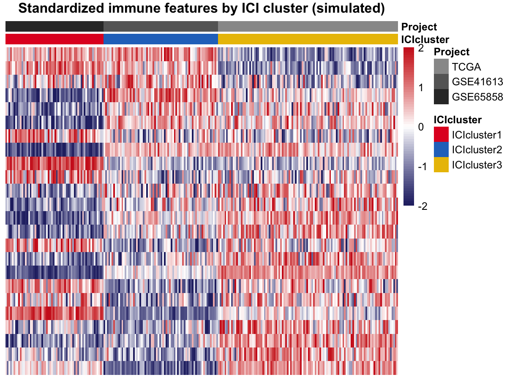

Multi-cohort immune subtyping clusters tumours on immune-deconvolution features across platforms, then asks whether the classes differ in survival \[1\]. The reference uses CIBERSORT + ESTIMATE + ConsensusClusterPlus (none in this lockfile); this tutorial simulates the 24-feature matrix directly (22 cell types + 2 scores, 3 cohorts, 3 latent clusters), keeps the `pheatmap` + `survminer` visual grammar, and uses `kmeans` as the clustering surrogate:

## Example

{fig-alt="Multi-Cohort Immune Subtype DEMO" fig-align="center" width="60%"}

## Setup

-   System Requirements: Cross-platform (Linux/MacOS/Windows)

-   Programming language: R

-   Dependent packages: `ggplot2`; `pheatmap`; `survival`; `survminer`; `patchwork`

```{r packages setup, message=FALSE, warning=FALSE, output=FALSE}
suppressPackageStartupMessages({
  library(ggplot2)
  library(pheatmap)
  library(survival)
  library(survminer)
})
```

```{r}
sessioninfo::session_info("attached")
```

## Data Preparation

240 samples across 3 cohorts (TCGA 110, GSE41613 70, GSE65858 60) with 24 immune features: 3 latent clusters with per-feature random directions plus cohort batch shifts. Survival is planted so one cluster is high-risk:

```{r load data}
# MultiCohortImmSubtypePlot prototype: 3-cohort feature heatmap + KM
suppressPackageStartupMessages({library(ggplot2); library(pheatmap); library(survival); library(survminer); library(patchwork)})
set.seed(21101)
cohorts <- c("TCGA", "GSE41613", "GSE65858")
n_coh <- c(110, 70, 60)
feats <- c(paste0("Cell", sprintf("%02d", 1:22)), "ImmuneScore", "StromalScore")
## latent 3-cluster structure + cohort batch shifts
lat <- rep(sample(1:3, 3), c(110, 70, 60))  # cluster label per sample
mat <- matrix(0, length(feats), sum(n_coh))
for (i in seq_along(feats)) {
  eff <- rnorm(3, 0, 0.6)[lat]          # cluster effect
  batch <- rnorm(3, 0, 0.3)             # cohort batch effect
  bidx <- rep(seq_along(cohorts), n_coh)
  mat[i, ] <- eff + batch[bidx] + rnorm(sum(n_coh), 0, 0.5)
}
colnames(mat) <- paste0(rep(cohorts, n_coh), "_", sequence(n_coh))
batch <- rep(cohorts, n_coh)
## ICIcluster via kmeans on the scaled feature matrix (ConsensusClusterPlus surrogate)
indata <- scale(t(mat))
km3 <- kmeans(indata, centers = 3, nstart = 10)
ici <- paste0("ICIcluster", km3$cluster)
## survival: one cluster is high-risk
hr_eff <- c(1.0, 1.5, 0.7)[km3$cluster]
OS.time <- pmin(120, pmax(2, qweibull(runif(sum(n_coh)), 1, 70 / hr_eff)))
OS <- rbinom(sum(n_coh), 1, 0.6)
ann_col <- data.frame(ICIcluster = ici, Project = batch)
rownames(ann_col) <- colnames(mat)
## Fig A: standardized feature heatmap (clip ±2), samples sorted by cluster then cohort
ord <- order(ici, batch)
std <- t(scale(t(mat)))          # feature z across samples
std[] <- pmin(2, pmax(-2, std))  # in-place clamp preserves dims (pmin strips them)
## sort features by their cluster-1 vs cluster-2 mean difference (block coherence)
fdir <- sapply(seq_len(nrow(std)), function(i)
  mean(std[i, ici == unique(ici)[1]]) - mean(std[i, ici == unique(ici)[2]]))
std <- std[order(fdir), ]
png("/tmp/bizard_b37/proto/p4_multicohort.png", width = 1200, height = 900, res = 180)
```

## Visualization

### 1. Standardized Feature Heatmap

The `pheatmap` landscape: 24 features x 240 samples, column-annotated by ICI cluster (kmeans surrogate) and cohort, features sorted by their cluster-1 vs cluster-2 mean difference for block coherence — the planted cluster structure is visible as horizontal blocks:

```{r}
#| label: fig-1.1MultiCohortHeatmap
#| fig-cap: "Standardized immune feature heatmap of 240 simulated samples from 3 cohorts, column-annotated by ICI cluster (kmeans) and cohort; features sorted for block coherence showing the planted cluster structure."
#| out.width: "100%"
#| warning: false
#| message: false
#| fig-width: 12
#| fig-height: 8

# MultiCohortImmSubtypePlot prototype: 3-cohort feature heatmap + KM
suppressPackageStartupMessages({library(ggplot2); library(pheatmap); library(survival); library(survminer); library(patchwork)})
set.seed(21101)
cohorts <- c("TCGA", "GSE41613", "GSE65858")
n_coh <- c(110, 70, 60)
feats <- c(paste0("Cell", sprintf("%02d", 1:22)), "ImmuneScore", "StromalScore")
## latent 3-cluster structure + cohort batch shifts
lat <- rep(sample(1:3, 3), c(110, 70, 60))  # cluster label per sample
mat <- matrix(0, length(feats), sum(n_coh))
for (i in seq_along(feats)) {
  eff <- rnorm(3, 0, 0.6)[lat]          # cluster effect
  batch <- rnorm(3, 0, 0.3)             # cohort batch effect
  bidx <- rep(seq_along(cohorts), n_coh)
  mat[i, ] <- eff + batch[bidx] + rnorm(sum(n_coh), 0, 0.5)
}
colnames(mat) <- paste0(rep(cohorts, n_coh), "_", sequence(n_coh))
batch <- rep(cohorts, n_coh)
## ICIcluster via kmeans on the scaled feature matrix (ConsensusClusterPlus surrogate)
indata <- scale(t(mat))
km3 <- kmeans(indata, centers = 3, nstart = 10)
ici <- paste0("ICIcluster", km3$cluster)
## survival: one cluster is high-risk
hr_eff <- c(1.0, 1.5, 0.7)[km3$cluster]
OS.time <- pmin(120, pmax(2, qweibull(runif(sum(n_coh)), 1, 70 / hr_eff)))
OS <- rbinom(sum(n_coh), 1, 0.6)
ann_col <- data.frame(ICIcluster = ici, Project = batch)
rownames(ann_col) <- colnames(mat)
## Fig A: standardized feature heatmap (clip ±2), samples sorted by cluster then cohort
ord <- order(ici, batch)
std <- t(scale(t(mat)))          # feature z across samples
std[] <- pmin(2, pmax(-2, std))  # in-place clamp preserves dims (pmin strips them)
## sort features by their cluster-1 vs cluster-2 mean difference (block coherence)
fdir <- sapply(seq_len(nrow(std)), function(i)
  mean(std[i, ici == unique(ici)[1]]) - mean(std[i, ici == unique(ici)[2]]))
std <- std[order(fdir), ]
png("/tmp/bizard_b37/proto/p4_multicohort.png", width = 1200, height = 900, res = 180)
```

### 2. Survival by ICI Cluster

The KM + risk table: one cluster is planted high-risk (log-rank p < 0.001), with the survminer median-line and per-strata risk counts — the survival difference validates the subtyping:

```{r}
#| label: fig-1.2MultiCohortKM
#| fig-cap: "Kaplan-Meier overall survival by ICI cluster for 240 simulated patients with the risk table; log-rank p < 0.001 across the three clusters."
#| out.width: "80%"
#| warning: false
#| message: false
#| fig-width: 6
#| fig-height: 6

pheatmap(std[, ord], color = colorRampPalette(c("#282B71", "white", "#CF2221"))(64),
         cluster_cols = FALSE, cluster_rows = FALSE,
         annotation_col = ann_col[ord, ],
         annotation_colors = list(ICIcluster = c(ICIcluster1 = "#E21F26", ICIcluster2 = "#2874C5", ICIcluster3 = "#EABF00"),
                                  Project = setNames(c("#999999", "#666666", "#333333"), cohorts)),
         treeheight_row = 0, treeheight_col = 0,
         show_colnames = FALSE, border_color = NA,
         main = "Standardized immune features by ICI cluster (simulated)")
dev.off()
## Fig B: KM + risk table (ggsurvplot returns list; print separately)
sdf <- data.frame(OS.time = OS.time, OS = OS, ICIcluster = factor(ici))
fitd <- survdiff(Surv(OS.time, OS) ~ ICIcluster, data = sdf)
pval <- 1 - pchisq(fitd$chisq, length(fitd$n) - 1)
ggs <- survminer::ggsurvplot(survfit(Surv(OS.time, OS) ~ ICIcluster, data = sdf),
                             risk.table = TRUE, risk.table.col = "strata",
                             palette = c("#E21F26", "#2874C5", "#EABF00"),
                             xlim = c(0, 120), break.time.by = 20,
                             surv.median.line = "hv", pval = FALSE,
                             legend.labs = levels(sdf$ICIcluster),
                             risk.table.height = 0.3)
print(ggs)
cat("log-rank P =", signif(pval, 3), "\n")
```

::: callout-tip
**Practice tips**

-   When CIBERSORT/ESTIMATE are unavailable (restricted-distribution, not in lockfile), simulate the cell-type feature matrix directly and use `kmeans` or `cluster::pam` as the clustering surrogate — the visual grammar is unchanged.
-   `scale(t(mat))` followed by `apply` clamping **drops colnames**: use the in-place idiom `std[] <- pmin(2, pmax(-2, std))` to preserve them, or pheatmap's annotation mapping breaks.
-   `ggsurvplot` returns a list — `print(ggs)` draws the KM and risk table together; and `legend.labs` must come from the **survfit** strata (or `levels(factor(...))`), not from `survdiff` which has no `$strata`.
:::

## Applications

::: {#fig-MultiCohortApplications1}
{fig-alt="Multi-cohort ICI subtyping" fig-align="center" width="60%"}

Multi-cohort ICI subtyping
:::

The feature-heatmap + KM pair generalises to any multi-cohort subtyping: TME scores by molecular subtype, methylation clusters by cohort, or proteomic clusters by treatment arm.

## Reference

\[1\] Xiaofan Lu, et al. FigureYa: A Standardized Visualization Framework for Enhancing Biomedical Data Interpretation and Research Efficiency. iMetaMed. 2025. doi:10.1002/imm3.70005

\[2\} Thorsson V, Gibbs DL, Brown SD, et al. The immune landscape of cancer. Immunity. 2018;48(4):812-830. doi:10.1016/j.immuni.2018.03.023 (source of the immune-subtype KM readout)