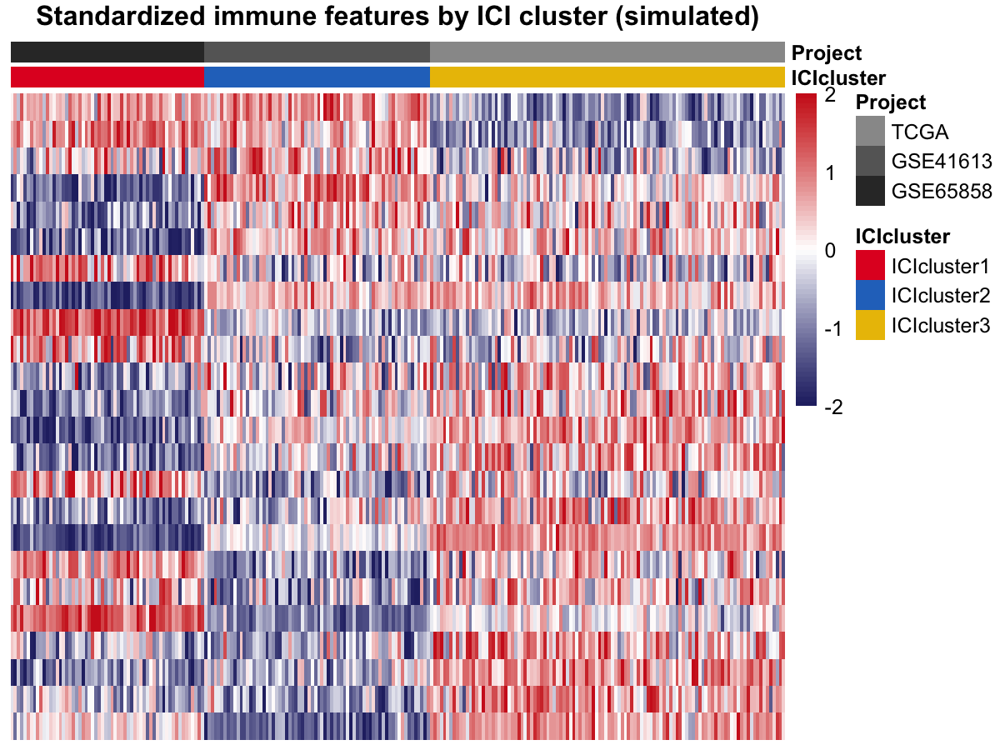

多队列免疫亚型在跨平台免疫解卷积特征上聚类肿瘤，然后问类别间生存是否有差异 \[1\]。参考用 CIBERSORT + ESTIMATE + ConsensusClusterPlus（均不在本 lockfile）；本教程直接模拟 24 特征矩阵（22 细胞类型 + 2 评分、3 队列、3 潜伏簇），保留 `pheatmap` + `survminer` 视觉语法、用 `kmeans` 作聚类代理：

## Example

{fig-alt="多队列免疫亚型 DEMO" fig-align="center" width="60%"}

## Setup

-   系统要求：跨平台（Linux/MacOS/Windows）

-   编程语言：R

-   依赖包：`ggplot2`; `pheatmap`; `survival`; `survminer`; `patchwork`

```{r packages setup, message=FALSE, warning=FALSE, output=FALSE}
suppressPackageStartupMessages({
  library(ggplot2)
  library(pheatmap)
  library(survival)
  library(survminer)
})
```

```{r}
sessioninfo::session_info("attached")
```

## 数据准备

跨 3 个队列（TCGA 110、GSE41613 70、GSE65858 60）的 240 个样本、24 个免疫特征：3 个潜伏簇带逐特征随机方向加队列批次位移。生存植入使一个簇高风险：

```{r load data}
# MultiCohortImmSubtypePlot prototype: 3-cohort feature heatmap + KM
suppressPackageStartupMessages({library(ggplot2); library(pheatmap); library(survival); library(survminer); library(patchwork)})
set.seed(21101)
cohorts <- c("TCGA", "GSE41613", "GSE65858")
n_coh <- c(110, 70, 60)
feats <- c(paste0("Cell", sprintf("%02d", 1:22)), "ImmuneScore", "StromalScore")
## latent 3-cluster structure + cohort batch shifts
lat <- rep(sample(1:3, 3), c(110, 70, 60))  # cluster label per sample
mat <- matrix(0, length(feats), sum(n_coh))
for (i in seq_along(feats)) {
  eff <- rnorm(3, 0, 0.6)[lat]          # cluster effect
  batch <- rnorm(3, 0, 0.3)             # cohort batch effect
  bidx <- rep(seq_along(cohorts), n_coh)
  mat[i, ] <- eff + batch[bidx] + rnorm(sum(n_coh), 0, 0.5)
}
colnames(mat) <- paste0(rep(cohorts, n_coh), "_", sequence(n_coh))
batch <- rep(cohorts, n_coh)
## ICIcluster via kmeans on the scaled feature matrix (ConsensusClusterPlus surrogate)
indata <- scale(t(mat))
km3 <- kmeans(indata, centers = 3, nstart = 10)
ici <- paste0("ICIcluster", km3$cluster)
## survival: one cluster is high-risk
hr_eff <- c(1.0, 1.5, 0.7)[km3$cluster]
OS.time <- pmin(120, pmax(2, qweibull(runif(sum(n_coh)), 1, 70 / hr_eff)))
OS <- rbinom(sum(n_coh), 1, 0.6)
ann_col <- data.frame(ICIcluster = ici, Project = batch)
rownames(ann_col) <- colnames(mat)
## Fig A: standardized feature heatmap (clip ±2), samples sorted by cluster then cohort
ord <- order(ici, batch)
std <- t(scale(t(mat)))          # feature z across samples
std[] <- pmin(2, pmax(-2, std))  # in-place clamp preserves dims (pmin strips them)
## sort features by their cluster-1 vs cluster-2 mean difference (block coherence)
fdir <- sapply(seq_len(nrow(std)), function(i)
  mean(std[i, ici == unique(ici)[1]]) - mean(std[i, ici == unique(ici)[2]]))
std <- std[order(fdir), ]
png("/tmp/bizard_b37/proto/p4_multicohort.png", width = 1200, height = 900, res = 180)
```

## Visualization

### 标准化特征热图

`pheatmap` 全景：24 特征 × 240 样本、列注释为 ICI 簇（kmeans 代理）与队列、特征按簇 1 vs 簇 2 均值差排序以获得块一致性——植入的簇结构以水平块呈现：

```{r}
#| label: fig-1.1MultiCohortHeatmap
#| fig-cap: "240 个模拟样本跨 3 个队列的标准化免疫特征热图、列注释为 ICI 簇（kmeans）与队列；特征排序后显示植入簇结构。"
#| out.width: "100%"
#| warning: false
#| message: false
#| fig-width: 12
#| fig-height: 8

# MultiCohortImmSubtypePlot prototype: 3-cohort feature heatmap + KM
suppressPackageStartupMessages({library(ggplot2); library(pheatmap); library(survival); library(survminer); library(patchwork)})
set.seed(21101)
cohorts <- c("TCGA", "GSE41613", "GSE65858")
n_coh <- c(110, 70, 60)
feats <- c(paste0("Cell", sprintf("%02d", 1:22)), "ImmuneScore", "StromalScore")
## latent 3-cluster structure + cohort batch shifts
lat <- rep(sample(1:3, 3), c(110, 70, 60))  # cluster label per sample
mat <- matrix(0, length(feats), sum(n_coh))
for (i in seq_along(feats)) {
  eff <- rnorm(3, 0, 0.6)[lat]          # cluster effect
  batch <- rnorm(3, 0, 0.3)             # cohort batch effect
  bidx <- rep(seq_along(cohorts), n_coh)
  mat[i, ] <- eff + batch[bidx] + rnorm(sum(n_coh), 0, 0.5)
}
colnames(mat) <- paste0(rep(cohorts, n_coh), "_", sequence(n_coh))
batch <- rep(cohorts, n_coh)
## ICIcluster via kmeans on the scaled feature matrix (ConsensusClusterPlus surrogate)
indata <- scale(t(mat))
km3 <- kmeans(indata, centers = 3, nstart = 10)
ici <- paste0("ICIcluster", km3$cluster)
## survival: one cluster is high-risk
hr_eff <- c(1.0, 1.5, 0.7)[km3$cluster]
OS.time <- pmin(120, pmax(2, qweibull(runif(sum(n_coh)), 1, 70 / hr_eff)))
OS <- rbinom(sum(n_coh), 1, 0.6)
ann_col <- data.frame(ICIcluster = ici, Project = batch)
rownames(ann_col) <- colnames(mat)
## Fig A: standardized feature heatmap (clip ±2), samples sorted by cluster then cohort
ord <- order(ici, batch)
std <- t(scale(t(mat)))          # feature z across samples
std[] <- pmin(2, pmax(-2, std))  # in-place clamp preserves dims (pmin strips them)
## sort features by their cluster-1 vs cluster-2 mean difference (block coherence)
fdir <- sapply(seq_len(nrow(std)), function(i)
  mean(std[i, ici == unique(ici)[1]]) - mean(std[i, ici == unique(ici)[2]]))
std <- std[order(fdir), ]
png("/tmp/bizard_b37/proto/p4_multicohort.png", width = 1200, height = 900, res = 180)
```

### 按 ICI 簇的生存

KM + 风险表：一个簇植入高风险（log-rank p < 0.001），survminer 中位线与逐分层风险数——生存差异验证亚型分型：

```{r}
#| label: fig-1.2MultiCohortKM
#| fig-cap: "240 个模拟患者按 ICI 簇分层的 Kaplan-Meier 总生存与风险表；三簇间 log-rank p < 0.001。"
#| out.width: "80%"
#| warning: false
#| message: false
#| fig-width: 6
#| fig-height: 6

pheatmap(std[, ord], color = colorRampPalette(c("#282B71", "white", "#CF2221"))(64),
         cluster_cols = FALSE, cluster_rows = FALSE,
         annotation_col = ann_col[ord, ],
         annotation_colors = list(ICIcluster = c(ICIcluster1 = "#E21F26", ICIcluster2 = "#2874C5", ICIcluster3 = "#EABF00"),
                                  Project = setNames(c("#999999", "#666666", "#333333"), cohorts)),
         treeheight_row = 0, treeheight_col = 0,
         show_colnames = FALSE, border_color = NA,
         main = "Standardized immune features by ICI cluster (simulated)")
dev.off()
## Fig B: KM + risk table (ggsurvplot returns list; print separately)
sdf <- data.frame(OS.time = OS.time, OS = OS, ICIcluster = factor(ici))
fitd <- survdiff(Surv(OS.time, OS) ~ ICIcluster, data = sdf)
pval <- 1 - pchisq(fitd$chisq, length(fitd$n) - 1)
ggs <- survminer::ggsurvplot(survfit(Surv(OS.time, OS) ~ ICIcluster, data = sdf),
                             risk.table = TRUE, risk.table.col = "strata",
                             palette = c("#E21F26", "#2874C5", "#EABF00"),
                             xlim = c(0, 120), break.time.by = 20,
                             surv.median.line = "hv", pval = FALSE,
                             legend.labs = levels(sdf$ICIcluster),
                             risk.table.height = 0.3)
print(ggs)
cat("log-rank P =", signif(pval, 3), "\n")
```


## 应用场景

::: {#fig-MultiCohortApplications1}
{fig-alt="多队列 ICI 分型" fig-align="center" width="60%"}

多队列 ICI 分型
:::

特征热图 + KM 配对适用于任何多队列分型：按分子亚型的 TME 评分、按队列的甲基化簇、或按治疗臂的蛋白组簇。

## 参考文献

\[1\] Xiaofan Lu, et al. FigureYa: A Standardized Visualization Framework for Enhancing Biomedical Data Interpretation and Research Efficiency. iMetaMed. 2025. doi:10.1002/imm3.70005

\[2\} Thorsson V, Gibbs DL, Brown SD, et al. The immune landscape of cancer. Immunity. 2018;48(4):812-830. doi:10.1016/j.immuni.2018.03.023 (source of the immune-subtype KM readout)