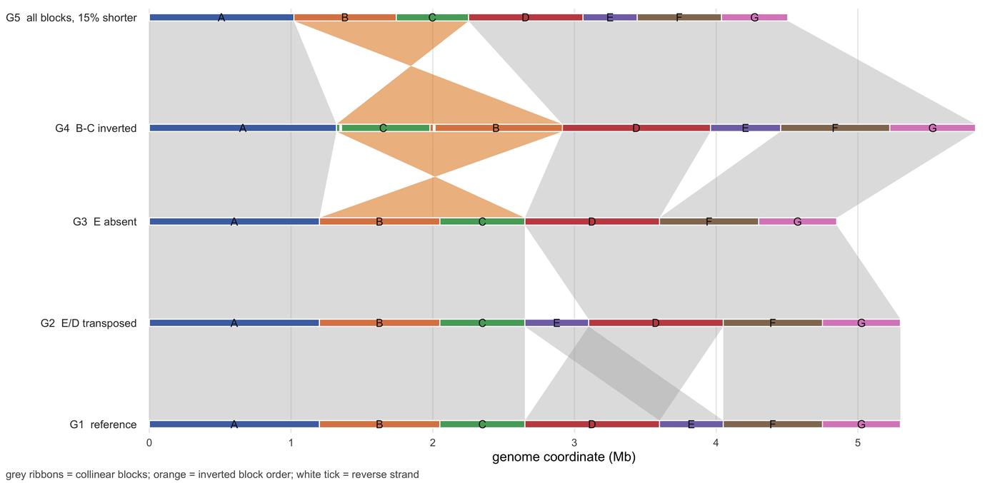

多基因组比较图必须回答一个比对坐标表回答不了的问题：**哪些块是共享的**，以及**它们以什么顺序出现**。Easyfig、AliTV、BRIG、CGView、gggenomes 与 SyntenyPortal 可视化的都是同一个对象——每个基因组的一组同源块——区别主要在轨道排布方式：带子连接的堆叠轨道、带弦的同心环，或按共同基因组长度归一化。

本教程用同一张手工指定的块表画出其中三种视图，便于逐项核对编码是否与已知排布一致：用于逐对相邻比较的**堆叠同源带**、用于多基因组总览的**同心环 + 弦**，以及一组**绝对坐标与归一化坐标的对照**，说明归一化这个决定究竟付出了什么代价。

## 示例

{fig-alt="多基因组比较图 DEMO" fig-align="center" width="85%"}

五个组装、七个同源区块的堆叠比较：每条轨道一个基因组，区块宽度在共享的 Mb 轴上编码长度，色带连接相邻基因组中的同一区块。G2 除 E/D 转座外共线，G3 丢失了 E（其色带扇面出现缺口），G4 带有一段倒置的 B-C（橙色色带交叉，白色短标记指出反向链区块），G5 保持参考顺序但整体短 15%。

## 环境配置

-   系统要求： 跨平台（Linux/MacOS/Windows）

-   编程语言：R

-   依赖包：`ggplot2`；`dplyr`；`patchwork`

```{r packages setup, message=FALSE, warning=FALSE, output=FALSE}
if (!requireNamespace("ggplot2", quietly = TRUE)) install.packages("ggplot2")
if (!requireNamespace("dplyr", quietly = TRUE)) install.packages("dplyr")
if (!requireNamespace("patchwork", quietly = TRUE)) install.packages("patchwork")

library(ggplot2)
library(dplyr)
library(patchwork)
```

```{r}
sessioninfo::session_info("attached")
```

## 数据准备

五个组装基因组共享 7 个同源块。每个基因组是一串按顺序排列的块，并带每个块的方向；G2 交换 E 与 D，G3 缺失 E，G4 倒位 B 与 C，G4 与 G5 的总长相对 G1 分别 +10% 与 -15%，以便归一化面板有真实差异可展示。

```{r load data, message=FALSE, warning=FALSE}
## Seven homologous blocks with their lengths in Mb, and five genome
## assemblies described as ordered block lists. G2 transposes E and D, G3 has
## lost E, G4 inverts B and C, and G4/G5 differ from G1 in total length by
## +10% and -15% so that the normalisation question has a visible answer.
blocks <- c("A", "B", "C", "D", "E", "F", "G")
blen <- c(A = 1.20, B = 0.85, C = 0.60, D = 0.95, E = 0.45, F = 0.70, G = 0.55)

order_list <- list(
  G1 = list(b = blocks, o = rep("+", 7)),
  G2 = list(b = c("A", "B", "C", "E", "D", "F", "G"), o = rep("+", 7)),
  G3 = list(b = c("A", "B", "C", "D", "F", "G"), o = rep("+", 6)),
  G4 = list(b = c("A", "C", "B", "D", "E", "F", "G"), o = c("+", "-", "-", rep("+", 4))),
  G5 = list(b = blocks, o = rep("+", 7))
)
scale_factor <- c(G1 = 1.00, G2 = 1.00, G3 = 1.00, G4 = 1.10, G5 = 0.85)
genomes <- names(order_list)

## Cumulative coordinates, per-genome total and percent-of-genome position.
ord <- do.call(rbind, lapply(genomes, function(g) {
  e <- order_list[[g]]
  data.frame(genome = g, block = e$b, orientation = e$o,
             len = blen[e$b] * scale_factor[[g]], stringsAsFactors = FALSE)
})) |>
  group_by(genome) |>
  mutate(x0 = cumsum(c(0, len[-n()])), x1 = cumsum(len),
         total = sum(len), mid = (x0 + x1) / 2) |>
  ungroup() |>
  group_by(genome) |>
  mutate(p0 = 100 * x0 / total, p1 = 100 * x1 / total) |>
  ungroup()

## Tracks are stacked with a fixed gap; integer y ranges keep blank space out.
gap <- 0.55
track_h <- 0.42
tot <- ord |> group_by(genome) |> summarise(total = first(total), .groups = "drop")
off <- setNames(cumsum(c(0, tot$total[-nrow(tot)] + gap)), tot$genome)
ord <- ord |> mutate(y0 = off[genome], y1 = y0 + track_h, ymid = y0 + track_h / 2)

pal <- c(A = "#4c72b0", B = "#dd8452", C = "#55a868", D = "#c44e52",
         E = "#8172b3", F = "#937860", G = "#da8bc3")
```

## 可视化

### 1. 相邻基因组之间的堆叠同源带

EasyFig、AliTV、gggenomes 与 SyntenyPortal 都把多基因组比较画成用带子连接的堆叠轨道。这种版式一次回答两个问题：哪些块共享，以及顺序在哪里断开。真正需要区分的是数据里三类不同的“断开”：**转座**产生在轨道间平移的平行带；**倒位**产生交叉的带，因为该块是反向互补的；**缺失**产生扇形连线的空档，对面完全没有伙伴块。配色应按块身份与方向区分，绝不按轨道序号 \[1,2\]。

```{r}
#| label: fig-1MultiGenomeLinear
#| fig-cap: "五个组装基因组共享 7 个同源块的堆叠比较图：每条轨道是一个基因组，块宽度在共享的 Mb 轴上编码块长度，灰色/橙色带把相邻基因组里的同一个块连起来。G2 除 E/D 互换外完全共线；G3 缺失 E（其连线段里出现空档）；G4 携带倒位的 B-C（橙色交叉带，白色短线标记反向链块）；G5 保持参考顺序但短 15%，在绝对坐标轴上表现为轨道更短。"
#| out.width: "100%"
#| warning: false
#| message: false
#| fig-width: 9.5
#| fig-height: 4.6
#| fig-dpi: 300
## Ribbons between adjacent genomes: a quadrilateral per shared block. When the
## orientation differs the bottom edge is reversed, so the ribbon crosses.
ribbon_pairs <- function(a, b) {
  A <- ord |> filter(genome == a)
  B <- ord |> filter(genome == b)
  m <- merge(A, B, by = "block", suffixes = c(".a", ".b"))
  do.call(rbind, lapply(seq_len(nrow(m)), function(i) {
    a0 <- c(m$x0.a[i], m$x1.a[i])
    b0 <- c(m$x0.b[i], m$x1.b[i])
    inv <- m$orientation.a[i] != m$orientation.b[i]
    ## x order (a-left, a-right, b-right, b-left) gives a simple quadrilateral;
    ## for an inversion the b edge is NOT reversed, so the ribbon self-crosses
    ## into a bow-tie -- the crossing IS the orientation signal.
    x <- if (inv) c(a0, b0) else c(a0, rev(b0))
    data.frame(grp = paste0(a, "-", i), x = x,
               y = c(m$y1.a[i], m$y1.a[i], m$y0.b[i], m$y0.b[i]), inv = inv)
  }))
}
ribs <- rbind(ribbon_pairs("G1", "G2"), ribbon_pairs("G2", "G3"),
              ribbon_pairs("G3", "G4"), ribbon_pairs("G4", "G5"))

desc <- c(G1 = "reference", G2 = "E/D transposed", G3 = "E absent",
          G4 = "B-C inverted", G5 = "all blocks, 15% shorter")
lab <- data.frame(y = off + track_h / 2, lab = paste0(genomes, "  ", desc[genomes]))

p_linear <- ggplot() +
  geom_polygon(data = filter(ribs, !inv), aes(x, y, group = grp),
               fill = "#a8a8a8", alpha = 0.36) +
  geom_polygon(data = filter(ribs, inv), aes(x, y, group = grp),
               fill = "#e08214", alpha = 0.55) +
  geom_rect(data = ord, aes(xmin = x0, xmax = x1, ymin = y0, ymax = y1, fill = block),
            colour = "white", linewidth = 0.35) +
  geom_text(data = filter(ord, len >= 0.38), aes(mid, ymid, label = block),
            size = 2.7, colour = "#111111") +
  geom_segment(data = filter(ord, orientation == "-"),
               aes(x = x0 + 0.03, xend = x0 + 0.03, y = y0 + 0.04, yend = y1 - 0.04),
               linewidth = 0.9, colour = "#ffffff") +
  scale_fill_manual(values = pal, guide = "none") +
  scale_y_continuous(breaks = lab$y, labels = lab$lab,
                     expand = expansion(mult = c(0.012, 0.012))) +
  scale_x_continuous(expand = expansion(mult = c(0.008, 0.012))) +
  labs(x = "genome coordinate (Mb)", y = NULL,
       caption = "grey ribbons = collinear blocks; orange = inverted block order; white tick = reverse strand") +
  theme_minimal(base_size = 9) +
  theme(panel.grid.major.y = element_blank(),
        panel.grid.minor = element_blank(),
        axis.text.y = element_text(size = 7.5, colour = "#333333", hjust = 1),
        plot.caption = element_text(size = 7.2, colour = "#525252", hjust = 0),
        plot.caption.position = "plot",
        plot.margin = margin(6, 10, 2, 4))

p_linear
```

### 2. 同心环 + 弦

BRIG 与 CGView 的版式是环形版本：每个基因组是一个环，同源关系画成穿过中心的弦。它的优势是一张图能放下很多基因组；代价是环的次序与角度位置本身不携带含义，因此必须明确告诉读者哪个环是哪个、边界沿半径对齐 \[3\]。各环的扫过角度、起点与块间缝隙必须完全一致，否则这种版式赖以成立的径向对齐会悄悄失效。

```{r}
#| label: fig-2MultiGenomeRing
#| fig-cap: "BRIG 风格同心环：每个环都从 12 点开始、按各自基因组长度归一化，因此无论基因组长短每个环都铺满 360 度。这种逐基因组归一化的后果是：G3 缺失的 E 表现为缺失的扇区而非缺口，且同源块边界在不同环之间不会沿半径对齐。弦连接外环（G1）与 G4 的同一块；两个倒位块（B、C）用橙色画出并与伙伴交叉。"
#| out.width: "62%"
#| warning: false
#| message: false
#| fig-width: 5.6
#| fig-height: 5.6
#| fig-dpi: 300
## Concentric rings (BRIG layout) plus chords between the outermost ring (G1)
## and the inverted genome (G4). Each ring starts at 12 o'clock and runs
## clockwise over the same 360° sweep: ring position is percent-of-genome,
## so boundaries are NOT radially aligned across rings of unequal genomes.
ring_r <- c(G1 = 1.00, G2 = 0.92, G3 = 0.84, G4 = 0.76, G5 = 0.68)
ring_w <- 0.05
th0 <- 90
sweep <- 360
ang <- function(p) th0 - sweep * p / 100
d2r <- function(d) d * pi / 180

arc_df <- do.call(rbind, lapply(seq_len(nrow(ord)), function(i) {
  a <- ord[i, ]
  th <- seq(ang(a$p0), ang(a$p1), length.out = 60)
  th[1] <- th[1] - 0.4              # 0.8° gap so adjacent blocks stay separate
  th[length(th)] <- th[length(th)] + 0.4
  r <- ring_r[[a$genome]]
  data.frame(grp = paste0(a$genome, a$block), block = a$block,
             x = c(r * cos(d2r(th)), (r - ring_w) * rev(cos(d2r(th)))),
             y = c(r * sin(d2r(th)), (r - ring_w) * rev(sin(d2r(th)))))
}))

ch <- merge(ord |> filter(genome == "G1") |> select(block, p0.a = p0, p1.a = p1),
            ord |> filter(genome == "G4") |> select(block, p0.b = p0, p1.b = p1),
            by = "block") |>
  mutate(inv = block %in% c("B", "C"))
chord_df <- do.call(rbind, lapply(seq_len(nrow(ch)), function(i) {
  s <- seq(0, 1, length.out = 40)
  p0a <- ch$p0.a[i]; p1a <- ch$p1.a[i]; p0b <- ch$p0.b[i]; p1b <- ch$p1.b[i]
  if (ch$inv[i]) { tmp <- p0b; p0b <- p1b; p1b <- tmp }
  r0 <- ring_r[["G1"]]; r1 <- ring_r[["G4"]]
  px <- function(p, r) c(r * cos(d2r(ang(p))), r * sin(d2r(ang(p))))
  A <- cbind(px(p0a, r0), px(p1a, r0))
  B <- cbind(px(p0b, r1), px(p1b, r1))
  bez <- function(p, q, ctrl = 0.6) {
    cx <- ctrl * (p[1] + q[1]) / 2
    cy <- ctrl * (p[2] + q[2]) / 2
    cbind((1 - s)^2 * p[1] + 2 * (1 - s) * s * cx + s^2 * q[1],
          (1 - s)^2 * p[2] + 2 * (1 - s) * s * cy + s^2 * q[2])
  }
  e1 <- bez(A[, 1], B[, 1])
  e2 <- bez(A[, 2], B[, 2])
  data.frame(grp = paste0("c", i), block = ch$block[i], inv = ch$inv[i],
             x = c(e1[, 1], rev(e2[, 1])), y = c(e1[, 2], rev(e2[, 2])))
}))

p_circle <- ggplot() +
  geom_polygon(data = chord_df, aes(x, y, group = grp, fill = inv),
               alpha = 0.22, colour = "#8c8c8c", linewidth = 0.12) +
  geom_polygon(data = arc_df, aes(x, y, group = grp, fill = block), colour = NA) +
  annotate("text", x = 0, y = 0.16, label = "G1 vs G4", fontface = "bold",
           size = 2.9, colour = "#222222") +
  annotate("text", x = 0, y = 0.00, label = "orange chord =\ninverted block order",
           size = 2.4, colour = "#7f3b08", lineheight = 0.9) +
  annotate("text", x = -0.05, y = ring_r - ring_w / 2, label = names(ring_r),
           size = 2.2, colour = "#333333", hjust = 1) +
  scale_fill_manual(values = c(pal, `TRUE` = "#e08214", `FALSE` = "#bdbdbd"),
                    guide = "none") +
  coord_equal(xlim = c(-1.06, 1.02), ylim = c(-1.06, 1.06), clip = "off") +
  theme_void()

p_circle
```

### 3. 绝对坐标与归一化坐标

这是多基因组图里最容易导致误读的一个决定。在**绝对**轴上，更长的基因组画成更长的轨道，块宽度与真实块长度成比例。在**占基因组百分比**轴上，每个基因组都被拉伸到 100%，这会抹掉可能正是本图目的的长度差异，也会让两个实际尺寸相差很大的块看起来一样宽 \[4\]。两者都没有错；错的是图里没有说明用的是哪一种。当比较依赖长度时，把两种都画出来，并把选择写进图注。

```{r}
#| label: fig-3MultiGenomeNormalised
#| fig-cap: "同一组模拟 G1/G4 分别在绝对坐标轴（上）与占基因组百分比坐标轴（下）上比较。G4 长 10%，绝对轨道画到 5.83 Mb，而 G1 只到 5.30 Mb；在归一化轴上两条轨道都终止于 100%，10% 的长度差被抹平。归一化面板适合比较块的顺序，不适合比较块的长度。"
#| out.width: "100%"
#| warning: false
#| message: false
#| fig-width: 10
#| fig-height: 3.3
#| fig-dpi: 300
## The same two genomes on an absolute axis and on a percent-of-genome axis.
## G4 is 10% longer than G1, so on the absolute axis its track runs to 5.83 Mb;
## on the normalised axis both tracks end exactly at 100%.
long <- rbind(
  ord |> transmute(genome, block, measure = "absolute (Mb)", lo = x0, hi = x1, pos = (x0 + x1) / 2),
  ord |> transmute(genome, block, measure = "percent of genome", lo = p0, hi = p1, pos = (p0 + p1) / 2)
)

make_panel <- function(meas, x_lim, subtitle) {
  d <- filter(long, measure == meas)
  m <- merge(filter(d, genome == "G1"), filter(d, genome == "G4"), by = "block")
  links <- do.call(rbind, lapply(seq_len(nrow(m)), function(i) {
    inv <- m$block[i] %in% c("B", "C")
    b0 <- c(m$lo.y[i], m$hi.y[i])
    ## Same vertex rule as figure 1: reverse the far edge only when the block
    ## is collinear, so inversions render as crossing ribbons.
    if (!inv) b0 <- rev(b0)
    data.frame(grp = i, inv = inv, x = c(m$lo.x[i], m$hi.x[i], b0),
               y = c(3.6, 3.6, 2.4, 2.4))
  }))
  ggplot() +
    geom_polygon(data = links, aes(x, y, group = grp, fill = inv),
                 alpha = 0.45, colour = NA) +
    geom_rect(data = filter(d, genome == "G1"), aes(xmin = lo, xmax = hi, ymin = 3.6, ymax = 4.0, fill = block),
              colour = "white", linewidth = 0.3, alpha = 0.92) +
    geom_rect(data = filter(d, genome == "G4"), aes(xmin = lo, xmax = hi, ymin = 2.0, ymax = 2.4, fill = block),
              colour = "white", linewidth = 0.3, alpha = 0.92) +
    geom_text(data = filter(d, genome == "G1"), aes(pos, 3.8, label = block),
              size = 2.3, colour = "#111111") +
    geom_text(data = filter(d, genome == "G4"), aes(pos, 2.2, label = block),
              size = 2.3, colour = "#111111") +
    annotate("text", x = -0.01 * x_lim, y = c(3.8, 2.2), label = c("G1", "G4"),
             hjust = 1, size = 2.7, fontface = "bold") +
    annotate("text", x = x_lim * 0.5, y = 4.2, label = subtitle,
             size = 2.5, colour = "#333333") +
    scale_fill_manual(values = c(pal, `TRUE` = "#e08214", `FALSE` = "#bdbdbd"),
                      guide = "none") +
    coord_cartesian(xlim = c(0, x_lim), ylim = c(1.9, 4.3), clip = "off") +
    labs(x = meas, y = NULL) +
    theme_minimal(base_size = 9) +
    theme(panel.grid.major.y = element_blank(),
          panel.grid.minor = element_blank(),
          axis.text.y = element_blank(),
          plot.margin = margin(2, 8, 2, 30))
}

p_abs <- make_panel("absolute (Mb)", 6.2, "absolute axis: G4 ends at 5.83 Mb")
p_pct <- make_panel("percent of genome", 104, "normalised axis: both end at 100%")

p_abs / p_pct
```

::: callout-tip
**实践要点**

-   显式编码方向。交叉的带已经表示倒位，但仍应在块内加链标记；否则由转座造成的交叉会与倒位看起来一模一样。
-   在绝对坐标面板上让块宽与块长成比例。等宽块会让小块看起来和大块一样，并掩盖哪次重排搬动了更多序列。
-   基因组名放在行标签位置，不要写在连线区域里。画在绘图区内的标签会与连线和彼此重叠，读者也无法判断标签属于哪条轨道。
-   在图注里声明坐标系统：绝对 Mb 还是占基因组百分比。两者都画时，要说明在每个面板里读者应该比较什么。
-   各环的起点、扫过角度与缝隙保持一致。径向对齐是同心版式唯一可读的基础，也是最容易在各面板分别出图时首先丢失的性质。
-   不要在归一化图里比较块长。如果长度是结论的一部分，只有绝对坐标面板是有效的。
:::

## 应用

比较不同大小的基因组，或把完成图与草图组装对照时，要选能回答当前问题的版式。**转座元件与质粒比较**用堆叠同源带，因为方向是关键。**原核泛基因组汇总**用同心环，因为基因组数量大、只需跟踪共享核心。**动植物比较 genomics** 通常需要绝对坐标面板，因为块长度本身就是结论（重复家族的扩张或收缩）。图要进论文时，把代码与图一起保存：归一化方式与环起点都会改变读法，而这两者在一张成品 PNG 里都看不见。

## 参考资料
\[1\] Sullivan MJ, Petty NK, Beatson SA. Easyfig: a genome comparison visualizer. Bioinformatics. 2011;27(7):1009-1010. doi:10.1093/bioinformatics/btr039

\[2\] Ankenbrand MJ, Hohlfeld S, Hackl T, Förster F. AliTV—interactive visualization of whole genome comparisons. PeerJ Comput Sci. 2017;3:e116. doi:10.7717/peerj-cs.116

\[3\] Alikhan NF, Petty NK, Ben Zakour NL, Beatson SA. BLAST Ring Image Generator (BRIG): simple prokaryote genome comparisons. BMC Genomics. 2011;12:402. doi:10.1186/1471-2164-12-402

\[4\] Hackl T, Ankenbrand MJ, van Adrichem B, Wilkins D, Haslinger K. gggenomes: effective and versatile visualizations for comparative genomics. arXiv. 2024. doi:10.48550/arXiv.2411.13556
