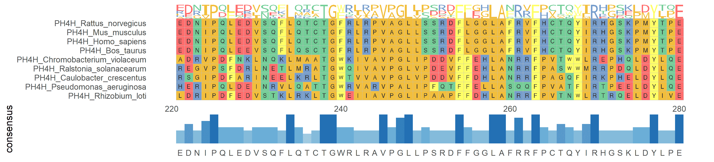

Multiple Sequence Alignment (MSA) is a fundamental and crucial technique in bioinformatics. It is used to align three or more biological sequences (DNA, RNA, or proteins) based on their evolutionary or structural similarities, so that homologous sites (i.e., sites derived from a common ancestor) are aligned as much as possible.

## Example

{fig-alt="MultiSeqsAlignment" fig-align="center" width="60%"}

## Setup

-   System Requirements: Cross-platform (Linux/MacOS/Windows)

-   Programming language: R

-   Dependent packages: `ggmsa`, `pheatmap`, `ape`, `ggtree`

```{r packages setup, message=FALSE, warning=FALSE, output=FALSE}
# Install packages
if (!requireNamespace("ggmsa", quietly = TRUE)) {
  install.packages("ggmsa")
}
if (!requireNamespace("pheatmap", quietly = TRUE)) {
  install.packages("pheatmap")
}
if (!requireNamespace("ape", quietly = TRUE)) {
  install.packages("ape")
}
if (!requireNamespace("ggtree", quietly = TRUE)) {
  if (!requireNamespace("BiocManager", quietly = TRUE)) install.packages("BiocManager")
  BiocManager::install("ggtree")
}

# Library packages
library(ggmsa)
library(pheatmap)
library(ape)
library(ggtree)
```

```{r}
sessioninfo::session_info("attached")
```

## Data Preparation

DNA/RNA/amino acid sequence data is usually stored in FASTA format, where each sequence consists of a description line (starting with ">") followed by sequence lines.

```{r load data, message=FALSE, warning=FALSE}
# Example data
protein_fasta <- system.file("extdata", "sample.fasta", package = "ggmsa")

# Data preview
seqs <- readLines(protein_fasta)
head(seqs)
```

### 4. Conservation Shading with a Secondary-Structure Strip (ESPript style)

`ggmsa` renders the alignment as coloured letters and a logo bar; the ESPript/Boxshade convention \[5,6\] adds two layers that answer different questions. A **shading layer** bins every column by its conservation — black for identical, grey for similar-by-physicochemical-class — which makes the conserved blocks stand out at the resolution of a printed page. A **secondary-structure strip** above the alignment maps the residues to helices and strands, so a reader can see whether a conserved column is a buried helix face or a surface loop. This is the layout used for essentially every protein-family alignment figure.

```{r}
#| label: fig-4-1BoxshadeAlignment
#| fig-cap: "ESPript-style conservation shading on a 60-column protein alignment: residues are shaded black when the column is fully conserved, blue-grey when all residues share the same physicochemical class (a column consensus rule in the spirit of Boxshade, applied here at 100% agreement), and left unshaded otherwise; the strip above the alignment marks alpha-helices and beta-strands so conserved columns can be read against secondary structure. The alignment is simulated."
#| out.width: "100%"
#| warning: false
#| message: false
#| fig-width: 10
#| fig-height: 5.2

suppressPackageStartupMessages({
  library(ggplot2)
  library(dplyr)
  library(tidyr)
  library(tibble)
})

set.seed(43513)

## Eight orthologues of a 60-residue fragment: positions 1-25 and 40-52 are
## conserved (the two secondary-structure elements the strip will mark).
aa <- strsplit("ACDEFGHIKLMNPQRSTVWY", "")[[1]]
classes <- c(A = "h", V = "h", I = "h", L = "h", M = "h", F = "a", W = "a",
             Y = "a", S = "p", T = "p", N = "p", Q = "p", C = "p", G = "t",
             P = "t", D = "n", E = "n", K = "b", R = "b", H = "b")

prot <- matrix(sample(aa, 8 * 60, replace = TRUE), nrow = 8)
conserved <- c(1:25, 40:52)
for (p in conserved) {
  keep <- sample(aa, 1)
  prot[, p] <- keep                            # fully conserved columns
}
## two columns are conserved only at class level
for (p in c(28, 55)) {
  cls <- sample(c("h", "p", "b"), 1)
  prot[, p] <- sample(names(classes)[classes == cls], 8, replace = TRUE)
}
rownames(prot) <- sprintf("SPECIES_%d", 1:8)

long <- as.data.frame(prot, stringsAsFactors = FALSE) |>
  rownames_to_column("seq") |>
  pivot_longer(-seq, names_to = "col", values_to = "residue") |>
  mutate(col = as.integer(sub("V", "", col)),
         row = as.integer(sub("SPECIES_", "", seq)))

## Conservation per column: identity (all residues equal) or class identity.
cons <- long |>
  group_by(col) |>
  summarise(n_res = n_distinct(residue),
            n_cls = n_distinct(classes[residue]), .groups = "drop") |>
  mutate(level = case_when(n_res == 1 ~ "identical",
                           n_cls == 1 ~ "class",
                           TRUE ~ "none"))

long <- left_join(long, cons |> select(col, level), by = "col") |>
  mutate(is_ident = !is.na(level) & level == "identical")

## Secondary-structure assignment for the strip.
ss <- data.frame(col = seq_len(60)) |>
  mutate(element = case_when(
    col %in% 4:12 ~ "helix H1",
    col %in% 18:24 ~ "strand S1",
    col %in% 41:48 ~ "helix H2",
    TRUE ~ NA_character_))

p <- ggplot(long, aes(col, row)) +
  ## Boxshade-style shading layer, drawn behind the letters.
  geom_tile(data = filter(cons, level != "none"),
            aes(x = col, y = 4.5, fill = level, width = 1, height = 8),
            inherit.aes = FALSE, colour = NA) +
  geom_text(aes(colour = is_ident), label = long$residue,
            size = 1.7, family = "mono") +
  scale_fill_manual(values = c(identical = "#222222", class = "#9db8d2"),
                    name = "conservation") +
  scale_colour_manual(values = c(`TRUE` = "white", `FALSE` = "#252525"),
                      guide = "none") +
  ## secondary-structure strip on top of the alignment rows
  geom_segment(data = filter(ss, !is.na(element) & grepl("helix", element)),
               aes(x = col - 0.4, xend = col + 0.4, y = 0.55, yend = 0.55),
               inherit.aes = FALSE, colour = "#b2182b", linewidth = 0.8) +
  geom_segment(data = filter(ss, !is.na(element) & grepl("strand", element)),
               aes(x = col - 0.4, xend = col + 0.4, y = 0.55, yend = 0.55),
               inherit.aes = FALSE, colour = "#2166ac", linewidth = 0.8,
               arrow = arrow(length = unit(0.06, "cm"), type = "closed")) +
  annotate("text", x = c(8, 21, 44), y = 0.28,
           label = c("H1", "S1", "H2"), size = 2.2,
           colour = c("#b2182b", "#2166ac", "#b2182b")) +
  ## row 1 at the top, as alignments are always printed
  scale_y_continuous(breaks = seq_len(8), labels = rownames(prot),
                     trans = "reverse", limits = c(0.2, 9.7),
                     expand = c(0, 0)) +
  scale_x_continuous(breaks = seq(10, 60, 10), expand = c(0.01, 0)) +
  coord_cartesian(clip = "off") +
  labs(x = "alignment column", y = NULL) +
  theme_minimal(base_size = 8) +
  theme(panel.grid = element_blank(), panel.background = element_blank(),
        axis.text.y = element_text(size = 5.8, family = "mono"),
        axis.text.x = element_text(size = 6.6),
        legend.position = "bottom",
        legend.key.size = unit(0.3, "cm"),
        legend.text = element_text(size = 7))

p
```

::: callout-tip
**Practice tips**

-   Shade by a stated rule, not by eye. Boxshade shades per residue against a threshold fraction of the column; the rule applied here is stricter - whole columns at 100% identity or 100% class agreement and it is auditable. Any other threshold must be printed in the caption.
-   When the shading fills the cell, the letter colour must invert (white on black); otherwise the most important residues become the hardest to read.
-   Map the alignment columns to a reference secondary structure and label it above: a conserved helix face and a conserved surface loop carry different meanings, and the alignment alone cannot tell them apart.
-   Print the column numbering. Without it, a reader cannot cite "column 44" in the text, and the figure stops being evidence.
-   Keep the monospace font and the one-letter code; a proportional font destroys column alignment and with it the entire argument of the figure.
:::

## Visualization

### 1. Multiple sequence alignment of proteins

The visualization of multiple protein sequence alignment shows the alignment of multiple protein sequences in specific regions, helps identify conserved regions and mutation sites, and provides a professional color scheme for amino acid sequences.

```{r}
#| label: fig-1MultiSeqsAlignmentProtein
#| fig-cap: "Multiple sequence alignment of proteins"
#| out.width: "95%"
#| warning: false

# Multiple sequence alignment of proteins
p <- ggmsa(
  protein_fasta,
  start = 300,
  end = 330,
  font = "DroidSansMono",
  color = "Chemistry_AA",
  char_width = 0.5,
  seq_name = TRUE,
  consensus_views = FALSE
)

p
```

### 2. Multiple sequence alignment and statistics

The statistical chart of multiple sequence alignment results shows the conservation and variation of multiple sequences within the alignment region, helping to identify key sites and regions.

```{r}
#| label: fig-1MultiSeqsAlignmentStats
#| fig-cap: "Multiple sequence alignment and statistics"
#| out.width: "95%"
#| warning: false

# Multiple sequence alignment and statistics
p <- ggmsa(
  protein_fasta,
  start = 300,
  end = 320,
  font = "DroidSansMono",
  color = "Chemistry_AA",
  char_width = 0.5,
  seq_name = TRUE,
  consensus_views = FALSE
) +
  geom_msaBar()

p
```

### 3. Multiple sequence alignment and Logo

While performing multiple sequence alignment and displaying the alignment consensus results with a Logo, the bases or amino acids of multiple sequences are sorted and displayed in the form of a Logo.

```{r}
#| label: fig-1MultiSeqsAlignmentLogo
#| fig-cap: "Multiple sequence alignment and Logo"
#| out.width: "95%"
#| warning: false

# Multiple sequence alignment and Logo
p <- ggmsa(
  protein_fasta,
  start = 300,
  end = 330,
  font = "DroidSansMono",
  color = "Chemistry_AA",
  char_width = 0.5,
  seq_name = TRUE,
  consensus_views = FALSE
) +
  geom_seqlogo()

p
```

### 4. From an Expression Cluster to a Gene Family: Heatmap + Tree + Alignment

The FigureYa2 workflow answers a common discovery question \[7\]: an expression heatmap clusters some genes of unknown function together with a known gene family — are the unknowns really family members? The check runs the other direction: align the family's protein sequences, build a tree from the alignment distances, and see whether expression clusters and sequence clades agree. The three panels below reproduce that loop on a simulated 12-member family with two subfamilies (evolved from one ancestor by substitutions only, so the "alignment" is exact and needs no aligner — with real sequences run `msa::msa()` and `seqinr::dist.alignment()` as in the reference, or any standard MSA tool).

Expression first: the two subfamilies are co-expressed, so a clustered heatmap with a group annotation separates them into two row blocks — the observation that starts the investigation.

```{r}
#| label: fig-4.1FamilyHeatmap
#| fig-cap: "Expression heatmap of the 12-member simulated family (rows z-scored, complete linkage): the two co-expression blocks correspond to the two subfamilies."
#| out.width: "85%"
#| warning: false
#| message: false
#| fig-width: 9
#| fig-height: 5

set.seed(2186)
aas <- strsplit("ARNDCQEGHILKMFPSTWYV", "")[[1]]
anc <- paste(sample(aas, 140, replace = TRUE), collapse = "")

evolve <- function(seq, n_sub) {
  s <- strsplit(seq, "")[[1]]
  pos <- sample(length(s), n_sub)
  s[pos] <- sample(aas, length(pos), replace = TRUE)
  paste(s, collapse = "")
}
## two subfamilies: 22 substitutions shared within each lineage, 6 private per member
fam_a <- anc; fam_b <- anc
for (j in 1:22) { fam_a <- evolve(fam_a, 1); fam_b <- evolve(fam_b, 1) }
seqs <- c(
  setNames(vapply(1:6, function(j) evolve(fam_a, 6), ""), paste0("FAM1_M", 1:6)),
  setNames(vapply(1:6, function(j) evolve(fam_b, 6), ""), paste0("FAM2_U", 1:6)))
aln <- do.call(rbind, lapply(seqs, function(s) strsplit(s, "")[[1]]))
rownames(aln) <- names(seqs)

n_samp <- 18
grp <- factor(rep(c("Group1", "Group2"), c(6, 12)))
expr <- matrix(rnorm(12 * n_samp, sd = 0.7), 12, n_samp,
               dimnames = list(rownames(aln), paste0("S", 1:n_samp)))
expr[grep("FAM1", rownames(expr)), grp == "Group1"] <-
  expr[grep("FAM1", rownames(expr)), grp == "Group1"] + 1.4
expr[grep("FAM2", rownames(expr)), grp == "Group2"] <-
  expr[grep("FAM2", rownames(expr)), grp == "Group2"] + 1.4

ann_col <- data.frame(group = grp); rownames(ann_col) <- colnames(expr)
pheatmap(expr, scale = "row", clustering_method = "complete",
         annotation_col = ann_col,
         annotation_colors = list(group = c(Group1 = "#F4A582", Group2 = "#92C5DE")),
         color = colorRampPalette(c("navy", "white", "firebrick3"))(20),
         show_colnames = FALSE, fontsize = 9)
```

Second, the alignment view: with no insertions or deletions in the simulation every member keeps the ancestor's 140 positions, so the alignment matrix is the sequences themselves; `ggmsa()` renders the first 60 positions. Subfamily 1's signature at positions 1–3 (`CSR…` vs `MSA…`) and the scattered private substitutions are exactly what a real family alignment shows.

```{r}
#| label: fig-4.2FamilyAlignment
#| fig-cap: "First 60 alignment positions of the 12 family members (ggmsa, Chemistry_AA colouring): each subfamily carries shared diagnostic substitutions plus private ones."
#| out.width: "100%"
#| warning: false
#| message: false
#| fig-width: 11
#| fig-height: 4.6

## write the member sequences as FASTA (the real workflow aligns member FASTAs)
fa <- file.path(tempdir(), "family_msa.fasta")
con <- file(fa, "w")
for (nm in names(seqs)) writeLines(c(paste0(">", nm), seqs[[nm]]), con)
close(con)
ggmsa(fa, start = 1, end = 60, font = "DroidSansMono",
      color = "Chemistry_AA", char_width = 0.5, seq_name = TRUE)
```

Third, the tree: a pairwise-identity distance (base R here; `seqinr::dist.alignment()` on a real MSA) feeds neighbour-joining (`ape::nj`), and `ggtree` \[2\] draws it with tips coloured by subfamily — the two expression clusters and the two sequence clades agree, which is the evidence the workflow exists to produce.

```{r}
#| label: fig-4.3FamilyTree
#| fig-cap: "Neighbour-joining tree from pairwise sequence identity (ggtree): the two clades match the two expression blocks of the heatmap."
#| out.width: "80%"
#| warning: false
#| message: false
#| fig-width: 8
#| fig-height: 6

n <- nrow(aln)
d <- matrix(0, n, n, dimnames = list(rownames(aln), rownames(aln)))
for (i in 2:n) for (j in 1:(i - 1)) {
  d[i, j] <- d[j, i] <- 1 - mean(aln[i, ] == aln[j, ])
}
tree <- nj(as.dist(d))
sub <- ifelse(grepl("FAM1", tree$tip.label), "subfamily 1", "subfamily 2")
xr <- max(ape::node.depth.edgelength(tree))
ggtree(tree, size = 0.8) %<+% data.frame(label = tree$tip.label, sub = sub) +
  geom_tippoint(aes(color = sub), size = 2.6) +
  geom_tiplab(aes(color = sub), size = 3.2, offset = 0.02,
              align = TRUE, linesize = 0.2, show.legend = FALSE) +
  scale_color_manual(values = c("subfamily 1" = "#B2182B",
                                "subfamily 2" = "#2166AC"), name = NULL) +
  xlim(0, xr * 1.5) + theme(legend.position = "bottom")
```

::: callout-tip
**Practice tips**

-   Read the three panels together, always in this order: expression block → alignment signature → tree clade. A cluster that splits into two tree clades is evidence of a subfamily; a cluster that mixes clades usually means the expression pattern is condition-specific, not family-wide.
-   The simulation evolves by substitutions only so the alignment is trivially correct; real proteins need a real aligner (`msa::msa()` with ClustalW, or MAFFT externally) — then convert with `msa::msaConvert(type = "seqinr::alignment")` for `dist.alignment()`.
-   `ggtree` needs tip-label data attached with `%<+%`; colour the tips AND the labels the same way so the clade membership survives greyscale printing.
-   For large families the reference switches to a circular layout — `ggtree(tree, layout = "circular") + geom_tiplab2(offset = .1)` with an expanded `xlim(-.2, 3)` — which keeps long tip labels inside the page; `msa::msaPrettyPrint()` additionally renders the alignment to LaTeX PDF for the supplementary figure.
:::

## Implementations deliberately not used here

This page draws its figures with ggplot2 rather than installing the skipped tools. Of the tools that the issue-435 inventory maps onto Omics/MultiSeqsAlignment.qmd, 1 is marked **skipped** here and used only as layout references, not as dependencies: 1 that has gone more than five years without an operational commit (cutoff 2021-11-07). Reproducing whatever still works would mean pinning abandoned code; installing the rest would mean pulling a whole analysis framework into a documentation build. The figure conventions were read off those tools, then re-implemented here so each panel can be inspected line by line.

| Tool | Last commit | Status | Why it is skipped |
| --- | --- | --- | --- |
| msaR | 2021-09-22 | stale | >5 years without maintenance |

## Reference

\[1\] Zhou L, Feng T, Xu S, et al. ggmsa: a visual exploration tool for multiple sequence alignment and associated data. Brief Bioinform. 2022;23(4):bbac222. doi:10.1093/bib/bbac222

\[2\] Yu G, Smith DK, Zhu H, Guan Y, Lam TT-Y. ggtree: an R package for visualization and annotation of phylogenetic trees with their covariates and other associated data. Methods Ecol Evol. 2017;8(1):28-36. doi:10.1111/2041-210X.12628

\[3\] Gille C, Fähling M, Weyand B, et al. Alignment-Annotator web server: rendering and annotating sequence alignments. Nucleic Acids Res. 2014;42(W1):W3-W6. doi:10.1093/nar/gku400

\[4\] Robert X, Gouet P. Deciphering key features in protein structures with the new ENDscript server. Nucleic Acids Res. 2014;42(W1):W320-W324. doi:10.1093/nar/gku316

\[5\] Gouet P, Courcelle E, Stuart DI, Metoz F. ESPript: analysis of multiple sequence alignments in PostScript. Bioinformatics. 1999;15(4):305-308. doi:10.1093/bioinformatics/15.4.305

\[6\] Hofmann K, Baron MD. Boxshade. EMBnet news. 1996;3(2):5.

\[7\] Xiaofan Lu, et al. FigureYa: A Standardized Visualization Framework for Enhancing Biomedical Data Interpretation and Research Efficiency. iMetaMed. 2025. doi:10.1002/imm3.70005
