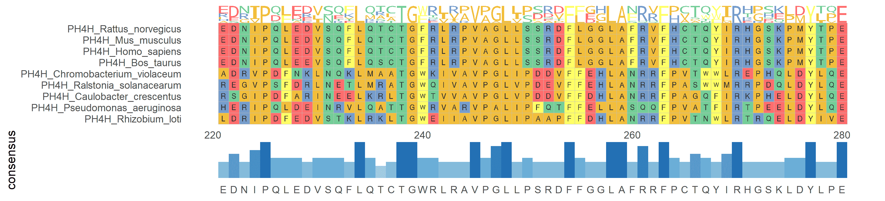

多序列比对（Multiple Sequence Alignment, MSA）是生物信息学中一项基础且关键的技术，用于将三个或更多生物序列（DNA、RNA 或蛋白质）按照其进化或结构上的相似性进行排列，使得同源位点（即来自共同祖先的位点）尽可能对齐。

## 示例

{fig-alt="MultiSeqsAlignment" fig-align="center" width="60%"}

## 环境配置

-   系统要求： 跨平台（Linux/MacOS/Windows）

-   编程语言：R

-   依赖包：`ggmsa`、`pheatmap`、`ape`、`ggtree`

```{r packages setup, message=FALSE, warning=FALSE, output=FALSE}
# 安装包
if (!requireNamespace("ggmsa", quietly = TRUE)) {
  install.packages("ggmsa")
}
if (!requireNamespace("pheatmap", quietly = TRUE)) {
  install.packages("pheatmap")
}
if (!requireNamespace("ape", quietly = TRUE)) {
  install.packages("ape")
}
if (!requireNamespace("ggtree", quietly = TRUE)) {
  if (!requireNamespace("BiocManager", quietly = TRUE)) install.packages("BiocManager")
  BiocManager::install("ggtree")
}

# 加载包
library(ggmsa)
library(pheatmap)
library(ape)
library(ggtree)
```

```{r}
sessioninfo::session_info("attached")
```

## 数据准备

DNA/RNA/氨基酸序列数据通常以FASTA格式存储，每个序列由一个描述行（以“>”开头）和随后的序列行组成。

```{r load data, message=FALSE, warning=FALSE}
# 示例数据
protein_fasta <- system.file("extdata", "sample.fasta", package = "ggmsa")

# 查看数据
seqs <- readLines(protein_fasta)
head(seqs)
```

## 可视化

### 1. 蛋白质多序列比对

蛋白质多序列比对可视化展示了多个蛋白质序列在特定区域的比对情况，帮助识别保守区域和变异位点，提供专业的氨基酸序列颜色方案。

```{r}
#| label: fig-1MultiSeqsAlignmentProtein
#| fig-cap: "蛋白质多序列比对"
#| out.width: "95%"
#| warning: false

# 蛋白质多序列比对
p <- ggmsa(
  protein_fasta,
  start = 300,
  end = 330,
  font = "DroidSansMono",
  color = "Chemistry_AA",
  char_width = 0.5,
  seq_name = TRUE,
  consensus_views = FALSE
)

p
```

### 2. 多序列比对及统计

多序列比对结果统计图展示了多个序列在比对区域内的保守性和变异情况，帮助识别关键位点和区域。

```{r}
#| label: fig-1MultiSeqsAlignmentStats
#| fig-cap: "多序列比对及统计"
#| out.width: "95%"
#| warning: false

# 多序列比对及统计
p <- ggmsa(
  protein_fasta,
  start = 300,
  end = 320,
  font = "DroidSansMono",
  color = "Chemistry_AA",
  char_width = 0.5,
  seq_name = TRUE,
  consensus_views = FALSE
) +
  geom_msaBar()

p
```

### 3. 多序列比对及Logo

多序列比对及Logo展示比对一致性结果的同时，对多个序列的碱基或氨基酸进行排序以Logo形式显示。

```{r}
#| label: fig-1MultiSeqsAlignmentLogo
#| fig-cap: "多序列比对及Logo"
#| out.width: "95%"
#| warning: false

# 多序列比对及Logo
p <- ggmsa(
  protein_fasta,
  start = 300,
  end = 330,
  font = "DroidSansMono",
  color = "Chemistry_AA",
  char_width = 0.5,
  seq_name = TRUE,
  consensus_views = FALSE
) +
  geom_seqlogo()

p
```

### 4. 从表达聚类到基因家族：热图 + 进化树 + 多序列比对

FigureYa2 工作流回答一个常见的发现型问题 \[1\]：表达热图中一些功能未知的基因与已知基因家族聚在同一簇——它们真的是家族成员吗？验证从序列方向展开：对家族蛋白序列做多序列比对、用比对距离建树，看表达簇与序列进化枝是否一致。下面三张图在一个模拟的 12 成员家族（两个亚家族，由同一祖先仅经替换演化而来，因此"比对"是精确的、无需比对软件）上复现该闭环；真实序列请按参考文档用 `msa::msa()` + `seqinr::dist.alignment()` 或任何标准 MSA 工具。

先看表达：两个亚家族分别共表达，带分组注释的聚类热图把它们分成两个行块——这正是启动验证的观察。

```{r}
#| label: fig-4.1FamilyHeatmap
#| fig-cap: "模拟 12 成员家族的表达热图（行 z-score，完全连锁）：两个共表达块对应两个亚家族。"
#| out.width: "85%"
#| warning: false
#| message: false
#| fig-width: 9
#| fig-height: 5

set.seed(2186)
aas <- strsplit("ARNDCQEGHILKMFPSTWYV", "")[[1]]
anc <- paste(sample(aas, 140, replace = TRUE), collapse = "")

evolve <- function(seq, n_sub) {
  s <- strsplit(seq, "")[[1]]
  pos <- sample(length(s), n_sub)
  s[pos] <- sample(aas, length(pos), replace = TRUE)
  paste(s, collapse = "")
}
## 两个亚家族：各自 22 个共享替换 + 每成员 6 个私有替换
fam_a <- anc; fam_b <- anc
for (j in 1:22) { fam_a <- evolve(fam_a, 1); fam_b <- evolve(fam_b, 1) }
seqs <- c(
  setNames(vapply(1:6, function(j) evolve(fam_a, 6), ""), paste0("FAM1_M", 1:6)),
  setNames(vapply(1:6, function(j) evolve(fam_b, 6), ""), paste0("FAM2_U", 1:6)))
aln <- do.call(rbind, lapply(seqs, function(s) strsplit(s, "")[[1]]))
rownames(aln) <- names(seqs)

n_samp <- 18
grp <- factor(rep(c("Group1", "Group2"), c(6, 12)))
expr <- matrix(rnorm(12 * n_samp, sd = 0.7), 12, n_samp,
               dimnames = list(rownames(aln), paste0("S", 1:n_samp)))
expr[grep("FAM1", rownames(expr)), grp == "Group1"] <-
  expr[grep("FAM1", rownames(expr)), grp == "Group1"] + 1.4
expr[grep("FAM2", rownames(expr)), grp == "Group2"] <-
  expr[grep("FAM2", rownames(expr)), grp == "Group2"] + 1.4

ann_col <- data.frame(group = grp); rownames(ann_col) <- colnames(expr)
pheatmap(expr, scale = "row", clustering_method = "complete",
         annotation_col = ann_col,
         annotation_colors = list(group = c(Group1 = "#F4A582", Group2 = "#92C5DE")),
         color = colorRampPalette(c("navy", "white", "firebrick3"))(20),
         show_colnames = FALSE, fontsize = 9)
```

第二，比对视图：模拟只发生替换、无插入缺失，每个成员都保持祖先的 140 个位置，比对矩阵即序列本身；`ggmsa()` 渲染前 60 个位置。亚家族 1 在 1–3 位有特征（`CSR…` vs `MSA…`），加上散布的私有替换——这正是真实家族比对呈现的结构。

```{r}
#| label: fig-4.2FamilyAlignment
#| fig-cap: "12 个家族成员的前 60 个比对位置（ggmsa，Chemistry_AA 配色）：每个亚家族携带共享的诊断性替换与各自的私有替换。"
#| out.width: "100%"
#| warning: false
#| message: false
#| fig-width: 11
#| fig-height: 4.6

## 把成员序列写成 FASTA（真实流程对成员 FASTA 做比对）
fa <- file.path(tempdir(), "family_msa.fasta")
con <- file(fa, "w")
for (nm in names(seqs)) writeLines(c(paste0(">", nm), seqs[[nm]]), con)
close(con)
ggmsa(fa, start = 1, end = 60, font = "DroidSansMono",
      color = "Chemistry_AA", char_width = 0.5, seq_name = TRUE)
```

第三，进化树：配对一致率距离（此处用 base R；真实 MSA 上用 `seqinr::dist.alignment()`）输入邻接法（`ape::nj`），`ggtree` \[2\] 绘制并以亚家族着色枝端——两个表达簇与两个序列进化枝完全对应，这正是该工作流要产出的证据。

```{r}
#| label: fig-4.3FamilyTree
#| fig-cap: "由配对序列一致率距离构建的邻接树（ggtree）：两个进化枝与热图的两个表达块对应。"
#| out.width: "80%"
#| warning: false
#| message: false
#| fig-width: 8
#| fig-height: 6

n <- nrow(aln)
d <- matrix(0, n, n, dimnames = list(rownames(aln), rownames(aln)))
for (i in 2:n) for (j in 1:(i - 1)) {
  d[i, j] <- d[j, i] <- 1 - mean(aln[i, ] == aln[j, ])
}
tree <- nj(as.dist(d))
sub <- ifelse(grepl("FAM1", tree$tip.label), "subfamily 1", "subfamily 2")
xr <- max(ape::node.depth.edgelength(tree))
ggtree(tree, size = 0.8) %<+% data.frame(label = tree$tip.label, sub = sub) +
  geom_tippoint(aes(color = sub), size = 2.6) +
  geom_tiplab(aes(color = sub), size = 3.2, offset = 0.02,
              align = TRUE, linesize = 0.2, show.legend = FALSE) +
  scale_color_manual(values = c("subfamily 1" = "#B2182B",
                                "subfamily 2" = "#2166AC"), name = NULL) +
  xlim(0, xr * 1.5) + theme(legend.position = "bottom")
```

::: callout-tip
**实践要点**

-   三张图务必按此顺序连读：表达块 → 比对特征 → 进化枝。一个表达簇分裂为两个进化枝是亚家族的证据；一个簇内混杂多个进化枝，通常说明表达模式是条件特异的而非家族性的。
-   模拟只含替换所以比对天然正确；真实蛋白需要真正的比对器（`msa::msa()` 的 ClustalW，或外部 MAFFT），再用 `msa::msaConvert(type = "seqinr::alignment")` 转换后计算 `dist.alignment()`。
-   `ggtree` 的枝端数据要用 `%<+%` 挂接；枝端点与标签用同一套颜色映射，保证灰度打印下进化枝归属仍可读。
:::

## Reference

\[1\] Xiaofan Lu, et al. FigureYa: A Standardized Visualization Framework for Enhancing Biomedical Data Interpretation and Research Efficiency. iMetaMed. 2025. doi:10.1002/imm3.70005

\[2\] Yu G, Lam TT. ggtree: an R package for visualization and annotation of phylogenetic trees. Methods in Ecology and Evolution. 2018. <https://guangchuangyu.github.io/ggtree/>
