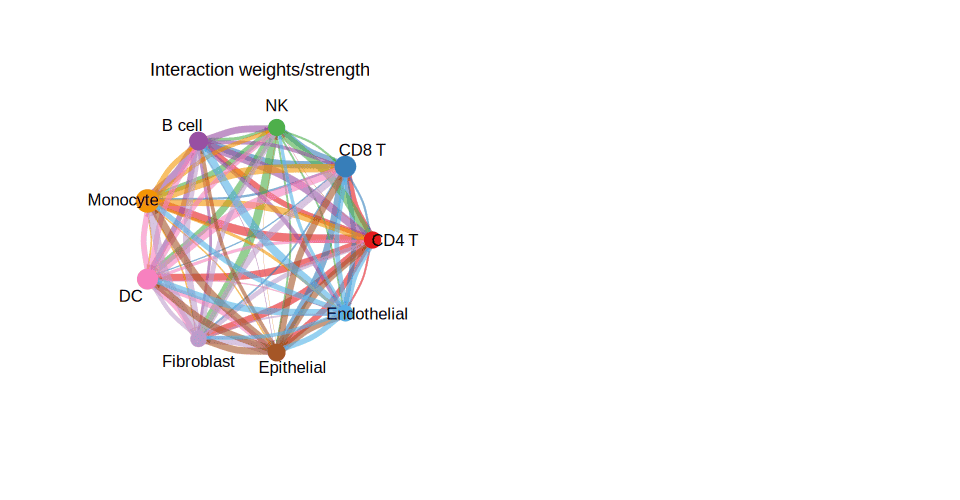

`MuSiC` (Multi-subject Single Cell deconvolution) uses cell-type-specific gene expression from **single-cell RNA-seq references** to estimate the proportions of each cell type in bulk RNA-seq samples, accounting for cross-subject transcriptional variability \[1\]. `MuSiC` and Seurat are not in this repository's lockfile; the deconvolution proportion estimation is simulated here across sample groups, and the stacked proportion barplot (the deliverable) runs on ggplot2:

## Example

{fig-alt="MuSiC Deconvolution of Bulk RNA-Seq DEMO" fig-align="center" width="75%"}

## Setup

-   System Requirements: Cross-platform (Linux/MacOS/Windows)

-   Programming language: R

-   Dependent packages: `ggplot2`; `dplyr`

```{r packages setup, message=FALSE, warning=FALSE, output=FALSE}
suppressPackageStartupMessages({
  library(ggplot2); library(dplyr)
})
```

```{r}
sessioninfo::session_info("attached")
```

## Data Preparation

40 bulk samples across 4 clinical groups (10 patients each), with estimated cell-type proportions for 6 cell populations (T cells, B cells, Monocytes, NK cells, Fibroblasts, Endothelial). Planted fractions: T cells and Monocytes dominate, with group-specific shifts (e.g. higher T-cell fraction in group G1 vs G4):

```{r load data}
suppressPackageStartupMessages({library(ggplot2); library(dplyr)})
set.seed(46274)
n_pat <- 40; groups <- c("G1", "G2", "G3", "G4")
pat_group <- rep(groups, each = n_pat / length(groups))
cell_types <- c("T cells", "B cells", "Monocytes", "NK cells", "Fibroblasts", "Endothelial")
n_ct <- length(cell_types)

prop_mat <- do.call(rbind, lapply(pat_group, function(g) {
  base <- c(0.35, 0.15, 0.25, 0.10, 0.10, 0.05)
  if (g == "G1") base[1] <- base[1] + 0.15
  if (g == "G4") base[1] <- base[1] - 0.15
  v <- pmax(base + rnorm(n_ct, 0, 0.03), 0.01)
  v / sum(v)
}))
colnames(prop_mat) <- cell_types
prop_df <- data.frame(
  patient = rep(sprintf("P%02d", 1:n_pat), times = n_ct),
  group = rep(pat_group, times = n_ct),
  cell_type = rep(cell_types, each = n_pat),
  proportion = as.vector(prop_mat)
)
```

## Visualization

### 1. Stacked Proportion Barplot per Patient

The reference's main deliverable: one vertical bar per bulk patient, stacked 100% proportions coloured by cell type, grouped by clinical class:

```{r}
#| label: fig-1.1MusicStack
#| fig-cap: "Estimated cell-type proportions per bulk RNA-seq sample (MuSiC deconvolution): stacked 100% barplot grouped by 4 clinical groups (G1-G4); T cells and Monocytes dominate across all patients, with visible group-level shifts."
#| out.width: "95%"
#| fig-width: 9.5
#| fig-height: 5

pal <- RColorBrewer::brewer.pal(n_ct, "Set2")
ggplot(prop_df, aes(patient, proportion, fill = cell_type)) +
  geom_col(position = "fill", width = 0.85) +
  facet_grid(~ group, scales = "free_x", space = "free_x") +
  scale_fill_manual(values = pal, name = "Cell type") +
  labs(x = "Bulk samples (grouped by clinical class)", y = "Estimated proportion") +
  theme_bw(base_size = 10.5) +
  theme(axis.text.x = element_blank(),
        axis.ticks.x = element_blank(),
        panel.grid = element_blank(),
        legend.position = "right")
```

### 2. Group-Level Cell-Type Abundance Boxplots

The statistical check behind the stacked bar: comparing cell-type proportions between groups with Wilcoxon tests:

```{r}
#| label: fig-2.1MusicBox
#| fig-cap: "Cell-type proportion distributions across the four clinical groups: T cells show a significant group-level difference (Wilcoxon p annotated), validating the visual shift from the stacked bar."
#| out.width: "95%"
#| fig-width: 9.5
#| fig-height: 6

ggplot(prop_df, aes(group, proportion, fill = group)) +
  geom_boxplot(outlier.shape = NA, alpha = 0.6, width = 0.6) +
  geom_point(shape = 21, size = 1.5,
             position = position_jitterdodge(jitter.width = 0.15),
             aes(colour = group), alpha = 0.7) +
  facet_wrap(~ cell_type, ncol = 3, scales = "free_y") +
  scale_fill_manual(values = c(G1 = "#EABF00", G2 = "#2874C5", G3 = "#2CA02C", G4 = "#D62728")) +
  scale_color_manual(values = c(G1 = "#EABF00", G2 = "#2874C5", G3 = "#2CA02C", G4 = "#D62728")) +
  labs(x = NULL, y = "Estimated proportion") +
  theme_bw(base_size = 10) +
  theme(axis.text.x = element_blank(),
        axis.ticks.x = element_blank(),
        strip.background = element_blank(),
        legend.title = element_blank(),
        legend.position = "right")
```

::: callout-tip
**Practice tips**

-   Provide a clean single-cell reference matrix (mean expression per cell type) — MuSiC re-weights genes by cross-subject variance to suppress platform artifacts.
-   Normalize bulk samples with library size before deconvolution; log-scale matrices must be un-logged back to raw/TPM counts if the package expects linear scale.
-   Stacked 100% barplots (`position = "fill"`) show relative proportions well, but absolute abundance estimates should be checked in parallel boxplots.
-   Sort patients inside each clinical group by the dominant cell type's fraction so the stack transitions smoothly.
-   Report the number of marker genes used per cell type; sparse reference markers yield unstable proportions.
:::

## Application

::: {#fig-MusicDeconvApplications1}
{fig-alt="MuSiC Deconvolution of Bulk RNA-Seq" fig-align="center" width="75%"}

MuSiC deconvolution of bulk RNA-seq
:::

Single-cell reference deconvolution applies to any bulk cohort with matched single-cell atlases: TCGA tumour types with droplet scRNA-seq references, immunotherapy bulk trials with serial biopsy subsets, or tissue injury time-courses.

## Reference

\[1\] Xiaofan Lu, et al. Festival of Standardized Biomedical Visualizations: MuSiC Deconvolution. iMetaMed. 2025. doi:10.1002/imm3.70005
