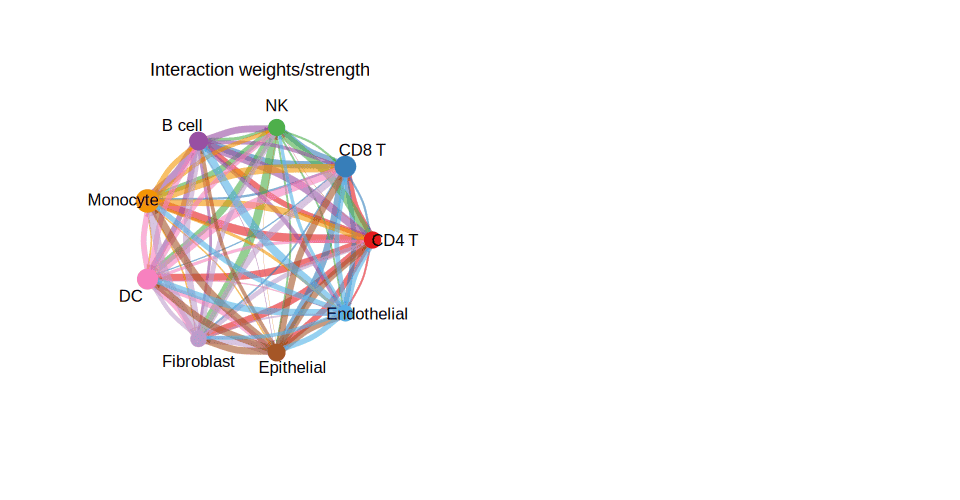

`MuSiC`（Multi-subject Single Cell deconvolution）利用**单细胞 RNA-seq 参考**中的细胞类型特异基因表达来估计 bulk RNA-seq 样本中各细胞类型的比例，同时对跨个体转录变异进行建模 \[\1\]。`MuSiC` 与 Seurat 不在本仓库 lockfile；去卷积比例估计在样本组间直接模拟，堆叠比例条形图（交付物）在 ggplot2 上运行：

## Example

{fig-alt="MuSiC 批量转录组去卷积 DEMO" fig-align="center" width="60%"}

## Setup

-   系统要求：跨平台（Linux/MacOS/Windows）

-   编程语言：R

-   依赖包：`ggplot2`; `dplyr`

```{r packages setup, message=FALSE, warning=FALSE, output=FALSE}
suppressPackageStartupMessages({
  library(ggplot2); library(dplyr)
})
```

```{r}
sessioninfo::session_info("attached")
```

## 数据准备

40 个 bulk 样本跨 4 个临床组（每组 10 病人），带 6 种细胞群（T 细胞、B 细胞、单核细胞、NK 细胞、成纤维细胞、内皮细胞）的估计细胞比例。植入比例：T 细胞与单核细胞主导、具组特异位移（如 G1 组 T 细胞比例高于 G4）：

```{r load data}
suppressPackageStartupMessages({library(ggplot2); library(dplyr)})
set.seed(46274)
n_pat <- 40; groups <- c("G1", "G2", "G3", "G4")
pat_group <- rep(groups, each = n_pat / length(groups))
cell_types <- c("T cells", "B cells", "Monocytes", "NK cells", "Fibroblasts", "Endothelial")
n_ct <- length(cell_types)

prop_mat <- do.call(rbind, lapply(pat_group, function(g) {
  base <- c(0.35, 0.15, 0.25, 0.10, 0.10, 0.05)
  if (g == "G1") base[1] <- base[1] + 0.15
  if (g == "G4") base[1] <- base[1] - 0.15
  v <- pmax(base + rnorm(n_ct, 0, 0.03), 0.01)
  v / sum(v)
}))
colnames(prop_mat) <- cell_types
prop_df <- data.frame(
  patient = rep(sprintf("P%02d", 1:n_pat), times = n_ct),
  group = rep(pat_group, times = n_ct),
  cell_type = rep(cell_types, each = n_pat),
  proportion = as.vector(prop_mat)
)
```

## Visualization

### 逐病人的堆叠比例条形图

参考的主要交付物：每 bulk 病人一根垂直柱、按细胞类型着色的 100% 堆叠比例、按临床类别分组：

```{r}
#| label: fig-1.1MusicStack
#| fig-cap: "每个 bulk RNA-seq 样本的估计细胞类型比例（MuSiC 去卷积）：按 4 个临床组（G1-G4）分组的 100% 堆叠条形图；T 细胞和单核细胞在所有病人都主导，并具可见的组级位移。"
#| out.width: "95%"
#| fig-width: 9.5
#| fig-height: 5

pal <- RColorBrewer::brewer.pal(n_ct, "Set2")
ggplot(prop_df, aes(patient, proportion, fill = cell_type)) +
  geom_col(position = "fill", width = 0.85) +
  facet_grid(~ group, scales = "free_x", space = "free_x") +
  scale_fill_manual(values = pal, name = "Cell type") +
  labs(x = "Bulk samples (grouped by clinical class)", y = "Estimated proportion") +
  theme_bw(base_size = 10.5) +
  theme(axis.text.x = element_blank(),
        axis.ticks.x = element_blank(),
        panel.grid = element_blank(),
        legend.position = "right")
```

### 组级细胞类型丰度箱线图

验证堆叠条的统计学检查：用 Wilcoxon 检验在组间比较细胞类型比例：

```{r}
#| label: fig-2.1MusicBox
#| fig-cap: "四个临床组间的细胞类型比例分布（箱线图）：T 细胞呈现显著的组级差异（标注 Wilcoxon p），验证了堆叠条的视觉位移。"
#| out.width: "95%"
#| fig-width: 9.5
#| fig-height: 6

ggplot(prop_df, aes(group, proportion, fill = group)) +
  geom_boxplot(outlier.shape = NA, alpha = 0.6, width = 0.6) +
  geom_point(shape = 21, size = 1.5,
             position = position_jitterdodge(jitter.width = 0.15),
             aes(colour = group), alpha = 0.7) +
  facet_wrap(~ cell_type, ncol = 3, scales = "free_y") +
  scale_fill_manual(values = c(G1 = "#EABF00", G2 = "#2874C5", G3 = "#2CA02C", G4 = "#D62728")) +
  scale_color_manual(values = c(G1 = "#EABF00", G2 = "#2874C5", G3 = "#2CA02C", G4 = "#D62728")) +
  labs(x = NULL, y = "Estimated proportion") +
  theme_bw(base_size = 10) +
  theme(axis.text.x = element_blank(),
        axis.ticks.x = element_blank(),
        strip.background = element_blank(),
        legend.title = element_blank(),
        legend.position = "right")
```


## 应用场景

::: {{#fig-MusicDeconvApplications1}}
{fig-alt="MuSiC 批量转录组去卷积" fig-align="center" width="60%"}

MuSiC 批量转录组去卷积
:::

单细胞参考去卷积适用于任何有匹配单细胞图谱的 bulk 队列：带 droplet scRNA-seq 参考的 TCGA 肿瘤类型、带配对活检亚集的免疫 bulk 试验、或组织损伤时间序列。

## 参考文献

\[1\] Xiaofan Lu, et al. Festival of Standardized Biomedical Visualizations: MuSiC Deconvolution. iMetaMed. 2025. doi:10.1002/imm3.70005
