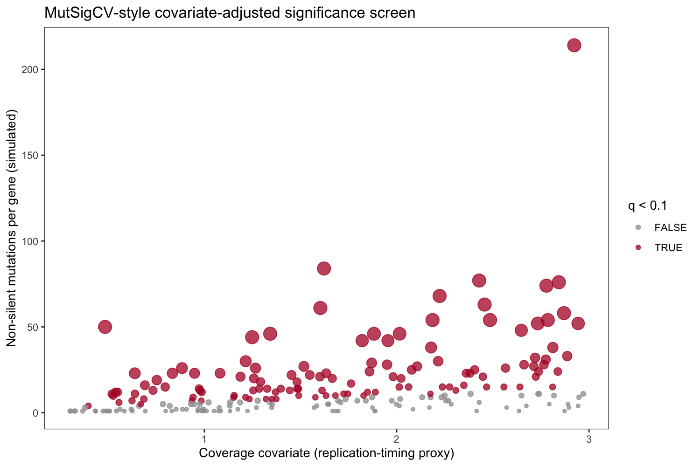

Not every frequently mutated gene is a driver: long, late-replicating genes with high expression accumulate mutations at a higher *background* rate. MutSigCV corrects each gene's mutation count for such patient-specific **covariates** before testing significance \[1\]. The reference figure is a scatter of mutations per gene against the covariate, with significant genes coloured. This tutorial reproduces that screen with a dependency-free binomial test on a simulated gene set — the plotting half of the MutSigCV pipeline (covariate matrix → normalized background → significance):

## Example

{fig-alt="MutSigCvPlot DEMO" fig-align="center" width="60%"}

## Setup

-   System Requirements: Cross-platform (Linux/MacOS/Windows)

-   Programming language: R

-   Dependent packages: `ggplot2`

```{r packages setup, message=FALSE, warning=FALSE, output=FALSE}
suppressPackageStartupMessages({
  library(ggplot2)
  library(dplyr)
})
```

```{r}
sessioninfo::session_info("attached")
```

## Data Preparation

Simulated non-silent mutation counts for 220 genes across 180 patients. Each gene carries a covariate (a replication-timing/expression proxy that scales the background rate); 8 genes get extra mutations — the drivers the screen must find against the covariate-adjusted background:

```{r load data}
set.seed(11301)
n_mut_genes <- 220
covariate <- runif(n_mut_genes, 0.3, 3)     # background-rate proxy
n_mut <- pmax(1, rnbinom(n_mut_genes, size = 1.4, mu = 8 * covariate))
hits <- sample(n_mut_genes, 8)
n_mut[hits] <- n_mut[hits] + rnbinom(8, size = 2, mu = 45)
## covariate-adjusted binomial test: expected mutations = genome-wide rate
## x the gene's own covariate exposure
pvals <- sapply(seq_len(n_mut_genes), function(i) {
  pbinom(n_mut[i] - 1, size = 180,
         prob = pmin(0.15, covariate[i] * 0.015), lower.tail = FALSE)
})
qvals <- p.adjust(pvals, method = "BH")
mutdf <- data.frame(n_mut = n_mut, covariate = covariate, q = qvals,
                    significant = qvals < 0.1, gene = paste0("GENE", sprintf("%03d", 1:n_mut_genes)))
```

## Visualization

### 1. Significance Scatter

```{r}
#| label: fig-1.1MutSigScatter
#| fig-cap: "MutSigCV-style significance scatter (simulated): non-silent mutations per gene vs the background covariate; coloured and enlarged points are BH-significant (q < 0.1) genes that rise above the covariate-matched background."
#| out.width: "75%"
#| warning: false
#| message: false
#| fig-width: 7.5
#| fig-height: 5

ggplot(mutdf, aes(covariate, n_mut)) +
  geom_point(aes(colour = significant, size = -log10(pmax(q, 1e-30))), alpha = 0.75) +
  scale_colour_manual(values = c(`FALSE` = "grey62", `TRUE` = "#B2182B"),
                      name = "q < 0.1") +
  scale_size_continuous(range = c(1.2, 5), guide = "none") +
  labs(x = "Coverage covariate (replication-timing proxy)",
       y = "Non-silent mutations per gene (simulated)",
       title = "MutSigCV-style covariate-adjusted significance screen") +
  theme_bw(base_size = 11) + theme(panel.grid = element_blank())
```

### 2. Top-Gene Lollipop

The scatter says *which genes pass*; the lollipop says *by how much*, in the order a results table would list them:

```{r}
#| label: fig-2.1MutSigLollipop
#| fig-cap: "BH-significant genes sorted by q-value: observed mutations (dot) against the covariate-matched 95% background band (grey line), connected by a stem."
#| out.width: "70%"
#| warning: false
#| message: false
#| fig-width: 6.5
#| fig-height: 4.5

top_genes <- mutdf %>% dplyr::filter(significant) %>% dplyr::arrange(q) %>% head(8)
bg_hi <- sapply(top_genes$covariate, function(cv)
  qbinom(0.975, size = 180, prob = pmin(0.15, cv * 0.015)))
ggplot(top_genes, aes(gene, n_mut)) +
  geom_linerange(aes(ymin = 0, ymax = n_mut), colour = "grey55", linewidth = 0.7) +
  geom_hline(yintercept = mean(bg_hi), linetype = "dashed", colour = "grey45") +
  geom_point(aes(colour = q), size = 4, shape = 16) +
  coord_flip() +
  scale_colour_viridis_c(trans = "log10") +
  labs(x = NULL, y = "Non-silent mutations (180 patients)",
       colour = "q value",
       title = "Top significant genes (BH-sorted)",
       subtitle = "Dashed line = median 97.5% background across shown covariates") +
  theme_bw(base_size = 11) + theme(panel.grid = element_blank())
```

::: callout-tip
**Practice tips**

-   The binomial test here conditions each gene on **its own covariate** — that conditioning is the whole point of MutSigCV; an unadjusted poisson test on the pooled rate flags long/expression-high genes with no driver evidence.
-   Report BH-corrected q-values, not raw p-values — over 20,000 genes even MutSigCV's corrected test leaves many borderline calls.
-   The scatter's x axis doubles as a diagnostic: significant genes should scatter across the whole covariate range, not cluster at one end (a clustering pattern means the covariate model is misfit).
:::

## Applications

::: {#fig-MutSigCvApplications1}
{fig-alt="MutSigCvPlot Application" fig-align="center" width="60%"}

Covariate-adjusted mutation significance
:::

The scatter + lollipop pair applies to any covariate-adjusted count screen: ribosomal dropout in scRNA-seq, variant burdens by coverage bin, or per-region ChIP peak calls.

## Reference

\[1\] Xiaofan Lu, et al. FigureYa: A Standardized Visualization Framework for Enhancing Biomedical Data Interpretation and Research Efficiency. iMetaMed. 2025. doi:10.1002/imm3.70005

\[2\] Lawrence MS, Stojanov P, Polak P, et al. Mutational heterogeneity in cancer and the search for new cancer-associated genes. Nature. 2013;499(7457):214-218. doi:10.1038/nature12213
