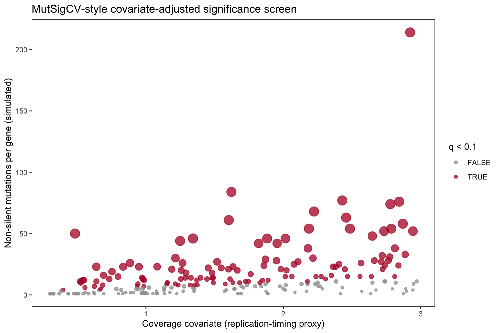

并非每个高频突变基因都是驱动基因：长基因、晚复制基因、高表达基因的*背景*突变率天然更高。MutSigCV 在检验显著性前将每个基因的突变计数按此类患者特异**协变量**校正 \[1\]。参考图为"每基因突变数 vs 协变量"散点图，显著基因着色。本教程用免依赖的二项检验在模拟基因集上复现该筛选——MutSigCV 流程（协变量矩阵 → 归一化背景 → 显著性）的绘图部分：

## Example

{fig-alt="MutSigCvPlot DEMO" fig-align="center" width="60%"}

## Setup

-   系统要求：跨平台（Linux/MacOS/Windows）

-   编程语言：R

-   依赖包：`ggplot2`；`dplyr`

```{r packages setup, message=FALSE, warning=FALSE, output=FALSE}
suppressPackageStartupMessages({
  library(ggplot2)
  library(dplyr)
})
```

```{r}
sessioninfo::session_info("attached")
```

## 数据准备

180 名患者 220 个基因的模拟非沉默突变计数。每个基因携带一个协变量（缩放背景率的复制时序/表达代理指标）；8 个基因获得额外突变——即筛选需要从协变量校正的背景中找出的驱动基因：

```{r load data}
sessioninfo::session_info("attached")
```

## Visualization

### 1. 显著性散点图

```{r}
#| label: fig-1.1MutSigScatter
#| fig-cap: "MutSigCV 风格显著性散点（模拟）：逐基因非沉默突变数 vs 背景协变量；着色放大的点为 BH 显著（q < 0.1）且高于协变量匹配背景的基因。"
#| out.width: "75%"
#| warning: false
#| message: false
#| fig-width: 7.5
#| fig-height: 5

set.seed(11301)
n_mut_genes <- 220
covariate <- runif(n_mut_genes, 0.3, 3)     # background-rate proxy
n_mut <- pmax(1, rnbinom(n_mut_genes, size = 1.4, mu = 8 * covariate))
hits <- sample(n_mut_genes, 8)
n_mut[hits] <- n_mut[hits] + rnbinom(8, size = 2, mu = 45)
## covariate-adjusted binomial test: expected mutations = genome-wide rate
## x the gene's own covariate exposure
pvals <- sapply(seq_len(n_mut_genes), function(i) {
  pbinom(n_mut[i] - 1, size = 180,
         prob = pmin(0.15, covariate[i] * 0.015), lower.tail = FALSE)
})
qvals <- p.adjust(pvals, method = "BH")
mutdf <- data.frame(n_mut = n_mut, covariate = covariate, q = qvals,
                    significant = qvals < 0.1, gene = paste0("GENE", sprintf("%03d", 1:n_mut_genes)))
```

### 2. Top 基因棒棒糖图

散点图回答*哪些基因通过*；棒棒糖图回答*通过多少*——按结果表的排序方式列出：

```{r}
#| label: fig-2.1MutSigLollipop
#| fig-cap: "BH 显著基因按 q 值排序：观测突变数（点）对照协变量匹配的 95% 背景带（灰线），以线段连接。"
#| out.width: "70%"
#| warning: false
#| message: false
#| fig-width: 6.5
#| fig-height: 4.5

#| label: fig-1.1MutSigScatter
#| fig-cap: "MutSigCV-style significance scatter (simulated): non-silent mutations per gene vs the background covariate; coloured and enlarged points are BH-significant (q < 0.1) genes that rise above the covariate-matched background."
#| out.width: "75%"
#| warning: false
#| message: false
#| fig-width: 7.5
#| fig-height: 5

ggplot(mutdf, aes(covariate, n_mut)) +
  geom_point(aes(colour = significant, size = -log10(pmax(q, 1e-30))), alpha = 0.75) +
  scale_colour_manual(values = c(`FALSE` = "grey62", `TRUE` = "#B2182B"),
                      name = "q < 0.1") +
  scale_size_continuous(range = c(1.2, 5), guide = "none") +
  labs(x = "Coverage covariate (replication-timing proxy)",
       y = "Non-silent mutations per gene (simulated)",
       title = "MutSigCV-style covariate-adjusted significance screen") +
  theme_bw(base_size = 11) + theme(panel.grid = element_blank())
```

::: callout-tip
**实践要点**

-   此处的二项检验以**该基因自身的协变量**为条件——这正是 MutSigCV 的核心；不加校正的合并率 poisson 检验会把长/高表达基因全部标为驱动。
-   报告 BH 校正后的 q 值而非原始 p——超过 2 万个基因即使 MutSigCV 的校正检验也留下大量边缘判读。
-   散点图的 x 轴兼具诊断功能：显著基因应散布在整个协变量范围——聚在一端意味着协变量模型失配。
:::

## Applications

::: {#fig-MutSigCvApplications1}
{fig-alt="MutSigCvPlot Application" fig-align="center" width="60%"}

协变量校正的突变显著性
:::

散点图 + 棒棒糖图组合适用于任何协变量校正的计数筛选：scRNA-seq 的核糖体基因 dropout、覆盖度分箱的变异负荷、或逐区域 ChIP peak 检验。

## Reference

\[1\] Xiaofan Lu, et al. FigureYa: A Standardized Visualization Framework for Enhancing Biomedical Data Interpretation and Research Efficiency. iMetaMed. 2025. doi:10.1002/imm3.70005

\[2\] Lawrence MS, Stojanov P, Polak P, et al. Mutational heterogeneity in cancer and the search for new cancer-associated genes. Nature. 2013;499(7457):214-218. doi:10.1038/nature12213