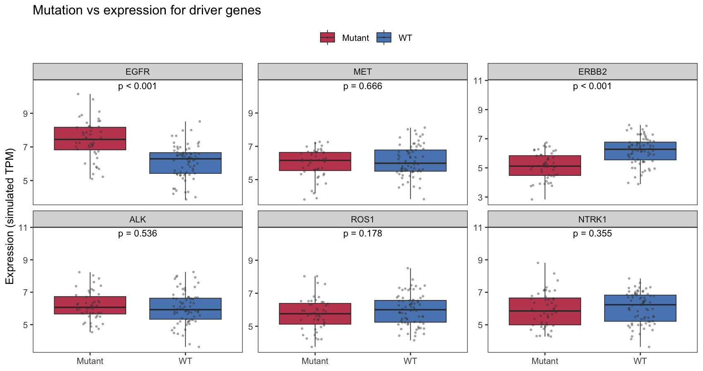

Driver-gene mutation status often shapes the expression of the mutated gene itself and of its pathway partners \[1\]. FigureYa123 overlays mutation calls (from MAF files) onto expression to draw **per-gene mutation vs expression boxplots with Wilcoxon stars**. This tutorial reproduces that layout on a simulated 6-gene panel with a planted EGFR gain and ERBB2 loss in mutants:

## Example

{fig-alt="MutVsExprPlot DEMO" fig-align="center" width="60%"}

## Setup

-   System Requirements: Cross-platform (Linux/MacOS/Windows)

-   Programming language: R

-   Dependent packages: `ggplot2`; `dplyr`; `tidyr`

```{r packages setup, message=FALSE, warning=FALSE, output=FALSE}
suppressPackageStartupMessages({
  library(ggplot2)
  library(dplyr)
  library(tidyr)
})
```

```{r}
sessioninfo::session_info("attached")
```

## Data Preparation

Simulated expression for 120 samples x 6 driver genes; 45% carry a mutation (any gene), which drives EGFR up and ERBB2 down:

```{r load data}
set.seed(12301)
n_mv <- 120
mut_status <- sample(c("WT", "Mutant"), n_mv, TRUE, c(0.55, 0.45))
gene_mv <- matrix(rnorm(n_mv * 6, 6, 1), n_mv, 6,
                  dimnames = list(NULL, c("EGFR", "MET", "ERBB2", "ALK", "ROS1", "NTRK1")))
gene_mv[mut_status == "Mutant", 1] <- gene_mv[mut_status == "Mutant", 1] + 1.5
gene_mv[mut_status == "Mutant", 3] <- gene_mv[mut_status == "Mutant", 3] - 0.8
mv_df <- as.data.frame(gene_mv); mv_df$mutation <- mut_status
mv_long <- tidyr::pivot_longer(mv_df, cols = -mutation,
                               names_to = "gene", values_to = "expr")
mv_long$gene <- factor(mv_long$gene, levels = colnames(gene_mv))
pv128 <- sapply(levels(mv_long$gene), function(g) {
  wilcox.test(expr ~ mutation, data = mv_long[mv_long$gene == g, ])$p.value
})
pv128 <- ifelse(pv128 < 0.001, "p < 0.001", sprintf("p = %.3f", pv128))
ann128 <- data.frame(gene = factor(names(pv128), levels = levels(mv_long$gene)),
                     y = max(mv_long$expr) * 1.05, lab = pv128)
```

## Visualization

### 1. Faceted Mutation-vs-Expression Boxplots

```{r}
#| label: fig-1.1MutExpr
#| fig-cap: "Expression of 6 driver genes by mutation status (simulated): only EGFR (up) and ERBB2 (down) show planted mutation effects; stars are per-gene Wilcoxon p-values."
#| out.width: "100%"
#| warning: false
#| message: false
#| fig-width: 9.5
#| fig-height: 5

ggplot(mv_long, aes(mutation, expr, fill = mutation)) +
  geom_boxplot(outlier.shape = NA, alpha = 0.8, linewidth = 0.3) +
  geom_jitter(width = 0.15, size = 0.5, alpha = 0.35, colour = "grey25") +
  facet_wrap(~gene, scales = "free_y") +
  geom_text(data = ann128, aes(x = 1.5, y = y, label = lab),
            inherit.aes = FALSE, size = 3) +
  scale_fill_manual(values = c(WT = "#2166AC", Mutant = "#B2182B"), name = NULL) +
  labs(x = NULL, y = "Expression (simulated TPM)",
       title = "Mutation vs expression for driver genes") +
  theme_bw(base_size = 10) +
  theme(panel.grid = element_blank(), legend.position = "top")
```

::: callout-tip
**Practice tips**

-   Mutation here is a **per-sample binary flag** (any driver gene mutated), not gene-specific — if the mutation is gene-specific, facet by both the mutated gene and the expression gene for a clearer story.
-   `scales = "free_y"` lets each gene's expression range breathe; keep `fixed` only when comparing fold-changes across genes.
-   The Wilcoxon stars are computed per gene over the same data — report the correction (none here; Bonferroni for 6 tests) in the caption.
:::

## Applications

::: {#fig-MutVsExprApplications1}
{fig-alt="MutVsExprPlot Application" fig-align="center" width="60%"}

Mutation vs expression panels
:::

The same layout applies to CNV vs expression (amplification = "Mutant"), methylation-high vs -low, or any binary genomic feature vs a continuous readout.

## Reference

\[1\] Xiaofan Lu, et al. FigureYa: A Standardized Visualization Framework for Enhancing Biomedical Data Interpretation and Research Efficiency. iMetaMed. 2025. doi:10.1002/imm3.70005
