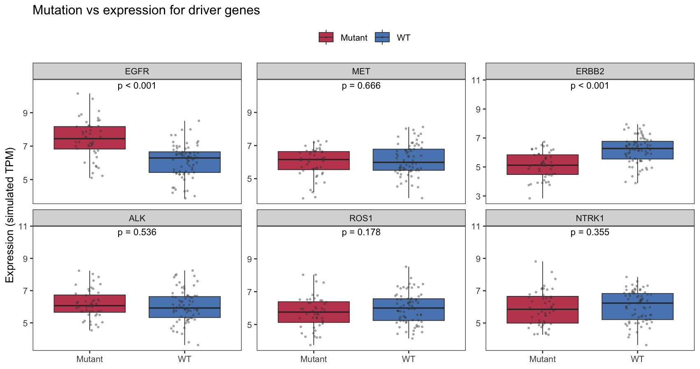

驱动基因的突变状态常常影响突变基因本身及其通路伙伴的表达 \[1\]。FigureYa123 将突变调用叠加到表达上，画出**逐基因的突变 vs 表达箱线图 + Wilcoxon 星号**。本教程在模拟 6 基因面板上复现该版式——突变者中 EGFR 上调、ERBB2 下调：

## Example

{fig-alt="突变 vs 表达 DEMO" fig-align="center" width="60%"}

## Setup

-   系统要求：跨平台（Linux/MacOS/Windows）

-   编程语言：R

-   依赖包：`ggplot2`; `dplyr`; `tidyr`

```{r packages setup, message=FALSE, warning=FALSE, output=FALSE}
suppressPackageStartupMessages({
  library(ggplot2)
  library(dplyr)
  library(tidyr)
})
```

```{r}
sessioninfo::session_info("attached")
```

## 数据准备

120 样本 × 6 个 driver 基因的模拟表达；45% 携带突变（任一基因），突变驱动 EGFR 上调、ERBB2 下调：

```{r load data}
set.seed(12301)
n_mv <- 120
mut_status <- sample(c("WT", "Mutant"), n_mv, TRUE, c(0.55, 0.45))
gene_mv <- matrix(rnorm(n_mv * 6, 6, 1), n_mv, 6,
                  dimnames = list(NULL, c("EGFR", "MET", "ERBB2", "ALK", "ROS1", "NTRK1")))
gene_mv[mut_status == "Mutant", 1] <- gene_mv[mut_status == "Mutant", 1] + 1.5
gene_mv[mut_status == "Mutant", 3] <- gene_mv[mut_status == "Mutant", 3] - 0.8
mv_df <- as.data.frame(gene_mv); mv_df$mutation <- mut_status
mv_long <- tidyr::pivot_longer(mv_df, cols = -mutation,
                               names_to = "gene", values_to = "expr")
mv_long$gene <- factor(mv_long$gene, levels = colnames(gene_mv))
pv128 <- sapply(levels(mv_long$gene), function(g) {
  wilcox.test(expr ~ mutation, data = mv_long[mv_long$gene == g, ])$p.value
})
pv128 <- ifelse(pv128 < 0.001, "p < 0.001", sprintf("p = %.3f", pv128))
ann128 <- data.frame(gene = factor(names(pv128), levels = levels(mv_long$gene)),
                     y = max(mv_long$expr) * 1.05, lab = pv128)
```

## Visualization

### 分面突变 vs 表达箱线图

6 个 driver 基因的表达按突变状态分组（模拟）：仅 EGFR（上调）和 ERBB2（下调）展现植入的突变效应；星号为逐基因 Wilcoxon p 值。

```{r}
#| label: fig-1.1MutExpr
#| fig-cap: "Expression of 6 driver genes by mutation status (simulated): only EGFR (up) and ERBB2 (down) show planted mutation effects; stars are per-gene Wilcoxon p-values."
#| out.width: "100%"
#| warning: false
#| message: false
#| fig-width: 9.5
#| fig-height: 5

ggplot(mv_long, aes(mutation, expr, fill = mutation)) +
  geom_boxplot(outlier.shape = NA, alpha = 0.8, linewidth = 0.3) +
  geom_jitter(width = 0.15, size = 0.5, alpha = 0.35, colour = "grey25") +
  facet_wrap(~gene, scales = "free_y") +
  geom_text(data = ann128, aes(x = 1.5, y = y, label = lab),
            inherit.aes = FALSE, size = 3) +
  scale_fill_manual(values = c(WT = "#2166AC", Mutant = "#B2182B"), name = NULL) +
  labs(x = NULL, y = "Expression (simulated TPM)",
       title = "Mutation vs expression for driver genes") +
  theme_bw(base_size = 10) +
  theme(panel.grid = element_blank(), legend.position = "top")```


## 应用场景

::: {#fig-MutVsExprPlotApplications1}
{fig-alt="MutVsExprPlot Application" fig-align="center" width="60%"}

突变 vs 表达面板
:::

同一版式适用于 CNV vs 表达（扩增 = "突变"）、甲基化高 vs 低、或任何二值基因组特征 vs 连续读数。

## 参考文献

\[1\] Xiaofan Lu, et al. FigureYa: A Standardized Visualization Framework for Enhancing Biomedical Data Interpretation and Research Efficiency. iMetaMed. 2025. doi:10.1002/imm3.70005
